<p align="center"><a href="README.md">Versão em português</a></p>

<div align="center">

# 🤖 Robocode Championship Manager

**Run [Robocode](https://robocode.sourceforge.io/) championships with an arcade look:
web registration, automatic brackets, 3D battles and a podium ceremony.**


</div>

---

## Contents

- [What it does](#-what-it-does)
- [The arenas](#-the-arenas)
- [Characters](#-characters)
- [Installation](#-installation)
  1. [Install Robocode](#1-install-robocode)
  2. [Download the program](#2-download-the-program)
  3. [Install the program](#3-install-the-program)
  4. [First run](#4-first-run)
- [Tutorial: running a championship](#-tutorial-running-a-championship)
  1. [Configure](#1-configure)
  2. [Open registration](#2-open-registration)
  3. [Draw the bracket](#3-draw-the-bracket)
  4. [Run the battles](#4-run-the-battles)
  5. [The podium ceremony](#5-the-podium-ceremony)
- [Tutorial: registering your team's robot](#-tutorial-registering-your-teams-robot)
- [All controls](#-all-controls)
- [Championship rules](#-championship-rules)
- [For developers](#-for-developers)
- [License](#-license)

---

## ✨ What it does

| | |
|---|---|
| 🌐 **Web registration** | Teams register their robot, source code, logo, motto and theme song on a website served by the program itself. |
| 🗂️ **Teams and robots** | An organizer screen (`Ctrl + E`) lists the robots, shows everything each team sent (with the tank turning in 3D) and lets you edit any information, replace files, and add and delete robots. |
| 🏆 **Automatic brackets** | Single or double elimination (with repechage), with any number of robots, and a single grand final. |
| 🎮 **3D battles** | Robocode runs hidden; the battle is recorded and replayed in 3D with a fighting-game HUD, a cinematic camera and a slow-motion replay of the killing shot. |
| 🌋 **Five arenas** | Neon city, volcanic forge, glacial tundra, tropical forest and Éden Solar, each with its own critters, who run away when the battle heats up. |
| 🎵 **Music and sound** | Each team comes in with its own music; shots, explosions, tracks and turrets have their own sounds. |
| 🥇 **Podium** | At the end the champion appears, then third, second and first place are revealed one by one, with bronze, silver and gold trophies. |
| ↩️ **Undo** | Entered a wrong result? `Ctrl + Z` undoes the last one. |

Everything runs full screen, with menus and dialogs in the style of an arcade game.

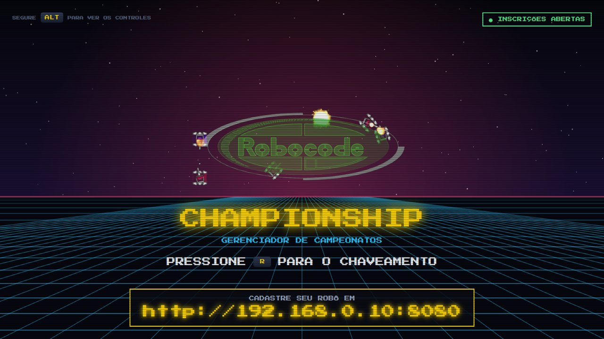

---

## 🌍 The arenas

Each battle takes place in an arena drawn at random (or a fixed one, if you prefer).

<table>
<tr>
<td width="50%">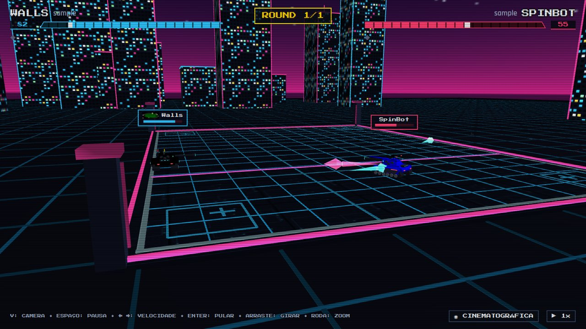<br><b>Neon Grid</b>: a neon city over a cyan grid, with roads and cars of light between the buildings.</td>
<td width="50%">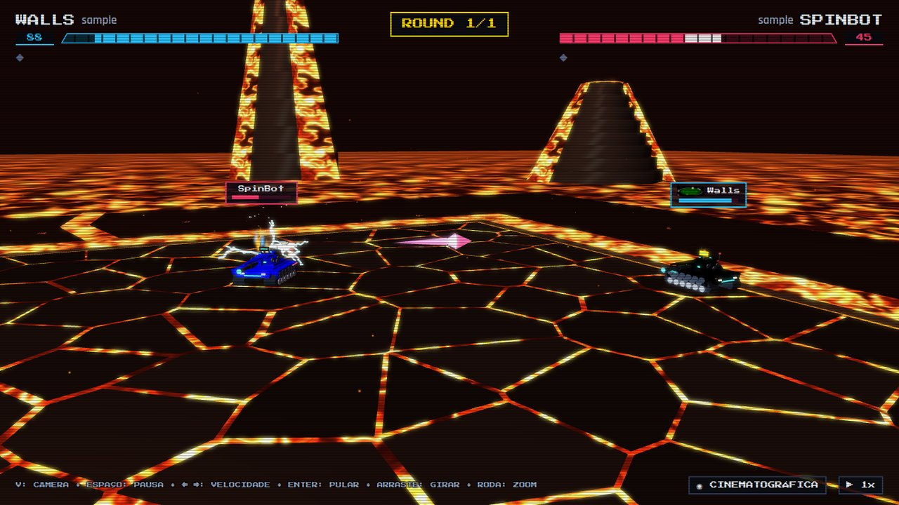<br><b>Volcanic Forge</b>: lava, basalt and volcanoes. The battlefield floor is dark gray rock, far more subdued than the surrounding lava, so the robots stand out.</td>
</tr>
<tr>
<td>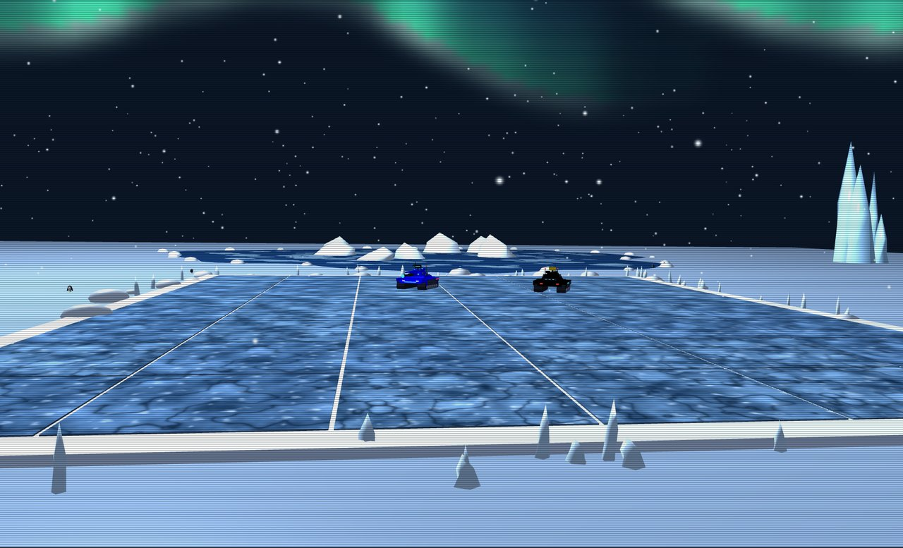<br><b>Glacial Tundra</b>: ice crystals, falling snow, an aurora borealis that waves across the sky and a glacial sea with penguins.</td>
<td>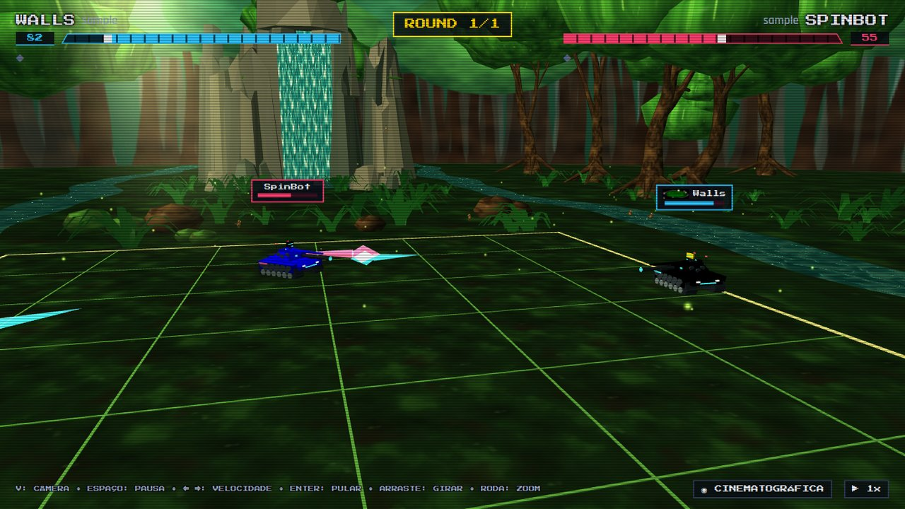<br><b>Tropical Forest</b>: dense jungle, rivers and waterfalls.</td>
</tr>
<tr>
<td colspan="2">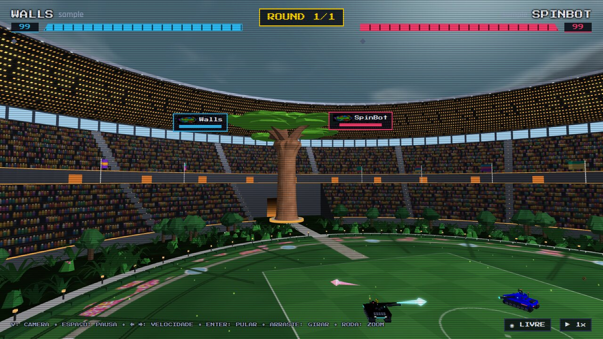<br><b>Éden Solar</b> (Africa, 2187): an enclosed stadium with a great opening in its roof to a stormy sky, where the sun breaks through the clouds. The roof is a lattice full of amber lights, and a band of pale blue panels runs around the top. The stands, in two rings, are packed with a crowd from every continent, with flags in the breeze and warm light strips between the rings. The field is a round garden drawn with mandala hedges, flower beds and reflecting pools, ringed by a walkway with lamps. Plants and round trees rise up to the stands. At both ends, at the mouth of each corridor, a glowing baobab, the tree of life, stands. Birds and monkeys roam free. It is the arena of the grand finals.</td>
</tr>
</table>

Before the first round, the camera stays on one of the critters that live in the arena for 2 seconds and then flies over the field to where the battle starts.
They never enter the battle area, but they get startled by shots and explosions.

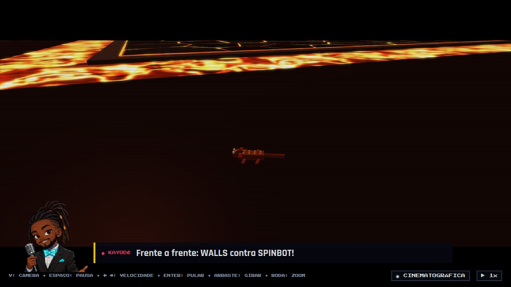

---

## 🎭 Characters

During a battle, **presenters** comment on what is happening, and **critters** live in each arena. None of them affect the result: they are the show around the fight.

### Presenters

Each kind of event has its own presenter. When something important happens, the presenter comes up from the bottom of the screen to comment, and goes down when there is nothing more to say.

| Photo | Presenter | Comments on | Personality |
|---|---|---|---|
|  | **Kayodê** | Start and end of the round, knockouts and the final headlines (such as *VIRADA HISTÓRICA!*, "historic comeback") | The master of ceremonies: lively, with a microphone in hand and a taste for big moments. |
|  | **Benê** | Numbers and achievements: accuracy, *PERFECT!*, landslide wins | The experienced analyst: calm, with a headset and a tablet, speaks in data. |
|  | **Zuri** | Walls and collisions, such as "ran into the force field!" | The referee: in a striped shirt, points out when someone hits a wall and lets nothing slide. |
| 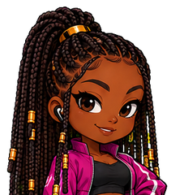 | **Dandara** | Hits, critical damage and combos (such as "Maximum power!" and "Relentless streak!") | The confident fighter: direct and intense, celebrates every clean hit. |
|  | **Luana** | Long shots, bullets that cancel each other and misses (such as "Recalibrate that aim!") | The cheerful aiming expert: relaxed, with a rocket-patched jacket and a peace sign. |
| 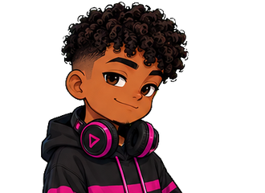 | **Caio** | Who is ahead, comebacks and long silences (such as "Twist!") | The laid-back DJ of the pace: with headphones and a hoodie, comments on the mood of the match. |
|  | **Nala** | Fire, danger and double knockouts (such as "Red alert!") | The attentive mechanic: in overalls with a wrench, warns when a robot is hanging by a thread. |

### Arena critters

Each arena has its own critters. They walk around the scenery, **never enter the battle area**, and run away when shots or explosions happen nearby. Before the first battle, the camera stays on one of them for 2 seconds and then goes on with its trip around the arena.

| | | |
|---|---|---|
| 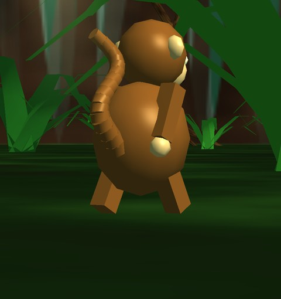<br>**Monkey**<br><i>Tropical Forest</i><br>Among the trees and near the river. | 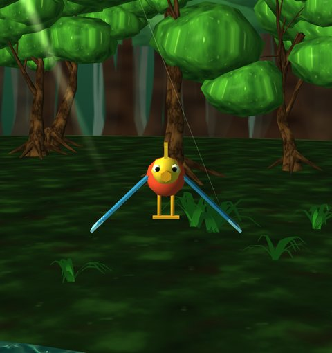<br>**Bird**<br><i>Tropical Forest (one in every three critters)</i><br>Flies through the forest, mixed with the leaves. | 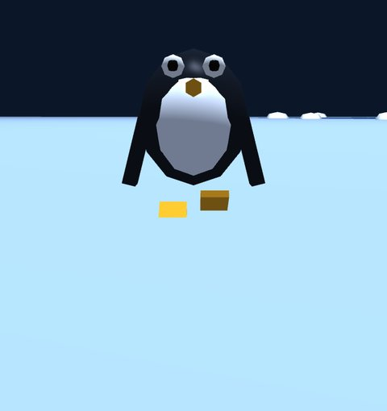<br>**Penguin**<br><i>Glacial Tundra</i><br>Walks on the ice and swims in the water of the glacial sea. |
| 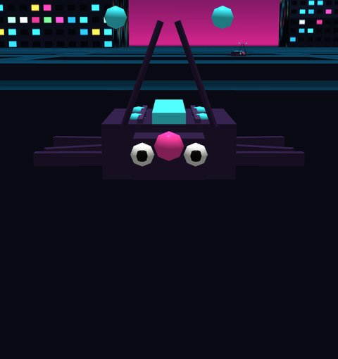<br>**Beetle**<br><i>Neon Grid</i><br>Runs along the edges of the grid, between the neon buildings. | 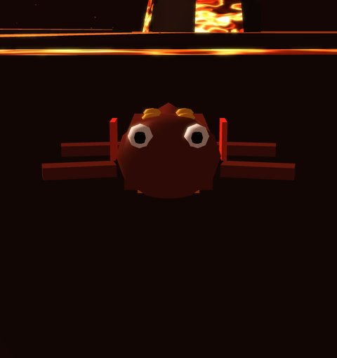<br>**Salamander**<br><i>Volcanic Forge</i><br>Walks over the rocks and ash, near the lava. | 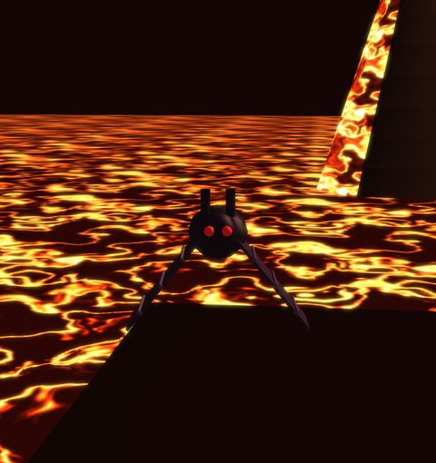<br>**Bat**<br><i>Volcanic Forge (one in every three critters)</i><br>Flies around the arena, above the rocks. |

> [!NOTE]
> The personality traits above are a reading of each character's style, based on the lines they say and how they look. They have no gameplay rules tied to those traits.

---

## 📥 Installation

This part is for people who just want to **use** the program. No programming knowledge is needed.

There are three steps: install **Robocode** (it runs the battles), install **this program**, and on the first run tell the program where Robocode is.

### 1. Install Robocode

The program does not include Robocode, so install it first.

1. **Java.** Robocode needs Java. If your computer doesn't have it, download Java 21 from [adoptium.net](https://adoptium.net) (choose **Temurin**) and install it.
2. **Robocode.** Download it from the official site, [robocode.sourceforge.io](https://robocode.sourceforge.io/). The file is named something like `robocode-…-setup.jar`.
3. **Double-click** the downloaded file and follow the installer.
4. **Write down the folder** where Robocode was installed. Inside it there is a folder called `robots`. You will need this folder in step 4.

### 2. Download the program

Open the [downloads page](https://github.com/ensismoebius/robocode-championship-manager/releases/latest) and download the file for your system:

| Your computer | File to download |
|---|---|
| Windows | `RobocodeChampManager-5.0.exe` |
| Mac with an Apple chip (M1, M2, M3, M4…) | `RobocodeChampManager-5.dmg` |
| Ubuntu 24.04 | `robocodechampmanager_5_ubuntu24.04_amd64.deb` |
| Debian 13 | `robocodechampmanager_5_debian13_amd64.deb` |
| Fedora | `robocodechampmanager-5-1.x86_64.rpm` |
| Arch Linux | `robocodechampmanager-5-1-x86_64.pkg.tar.zst` |

> [!NOTE]
> Not sure which Mac you have? Click the Apple logo in the corner of the screen → **About This Mac**. If it shows **Chip Apple** followed by M1, M2, M3 or M4, use the `.dmg`. Macs with an **Intel** processor are not supported by this installer.

### 3. Install the program

**Windows**

1. **Double-click** the `.exe` file.
2. A window titled **"Windows protected your PC"** appears, because the program is not digitally signed. Click **More info**, then **Run anyway**.
3. Follow the installer (**Next**, **Next**, **Install**, **Finish**). The program appears in the **Start menu**.

**macOS**

1. **Double-click** the `.dmg` file and drag the program icon into the **Applications** folder.
2. Open **Applications**, **right-click** the program and choose **Open**. Confirm with **Open** in the window that appears.
3. If the Mac only says it "can't be opened", go to **System Settings → Privacy & Security**, scroll to the message about the program and click **Open Anyway**.

**Ubuntu and Debian**

- **Easy way:** **double-click** the `.deb` file. The Software Center opens: click **Install** and type your computer password.
- **Terminal:** open a terminal, go to the folder where the file was downloaded and install it:
  ```bash
  cd ~/Downloads
  sudo apt install ./robocodechampmanager_5_ubuntu24.04_amd64.deb
  ```
  (on Debian, use the `…debian13…` file)

**Fedora**

- **Double-click** the `.rpm` file and click **Install**, or in the terminal:
  ```bash
  cd ~/Downloads
  sudo dnf install ./robocodechampmanager-5-1.x86_64.rpm
  ```

**Arch Linux**

- In the terminal:
  ```bash
  cd ~/Downloads
  sudo pacman -U ./robocodechampmanager-5-1-x86_64.pkg.tar.zst
  ```

On Linux the program is installed in `/opt/robocodechampmanager`. If it does not show up in the applications menu, start it from a terminal with `/opt/robocodechampmanager/bin/RobocodeChampManager`.

### 4. First run

1. Open the program. It fills the whole screen and has no close button: to quit, press **Ctrl + Q**.
2. The first time, the **Settings** screen appears, right inside the program, with an explanation under each field. Open the **System** tab and fill in:
   - **Robocode folder**: click **Choose...** and select the Robocode folder from step 1 (the one that contains `robots`). **This field is required.**
3. On the **Start screen** tab you can change the title and subtitle. The other tabs can stay as they are.
4. Click **Save** (or press **Enter**). **Esc** cancels. If something is wrong, the field turns red, the right tab opens and the message says what to fix.

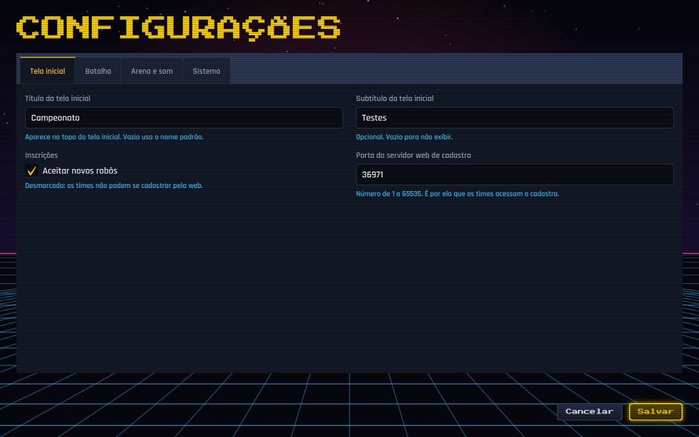

To change anything later, press **C** at any time. The start screen shows the shortcuts while you hold **Alt**.

### 5. Done!

The start screen appears with the championship title. From here:

- To run a championship, follow the [Tutorial: running a championship](#-tutorial-running-a-championship).
- To register a robot, the team follows the [Tutorial: registering your team's robot](#-tutorial-registering-your-teams-robot).

### Common problems

| What happens | What to do |
|---|---|
| Windows says the program is unsafe | Click **More info** → **Run anyway** (step 3). |
| The Mac says the program can't be opened | Use **Open Anyway** under **Privacy & Security** (step 3). |
| Battles don't start, or an error about Robocode appears | Press **C**, open the **System** tab and check the **Robocode folder**: it must be the folder that contains `robots`. |
| Teams can't open the registration address | The championship computer and the team computers must be on the same network (Wi-Fi or cable). If Windows asks about the firewall, allow access on **private networks**. The port is 8080, which can be changed on the **Start screen** tab. |
| I want to update the program | Download the new version and install it. Your data and settings are kept in a user folder, not in the program folder. |

Data is stored in `~/RobocodeChampManager` (your user folder). **Deleting that folder deletes the championships**, so make a copy first.

---

## 📖 Tutorial: running a championship

### 1. Configure

The first time the program opens, it asks for the configuration. After that, press **`C`** at any time to
change it. The configuration is a screen of the program itself, and every field has a line
explaining what it accepts. Changes apply right away, with no restart: the web server moves to the
new port and the new database file is opened immediately.


| Tab | What's there |
|---|---|
| **Start screen** | Start screen title and subtitle (an empty subtitle is not shown), whether registrations are open, and the registration web server port (8080 by default). |
| **Battle** | The kind of battle (by points or by knockout) and the number of rounds, display (3D in the manager or the classic Robocode window), starting speed and the round start text (`FIGHT!`). |
| **Arena and sound** | Arena and music (random or fixed), "use the arena's own music", volume and anti-aliasing (turn it off if battles run slowly). |
| **System** | The SQLite database file and the Robocode folder (the one that has the `robots` folder). |

The configuration is stored in `~/robocodeChampManager.config` and the data in
`~/RobocodeChampManager/robochamp.db` (tables are created automatically).

### 2. Open registration

With registrations open, the start screen shows the address where teams register their robots.
Put that screen up where everyone can see it! **`Ctrl + S`** opens or closes registrations.

You don't need to memorize the shortcuts: **hold `Alt`** on the start screen and they appear.

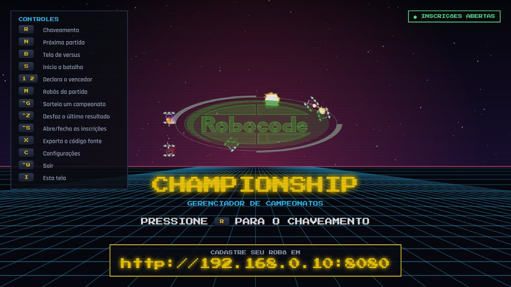

The steps for teams are in
[Tutorial: registering your team's robot](#-tutorial-registering-your-teams-robot).

#### Teams and robots: view, edit, add and delete

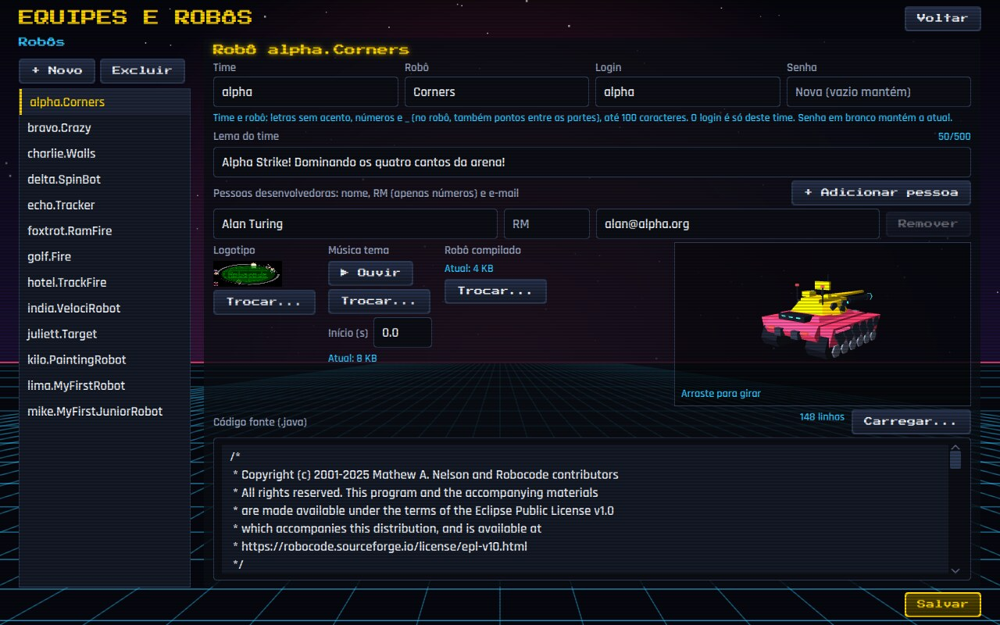

**`Ctrl + E`** opens the teams and robots screen. The list of registered robots is on the left;
when you click one, the form shows everything the team sent, and the robot's tank turns in 3D
next to the files (drag with the mouse to turn it).

- **Everything can be edited**: team, robot, login, password (blank keeps the current one), motto,
  people (name, student ID and email), music start and source code.
- **Files can be replaced**: **Trocar...** (change) under the logo, under the music (change
  music, you can listen to it right away), under the compiled robot (if the name is the
  packager's, the team and robot are filled in for you) and **Carregar...** (load) in the source code.
- **+ Novo** (new) adds a robot: it needs everything, including the `.jar`, the logo and the music.
- **Excluir** (delete) removes the robot. If it is in championships, the confirmation says how
  many, because they are deleted along with it, results included.
- **Salvar** (save) checks the same rules as the web registration and tells you what is wrong. With
  unsaved changes, the program asks before switching robots or going back.

### 3. Draw the bracket

Once everyone has registered, press **`Ctrl + G`** to draw a championship with all registered robots,
then **`R`** to see the bracket.

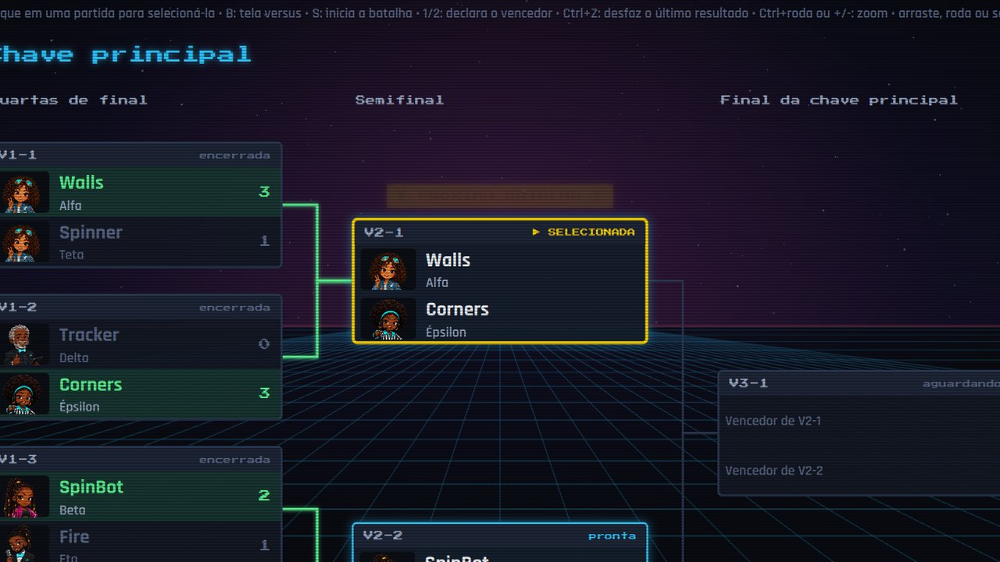

- The main bracket is on top, the repechage below, and the finals and standings on the side.
- **Semifinals and finals are announced**: on the bracket screen the next match is shown in gold with the name of the stage, and in the 3D arena the stage (★ SEMIFINAL ★, ★ FINAL ★) appears in the intro, in the scoreboard during the battle and in the presenter's line.
- Click a match to select it; after each result the next match is selected automatically.
- **`+`**, **`-`** and **`0`** zoom in, zoom out and show the whole bracket (or `Ctrl` + mouse wheel);
  drag, use the wheel or the arrows to move around.

After a result, the bracket shows what happened like a game: the camera goes to the match, the winner
and loser are revealed, the robots walk to their next matches, and the camera zooms in on the next
battle. Any key or click skips the animation.

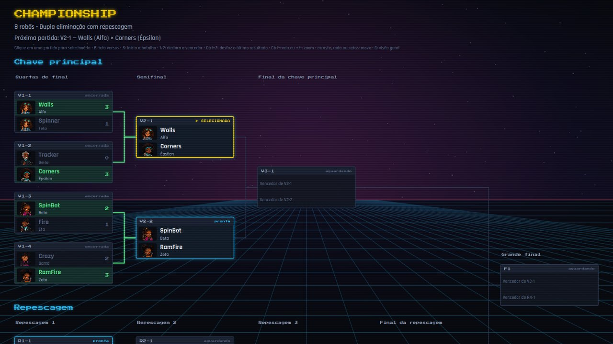

### 4. Run the battles

**`N`** selects the next match and **`B`** shows the versus screen:

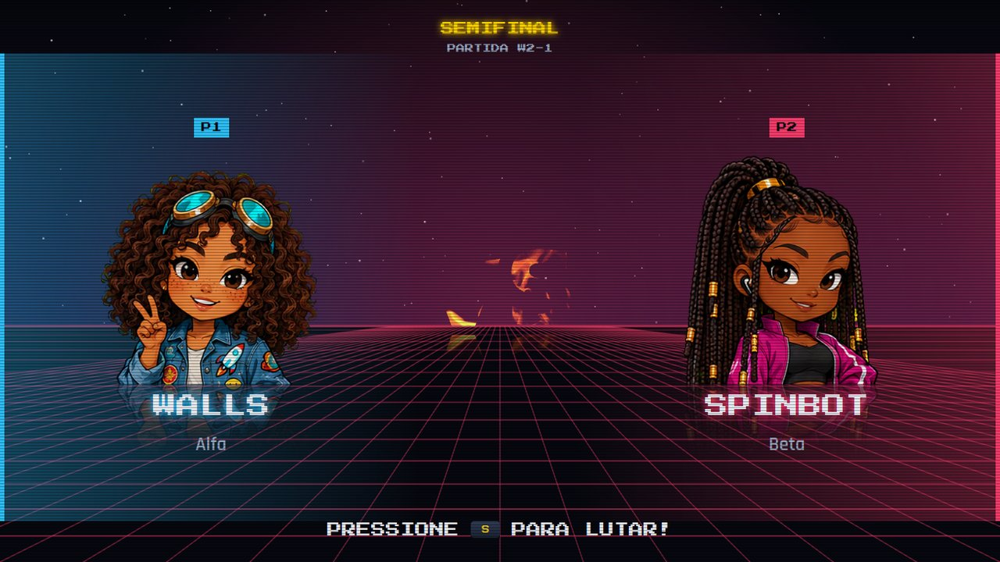

**`M`** presents the robots of the match, with team, motto and developers:

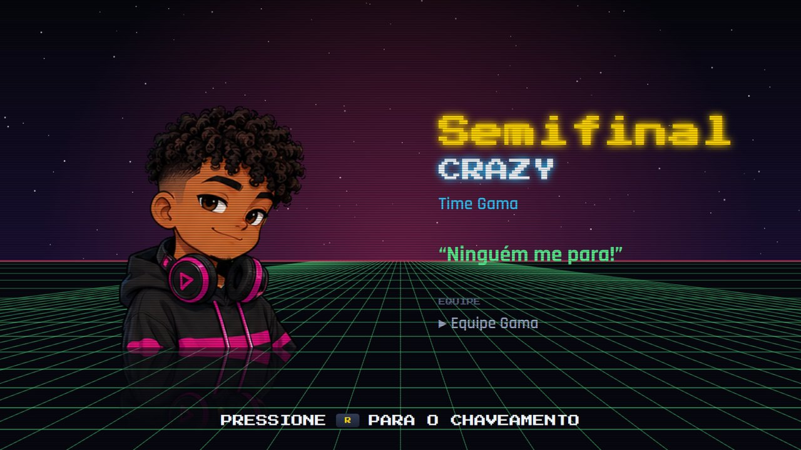

**`S`** starts the battle. First each robot enters the scene to its team's music...

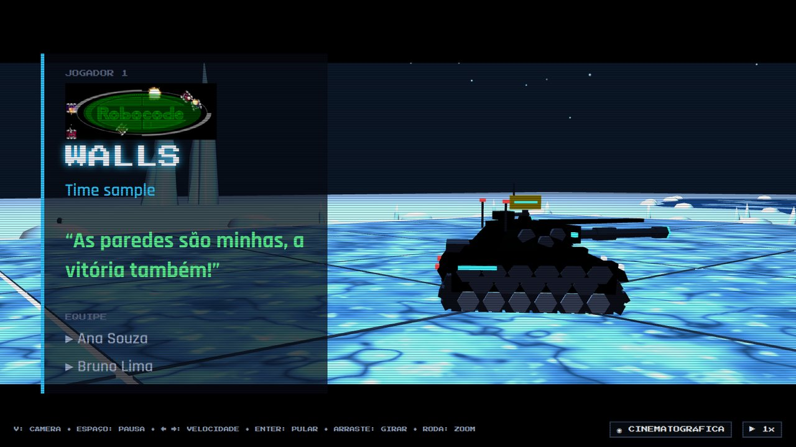

...then the two face each other, the camera flies over the arena (stopping for 2 seconds on each critter it meets on the way), and each round starts with a 3-second countdown.

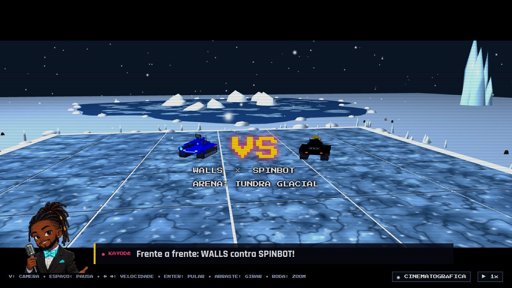

In **semifinals** and **finals** the program gives a warning: the name of the stage appears in gold in the intro (★ SEMIFINAL ★, ★ FINAL ★), the scoreboard shows the stage throughout the battle and the presenter announces the match.

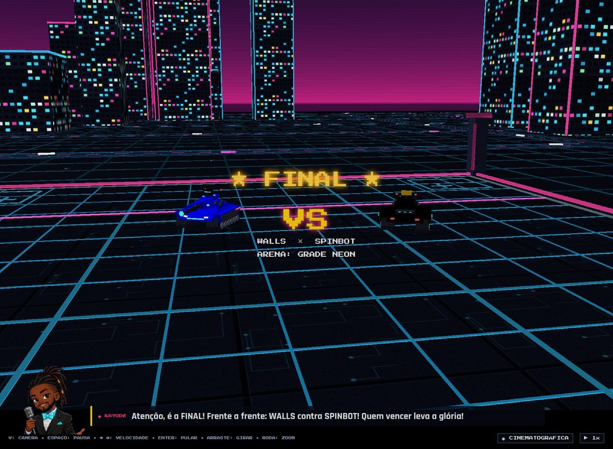

During the fight, each robot's energy bar sits at the top of the screen. The tanks use the colors the
robot chose in its code, and shots come out in the color of whoever fired them. When a robot is
destroyed, the moments before its death are replayed in slow motion, following the fatal shot.

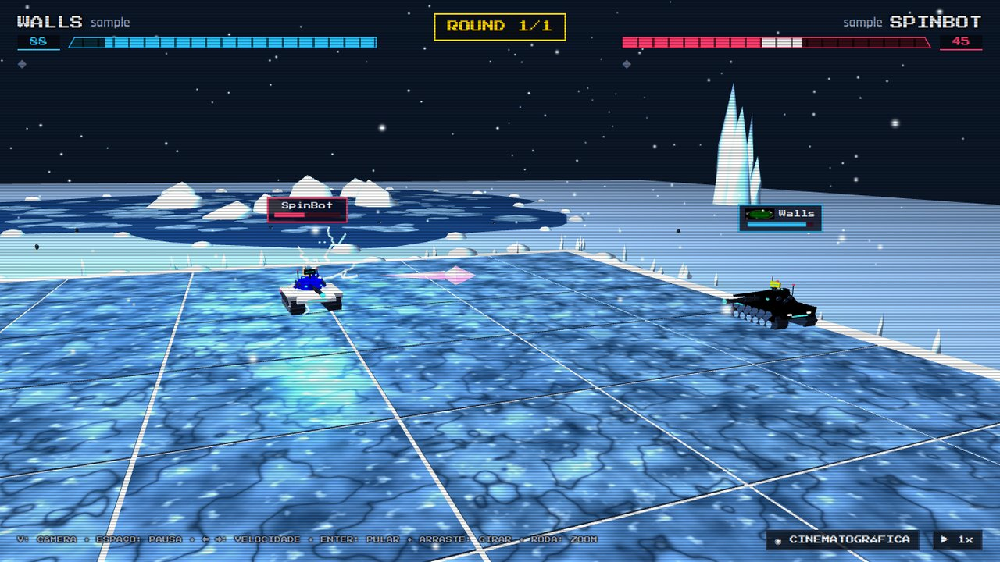

| During the 3D battle | |
|---|---|
| `V` | Changes the camera: **CINEMATIC** (follows the action by itself), **FREE**, **ISOMETRIC** and **TOP VIEW** |
| `Space` | Pause |
| `←` `→` (or `-` `+`) | Slower / faster |
| `Enter` | Skips what is playing (presentation, fly-over or replay); otherwise goes to the result |
| `Esc` | The same, and skips the presentation of all robots |
| Drag | Orbits the camera (dragging in the cinematic camera switches to the free one) |
| Mouse wheel | Zoom |

The winner is recorded automatically. If you need to declare the result by hand, **`1`** and **`2`** give
the win to the first or second robot; **`Ctrl + Z`** undoes the last result.

### 5. The podium ceremony

When the last battle ends, the screen fades to black, the music swells and the champion appears:

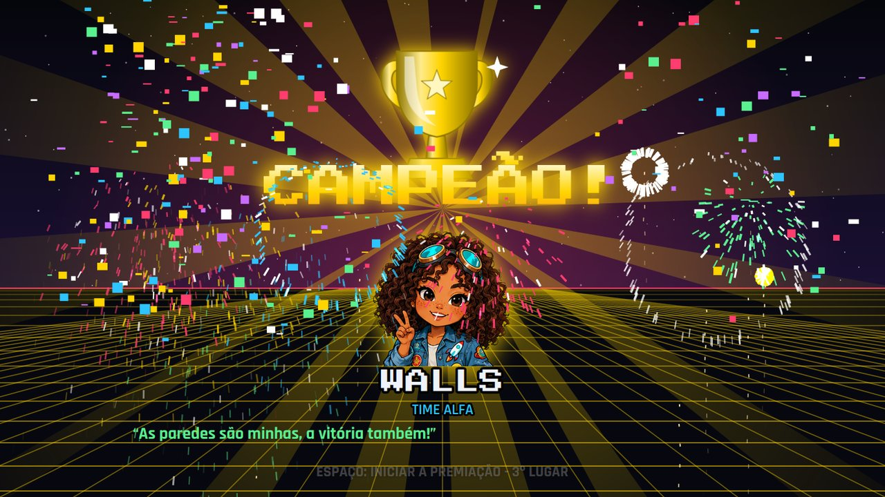

Then **`Space`**, **`Enter`** or **`→`** reveal third, second and first place, one at a time, each with
their robot, team, motto and trophy.

<table>
<tr>
<td width="50%">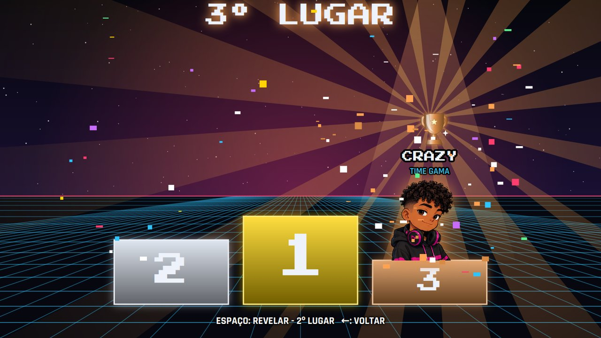</td>
<td width="50%">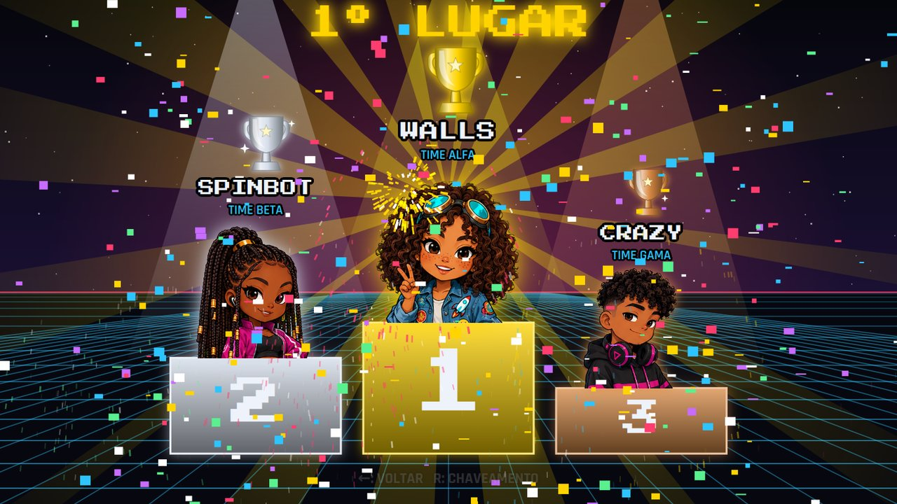</td>
</tr>
</table>

**`←`** goes back one place and **`R`** opens the bracket. Once the championship is over, `S`, `1`, `2`, `B`
and `M` bring the podium back.

---

## 📝 Tutorial: registering your team's robot

> This part is for the teams. The address is shown on the championship's start screen, something like
> `http://192.168.0.10:8080`.

**1. Open the address in your browser.** If your team has no login yet, click **Register your team**.
If it already does, sign in with your login and password to change your registration.

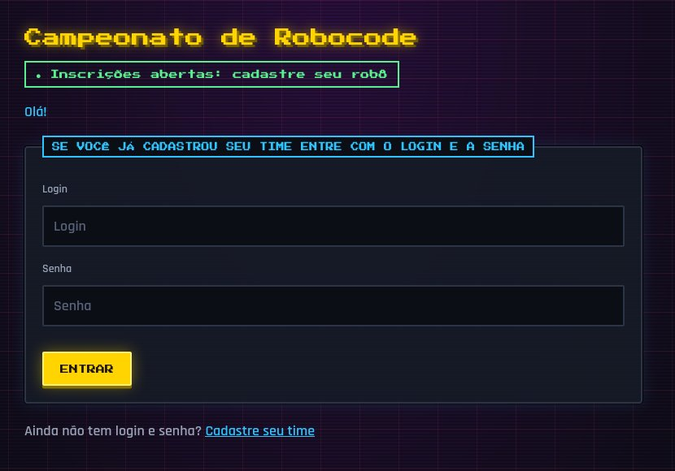

**2. Fill in the registration form.**

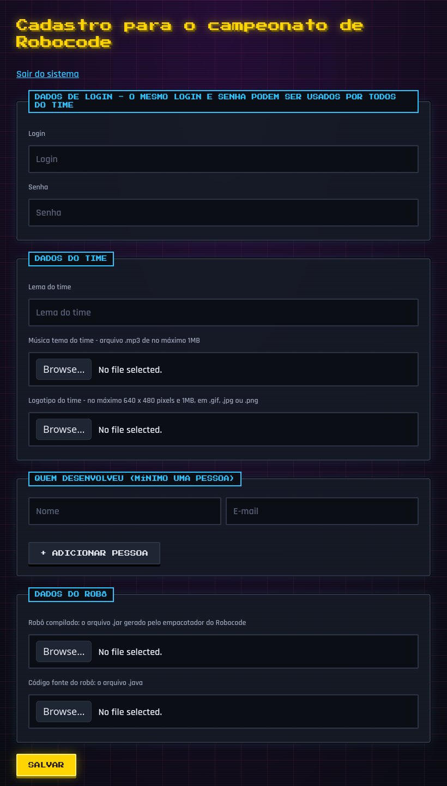

- **Login details**: a login and a password that the whole team can use.
- **Team details**:
  - the **motto**, the battle cry shown during presentations and on the podium;
  - the **theme song**, an `.mp3` of up to 1 MB that plays when the robot enters the arena;
  - the **logo**, a `.gif`, `.jpg` or `.png` of up to 640 x 480 pixels and 1 MB.
- **Developers**: name, **student ID** (RM, numbers only, up to 20 digits) and email of at least
  one person. Use **+ Add person** for the others.
- **Robot data**:
  - the **compiled robot**, the `.jar` produced by the Robocode packager
    (*Robot → Package robot for upload*);
  - the **source code**, the `.java` file.

Each field shows, right under its name, the rules it follows (sizes, formats, what is required).
Before sending, the browser checks everything and lists what needs fixing, with the fields in red,
without losing what you already filled in.

**3. Click Save.** Done! Until registrations close, you can sign in again and change your robot as
many times as you like.

<br clear="right">

> [!TIP]
> Choose your tank's colors in the robot's code, with `setColors(...)`: the 3D arena uses those colors.

---

## ⌨️ All controls

Hold **`Alt`** on the start screen to see this list.

| Key | Action |
|---|---|
| `I` | Start screen |
| `Ctrl + G` | Draws a new championship |
| `Ctrl + S` | Opens or closes registrations |
| `Ctrl + E` | Teams and robots: views, edits, adds and deletes robots and teams |
| `R` | Bracket (click a match to select it) |
| `N` | Selects the next match (and flies to it) |
| `B` | Versus screen of the selected match |
| `S` | Runs the selected match and records the winner |
| `1` / `2` | Declares the first / second robot the winner |
| `Ctrl + Z` | Undoes the last result |
| `M` | Shows the robots of the match (at the end, the champion) |
| `X` | Exports the robots' source code to `<temp folder>/robochamp-export` |
| `C` | Configuration |
| `Ctrl + Q` | Quits (the window is always full screen, with no close button) |
| `+` / `-` / `0` | In the bracket: zoom in, zoom out, show the whole bracket |

The [3D battle](#4-run-the-battles) and [podium](#5-the-podium-ceremony) controls are in their
tutorials above.

---

## 📜 Championship rules

- **Any number of robots** (two or more). When it isn't a power of two, the first robots drawn go
  straight to the second round.
- **With repechage** (double elimination, the default): whoever loses in the main bracket goes to the
  repechage and is only out after a second loss. The main bracket champion and the repechage champion
  play the grand final, which decides the champion (there is no rematch).
- **Without repechage**: single elimination.
- **The kind of battle** is configurable (key `C`, **Battle** tab):
  - **By points, with N rounds:** every round is fought and whoever adds up more points wins. If
    the points are tied, whoever won more rounds wins.
  - **By knockout, best of N rounds:** whoever wins most of the rounds takes the battle, and it
    ends as soon as someone gets there. For example, in a best of 5, three wins are enough; if
    each one wins 2, the fifth round breaks the tie. A round in which both robots are destroyed
    together (a double knockout) gives a win to nobody: if that leaves the wins tied at the end,
    the points decide.
  - The two kinds can disagree: a robot may win more rounds with fewer points. The ranking
    Robocode reports itself is not used, because it can be wrong (it is computed before the last
    round counts).

Robots are copied to `<robocode>/robots` as `team.Robot.jar` before each battle.

---

## 🛠️ For developers
### Build and run from the source code

You need the **JDK 21** and **Maven**. JavaFX, Jetty, Hibernate, SQLite and the MP3 decoder are downloaded by Maven.

```bash
./run.sh            # builds when needed and opens the program
./run.sh --build    # forces a build
./run.sh --test     # runs the tests
```

or, without the script:

```bash
mvn package                                  # builds and runs the tests
java -jar target/RobocodeChampManager-5-all.jar
# or
mvn javafx:run
```

Run it from this folder: the battles are started by `RobocodeStarter/start.sh` (or `start.bat` on Windows).

### Building the installers

Linux builds one package per distribution (needs Docker). Each system builds its own installer, because `jpackage` can not cross-build.

| System | Command | Result |
|---|---|---|
| Linux (needs Docker) | `packaging/build-linux-packages.sh` | `dist/linux/ubuntu/*.deb` (Ubuntu 24.04), `dist/linux/debian/*.deb` (Debian 13), `dist/linux/fedora/*.rpm`, `dist/linux/arch/*.pkg.tar.zst` |
| Current system | `packaging/build-installer.sh` | The package for the system it runs on |
| macOS | `packaging/build-installer.sh` | `dist/*.dmg` |
| Windows (needs WiX Toolset 3) | `packaging\build-installer.ps1` | `dist\*.exe` |

The `.github/workflows/installers.yml` workflow builds the Linux, Windows and macOS installers when a `v*` tag is pushed (or by hand), and keeps them as artifacts.

> [!NOTE]
> The installers are not signed. macOS needs the approval under **Privacy & Security**, and Windows shows the SmartScreen warning.

### Source organization

| Where | What |
|---|---|
| `src/model` | The JPA entities |
| `src/tournament` | The bracket rules (`Bracket`) and championship storage |
| `src/jetty` | The web server and the registration pages |
| `src/utils` | Utilities: configuration, database, battles... |
| `src/widgets` | Controls, windows and scenes (the 3D arenas are in `widgets/scenes`) |
| `RobocodeStarter/` | Pre-compiled program that controls the Robocode battles (source in the `robocodebattlestarter` submodule) |
| `test/` | Automated tests, run with `mvn test` |

### The battle starter

`RobocodeStarter/BattleStarter.java` is the program that runs the battles. After changing it,
compile it with:

```bash
javac --release 11 -cp "<robocode folder>/libs/*" -d RobocodeStarter RobocodeStarter/BattleStarter.java
```

### Upgrading from version 3

Version 3 stored data in H2; this version uses SQLite, and the old "levels" ranking was replaced by
the brackets. Robots have to be registered again (or the data copied by hand). Old plain-text
passwords keep working if copied.

---

## ⚖️ License

Distributed under the [GNU General Public License v3](LICENSE).

Made by André Furlan ([ensismoebius@gmail.com](mailto:ensismoebius@gmail.com)).
