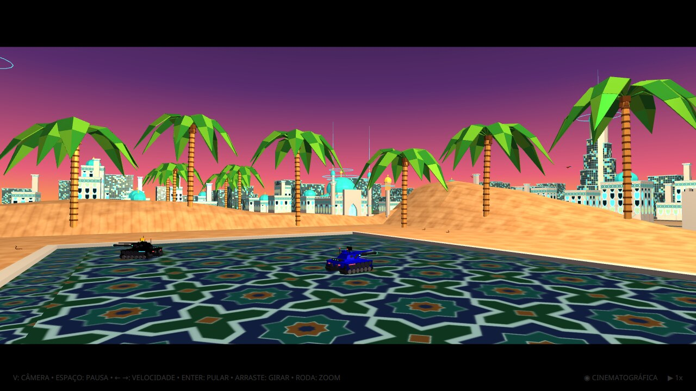
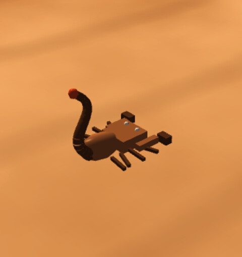

<p align="center"><a href="README.en.md">English version</a></p>

<div align="center">

# 🤖 Robocode Championship Manager

**Organize campeonatos de [Robocode](https://robocode.sourceforge.io/) com cara de fliperama:
inscrições pela web, chaveamento automático, batalhas em 3D e cerimônia de pódio.**


</div>

---

## Sumário

- [O que ele faz](#-o-que-ele-faz)
- [As arenas](#-as-arenas)
- [Personagens](#-personagens)
- [Instalação](#-instalação)
  1. [Instale o Robocode](#1-instale-o-robocode)
  2. [Baixe o programa](#2-baixe-o-programa)
  3. [Instale o programa](#3-instale-o-programa)
  4. [Primeira abertura](#4-primeira-abertura)
- [Tutorial: organizando um campeonato](#-tutorial-organizando-um-campeonato)
  1. [Configure](#1-configure)
  2. [Abra as inscrições](#2-abra-as-inscrições)
  3. [Sorteie o chaveamento](#3-sorteie-o-chaveamento)
  4. [Rode as batalhas](#4-rode-as-batalhas)
  5. [A cerimônia do pódio](#5-a-cerimônia-do-pódio)
- [Tutorial: inscrevendo o robô da sua equipe](#-tutorial-inscrevendo-o-robô-da-sua-equipe)
- [Todos os controles](#-todos-os-controles)
- [Regras do campeonato](#-regras-do-campeonato)
- [Para desenvolvedores](#-para-desenvolvedores)
- [Licença](#-licença)

---

## ✨ O que ele faz

| | |
|---|---|
| 🌐 **Inscrições pela web** | As equipes cadastram robô, código fonte, logotipo, lema e música tema num site servido pelo próprio programa. |
| 🗂️ **Equipes e robôs** | Uma tela do organizador (`Ctrl + E`) lista os robôs, mostra tudo o que cada equipe enviou (com o tanque em 3D girando) e deixa editar qualquer informação, trocar arquivos, adicionar e excluir robôs. |
| 🏆 **Chaveamento automático** | Eliminatória simples ou dupla (com repescagem), com qualquer número de robôs, e uma única grande final. |
| 🎮 **Batalhas em 3D** | O Robocode roda escondido; a batalha é gravada e reproduzida em 3D com HUD de jogo de luta, câmera cinematográfica e replay em câmera lenta do golpe final. |
| 🌋 **Seis arenas** | Cidade neon, forja vulcânica, tundra glacial, floresta tropical, Éden Solar e areias do Oriente Médio, cada uma com seus bichos, que fogem quando a batalha esquenta. |
| 🎵 **Música e som** | Cada equipe entra com sua música; tiros, explosões, esteiras e torres têm som próprio. Cada arena tem a sua trilha, tocada na escala da região que ela representa. |
| 🥇 **Pódio** | No fim, o campeão aparece e o terceiro, o segundo e o primeiro lugares são revelados um a um, com troféus de bronze, prata e ouro. |
| ↩️ **Desfazer** | Errou um resultado? `Ctrl + Z` desfaz o último. |

Tudo roda em tela cheia, com menus e diálogos no estilo de um jogo de fliperama.

---

## 🌍 As arenas

Cada batalha acontece numa arena sorteada (ou numa arena fixa, se você preferir).

<table>
<tr>
<td width="50%"><br><b>Grade Neon</b>: uma cidade neon sobre uma grade ciano, com estradas e carros de luz entre os prédios. A trilha é um synthwave tocado nas escalas do Extremo Oriente: o hirajoshi japonês sobre os acordes menores e a pentatônica chinesa sobre os maiores, com um koto dedilhando a frase.</td>
<td width="50%"><br><b>Forja Vulcânica</b>: lava, basalto e vulcões. O piso do campo de batalha é de rocha cinza-escura, bem mais discreto que a lava ao redor, para os robôs se destacarem. A trilha são tambores de guerra: claves de madeira, taikos e uma kalimba na pentatônica menor.</td>
</tr>
<tr>
<td><br><b>Tundra Glacial</b>: cristais de gelo, neve caindo, uma aurora boreal que ondula no céu e um mar glacial com pinguins. A trilha se inspira no canto inuíte, que não tem uma escala própria, só hábitos: poucas notas numa faixa estreita, com segundas menores e terças maiores, que ondulam e descem sobre um tambor de moldura, com dois cantores de garganta que respondem à respiração um do outro.</td>
<td><br><b>Floresta Tropical</b>: mata fechada, rios e cachoeiras. A trilha usa a escala ocidental, em sol maior, com os acordes I, V, vi e IV: uma marimba canta a melodia, sobre baixo, violão e bateria.</td>
</tr>
<tr>
<td colspan="2"><br><b>Éden Solar</b> (África, 2187): um estádio fechado, com uma grande abertura no teto para um céu de tempestade onde o sol rompe as nuvens. A planta é sinuosa e orgânica, como um rim, com lobos e cinturas, e as paredes são de terra coberta de musgo. Nervuras de madeira sobem em arco sobre a plateia, como galhos, até o teto, de onde pendem trepadeiras, e sebes floridas contornam as arquibancadas, lotadas com gente de todos os continentes e bandeiras ao vento. O campo é um jardim redondo, e o piso onde os robôs lutam traz padrões da arte africana (faixas de triângulos e zigue-zague, losangos concêntricos e um sol no centro, nas cores da terra), cortados por linhas de luz e nós brilhantes, como as trilhas de um circuito. Nas duas pontas, na boca de cada corredor, brilha um baobá, a árvore da vida. As aves ficam pousadas nos baobás e voam em volta deles, e o sobrevoo que abre a luta passa por um baobá, por três aves e por uma visão geral da região antes de chegar ao campo. Em volta do estádio, no alto, uma fileira de telas enormes mostra a batalha ao vivo, filmada de cima por uma câmera de transmissão que acompanha os robôs. A arena tem música própria, afrofuturista: um sino agogô e conga em compasso africano, chocalho, mbira em chamada e resposta e um baixo profundo, com sequenciador, teremim e lasers que entram aos poucos conforme a luta esquenta. As melodias são afinadas como nos xilofones do Malawi e de Moçambique, na escala heptatônica equidistante (a oitava em sete passos iguais), e não nas doze notas do piano. É a arena das grandes finais: ela só aparece na grande final, a partida que decide o campeonato. Nas outras partidas nunca é usada, nem se for a arena escolhida na configuração (nesse caso as outras partidas sorteiam entre as demais arenas), e a final a usa quando a arena é sorteada ou é ela mesma. Se você fixar outra arena, a final usa a que você fixou.</td>
</tr>
<tr>
<td colspan="2"><br><b>Areias do Oriente Médio</b>: um pátio de azulejos zellij no padrão "estrela e cruz" da arte islâmica, com os filetes brilhando de leve: estrelas de oito pontas (a khatam) aninhadas em azul-cobalto, turquesa e amarelo-mel, com cruzes verde-esmeralda entre elas e filetes de gesso branco, emolduradas por uma borda de estrelas menores, cercado por um platô de areia, com oásis de palmeiras na borda das dunas, de tronco anelado e folhas em arco, que sobem e depois descem, facetadas em dois tons de verde, como nos jogos de plataforma dos anos 90. Além do platô, um anel de dunas fica rente à arena e, depois dele, o chão é plano e se estende até o horizonte como uma cidade futurista de arquitetura islâmica, em quarteirões entre ruas de calçadas e faixas de luz, com jardins de quatro canais ("charbagh"), de água brilhante, cruzados em uma fonte, com ciprestes e palmeiras, e praças de azulejos sob mesquitas, portões e arranha-céus: casas baixas de cerâmica branca perolada, com janelas de arco ogival e treliça contornadas de luz, frisos de azulejo com o mesmo padrão, cujos filetes brilham, cúpulas de vidro sobre tambores e torres de vento; duas mesquitas, cada uma com sua grande cúpula sob halos de luz, cúpulas menores nos cantos, um pórtico em arco fechado por um véu de luz e dois minaretes de balcão, coroados por agulhas de luz; e portões de muralha entre torres redondas e merlões. Ao fundo, arranha-céus inspirados na arquitetura árabe contemporânea: um tripé de alas em espiral como o Burj Khalifa, torres cilíndricas com pele de losangos luminosos como a mashrabiya (Torre de Doha, Al Bahar), uma torre de abertura parabólica com passarela como a Kingdom Centre de Riad, uma torre torcida e inclinada como a Capital Gate de Abu Dhabi e uma torre coroada por um arco ogival. Nos cantos do pátio há lanternas octogonais com cúpula dourada e um halo de luz. O céu é de pôr do sol e a areia é levada pelo vento. A música é própria, na escala árabe (o maqam hijaz): um alaúde dedilha a escala, um ney canta por cima e uma darbuka marca o maqsum, e as notas e as batidas se multiplicam conforme a luta esquenta.</td>
</tr>
</table>

Antes do primeiro round, a câmera passeia pelo cenário: dá uma volta por cima da arena, fica 2 segundos num dos bichos que vivem nela e depois sobrevoa o campo, até onde a batalha começa. No deserto o passeio começa pela cidade: a câmera olha para cima, para um arranha-céu, e voa baixo por uma avenida até sair sobre as dunas, diante da arena.
Eles nunca entram na área de batalha, mas se assustam com os tiros e as explosões.


---

## 🎭 Personagens

Durante a batalha, **apresentadores** comentam o que acontece, e **bichos** vivem em cada arena. Nenhum deles interfere no resultado: são o show em volta da luta.

### Apresentadores

Cada tipo de acontecimento tem o seu apresentador. Quando algo importante acontece, ele aparece de baixo da tela para comentar, e sai quando não há mais nada a dizer. Eles dividem a tela: quem já apareceu mais do que os outros fala menos, quem apareceu menos fala mais, e o mesmo apresentador não aparece duas vezes seguidas. Os grandes momentos (início e fim do round, nocaute, manchetes) sempre são ditos.

| Foto | Apresentador | Comenta sobre | Como ele é |
|---|---|---|---|
|  | **Kayodê** | Início e fim do round, nocaute e as manchetes do final (como *VIRADA HISTÓRICA!*) | O mestre de cerimônias: animado, com microfone na mão e gosto por momentos grandes. |
|  | **Benê** | Números e conquistas: precisão, *PERFECT!*, vitórias esmagadoras | O analista experiente: calmo, de headset e tablet na mão, fala com dados. |
|  | **Zuri** | Paredes e colisões, como *"deu de cara com o campo de força!"* | A juíza da luta: de camisa listrada, aponta quando alguém bate na parede e não deixa passar nada. |
|  | **Dandara** | Golpes, dano crítico e combos (como *"Potência máxima!"* e *"Sequência implacável!"*) | A lutadora confiante: direta e intensa, comemora cada pancada certeira. |
|  | **Luana** | Tiros longos, tiros que se anulam e erros de mira (como *"calibra essa mira!"*) | A animada das manhas da pontaria: descontraída, com jaqueta de foguetes e sinal de paz. |
|  | **Caio** | Quem está na frente, reviravoltas e silêncios longos (como *"Reviravolta!"*) | O DJ tranquilo do ritmo: de fone e moletom, comenta o clima da partida. |
|  | **Nala** | Fogo, perigo e nocaute duplo (como *"Alerta vermelho!"*) | A mecânica atenta: de macacão e chave inglesa, avisa quando um robô está por um fio. |

### Bichos das arenas

Cada arena tem os seus bichos. Eles andam pelo cenário, **nunca entram na área da batalha** e fogem quando há tiros ou explosões por perto. Antes da primeira batalha, a câmera dá uma volta por cima da arena, fica 2 segundos num deles e depois segue o seu passeio.

| | | |
|---|---|---|
| <br>**Macaco**<br><i>Floresta Tropical</i><br>Entre as árvores e perto do rio. | <br>**Pássaro**<br><i>Floresta Tropical (um a cada três bichos)</i><br>Voa pela mata e se mistura às folhas. | <br>**Pinguim**<br><i>Tundra Glacial</i><br>Anda pelo gelo e, na água do mar glacial, nada. |
| <br>**Besouro**<br><i>Grade Neon</i><br>Corre pelas bordas da grade, entre os prédios de neon. | <br>**Salamandra**<br><i>Forja Vulcânica</i><br>Anda pelas rochas e pela cinza, perto da lava. | <br>**Morcego**<br><i>Forja Vulcânica (um a cada três bichos)</i><br>Voa pela arena, acima das rochas. |
| <br>**Escorpião**<br><i>Areias do Oriente Médio (dois a cada três bichos)</i><br>Anda pela areia em volta do pátio, com a cauda curvada sobre as costas e o ferrão em cima. | | |

> [!NOTE]
> Os traços de personalidade descritos acima são uma leitura do estilo de cada personagem, feita a partir das falas que eles dizem e da aparência de cada um. Eles não têm regras de jogo ligadas a esses traços.

---

## 📥 Instalação

Esta parte é para quem vai **usar** o programa. Não é preciso saber programar.

São três passos: instalar o **Robocode** (é ele que faz as batalhas), instalar o **Campeonato** e, na primeira vez, dizer ao programa onde está o Robocode.

### 1. Instale o Robocode

O programa não traz o Robocode, então instale-o primeiro.

1. **Java.** O Robocode precisa de Java. Se o seu computador ainda não tem, baixe o Java 21 no site [adoptium.net](https://adoptium.net) (escolha a opção **Temurin**) e instale.
2. **Robocode.** Baixe-o no site oficial [robocode.sourceforge.io](https://robocode.sourceforge.io/). O arquivo se chama parecido com `robocode-…-setup.jar`.
3. Dê **dois cliques** no arquivo baixado e siga o instalador.
4. **Anote a pasta** onde o Robocode foi instalado. Dentro dela existe uma pasta chamada `robots`. Você vai precisar dela no passo 4.

### 2. Baixe o programa

Abra a [página de downloads](https://github.com/ensismoebius/robocode-championship-manager/releases/latest) e baixe o arquivo do seu sistema:

| Seu computador | Arquivo para baixar |
|---|---|
| Windows | `RobocodeChampManager-5.0.exe` |
| Mac com chip Apple (M1, M2, M3, M4…) | `RobocodeChampManager-5.dmg` |
| Ubuntu 24.04 | `robocodechampmanager_5_ubuntu24.04_amd64.deb` |
| Debian 13 | `robocodechampmanager_5_debian13_amd64.deb` |
| Fedora | `robocodechampmanager-5-1.x86_64.rpm` |
| Arch Linux | `robocodechampmanager-5-1-x86_64.pkg.tar.zst` |

> [!NOTE]
> Não sabe o seu Mac? Clique na maçã no canto da tela → **Sobre este Mac**. Se aparecer **Chip Apple** seguido de M1, M2, M3 ou M4, use o `.dmg`. Macs com processador **Intel** não são suportados por este instalador.

### 3. Instale o programa

**Windows**

1. Dê **dois cliques** no arquivo `.exe`.
2. Vai aparecer a janela **"O Windows protegeu o seu PC"**, porque o programa ainda não é assinado digitalmente. Clique em **Mais informações** e depois em **Executar assim mesmo**.
3. Siga o instalador (**Avançar**, **Avançar**, **Instalar**, **Concluir**). O programa fica no **Menu Iniciar**.

**macOS**

1. Dê **dois cliques** no arquivo `.dmg` e arraste o ícone do programa para a pasta **Aplicativos**.
2. Abra a pasta **Aplicativos**, clique com o **botão direito** no programa e escolha **Abrir**. Confirme em **Abrir** na janela que aparecer.
3. Se o Mac só mostrar "não pode ser aberto", vá em **Ajustes do Sistema → Privacidade e Segurança**, role até o aviso sobre o programa e clique em **Abrir Mesmo Assim**. (Em versões antigas do macOS, o caminho é **Configurações do Sistema**.)

**Ubuntu e Debian**

- **Jeito fácil:** dê **dois cliques** no arquivo `.deb`. Vai abrir a Central de Programas: clique em **Instalar** e digite a senha do computador.
- **Pelo terminal:** abra o terminal, vá até a pasta onde o arquivo foi baixado e instale:
  ```bash
  cd ~/Downloads
  sudo apt install ./robocodechampmanager_5_ubuntu24.04_amd64.deb
  ```
  (no Debian, use o arquivo `…debian13…`)

**Fedora**

- Dê **dois cliques** no arquivo `.rpm` e clique em **Instalar**, ou, no terminal:
  ```bash
  cd ~/Downloads
  sudo dnf install ./robocodechampmanager-5-1.x86_64.rpm
  ```

**Arch Linux**

- No terminal:
  ```bash
  cd ~/Downloads
  sudo pacman -U ./robocodechampmanager-5-1-x86_64.pkg.tar.zst
  ```

No Linux, o programa é instalado em `/opt/robocodechampmanager`. Se ele não aparecer no menu de aplicativos, abra-o pelo terminal com `/opt/robocodechampmanager/bin/RobocodeChampManager`.

### 4. Primeira abertura

1. Abra o programa. Ele ocupa a tela inteira e não tem botão de fechar: para sair, use **Ctrl + Q**.
2. Na primeira vez aparece a tela **Configurações**, inteira dentro do programa, com uma explicação sob cada campo. Vá na aba **Sistema** e preencha:
   - **Diretório do robocode**: clique em **Escolher...** e selecione a pasta do Robocode do passo 1 (a que contém `robots`). **Este campo é obrigatório.**
3. Na aba **Tela inicial** você pode mudar o título e o subtítulo. As outras abas podem ficar como estão.
4. Clique em **Salvar** (ou **Enter**). **Esc** cancela. Se algo estiver errado, o campo fica em vermelho, a aba certa abre e a mensagem diz o que corrigir.


Depois, para mudar qualquer coisa, aperte **C** a qualquer momento. A tela inicial mostra os atalhos quando você segura **Alt**.

### 5. Pronto!

A tela inicial aparece com o título do campeonato. A partir daqui:

- Para organizar um campeonato, siga o [Tutorial: organizando um campeonato](#-tutorial-organizando-um-campeonato).
- Para inscrever um robô, a equipe segue o [Tutorial: inscrevendo o robô da sua equipe](#-tutorial-inscrevendo-o-robô-da-sua-equipe).

### Problemas comuns

| O que acontece | O que fazer |
|---|---|
| O Windows diz que o programa não é seguro | Clique em **Mais informações** → **Executar assim mesmo** (passo 3). |
| O Mac diz que o programa não pode ser aberto | Use **Abrir Mesmo Assim** em **Privacidade e Segurança** (passo 3). |
| A batalha não começa, ou aparece erro sobre o Robocode | Aperte **C**, aba **Sistema**, e confira o **Diretório do robocode**: ele deve ser a pasta que contém `robots`. |
| As equipes não conseguem abrir o endereço de inscrição | O computador do campeonato e os das equipes precisam estar na mesma rede (Wi-Fi ou cabo). Se o Windows perguntar sobre o firewall, permita o acesso em **redes privadas**. A porta é a 8080, que pode ser mudada na aba **Tela inicial**. |
| Quero atualizar o programa | Baixe a versão nova e instale-a. Os seus dados e configurações ficam numa pasta do usuário, não na pasta do programa. |

Os dados ficam em `~/RobocodeChampManager` (a pasta **Usuário** da sua conta). **Apagar essa pasta apaga os campeonatos**, então faça uma cópia antes.

---

## 📖 Tutorial: organizando um campeonato

### 1. Configure

Na primeira vez que o programa abre, ele pede a configuração. Depois, aperte **`C`** a qualquer
momento para mudá-la. A configuração é uma tela do próprio programa, e cada campo tem uma linha
explicando o que ele aceita. As mudanças valem na hora, sem reiniciar: o servidor web muda de
porta e o novo banco de dados é aberto na mesma hora.


| Aba | O que tem lá |
|---|---|
| **Tela inicial** | Título e subtítulo da tela inicial (um subtítulo vazio não aparece), se as inscrições estão abertas e a porta do site de inscrições (8080 por padrão). |
| **Batalha** | O tipo de batalha (por pontos ou por K.O.) e o número de partidas, exibição (3D no gerenciador ou a janela clássica do Robocode), velocidade inicial e o texto do início do round (`FIGHT!`). |
| **Arena e som** | Arena e música (sorteadas ou fixas; são sete músicas, e cada arena tem a sua), "usar a mesma música da arena", volume e a suavização de bordas (desligue se a batalha ficar lenta). |
| **Sistema** | O arquivo do banco SQLite e a pasta do Robocode (a que tem a pasta `robots`). |

A configuração fica em `~/robocodeChampManager.config` e os dados em
`~/RobocodeChampManager/robochamp.db` (as tabelas são criadas sozinhas).

### 2. Abra as inscrições

Com as inscrições abertas, a tela inicial mostra o endereço onde as equipes cadastram seus
robôs. Projete essa tela para todo mundo ver! **`Ctrl + S`** abre ou fecha as inscrições.

Não decore os atalhos: **segure `Alt`** na tela inicial e eles aparecem.


O passo a passo das equipes está em
[Tutorial: inscrevendo o robô da sua equipe](#-tutorial-inscrevendo-o-robô-da-sua-equipe).

#### Equipes e robôs: ver, editar, adicionar e excluir


**`Ctrl + E`** abre a tela das equipes e dos robôs. À esquerda fica a lista de robôs cadastrados;
ao clicar em um, o formulário mostra tudo o que a equipe enviou, e o tanque do robô gira em 3D
ao lado dos arquivos (arraste com o mouse para girá-lo).

- **Tudo pode ser editado**: time, robô, login, senha (em branco, mantém a atual), lema, pessoas
  (nome, RM e e-mail), início da música e código fonte.
- **Os arquivos podem ser trocados**: **Trocar...** sob o logotipo, sob a música (dá para ouvir
  na hora), sob o robô compilado (se o nome for o do empacotador, o time e o robô são preenchidos
  sozinhos) e **Carregar...** no código fonte.
- **+ Novo** adiciona um robô: ele precisa de tudo, inclusive o `.jar`, o logotipo e a música.
- **Excluir** remove o robô. Se ele estiver em campeonatos, a confirmação avisa quantos, porque
  eles são apagados junto, com os resultados.
- **Salvar** confere as mesmas regras da inscrição pela web e diz o que está errado. Se houver
  alterações não salvas, o programa pergunta antes de trocar de robô ou voltar.

### 3. Sorteie o chaveamento

Quando todos tiverem se inscrito, aperte **`Ctrl + G`** para sortear um campeonato com todos os
robôs cadastrados, depois **`R`** para ver o chaveamento.


- A chave principal fica em cima, a repescagem embaixo, as finais e a classificação ao lado.
- **Semifinais e finais são avisadas**: na tela da chave a próxima partida aparece em dourado com o nome da fase, e na arena 3D o nome da fase (★ SEMIFINAL ★, ★ FINAL ★) aparece na abertura, no placar durante a batalha e na fala do apresentador.
- Clique numa partida para selecioná-la; depois de cada resultado a próxima é selecionada sozinha.
- **`+`**, **`-`** e **`0`** aproximam, afastam e mostram a chave inteira (ou `Ctrl` + roda do mouse);
  arraste, use a roda ou as setas para mover.

Depois de um resultado o chaveamento mostra o que aconteceu como num jogo: a câmera vai até a
partida, revela vencedor e perdedor, os robôs andam para as próximas partidas e a câmera
aproxima a próxima batalha. Qualquer tecla ou clique pula a animação.


### 4. Rode as batalhas

**`N`** seleciona a próxima partida e **`B`** mostra a tela de versus:


**`M`** apresenta os robôs da partida, com equipe, lema e quem os desenvolveu:


**`S`** começa a batalha. Primeiro cada robô entra em cena ao som da música da sua equipe...


...depois os dois se encaram, a câmera passeia pela arena (uma volta por cima, 2 segundos num bicho e o sobrevoo até o campo; no deserto, antes disso, a cidade) e cada round começa com uma contagem de 3 segundos.


Em **semifinais** e **finais** o programa avisa: o nome da fase aparece em dourado na abertura (★ SEMIFINAL ★, ★ FINAL ★), o placar mostra a fase durante toda a batalha e o apresentador anuncia a partida.


Durante a luta, a barra de energia de cada robô fica no alto da tela. Os tanques usam as cores
que o robô escolheu no seu código, e os tiros saem na cor de quem atirou. Quando um robô é
destruído, os momentos antes da sua morte são repetidos em câmera lenta, seguindo o tiro fatal.


| Durante a batalha 3D | |
|---|---|
| `V` | Troca a câmera: **CINEMATOGRÁFICA** (segue a ação sozinha), **LIVRE**, **ISOMÉTRICA** e **VISTA DE CIMA** |
| `Espaço` | Pausa |
| `←` `→` (ou `-` `+`) | Mais devagar / mais rápido |
| `Enter` | Pula o que está passando (apresentação, sobrevoo ou replay); senão vai para o resultado |
| `Esc` | O mesmo, e pula a apresentação de todos os robôs |
| Arrastar | Gira a câmera (arrastar na câmera cinematográfica passa para a livre) |
| Roda do mouse | Zoom |

O vencedor é gravado sozinho. Se precisar declarar o resultado na mão, **`1`** e **`2`** dão a
vitória ao primeiro ou ao segundo robô; **`Ctrl + Z`** desfaz o último resultado.

### 5. A cerimônia do pódio

Quando a última batalha termina, a tela escurece, a música sobe e o campeão aparece:


Então **`Espaço`**, **`Enter`** ou **`→`** revelam o terceiro, o segundo e o primeiro lugares, um
de cada vez, cada um com seu robô, equipe, lema e troféu.

<table>
<tr>
<td width="50%"></td>
<td width="50%"></td>
</tr>
</table>

**`←`** volta um lugar e **`R`** abre o chaveamento. Com o campeonato encerrado, `S`, `1`, `2`, `B`
e `M` abrem o pódio de novo.

---

## 📝 Tutorial: inscrevendo o robô da sua equipe

> Esta parte é para as equipes. O endereço aparece na tela inicial do campeonato, algo como
> `http://192.168.0.10:8080`.

**1. Abra o endereço no navegador.** Se a sua equipe ainda não tem login, clique em
**Cadastre seu time**. Se já tem, entre com o login e a senha para alterar o cadastro.


**2. Preencha o cadastro.**


- **Dados de login**: um login e uma senha que toda a equipe pode usar.
- **Dados do time**:
  - o **lema**, o grito de guerra que aparece nas apresentações e no pódio;
  - a **música tema**, um `.mp3` de até 1 MB que toca quando o robô entra na arena;
  - o **logotipo**, um `.gif`, `.jpg` ou `.png` de até 640 x 480 pixels e 1 MB.
- **Quem desenvolveu**: nome, **RM** (registro de matrícula, só números, até 20 dígitos) e
  e-mail de pelo menos uma pessoa. Use **+ Adicionar pessoa** para as outras.
- **Dados do robô**:
  - o **robô compilado**, o `.jar` gerado pelo empacotador do Robocode
    (*Robot → Package robot for upload*);
  - o **código fonte**, o arquivo `.java`.

Cada campo traz, logo abaixo do nome, as regras que ele segue (tamanhos, formatos, o que é
obrigatório). Antes de enviar, o navegador confere tudo e lista o que precisa ser corrigido, com os
campos em vermelho, sem perder o que você já preencheu.

**3. Clique em Salvar.** Pronto! Até as inscrições fecharem, você pode entrar de novo e trocar
o robô quantas vezes quiser.

<br clear="right">

> [!TIP]
> Escolha as cores do seu tanque no código do robô, com `setColors(...)`: a arena 3D usa essas cores.

---

## ⌨️ Todos os controles

Segure **`Alt`** na tela inicial para ver esta lista.

| Tecla | Ação |
|---|---|
| `I` | Tela inicial |
| `Ctrl + G` | Sorteia um novo campeonato |
| `Ctrl + S` | Abre ou fecha as inscrições |
| `Ctrl + E` | Equipes e robôs: vê, edita, adiciona e exclui robôs e equipes |
| `R` | Chaveamento (clique numa partida para selecioná-la) |
| `N` | Seleciona a próxima partida (e voa até ela) |
| `B` | Tela de versus da partida selecionada |
| `S` | Roda a partida selecionada e grava o vencedor |
| `1` / `2` | Declara o primeiro / segundo robô vencedor |
| `Ctrl + Z` | Desfaz o último resultado |
| `M` | Mostra os robôs da partida (no fim, o campeão) |
| `X` | Exporta o código fonte dos robôs para `<pasta temporária>/robochamp-export` |
| `C` | Configurações |
| `Ctrl + Q` | Sai (a janela fica sempre em tela cheia, sem botão de fechar) |
| `+` / `-` / `0` | No chaveamento: aproxima, afasta e mostra a chave inteira |

Os controles da [batalha 3D](#4-rode-as-batalhas) e do [pódio](#5-a-cerimônia-do-pódio) estão
nos seus tutoriais.

---

## 📜 Regras do campeonato

- **Qualquer número de robôs** (dois ou mais). Quando não é uma potência de dois, os primeiros
  sorteados avançam direto na primeira rodada.
- **Com repescagem** (eliminação dupla, o padrão): quem perde na chave principal vai para a
  repescagem e só sai depois da segunda derrota. O campeão da chave principal e o da repescagem
  fazem a grande final, que decide o campeão (não há revanche).
- **Sem repescagem**: eliminação simples.
- **O tipo de batalha** é configurável (tecla `C`, aba **Batalha**):
  - **Por pontos, com N partidas:** todas as partidas são jogadas e vence quem somar mais
    pontos. Se empatar nos pontos, vence quem ganhou mais partidas.
  - **Por K.O., melhor de N partidas:** vence quem ganhar a maioria das partidas, e a batalha
    termina assim que alguém chegar lá. Por exemplo, na melhor de 5, quem ganhar 3 já leva; se
    cada um ganhar 2, a quinta partida desempata. Uma partida em que os dois robôs são
    destruídos juntos (duplo K.O.) não dá vitória a ninguém: se isso deixar as vitórias
    empatadas no fim, decidem os pontos.
  - Os dois tipos podem discordar: um robô pode vencer mais partidas com menos pontos. A
    colocação que o próprio Robocode informa não é usada, porque pode estar errada (é calculada
    antes da última partida contar).

Os robôs são copiados para `<robocode>/robots` como `equipe.Robo.jar` antes de cada batalha.

---

## 🛠️ Para desenvolvedores
### Compilar e rodar a partir do código

É preciso o **JDK 21** e o **Maven**. JavaFX, Jetty, Hibernate, SQLite e o decodificador de MP3 são baixados pelo Maven.

```bash
./run.sh            # compila quando precisa e abre o programa
./run.sh --build    # força a compilação
./run.sh --test     # roda os testes
```

ou, sem o script:

```bash
mvn package                                  # compila e roda os testes
java -jar target/RobocodeChampManager-5-all.jar
# ou
mvn javafx:run
```

Rode a partir desta pasta: as batalhas são iniciadas por `RobocodeStarter/start.sh` (ou `start.bat` no Windows).

### Gerando os instaladores

O Linux gera um pacote por distribuição (precisa de Docker); cada sistema gera o seu próprio instalador, porque o `jpackage` não faz compilação cruzada.

| Sistema | Comando | Resultado |
|---|---|---|
| Linux (precisa de Docker) | `packaging/build-linux-packages.sh` | `dist/linux/ubuntu/*.deb` (Ubuntu 24.04), `dist/linux/debian/*.deb` (Debian 13), `dist/linux/fedora/*.rpm`, `dist/linux/arch/*.pkg.tar.zst` |
| O sistema atual | `packaging/build-installer.sh` | O pacote do sistema onde roda |
| macOS | `packaging/build-installer.sh` | `dist/*.dmg` |
| Windows (precisa do WiX Toolset 3) | `packaging\build-installer.ps1` | `dist\*.exe` |

O workflow `.github/workflows/installers.yml` gera os instaladores de Linux, Windows e macOS quando uma tag `v*` é enviada (ou manualmente), e os guarda como artefatos.

> [!NOTE]
> Os instaladores não são assinados. O macOS exige a liberação em **Privacidade e Segurança**, e o Windows mostra o aviso do SmartScreen.

### Organização do código

| Onde | O quê |
|---|---|
| `src/model` | As entidades JPA |
| `src/tournament` | As regras do chaveamento (`Bracket`) e o armazenamento do campeonato |
| `src/jetty` | O servidor web e as páginas de inscrição |
| `src/utils` | Utilitários: configuração, banco de dados, batalhas... |
| `src/widgets` | Controles, janelas e cenas do programa (as arenas 3D estão em `widgets/scenes` e as músicas em `BattleAudio*.java`) |
| `RobocodeStarter/` | Versão compilada do programa que controla as batalhas do Robocode (fonte no submódulo `robocodebattlestarter`) |
| `test/` | Testes automáticos, rodados com `mvn test` |

### O iniciador de batalhas

`RobocodeStarter/BattleStarter.java` é o programa que roda as batalhas. Depois de alterá-lo,
compile com:

```bash
javac --release 11 -cp "<pasta do robocode>/libs/*" -d RobocodeStarter RobocodeStarter/BattleStarter.java
```

### Atualizando da versão 3

A versão 3 guardava os dados em H2; esta usa SQLite, e o antigo ranking por "níveis" foi
trocado pelo chaveamento. Os robôs precisam ser cadastrados de novo (ou os dados copiados na
mão). Senhas antigas em texto puro continuam funcionando se forem copiadas.

---

## ⚖️ Licença

Distribuído sob a [GNU General Public License v3](LICENSE).

Feito por André Furlan ([ensismoebius@gmail.com](mailto:ensismoebius@gmail.com)).
