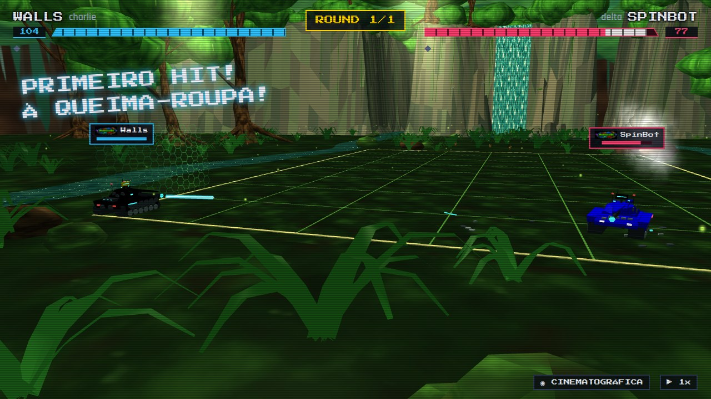
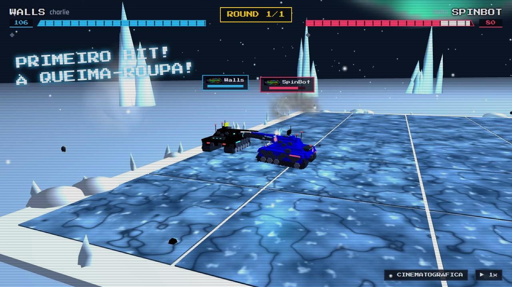
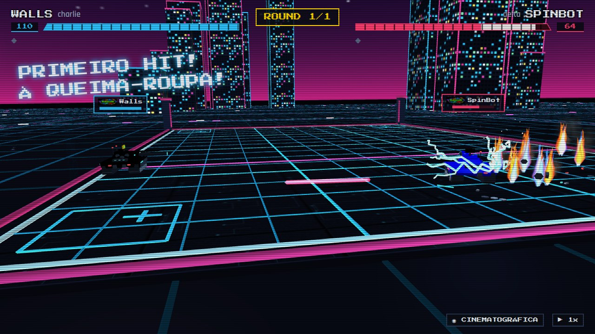
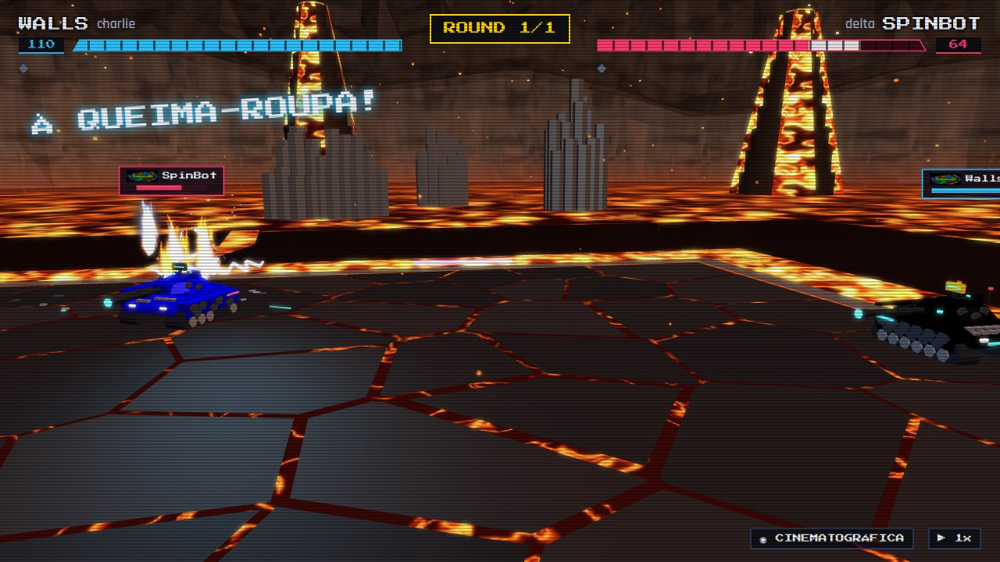
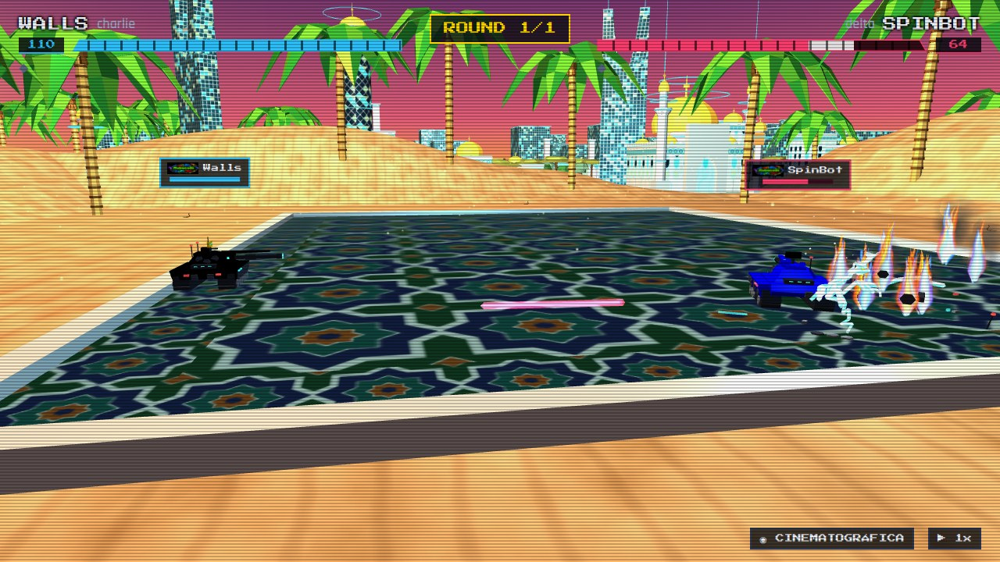
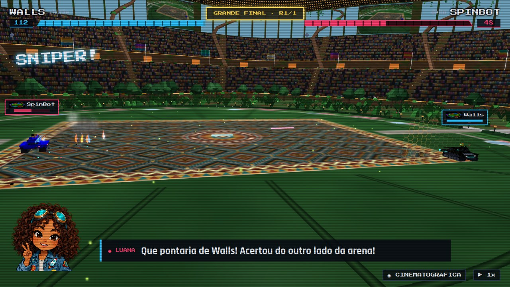

# ROBOCODE — A GRANDE BATALHA

## A história de um mundo que escolheu competir para não se destruir

> [English version](STORY.md) · [Voltar ao README](../README.md)

Esta é a história de fundo do **Robocode Championship Manager**: o mundo em que as batalhas acontecem, quem são os apresentadores e por que cada arena fica onde fica.

## Sumário

1. [O mundo antes do Robocode](#1-o-mundo-antes-do-robocode)
2. [A paz forçada](#2-a-paz-forçada)
3. [A reconstrução do planeta](#3-a-reconstrução-do-planeta)
4. [A natureza humana e a necessidade de conflito](#4-a-natureza-humana-e-a-necessidade-de-conflito)
5. [O nascimento do Robocode](#5-o-nascimento-do-robocode)
6. [Uma competição verdadeiramente internacional](#6-uma-competição-verdadeiramente-internacional)
7. [A governança africana do Robocode](#7-a-governança-africana-do-robocode)
8. [Os personagens do Robocode](#8-os-personagens-do-robocode)
9. [As arenas do Robocode](#9-as-arenas-do-robocode)
10. [A grande final](#10-a-grande-final)
11. [O significado do Robocode](#11-o-significado-do-robocode)

---

## 1. O mundo antes do Robocode

Durante séculos, a humanidade permaneceu marcada por conflitos políticos, disputas territoriais, interesses econômicos e guerras entre nações. Mesmo com o avanço científico e tecnológico, a capacidade humana de desenvolver instrumentos cada vez mais sofisticados de destruição continuou sendo utilizada em confrontos que ameaçavam a estabilidade das sociedades e a própria existência dos ecossistemas terrestres.

Até meados do século XXII, as guerras ainda representavam uma das principais ameaças à continuidade da civilização. A degradação ambiental, a destruição de cidades e os deslocamentos populacionais provocados pelos conflitos colocavam em risco o futuro do planeta.

Esse cenário começou a mudar em 2150.

## 2. A paz forçada

Em 2150, nações africanas, após um longo período de desenvolvimento científico e tecnológico independente, alcançaram um avanço tecnológico sem precedentes.

O desenvolvimento dessa tecnologia conferiu a essas nações capacidade suficiente para impor limites às potências militares que historicamente fomentavam e sustentavam conflitos internacionais.

Países como os Estados Unidos, nações europeias, Israel e outras potências militares foram obrigados a abandonar a guerra convencional.

Não se tratava simplesmente de um acordo diplomático ou de uma mudança espontânea nas relações internacionais. Era uma nova configuração geopolítica na qual a continuidade das guerras deixou de ser uma possibilidade aceitável.

A paz passou a ser uma condição obrigatória.

A partir desse momento, as nações africanas assumiram um papel central na manutenção dessa nova ordem mundial. A tecnologia desenvolvida por elas começou a ser distribuída internacionalmente, mas sua utilização estava condicionada à preservação da paz.

O acesso a essa tecnologia dependia do compromisso das nações com a manutenção da estabilidade internacional.

## 3. A reconstrução do planeta

Com a interrupção das guerras convencionais, tornou-se possível iniciar um processo de recuperação ambiental em escala global.

Cidades anteriormente degradadas começaram a ser reconstruídas. Ecossistemas destruídos passaram por processos de restauração. Áreas naturais recuperaram parte de sua biodiversidade, enquanto novas tecnologias permitiram desenvolver formas mais sustentáveis de ocupação humana.

A humanidade passou a direcionar seus esforços científicos e tecnológicos para a recuperação do planeta.

A restauração dos ambientes naturais, a recuperação das cidades e a proteção dos animais tornaram-se elementos fundamentais dessa nova etapa da civilização.

Pela primeira vez em muito tempo, a humanidade dispunha das condições necessárias para construir um futuro no qual o desenvolvimento tecnológico e a preservação ambiental pudessem coexistir.

Entretanto, a ausência de guerras trouxe uma questão inesperada.

## 4. A natureza humana e a necessidade de conflito

Com o passar dos anos, pesquisadores de diferentes áreas chegaram a uma conclusão que provocou intensos debates: a natureza humana apresentava uma dimensão profundamente conflituosa.

A rivalidade, a competição, o desejo de superação e a necessidade de confrontar adversários continuavam presentes nas sociedades, mesmo depois do fim das guerras convencionais.

A paz havia eliminado a destruição provocada pelos conflitos militares, mas não havia eliminado o impulso humano de competir e confrontar.

Surgiu, então, um problema fundamental: como permitir que a humanidade expressasse sua natureza competitiva e seu espírito bélico sem colocar novamente em risco a própria civilização?

A solução precisava preservar aquilo que havia sido conquistado desde 2150.

Não seria aceitável retornar às guerras, destruir cidades, comprometer ecossistemas ou colocar vidas humanas e animais em perigo.

Era necessário encontrar uma nova forma de guerra.

Uma guerra na qual o conflito pudesse existir sem que suas consequências recaíssem sobre o mundo real.

## 5. O nascimento do Robocode

Foi nesse contexto que surgiu o Robocode.

O Robocode nasceu como um sistema internacional de batalhas entre robôs de combate automatizados, desenvolvido para oferecer à humanidade uma forma de expressar seu espírito competitivo e suas tendências bélicas sem provocar destruição real.

As batalhas acontecem em arenas especialmente construídas, protegidas por campos de força que delimitam as áreas de combate e impedem que os confrontos provoquem danos ao ambiente externo.

Os combatentes são tanques de guerra robóticos, máquinas automatizadas controladas por sistemas de inteligência artificial e programas desenvolvidos por equipes especializadas.

O próprio nome Robocode representa a essência dessa competição: robôs cuja capacidade de combate depende diretamente do código que os controla.

As batalhas não são simples simulações visuais. Os robôs disputam confrontos reais dentro dos limites estabelecidos pelo sistema, utilizando suas estratégias, capacidades mecânicas e inteligência computacional.

O resultado depende da combinação entre engenharia mecânica, desenvolvimento de software, inteligência artificial e estratégia.

Assim, a humanidade encontrou uma maneira de preservar a experiência simbólica da guerra sem reproduzir suas consequências destrutivas.

O Robocode tornou-se uma válvula de escape para o espírito bélico humano.

## 6. Uma competição verdadeiramente internacional

Com a consolidação do Robocode, países e continentes passaram a organizar suas próprias equipes de competição.

Cada equipe reúne profissionais especializados em duas grandes áreas: engenharia mecânica e desenvolvimento de software.

Os responsáveis pela engenharia mecânica trabalham na construção, configuração e otimização dos robôs. Os desenvolvedores de software são responsáveis pelos algoritmos, estratégias e sistemas de inteligência artificial que determinam o comportamento das máquinas durante as batalhas.

Embora os robôs apresentem características externas semelhantes, isso acontece porque existe um conjunto internacional de regras que estabelece padrões para sua aparência e configuração externa.

Essas regras garantem condições de competição e impedem que diferenças físicas comprometam a integridade do sistema.

Entretanto, internamente, os robôs podem apresentar tecnologias muito diferentes.

Cada equipe possui liberdade para desenvolver suas próprias soluções tecnológicas, arquiteturas de software, estratégias computacionais e configurações mecânicas, desde que respeite as regras oficiais da competição.

Essa diversidade tecnológica é uma das características fundamentais do Robocode.

Por trás de máquinas aparentemente semelhantes existem diferentes filosofias de engenharia, estratégias e abordagens de inteligência artificial.

O resultado é uma competição na qual a criatividade e a capacidade de inovação são tão importantes quanto a habilidade de vencer uma batalha.

## 7. A governança africana do Robocode

Embora equipes de diferentes países e continentes participem das competições, a administração internacional do Robocode permanece sob responsabilidade das nações africanas.

São elas que gerenciam o sistema, controlam sua infraestrutura e garantem que as regras sejam respeitadas.

Essa responsabilidade decorre diretamente do papel desempenhado pelas nações africanas na construção e manutenção da paz mundial a partir de 2150.

O objetivo dessa administração não é favorecer determinadas equipes ou continentes, mas assegurar que a competição permaneça dentro dos limites estabelecidos.

O povo africano também possui presença expressiva na cultura do Robocode.

A maior parte dos narradores, comentaristas e profissionais responsáveis pela apresentação das batalhas tem origem africana. Essa presença representa a participação cultural das sociedades africanas na construção e na manutenção do sistema internacional de competições.

É importante destacar que essa responsabilidade administrativa não significa que as equipes africanas liderem ou dominem as competições. Os participantes de todos os continentes disputam em condições regulamentadas.

O Robocode pertence à humanidade, embora sua infraestrutura e sua governança estejam sob responsabilidade africana.

## 8. Os personagens do Robocode

Ao longo de sua consolidação como fenômeno internacional, o Robocode desenvolveu uma cultura própria de transmissão e acompanhamento das batalhas.

Seus personagens representam diferentes funções dentro desse universo, contribuindo para transformar os confrontos em eventos esportivos e culturais.

Entre as figuras que participam das transmissões estão:

| | Apresentador | Função na transmissão |
|---|---|---|
|  | **Kayodê** | Responsável pelas aberturas e encerramentos dos rounds, anúncios de nocautes e apresentação de acontecimentos históricos das competições. |
|  | **Benê** | Especialista em estatísticas, análise de desempenho, precisão e resultados excepcionais dos robôs. |
|  | **Zuri** | Acompanha colisões, impactos contra as paredes e situações relacionadas à fiscalização das regras da competição. |
|  | **Dandara** | Comenta os golpes, danos críticos e sequências de ataques realizados durante as batalhas. |
|  | **Luana** | Especialista em disparos de longa distância, tiros anulados e situações relacionadas à precisão dos sistemas de mira. |
|  | **Caio** | Acompanha a liderança das partidas, as reviravoltas e o desenvolvimento geral dos confrontos. |
|  | **Nala** | Comenta situações envolvendo fogo, perigo e acontecimentos de grande intensidade, incluindo nocautes duplos. |

Esses personagens dão identidade às transmissões e ajudam a construir uma linguagem própria para o espetáculo. No programa, eles aparecem o mesmo número de vezes ao longo de cada campeonato.

## 9. As arenas do Robocode

Para receber as competições, foram desenvolvidas **seis arenas** distribuídas por diferentes regiões do planeta.

Cada arena possui características ambientais e visuais próprias, representando diferentes relações entre tecnologia, natureza e civilização. Cada uma também segue, no cenário e na música, o que é típico da região em que fica.

As arenas não são apenas espaços físicos para os confrontos. Elas também representam diferentes perspectivas sobre o mundo que surgiu depois de 2150.

| Arena | Onde fica |
|---|---|
| Floresta Tropical | América Latina |
| Tundra Glacial | Extremo norte, na Rússia |
| Grade Neon | Ásia (Japão e China unidos numa só região) |
| Forja Vulcânica | Havaí |
| Areias do Oriente Médio | Oriente Médio |
| Éden Solar | África central, perto do atual Congo |

### 9.1. Floresta Tropical — América Latina

Localizada na América Latina, a Floresta Tropical representa a recuperação dos grandes ecossistemas naturais do planeta. Depois de conquistar a independência de fato, os países latino-americanos se uniram num único bloco, restauraram seus biomas e se destacaram como fornecedores de biotecnologia e bioengenharia avançadas.

A arena está inserida em um ambiente de vegetação densa, árvores monumentais, rios, cachoeiras que despencam de paredões de rocha úmida e uma grande diversidade de animais.

O cenário representa a importância da preservação da biodiversidade e a possibilidade de reconstruir ambientes naturais que anteriormente sofreram com a degradação ambiental.

Entre os animais associados ao ambiente estão macacos e pássaros.

Durante as batalhas, os animais permanecem fora da área de combate e fogem quando são assustados pelos disparos e explosões.

A Floresta Tropical simboliza a recuperação da natureza e a necessidade de preservar aquilo que a humanidade quase perdeu.

### 9.2. Tundra Glacial — Extremo norte, Rússia

Localizada no extremo norte, na Rússia, a Tundra Glacial apresenta um ambiente dominado pelo gelo, pela neve e pelas baixas temperaturas. Depois da Revolução pela Paz, liderada pelos países africanos, o gelo polar voltou a se formar, e a arena nasceu sobre ele.

A arena possui formações de cristais de gelo, superfícies congeladas e paisagens que remetem à imensidão dos ambientes polares.

A aurora boreal acrescenta uma dimensão visual característica ao cenário.

O ambiente também abriga animais adaptados às condições polares, incluindo os pinguins presentes na representação visual da arena.

A Tundra Glacial representa a diversidade dos ambientes naturais e a capacidade humana de construir espaços de competição em regiões ambientalmente extremas.

### 9.3. Grade Neon — Ásia

Localizada na Ásia, a Grade Neon representa a relação entre desenvolvimento tecnológico, urbanização e inovação. Depois dos movimentos de unificação dos povos asiáticos, Japão e China se tornaram uma única região, e a arena fica numa metrópole dela.

Seu cenário é formado por uma cidade futurista, com estruturas arquitetônicas avançadas, iluminação neon, estradas e carros de luz entre os prédios, e elementos tecnológicos integrados ao ambiente urbano. Os besouros correm pelas bordas da grade.

A arena representa uma sociedade na qual a tecnologia atingiu níveis elevados de desenvolvimento, mas na qual a competição continua sendo uma expressão importante da cultura humana.

A Grade Neon simboliza a criatividade tecnológica e a capacidade de transformar o ambiente urbano em um espaço de inovação e competição.

### 9.4. Forja Vulcânica — Havaí

Localizada no Havaí, a Forja Vulcânica apresenta um ambiente geológico marcado pela atividade vulcânica. Depois das lutas pela independência do arquipélago, o povo havaiano passou a extrair energia geotérmica dos vulcões com tecnologia própria: a "forja vulcânica".

A arena possui formações de basalto, lagos e rios de lava, penhascos, cavernas com fungos que brilham e vulcões que compõem um cenário de grande intensidade visual.

O ambiente representa a convivência da humanidade com as forças naturais do planeta.

A presença de salamandras e morcegos integra a fauna representada nesse cenário. Como nas demais arenas, os animais permanecem protegidos dos confrontos.

A Forja Vulcânica simboliza transformação, resistência e a capacidade de desenvolver tecnologia mesmo diante de ambientes naturais extremos.

### 9.5. Areias do Oriente Médio

Depois da derrota e da contenção dos países que promoviam a guerra na região, o Oriente Médio voltou aos seus dias de glória. Desenvolveu a medicina, a matemática e outras tecnologias, e, na paz, floresceram a arte, a arquitetura e a integração com o meio ambiente.

A arena é um pátio de azulejos zellij cercado de dunas e oásis, diante de uma cidade futurista de arquitetura islâmica, com arcos ogivais, cúpulas, minaretes e portões de muralha, sob um pôr do sol. Os escorpiões andam pela areia em volta do pátio.

As Areias do Oriente Médio simbolizam a retomada de uma tradição de conhecimento, agora em harmonia com o ambiente.

### 9.6. Éden Solar — África central

O Éden Solar é a **sexta e última arena** do Robocode e possui um significado especial: é o local escolhido para receber a grande final do campeonato.

Localizada na África central, perto do atual Congo, essa arena apresenta uma estética solarpunk, na qual tecnologia e natureza finalmente alcançaram uma relação de harmonia complementar. Depois de liderar a revolução pela paz mundial, a África, riquíssima em minerais e recursos naturais, viveu um grande surto de desenvolvimento local.

Sua arquitetura combina infraestrutura tecnológica, fontes de energia renovável, vegetação abundante, jardins integrados às construções e espaços naturais preservados. A arena é um estádio de paredes de musgo, aberto a um céu de tempestade, com baobás que brilham, cercado por uma cidade solarpunk africana.

O ambiente representa uma sociedade que deixou de tratar desenvolvimento tecnológico e preservação ambiental como objetivos incompatíveis.

No Éden Solar, a tecnologia não substitui a natureza, assim como a natureza não representa um obstáculo ao desenvolvimento tecnológico.

Ambas fazem parte de um mesmo sistema.

A arena simboliza o resultado mais importante das transformações iniciadas em 2150: a possibilidade de construir uma civilização tecnologicamente avançada que também respeita e preserva o planeta.

Por esse motivo, o Éden Solar foi escolhido para sediar a grande final do Robocode.

A última batalha de um campeonato internacional acontece justamente no continente responsável pela construção e manutenção da paz mundial.

## 10. A grande final

A grande final do Robocode representa o momento mais importante de cada campeonato.

Depois de disputas realizadas em diferentes arenas e entre equipes de diversos países e continentes, os competidores finalistas chegam ao Éden Solar.

O ambiente da final contrasta com os cenários anteriores.

Na Floresta Tropical, a natureza representa a recuperação dos ecossistemas. Na Tundra Glacial, a humanidade demonstra sua capacidade de conviver com ambientes extremos. Na Grade Neon, a tecnologia representa a inovação urbana. Na Forja Vulcânica, as forças naturais simbolizam transformação e resistência. Nas Areias do Oriente Médio, o conhecimento antigo floresce na paz.

No Éden Solar, essas perspectivas encontram uma síntese: tecnologia e natureza coexistem em harmonia.

É nesse ambiente que acontece o confronto decisivo.

Os robôs entram na arena, os sistemas são preparados e as equipes aguardam o início da batalha.

O resultado será determinado pelas estratégias, pela engenharia e pelo código desenvolvido pelos competidores.

A competição permanece intensa, mas o ambiente ao redor continua preservado.

A batalha acontece, enquanto a vida continua.

## 11. O significado do Robocode

O Robocode representa um dos maiores paradoxos da civilização humana.

Depois de séculos de guerras, a humanidade encontrou uma maneira de continuar competindo por meio de batalhas mecanizadas e sistemas de inteligência artificial.

O impulso competitivo não desapareceu. Ele foi redirecionado.

A rivalidade entre nações continua existindo, mas agora se manifesta por meio da engenharia, da programação, da criatividade e da inteligência computacional.

As equipes competem para demonstrar sua capacidade de construir máquinas e desenvolver algoritmos superiores.

Os espectadores acompanham as batalhas, os narradores transformam os acontecimentos em espetáculo e as equipes buscam reconhecimento internacional.

Entretanto, existe uma diferença fundamental entre o mundo anterior e o mundo do Robocode.

As batalhas não precisam destruir cidades, comprometer ecossistemas ou colocar vidas humanas em risco.

A humanidade encontrou uma maneira de satisfazer seu espírito competitivo sem sacrificar aquilo que levou séculos para preservar.

O Robocode não representa o desaparecimento dos conflitos humanos.

Representa uma tentativa de conviver com eles de uma maneira diferente.

E, enquanto os robôs continuam lutando dentro de suas arenas, o planeta permanece vivo do lado de fora.

**ROBOCODE — A GRANDE BATALHA.**

**A competição continua. A humanidade permanece. O planeta vive.**
