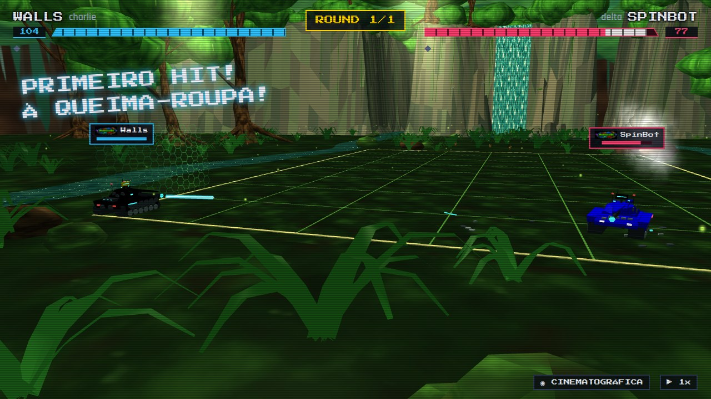
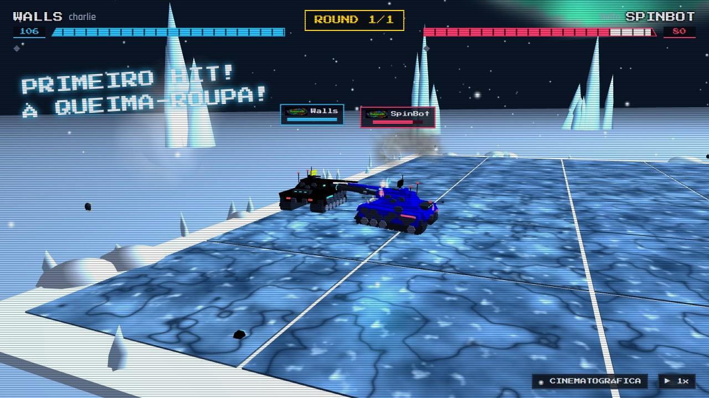
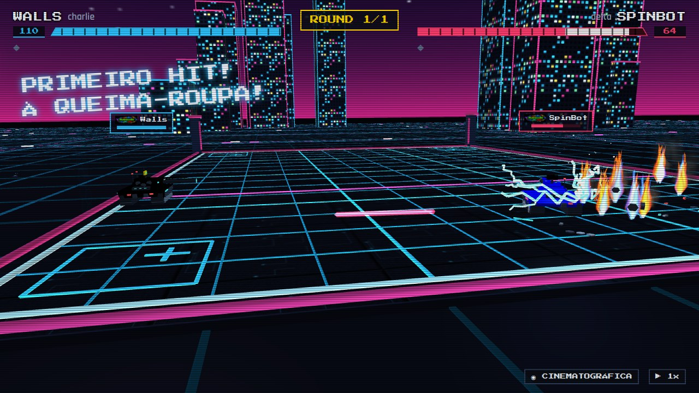
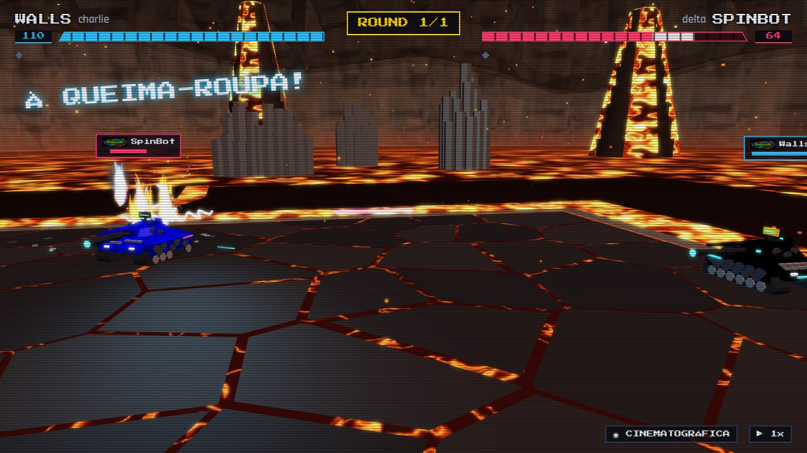
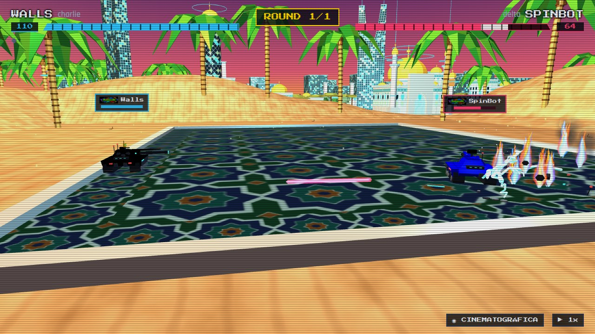
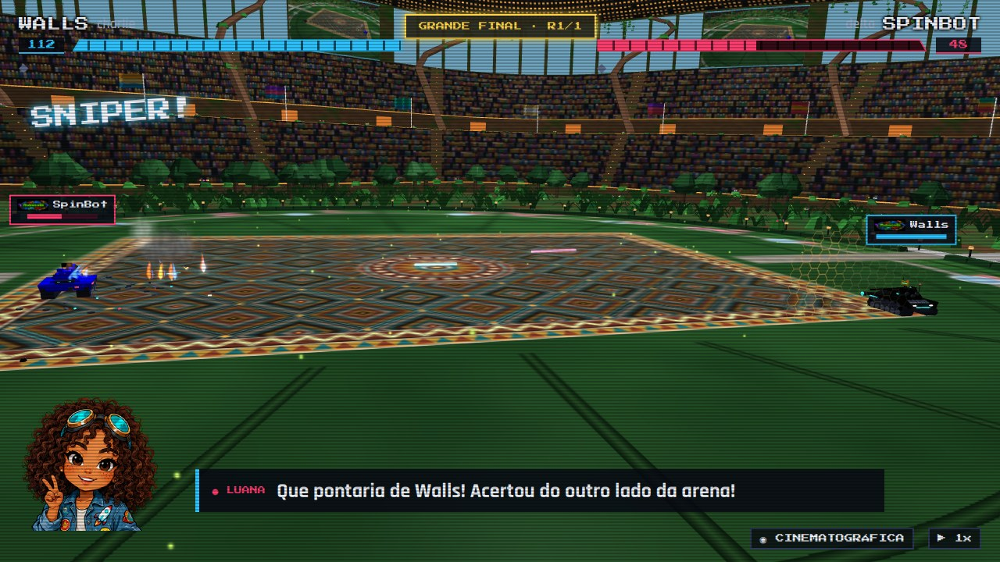

# ROBOCODE — THE GREAT BATTLE

## The story of a world that chose to compete so as not to destroy itself

> [Versão em português](HISTORIA.md) · [Back to the README](../README.en.md)

This is the backstory of the **Robocode Championship Manager**: the world where the battles take place, who the presenters are, and why each arena is where it is.

## Contents

1. [The world before Robocode](#1-the-world-before-robocode)
2. [A peace by force](#2-a-peace-by-force)
3. [Rebuilding the planet](#3-rebuilding-the-planet)
4. [Human nature and the need for conflict](#4-human-nature-and-the-need-for-conflict)
5. [The birth of Robocode](#5-the-birth-of-robocode)
6. [A truly international competition](#6-a-truly-international-competition)
7. [The African governance of Robocode](#7-the-african-governance-of-robocode)
8. [The characters of Robocode](#8-the-characters-of-robocode)
9. [The arenas of Robocode](#9-the-arenas-of-robocode)
10. [The grand final](#10-the-grand-final)
11. [What Robocode means](#11-what-robocode-means)

---

## 1. The world before Robocode

For centuries, humanity was marked by political conflicts, territorial disputes, economic interests and wars between nations. Even as science and technology advanced, the human ability to build ever more sophisticated instruments of destruction kept being used in confrontations that threatened the stability of societies and the very existence of Earth's ecosystems.

Until the middle of the 22nd century, wars were still one of the main threats to the continuity of civilization. Environmental degradation, the destruction of cities and the displacement of people caused by the conflicts put the planet's future at risk.

That began to change in 2150.

## 2. A peace by force

In 2150, African nations, after a long period of independent scientific and technological development, reached an unprecedented technological breakthrough.

The new technology gave these nations enough capacity to set limits on the military powers that had historically fomented and sustained international conflicts.

Countries such as the United States, European nations, Israel and other military powers were forced to give up conventional war.

It was not simply a diplomatic agreement or a spontaneous change in international relations. It was a new geopolitical arrangement in which the continuation of wars was no longer an acceptable possibility.

Peace became a mandatory condition.

From then on, the African nations took a central role in keeping this new world order. The technology they had developed began to be distributed internationally, but its use depended on preserving peace.

Access to the technology depended on each nation's commitment to international stability.

## 3. Rebuilding the planet

With conventional wars interrupted, a global environmental recovery became possible.

Cities that had been degraded began to be rebuilt. Destroyed ecosystems went through restoration. Natural areas regained part of their biodiversity, while new technologies allowed more sustainable ways of living.

Humanity turned its scientific and technological efforts to healing the planet.

Restoring natural environments, recovering cities and protecting animals became fundamental to this new stage of civilization.

For the first time in a long while, humanity had the conditions to build a future in which technological development and environmental preservation could coexist.

However, the absence of wars brought an unexpected question.

## 4. Human nature and the need for conflict

Over the years, researchers from many fields reached a conclusion that caused intense debate: human nature has a deeply conflictual dimension.

Rivalry, competition, the desire to excel and the need to face opponents were still present in societies, even after conventional wars ended.

Peace had eliminated the destruction caused by military conflict, but it had not eliminated the human drive to compete and confront.

A fundamental problem appeared: how could humanity express its competitive nature and its fighting spirit without putting civilization itself at risk again?

The solution had to preserve what had been achieved since 2150.

Going back to war, destroying cities, harming ecosystems or endangering human and animal lives would not be acceptable.

A new form of war was needed.

A war in which the conflict could exist without its consequences falling on the real world.

## 5. The birth of Robocode

In this context, Robocode was born.

Robocode began as an international system of battles between automated combat robots, built to give humanity a way to express its competitive spirit and its warlike tendencies without causing real destruction.

The battles take place in purpose-built arenas, protected by force fields that mark out the combat areas and stop the confrontations from harming the outside environment.

The fighters are robotic war tanks, automated machines controlled by artificial intelligence systems and by programs written by specialized teams.

The name Robocode itself captures the essence of the competition: robots whose fighting ability depends directly on the code that controls them.

The battles are not mere visual simulations. The robots fight real confrontations within the limits set by the system, using their strategies, mechanical capabilities and computational intelligence.

The result depends on the combination of mechanical engineering, software development, artificial intelligence and strategy.

So humanity found a way to keep the symbolic experience of war without reproducing its destructive consequences.

Robocode became a release valve for the human fighting spirit.

## 6. A truly international competition

As Robocode took hold, countries and continents began to organize their own competition teams.

Each team brings together professionals in two major areas: mechanical engineering and software development.

The mechanical engineers build, configure and optimize the robots. The software developers write the algorithms, strategies and artificial intelligence systems that decide how the machines behave during the battles.

The robots look alike on the outside because an international set of rules sets standards for their appearance and external configuration.

These rules guarantee fair conditions and keep physical differences from compromising the integrity of the system.

Inside, however, the robots can use very different technologies.

Each team is free to develop its own technological solutions, software architectures, computational strategies and mechanical configurations, as long as it follows the official rules.

This technological diversity is one of the key traits of Robocode.

Behind machines that look alike there are different engineering philosophies, strategies and approaches to artificial intelligence.

The result is a competition where creativity and the capacity to innovate matter as much as the ability to win a battle.

## 7. The African governance of Robocode

Although teams from different countries and continents take part, the international administration of Robocode stays with the African nations.

They run the system, control its infrastructure and make sure the rules are respected.

This responsibility comes directly from the role the African nations played in building and keeping world peace since 2150.

The aim of this administration is not to favor certain teams or continents, but to make sure the competition stays within the established limits.

African people also have a strong presence in Robocode culture.

Most of the narrators, commentators and professionals who present the battles are of African origin. This presence stands for the cultural participation of African societies in building and maintaining the international competition system.

It is important to stress that this administrative responsibility does not mean African teams lead or dominate the competitions. Participants from every continent compete under regulated conditions.

Robocode belongs to humanity, although its infrastructure and governance are in African hands.

## 8. The characters of Robocode

As it grew into an international phenomenon, Robocode developed its own culture of broadcasting and following the battles.

Its characters play different roles in this universe and help turn the fights into sporting and cultural events.

Among the figures in the broadcasts are:

| | Presenter | Role in the broadcast |
|---|---|---|
|  | **Kayodê** | Opens and closes the rounds, announces knockouts and presents historic moments of the competitions. |
|  | **Benê** | Specialist in statistics, performance analysis, accuracy and exceptional results. |
|  | **Zuri** | Follows collisions, impacts against the walls and situations about enforcing the rules. |
|  | **Dandara** | Comments on blows, critical damage and attack sequences. |
|  | **Luana** | Specialist in long-distance shots, cancelled shots and the accuracy of aiming systems. |
|  | **Caio** | Follows who is in the lead, the comebacks and the overall course of the fights. |
|  | **Nala** | Comments on fire, danger and high-intensity moments, including double knockouts. |

These characters give the broadcasts an identity and help build a language of their own for the show. In the program, they appear the same number of times over each championship.

## 9. The arenas of Robocode

To host the competitions, **six arenas** were built in different regions of the planet.

Each arena has its own environmental and visual traits, standing for a different relation between technology, nature and civilization. Each one also follows, in its scenery and its music, what is typical of its region.

The arenas are not just physical spaces for the fights. They also stand for different views of the world that appeared after 2150.

| Arena | Where it is |
|---|---|
| Tropical Forest | Latin America |
| Glacial Tundra | The far north, in Russia |
| Neon Grid | Asia (Japan and China joined as one region) |
| Volcanic Forge | Hawaii |
| Middle East Sands | The Middle East |
| Solar Eden | Central Africa, near today's Congo |

### 9.1. Tropical Forest — Latin America

In Latin America, the Tropical Forest stands for the recovery of the planet's great natural ecosystems. After winning real independence, the Latin American countries joined into a single bloc, restored their biomes and became leading suppliers of advanced biotechnology and bioengineering.

The arena sits in dense vegetation, monumental trees, rivers, waterfalls that fall from walls of damp rock, and a great diversity of animals.

The scenery stands for the importance of preserving biodiversity and the possibility of rebuilding natural environments that had suffered from degradation.

The animals of this environment are monkeys and birds.

During the battles, the animals stay outside the combat area and run away when frightened by the shots and explosions.

The Tropical Forest symbolizes the recovery of nature and the need to preserve what humanity almost lost.

### 9.2. Glacial Tundra — the far north, Russia

In the far north, in Russia, the Glacial Tundra is a world of ice, snow and low temperatures. After the Peace Revolution, led by the African countries, the polar ice formed again, and the arena was built on it.

The arena has ice crystal formations, frozen surfaces and landscapes that recall the vastness of polar environments.

The aurora borealis adds a visual signature to the scene.

The environment also shelters animals adapted to polar conditions, including the penguins in the arena's visual representation.

The Glacial Tundra stands for the diversity of natural environments and the human ability to build competition spaces in extreme regions.

### 9.3. Neon Grid — Asia

In Asia, the Neon Grid stands for the relation between technological development, urbanization and innovation. After the movements to unify the Asian peoples, Japan and China became a single region, and the arena sits in one of its metropolises.

Its scenery is a futuristic city, with advanced architecture, neon lighting, roads and light cars among the buildings, and technology built into the urban setting. Beetles run along the edges of the grid.

The arena stands for a society where technology has reached very high levels, but where competition is still an important expression of human culture.

The Neon Grid symbolizes technological creativity and the ability to turn the urban environment into a space of innovation and competition.

### 9.4. Volcanic Forge — Hawaii

In Hawaii, the Volcanic Forge is a geological setting shaped by volcanic activity. After the struggles for the islands' independence, the Hawaiian people began to draw geothermal energy from the volcanoes with technology of their own: the "volcanic forge".

The arena has basalt formations, lava lakes and rivers, cliffs, caves with glowing fungi, and volcanoes that make a scene of great visual intensity.

The environment stands for humanity living with the forces of the planet.

Salamanders and bats are the fauna of this setting. As in the other arenas, the animals stay protected from the fights.

The Volcanic Forge symbolizes transformation, resilience and the ability to develop technology even in extreme natural environments.

### 9.5. Middle East Sands

After the defeat and containment of the countries that promoted war in the region, the Middle East returned to its days of glory. It developed medicine, mathematics and other technologies, and in peace art, architecture and harmony with the environment flourished.

The arena is a courtyard of zellij tiles surrounded by dunes and oases, in front of a futuristic city of Islamic architecture, with pointed arches, domes, minarets and city gates, under a sunset. Scorpions walk on the sand around the courtyard.

The Middle East Sands symbolize the return of a tradition of knowledge, now in harmony with the environment.

### 9.6. Solar Eden — Central Africa

Solar Eden is the **sixth and last arena** of Robocode and has a special meaning: it is the place chosen to host the grand final of the championship.

In central Africa, near today's Congo, this arena has a solarpunk look, in which technology and nature finally reached a relation of complementary harmony. After leading the world peace revolution, Africa, rich in minerals and natural resources, went through a great surge of local development.

Its architecture combines technological infrastructure, renewable energy sources, abundant vegetation, gardens built into the buildings and preserved natural spaces. The arena is a stadium with mossy walls, open to a stormy sky, with glowing baobabs, surrounded by an African solarpunk city.

The environment stands for a society that stopped treating technological development and environmental preservation as incompatible goals.

In Solar Eden, technology does not replace nature, and nature is not an obstacle to technological development.

Both are parts of one system.

The arena symbolizes the most important result of the changes begun in 2150: the possibility of building a technologically advanced civilization that also respects and preserves the planet.

For this reason, Solar Eden was chosen to host the grand final of Robocode.

The last battle of an international championship takes place on the very continent responsible for building and keeping world peace.

## 10. The grand final

The grand final is the most important moment of every championship.

After fights held in different arenas between teams from many countries and continents, the finalists arrive at Solar Eden.

The setting of the final contrasts with the earlier ones.

In the Tropical Forest, nature stands for the recovery of ecosystems. In the Glacial Tundra, humanity shows it can live with extreme environments. In the Neon Grid, technology stands for urban innovation. In the Volcanic Forge, natural forces symbolize transformation and resilience. In the Middle East Sands, ancient knowledge flourishes in peace.

In Solar Eden, these views find a synthesis: technology and nature coexist in harmony.

This is where the decisive confrontation happens.

The robots enter the arena, the systems are prepared and the teams wait for the battle to start.

The result will be decided by the strategies, the engineering and the code written by the competitors.

The competition stays intense, but the surrounding environment stays preserved.

The battle happens, while life goes on.

## 11. What Robocode means

Robocode is one of the greatest paradoxes of human civilization.

After centuries of war, humanity found a way to keep competing through mechanized battles and artificial intelligence systems.

The competitive drive did not disappear. It was redirected.

The rivalry between nations still exists, but now it shows itself through engineering, programming, creativity and computational intelligence.

The teams compete to show they can build better machines and write better algorithms.

The spectators follow the battles, the narrators turn events into spectacle and the teams seek international recognition.

Yet there is a fundamental difference between the earlier world and the world of Robocode.

The battles do not have to destroy cities, harm ecosystems or put human lives at risk.

Humanity found a way to satisfy its competitive spirit without sacrificing what took centuries to preserve.

Robocode does not mean the disappearance of human conflict.

It is an attempt to live with it in a different way.

And while the robots keep fighting inside their arenas, the planet stays alive outside.

**ROBOCODE — THE GREAT BATTLE.**

**The competition goes on. Humanity remains. The planet lives.**
