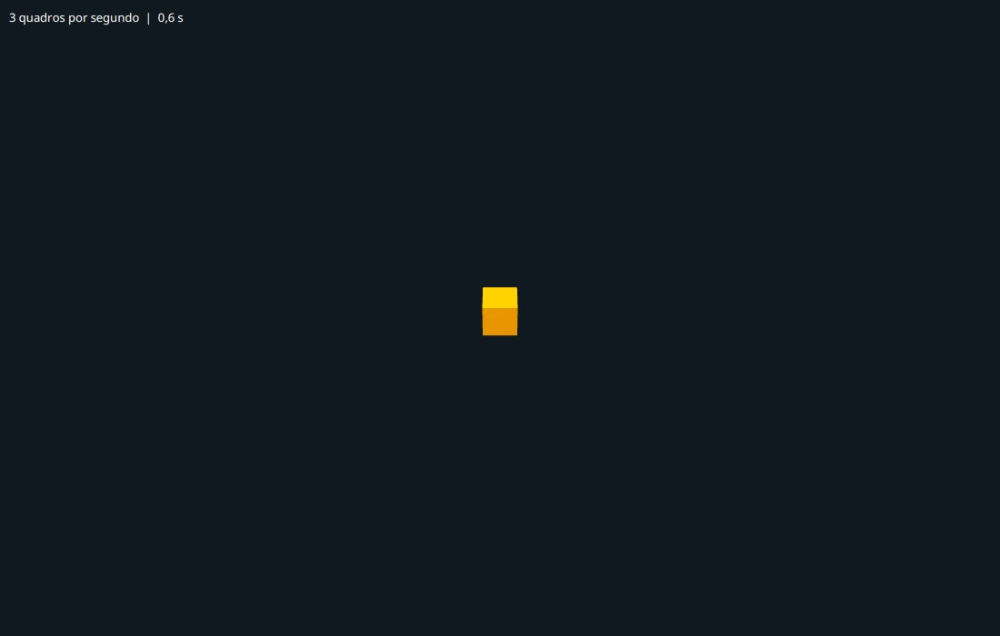
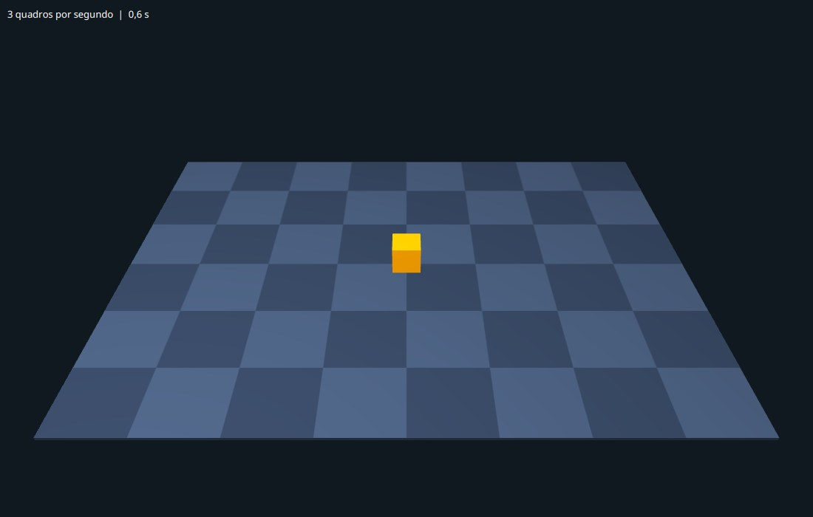
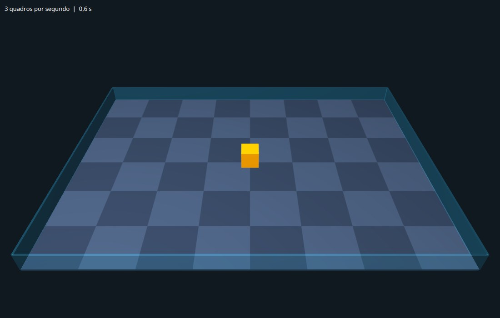
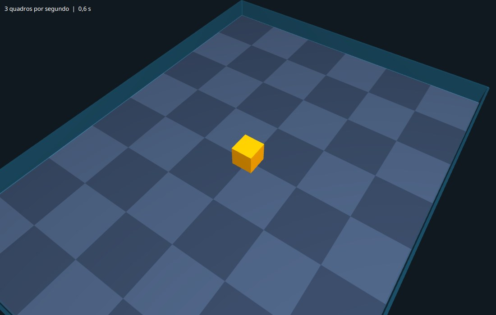

# Capítulo 2 — O mundo em 3D

## Objetivo

Dar uma terceira dimensão à arena: uma cena 3D com câmera, luz, um chão de tabuleiro e uma cerca de vidro, e uma câmera que você gira com o mouse. No fim do capítulo há um cubo no lugar onde, mais tarde, ficará o primeiro tanque.

## Passo 1 — Os eixos do mundo 3D

Uma cena 3D é um espaço com três eixos. Para dizer onde uma coisa está, usamos três números: `x`, `y` e `z`. No JavaFX, os eixos apontam assim:

```text
           x  →  (direita)
        ┌──────────────────────
        │ ╲
        │   ╲   z  (para dentro da tela)
      y │
        ↓  (para baixo)
```

O que mais surpreende é o `y`: ele cresce **para baixo**, como nas coordenadas de tela, e não para cima, como no gráfico que você aprendeu na escola. O `z` cresce para longe de você, para dentro da tela.

Tudo no nosso programa segue esta convenção:

- O **chão** é o plano `y = 0`.
- O que está **acima** do chão tem `y` **negativo**. Um cubo de 40 de altura pousado no chão tem o centro em `y = -20`.
- O centro da arena é o ponto `(0, 0, 0)`.

Guarde isso: quando o Robocode disser que um tanque está "mais ao norte", o nosso programa vai pôr o tanque em um `z` maior, e a altura do tanque será sempre um número negativo.

## Passo 2 — Uma câmera que gira em volta da arena

Para ver uma cena 3D é preciso uma **câmera**. A nossa vai ficar numa classe própria, a `CameraOrbital`, porque ela vai ter comportamento: girar, subir, aproximar. Ela fica no pacote `campeonato.cena`. **Crie o arquivo** `src/main/java/campeonato/cena/CameraOrbital.java`:

<!-- arquivo: src/main/java/campeonato/cena/CameraOrbital.java | criar -->
```java
package campeonato.cena;

import javafx.scene.PerspectiveCamera;
import javafx.scene.transform.Rotate;
import javafx.scene.transform.Translate;

/** Uma câmera que gira em volta de um ponto, como um satélite em órbita. */
public class CameraOrbital {

    private final PerspectiveCamera camera = new PerspectiveCamera(true);
    private final Translate foco = new Translate(0, -10, 0);
    private final Rotate giro = new Rotate(0, Rotate.Y_AXIS);
    private final Rotate inclinacao = new Rotate(-38, Rotate.X_AXIS);
    private final Translate afastamento = new Translate(0, 0, -900);

    public CameraOrbital() {
        camera.setFieldOfView(45);
        camera.setNearClip(5);
        camera.setFarClip(30000);
        camera.getTransforms().addAll(foco, giro, inclinacao, afastamento);
    }

    public PerspectiveCamera camera() {
        return camera;
    }
}
```

Uma `PerspectiveCamera` enxerga como o olho: o que está longe parece menor. O `true` do construtor fixa o "olho" da câmera na origem do espaço *dela*, e a [documentação](https://openjfx.io/javadoc/21/javafx.graphics/javafx/scene/PerspectiveCamera.html) recomenda esse modo quando a câmera vai se mover. Por padrão a câmera olha ao longo do eixo `z`, para dentro da tela.

O ponto central é `getTransforms()`. Uma **transformação** muda a posição ou a orientação de um nó, e podemos empilhar várias. A câmera nasce em `(0, 0, 0)`, olhando para `+z`. A lista `foco, giro, inclinacao, afastamento` deve ser lida **de trás para a frente**, como uma sequência de gestos aplicados à câmera:

1. `afastamento`: empurra a câmera 900 unidades para trás (`z = -900`). Agora ela está atrás da origem, olhando para ela.
2. `inclinacao`: gira o conjunto em torno do eixo `x` por -38 graus. A câmera sobe e passa a olhar a arena de cima. (Ângulo negativo = para cima, pela convenção do `y`.)
3. `giro`: gira em torno do eixo `y` (o eixo vertical). É o que faz a câmera dar a volta na arena.
4. `foco`: desloca tudo para o ponto que queremos olhar, um pouquinho acima do chão (`y = -10`).

Como o giro e a inclinação rodam a câmera **junto com** o seu afastamento, ela continua olhando para o foco, qualquer que seja o ângulo. É o mesmo que prender uma câmera na ponta de um cabo de 900 unidades e girar o cabo.

Faltam os movimentos. **Acrescente ao final da classe**:

<!-- arquivo: src/main/java/campeonato/cena/CameraOrbital.java | acrescentar -->
```java
    /** Gira em volta do foco, em graus: valor positivo gira a arena para a direita. */
    public void girar(double graus) {
        giro.setAngle(giro.getAngle() + graus);
    }

    /** Sobe ou desce a câmera. A inclinação vai de -85 (vista de cima) a -5 (quase na altura do chão). */
    public void inclinar(double graus) {
        inclinacao.setAngle(Math.max(-85, Math.min(-5, inclinacao.getAngle() + graus)));
    }

    /** Aproxima (fator menor que 1) ou afasta (fator maior que 1), sem passar dos limites. */
    public void aproximar(double fator) {
        afastamento.setZ(-Math.max(150, Math.min(2500, -afastamento.getZ() * fator)));
    }
```

`Math.max(a, Math.min(b, valor))` é a forma de **limitar** um valor ao intervalo de `a` até `b`. Sem esse limite, você poderia girar a câmera para baixo do chão ou atravessar a arena.

<!-- compilar -->

## Passo 3 — A cena 3D e um cubo

Agora a `Arena3D` passa a ter um mundo. Duas ideias novas:

- O **mundo** é um `Group`, um nó que só serve para agrupar outros. Dividimos o mundo em três **camadas**: `chao`, `robos` e `cerca`. A ordem dos filhos de um grupo é a ordem em que o JavaFX os desenha, e isso vai importar quando houver coisas transparentes (passo 6).
- Uma `SubScene` é uma "cena dentro da cena": um retângulo da tela onde cabe um mundo 3D. Ela deixa misturar o 3D com os textos e as barras 2D que virão por cima.

Primeiro os `import`. **No topo do arquivo** `Arena3D.java`, junto dos outros:

<!-- arquivo: src/main/java/campeonato/cena/Arena3D.java | importar -->
```java
import javafx.scene.Group;
import javafx.scene.SceneAntialiasing;
import javafx.scene.SubScene;
import javafx.scene.paint.PhongMaterial;
import javafx.scene.shape.Box;
```

**Acrescente ao final da classe** os campos do mundo:

<!-- arquivo: src/main/java/campeonato/cena/Arena3D.java | acrescentar -->
```java
    /** Camadas do mundo 3D, na ordem em que são desenhadas. */
    private final Group chao = new Group();
    private final Group robos = new Group();
    private final Group cerca = new Group();
    private final Group mundo = new Group(chao, robos, cerca);

    /** Sem private nem public, o campo é visível dentro do pacote: ajuda nos testes. */
    final CameraOrbital camera = new CameraOrbital();

    private final SubScene cena3D = new SubScene(mundo, 100, 100, true, SceneAntialiasing.BALANCED);
```

Os argumentos da `SubScene` são o conteúdo (`mundo`), um tamanho inicial (que logo vamos substituir), um `true` e um modo de suavização. O `true` liga o **buffer de profundidade** (*depth buffer*, ou z-buffer): para cada ponto da tela, o JavaFX guarda a distância do que foi desenhado ali e descarta tudo o que estiver atrás. Sem ele, o que fosse desenhado por último apareceria por cima, mesmo estando atrás. O `SceneAntialiasing.BALANCED` suaviza as bordas serrilhadas.

Agora o método que monta o mundo, com a câmera e um cubo laranja pousado no chão. **Acrescente ao final da classe**:

<!-- arquivo: src/main/java/campeonato/cena/Arena3D.java | acrescentar -->
```java
    private void montarMundo() {
        mundo.getChildren().add(camera.camera());

        Box cubo = new Box(40, 40, 40);
        cubo.setMaterial(new PhongMaterial(Color.ORANGE));
        cubo.setTranslateY(-20);
        robos.getChildren().add(cubo);
    }
```

Um `Box(40, 40, 40)` é um cubo de 40 por 40 por 40, centrado na origem. Como o `y` cresce para baixo, o `setTranslateY(-20)` o **sobe** 20 unidades, e a face de baixo do cubo, que estava em `y = 20`, fica exatamente no chão, em `y = 0`.

O `PhongMaterial` é o "material" do objeto: a cor e o modo como ele reage à luz. Falta ligar tudo no construtor. **Substitua o método** `Arena3D` (o construtor):

<!-- arquivo: src/main/java/campeonato/cena/Arena3D.java | substituir-metodo Arena3D -->
```java
    public Arena3D() {
        setStyle("-fx-background-color: #101820;");
        medidor.setTextFill(Color.WHITE);
        StackPane.setAlignment(medidor, Pos.TOP_LEFT);
        StackPane.setMargin(medidor, new Insets(10));

        montarMundo();
        cena3D.setCamera(camera.camera());
        cena3D.setFill(Color.web("#101820"));
        cena3D.widthProperty().bind(widthProperty());
        cena3D.heightProperty().bind(heightProperty());
        // a cena 3D fica embaixo e o medidor por cima
        getChildren().addAll(cena3D, medidor);

        // O relógio só roda enquanto a arena está dentro de uma janela
        sceneProperty().addListener((observavel, antiga, nova) -> {
            if (nova == null) {
                relogio.stop();
            } else {
                relogio.start();
            }
        });
    }
```

O `bind` liga uma propriedade à outra: o tamanho da `SubScene` passa a ser sempre igual ao da arena. Quando você alarga a janela, a cena 3D acompanha. Sem isso ela ficaria presa nos 100 por 100 do construtor. E `getChildren().addAll(cena3D, medidor)` empilha: o primeiro filho fica embaixo, o último fica por cima.

<!-- compilar -->
<!-- marco: 02-sem-luz -->

Rode (`mvn javafx:run`). A janela abre... e só mostra o fundo escuro e o medidor. **Cadê o cubo?** Ele está lá, mas a cena não tem nenhuma **luz**. O material reage à luz, e sem luz não há o que refletir: o cubo fica escuro e some contra o fundo.

## Passo 4 — Acender a luz

Uma cena 3D normalmente tem dois tipos de luz:

- a **luz ambiente** (`AmbientLight`) vem de todos os lados e ilumina tudo por igual. Sozinha, deixa tudo chapado, sem noção de forma;
- a **luz pontual** (`PointLight`) sai de um ponto, como uma lâmpada, e ilumina mais as faces que apontam para ela. É ela que dá volume. Vamos usá-la como "sol".

Para ela ficar acima e ao lado da arena, precisa de um `Translate`. **No topo do arquivo**:

<!-- arquivo: src/main/java/campeonato/cena/Arena3D.java | importar -->
```java
import javafx.scene.AmbientLight;
import javafx.scene.PointLight;
import javafx.scene.transform.Translate;
```

**Substitua o método** `montarMundo`:

<!-- arquivo: src/main/java/campeonato/cena/Arena3D.java | substituir-metodo montarMundo -->
```java
    private void montarMundo() {
        PointLight sol = new PointLight(Color.WHITE);
        sol.getTransforms().add(new Translate(-300, -900, -500));
        mundo.getChildren().addAll(new AmbientLight(Color.gray(0.45)), sol, camera.camera());

        Box cubo = new Box(40, 40, 40);
        cubo.setMaterial(new PhongMaterial(Color.ORANGE));
        cubo.setTranslateY(-20);
        robos.getChildren().add(cubo);
    }
```

O sol está em `(-300, -900, -500)`: um pouco à esquerda, **muito acima** (`y` negativo!) e atrás da arena, do ponto de vista da câmera. `Color.gray(0.45)` é um cinza médio; quanto maior o número, mais clara a luz ambiente.

<!-- compilar -->
<!-- marco: 02-cubo -->

Rode de novo. Um cubo laranja aparece no meio da janela, com o topo mais claro que as laterais: a luz vem de cima.



## Passo 5 — O chão

O chão será um `Box` achatado, e queremos que ele seja um tabuleiro: um padrão de quadrados claros e escuros ajuda o olho a perceber distância e movimento (sem ele, um tanque deslizando sobre uma cor lisa parece parado). Cada quadrado vai ter 100 unidades, que é também o tamanho de 100 unidades do campo do Robocode, o que ajudará a conferir posições depois.

Em vez de baixar uma imagem, vamos **desenhar a textura com código**, pixel a pixel. Uma `WritableImage` é uma imagem que podemos editar. **No topo do arquivo**:

<!-- arquivo: src/main/java/campeonato/cena/Arena3D.java | importar -->
```java
import javafx.scene.image.Image;
import javafx.scene.image.PixelWriter;
import javafx.scene.image.WritableImage;
```

**Acrescente ao final da classe**:

<!-- arquivo: src/main/java/campeonato/cena/Arena3D.java | acrescentar -->
```java
    /** O tamanho do campo de batalha do Robocode, em unidades. */
    static final double LARGURA_DO_CAMPO = 800;
    static final double ALTURA_DO_CAMPO = 600;

    private Box criarChao() {
        Box piso = new Box(LARGURA_DO_CAMPO, 4, ALTURA_DO_CAMPO);
        // o piso tem 4 de espessura: descido 2, o topo fica exatamente em y = 0
        piso.setTranslateY(2);
        PhongMaterial material = new PhongMaterial();
        material.setDiffuseMap(criarTabuleiro(8, 6, 100));
        piso.setMaterial(material);
        return piso;
    }

    /** Uma imagem de tabuleiro: casasX por casasZ quadrados de 'lado' pixels, de duas cores. */
    private Image criarTabuleiro(int casasX, int casasZ, int lado) {
        WritableImage imagem = new WritableImage(casasX * lado, casasZ * lado);
        PixelWriter pincel = imagem.getPixelWriter();
        for (int y = 0; y < imagem.getHeight(); y++) {
            for (int x = 0; x < imagem.getWidth(); x++) {
                boolean clara = (x / lado + y / lado) % 2 == 0;
                pincel.setColor(x, y, clara ? Color.web("#3a4a63") : Color.web("#2b384d"));
            }
        }
        return imagem;
    }
```

Como funciona o tabuleiro: `x / lado` é uma divisão **inteira**, que dá o número da coluna do quadrado onde o pixel está (os pixels 0 a 99 dão 0, de 100 a 199 dão 1, e assim por diante). Somando a coluna e a linha e olhando se o resultado é par (`% 2 == 0`), os quadrados vizinhos alternam de cor.

O `setDiffuseMap` pede ao material que use a imagem como cor de cada ponto do objeto. O JavaFX estica a imagem sobre a face de cima do `Box`, e como o piso tem 800 por 600 e a imagem também, cada pixel da imagem cobre uma unidade do campo.

Agora o chão entra no mundo. **Substitua o método** `montarMundo`:

<!-- arquivo: src/main/java/campeonato/cena/Arena3D.java | substituir-metodo montarMundo -->
```java
    private void montarMundo() {
        PointLight sol = new PointLight(Color.WHITE);
        sol.getTransforms().add(new Translate(-300, -900, -500));
        mundo.getChildren().addAll(new AmbientLight(Color.gray(0.45)), sol, camera.camera());

        chao.getChildren().add(criarChao());

        Box cubo = new Box(40, 40, 40);
        cubo.setMaterial(new PhongMaterial(Color.ORANGE));
        cubo.setTranslateY(-20);
        robos.getChildren().add(cubo);
    }
```

<!-- compilar -->
<!-- marco: 02-chao -->



## Passo 6 — A cerca de vidro

No Robocode, os tanques não saem do campo: há paredes. No nosso 3D, elas serão um vidro azulado em volta do tabuleiro. Para isso precisamos de um material **transparente**, e é aqui que o JavaFX 3D guarda duas armadilhas.

**Armadilha 1: a ordem de desenho.** O JavaFX não ordena os objetos por distância. Ele desenha na ordem em que estão na árvore. Um objeto transparente guarda sua profundidade como qualquer outro, então tudo o que for desenhado **depois** dele e estiver **atrás** dele é descartado pelo buffer de profundidade, como se o vidro fosse de concreto. Por isso o grupo `cerca` é o último do mundo: os objetos transparentes entram por último.

**Armadilha 2: o alfa da cor.** O alfa é a opacidade de uma cor, de 0 (invisível) a 1 (sólida). Seria natural escrever `new PhongMaterial(Color.web("#2ec4ff", 0.22))` para obter um azul quase transparente. No JavaFX 21.0.12 que usamos, o resultado não é um vidro: o objeto fica mais **claro**, lavado, e não deixa ver o que está atrás. O que funciona é o alfa dos **pixels da textura**. Então fazemos uma textura de um único pixel, azul e quase transparente, e a usamos como mapa do material.

**Acrescente ao final da classe**:

<!-- arquivo: src/main/java/campeonato/cena/Arena3D.java | acrescentar -->
```java
    /** Quatro paredes de vidro em volta do campo, de 40 de altura. */
    private Group criarCerca() {
        PhongMaterial vidro = new PhongMaterial();
        WritableImage pixel = new WritableImage(1, 1);
        pixel.getPixelWriter().setColor(0, 0, Color.web("#2ec4ff", 0.22));
        vidro.setDiffuseMap(pixel);

        Group paredes = new Group();
        for (int lado = -1; lado <= 1; lado += 2) {
            Box norteSul = new Box(LARGURA_DO_CAMPO, 40, 4);
            norteSul.setTranslateY(-20);
            norteSul.setTranslateZ(lado * ALTURA_DO_CAMPO / 2);
            norteSul.setMaterial(vidro);

            Box lesteOeste = new Box(4, 40, ALTURA_DO_CAMPO);
            lesteOeste.setTranslateY(-20);
            lesteOeste.setTranslateX(lado * LARGURA_DO_CAMPO / 2);
            lesteOeste.setMaterial(vidro);

            paredes.getChildren().addAll(norteSul, lesteOeste);
        }
        return paredes;
    }
```

O laço roda duas vezes, com `lado` valendo -1 e depois +1: cada volta cria as duas paredes de um mesmo lado (norte ou sul, leste ou oeste) multiplicando o `lado` pela metade do campo. Os quatro blocos usam o mesmo material.

**Substitua o método** `montarMundo`:

<!-- arquivo: src/main/java/campeonato/cena/Arena3D.java | substituir-metodo montarMundo -->
```java
    private void montarMundo() {
        PointLight sol = new PointLight(Color.WHITE);
        sol.getTransforms().add(new Translate(-300, -900, -500));
        mundo.getChildren().addAll(new AmbientLight(Color.gray(0.45)), sol, camera.camera());

        chao.getChildren().add(criarChao());
        cerca.getChildren().add(criarCerca());

        Box cubo = new Box(40, 40, 40);
        cubo.setMaterial(new PhongMaterial(Color.ORANGE));
        cubo.setTranslateY(-20);
        robos.getChildren().add(cubo);
    }
```

<!-- compilar -->
<!-- marco: 02-cerca -->



## Passo 7 — Girar a câmera com o mouse

Falta poder olhar a arena de outros ângulos. Vamos tratar três eventos do mouse: **apertar** (guardar onde o mouse estava), **arrastar** (girar e inclinar pelo quanto o mouse andou) e a **roda** (aproximar ou afastar). **No topo do arquivo** `CameraOrbital.java`:

<!-- arquivo: src/main/java/campeonato/cena/CameraOrbital.java | importar -->
```java
import javafx.scene.Node;
```

**Acrescente ao final da classe** `CameraOrbital`:

<!-- arquivo: src/main/java/campeonato/cena/CameraOrbital.java | acrescentar -->
```java
    /** Liga o mouse ao alvo: arrastar gira e inclina, a roda aproxima e afasta. */
    public void instalarControles(Node alvo) {
        double[] ultimo = new double[2];
        alvo.setOnMousePressed(evento -> {
            ultimo[0] = evento.getSceneX();
            ultimo[1] = evento.getSceneY();
        });
        alvo.setOnMouseDragged(evento -> {
            girar((evento.getSceneX() - ultimo[0]) * 0.4);
            inclinar((ultimo[1] - evento.getSceneY()) * 0.3);
            ultimo[0] = evento.getSceneX();
            ultimo[1] = evento.getSceneY();
        });
        alvo.setOnScroll(evento -> aproximar(Math.exp(-evento.getDeltaY() * 0.002)));
    }
```

Pontos a notar:

- Cada `setOn...` recebe uma **lambda**: o código que o JavaFX executa quando o evento acontece.
- O array `ultimo` guarda a última posição do mouse. Ele é um array, e não duas variáveis `double`, porque uma lambda só pode usar variáveis que não mudam depois de criadas; já o *conteúdo* de um array pode mudar.
- Arrastar para a direita gira a arena para a direita; arrastar para baixo **sobe** a câmera (a inclinação diminui, e lembre que menor é mais alto).
- A roda manda um `deltaY` positivo quando você a gira para a frente. A função `Math.exp(-delta * 0.002)` dá um número um pouco **menor que 1** nesse caso, e `aproximar` multiplica a distância por ele: a câmera se aproxima. Em sentido contrário, o fator fica maior que 1.

Ligue o mouse à arena. **Substitua o método** `Arena3D` (o construtor), com uma linha a mais:

<!-- arquivo: src/main/java/campeonato/cena/Arena3D.java | substituir-metodo Arena3D -->
```java
    public Arena3D() {
        setStyle("-fx-background-color: #101820;");
        medidor.setTextFill(Color.WHITE);
        StackPane.setAlignment(medidor, Pos.TOP_LEFT);
        StackPane.setMargin(medidor, new Insets(10));

        montarMundo();
        cena3D.setCamera(camera.camera());
        cena3D.setFill(Color.web("#101820"));
        cena3D.widthProperty().bind(widthProperty());
        cena3D.heightProperty().bind(heightProperty());
        camera.instalarControles(this);
        // a cena 3D fica embaixo e o medidor por cima
        getChildren().addAll(cena3D, medidor);

        // O relógio só roda enquanto a arena está dentro de uma janela
        sceneProperty().addListener((observavel, antiga, nova) -> {
            if (nova == null) {
                relogio.stop();
            } else {
                relogio.start();
            }
        });
    }
```

<!-- compilar -->
<!-- marco: 02-orbita -->

Rode e experimente: arraste com o botão do mouse apertado, gire a roda. Dê a volta na arena e veja o cubo de todos os lados.



## O que construímos

```text
src/main/java/campeonato/
├── Principal.java
└── cena/
    ├── Arena3D.java          o mundo 3D: chão, cerca, luz e o cubo de teste
    └── CameraOrbital.java    a câmera que gira com o mouse
```

## Exercícios

**Fácil**

1. Mude o tabuleiro para `16` por `12` casas de `50` pixels. A imagem continua tendo 800 por 600 pixels, então o chão fica igual, mas com quadrados menores. Troque também as duas cores.
2. Mude a cor e o tamanho do cubo, e ponha um segundo cubo, verde, em `x = 200`.

**Médio**

3. Ponha três eixos de referência na origem, finos e compridos (por exemplo `Box(150, 2, 2)`): um vermelho para o eixo `x`, um verde para o `y` e um azul para o `z`. Lembre que o `y` positivo é **para baixo**. Gire a câmera e confira a convenção do passo 1.
4. Faça a câmera começar vista pelo lado leste (gire 90 graus). Em qual método você mexeu?
5. Troque a ordem das camadas: `new Group(chao, cerca, robos)`. Incline a câmera até quase a altura do chão (arraste o mouse para cima) e olhe o cubo através da parede mais próxima. Compare com a ordem original: o que acontece com a parte do cubo que fica atrás do vidro? Volte a ordem original depois.

**Difícil**

6. Faça o cubo andar em círculo em volta do centro, num raio de 200, dando uma volta a cada 4 segundos. Guarde o cubo num campo da classe, acompanhe o tempo total e, no método `atualizar`, calcule `x = 200 * cos(ângulo)` e `z = 200 * sin(ângulo)`. É o mesmo cálculo que moverá os tanques.

## Perguntas para fixação

1. Por que o cubo foi posto em `setTranslateY(-20)` e não em `+20`? Em que lugar ficaria a face de baixo do cubo se fosse `0`?
2. Por que a cerca de vidro é o último grupo do mundo? O que aconteceria com um objeto desenhado depois do vidro e visto através dele?

<details>
<summary>Respostas</summary>

1. No JavaFX o `y` cresce para baixo, então uma altura **acima** do chão é negativa. O cubo tem 40 de altura, e o centro dele precisa estar 20 acima do chão (`-20`) para a base tocar o chão. Com `0`, o cubo ficaria metade enterrado no tabuleiro; com `+20`, ele ficaria inteiro abaixo do chão.
2. O JavaFX desenha na ordem da árvore e usa o buffer de profundidade: o vidro grava a sua profundidade como qualquer objeto sólido. O que for desenhado depois e estiver atrás dele é descartado e some, como se o vidro fosse opaco. Por isso os objetos transparentes entram por último.

</details>

No próximo capítulo o cubo vira um tanque.
