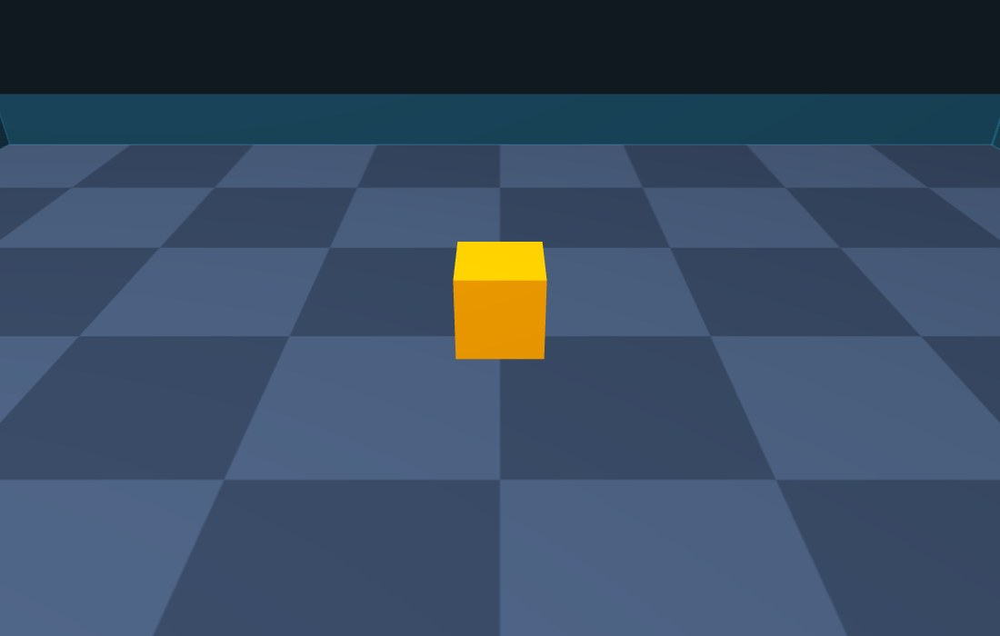
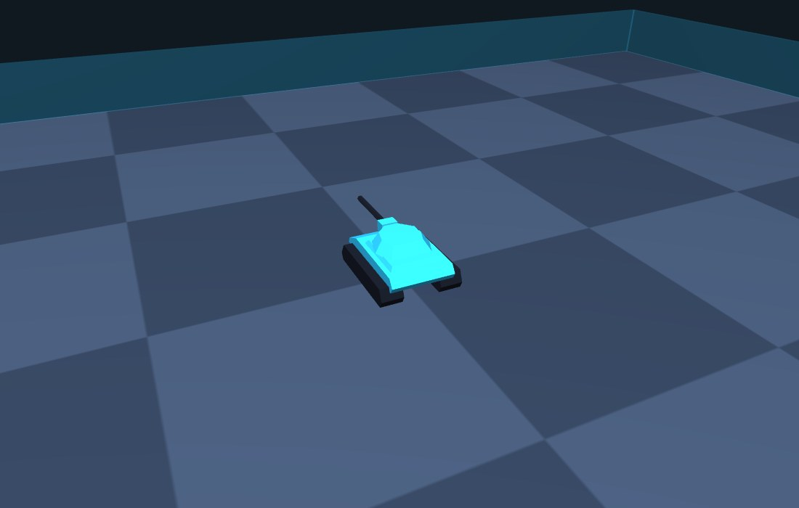
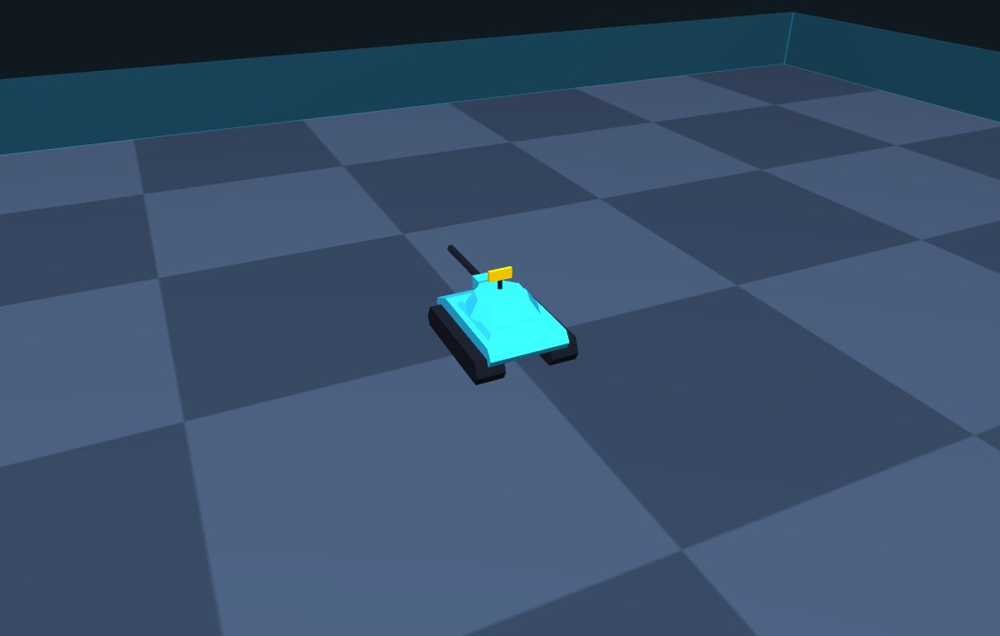
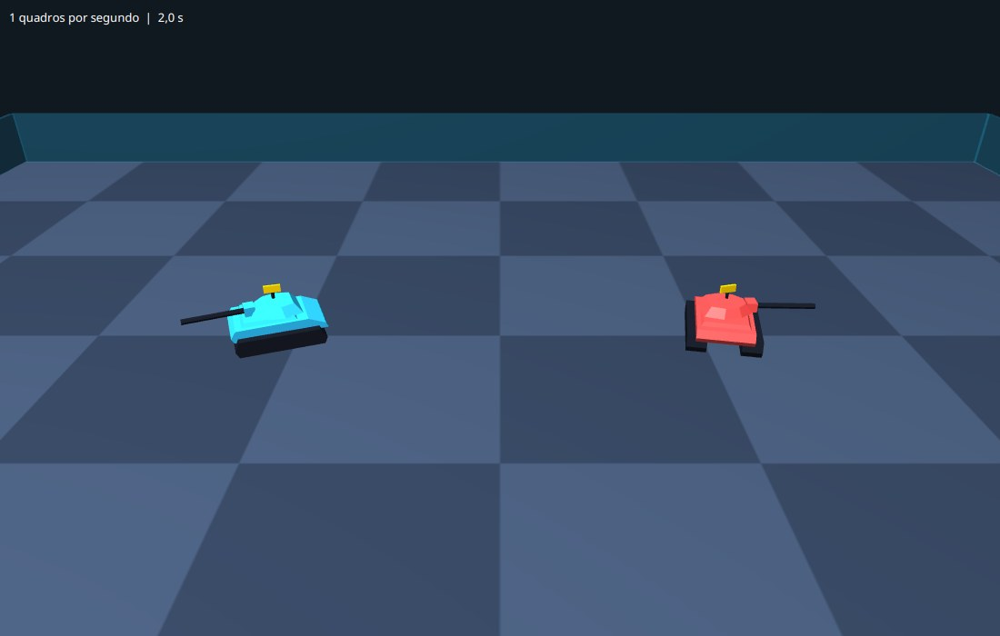

# Capítulo 3 — O tanque

## Objetivo

Trocar o cubo por um tanque de verdade, feito com as próprias mãos: um casco com esteiras, uma torre com canhão e um radar, em que a torre e o radar giram independentes do casco, como no Robocode.

## Passo 1 — Por que construir as formas à mão

O JavaFX traz formas prontas (`Box`, `Sphere`, `Cylinder`), e com elas dá para montar um tanque de caixas. Mas o resultado parece um brinquedo de blocos. Para um casco inclinado na frente, ou uma torre de lados chanfrados, precisamos desenhar a forma ponto a ponto. Toda forma 3D no computador é feita de **triângulos**, e o JavaFX tem uma classe para isso: a `TriangleMesh` (*malha de triângulos*).

Uma `TriangleMesh` guarda três listas:

| Lista | O que tem |
|---|---|
| `points` | Os pontos: três números (`x`, `y`, `z`) para cada um. |
| `texCoords` | Coordenadas de textura: dois números (`u`, `v`) para cada uma, dizendo que parte de uma imagem cai em cada ponto. Como pintaremos só com cores, usaremos uma única. |
| `faces` | Os triângulos. Cada triângulo tem **seis** números: para cada um dos três vértices, o índice do ponto e o índice da coordenada de textura. |

Veja a [documentação da `TriangleMesh`](https://openjfx.io/javadoc/21/javafx.graphics/javafx/scene/shape/TriangleMesh.html) para o formato exato. Um triângulo no nosso código será sempre assim: `faces.addAll(p0, 0, p1, 0, p2, 0)`, três pontos e a única coordenada de textura (índice 0).

Há uma regra importante: cada triângulo tem **dois lados**, o da frente e o de trás, e o JavaFX só desenha o da frente (para não gastar tempo desenhando o lado de dentro dos objetos). O lado da frente é aquele de onde se vê os três pontos em **sentido anti-horário**:

```text
    p0 ●───────────● p1          visto de frente: p0 → p1 → p2
        ╲         ╱              dá a volta em sentido anti-horário
          ╲     ╱                (a documentação chama isso de
            ╲ ╱                  regra da mão direita)
             ● p2
```

Se escrevermos os pontos na ordem errada, o triângulo aponta para dentro do sólido e **some** quando olhamos de fora. Vamos programar a classe de forma a nunca errar essa ordem.

## Passo 2 — A classe `Poligonos`: o esqueleto

A classe `Poligonos` vai acumular triângulos numa malha e, no fim, entregá-la como algo que o JavaFX sabe desenhar (um `MeshView`). **Crie o arquivo** `src/main/java/campeonato/cena/Poligonos.java`:

<!-- arquivo: src/main/java/campeonato/cena/Poligonos.java | criar -->
```java
package campeonato.cena;

import javafx.scene.paint.PhongMaterial;
import javafx.scene.shape.CullFace;
import javafx.scene.shape.MeshView;
import javafx.scene.shape.TriangleMesh;

/** Monta sólidos de faces planas (um tanque, por exemplo) numa única malha de triângulos. */
public class Poligonos {

    private final TriangleMesh malha = new TriangleMesh();

    public Poligonos() {
        // uma única coordenada de textura: pintamos com cores, não com imagens
        malha.getTexCoords().addAll(0, 0);
    }

    /** A malha como um nó que o JavaFX sabe desenhar, com o material dado. */
    public MeshView visao(PhongMaterial material) {
        MeshView visao = new MeshView(malha);
        visao.setMaterial(material);
        visao.setCullFace(CullFace.BACK);
        return visao;
    }
}
```

O `CullFace.BACK` é o ajuste que manda **não** desenhar o lado de trás dos triângulos.

## Passo 3 — Um triângulo que aponta para fora

Para qualquer triângulo, queremos que a frente aponte **para fora do sólido** de que ele faz parte. Para saber de que lado fica a frente, usamos duas contas de vetores, ambas fáceis de usar mesmo sem saber a teoria por trás:

- O **produto vetorial** de dois lados do triângulo (`u = b - a` e `v = c - a`) é um vetor perpendicular ao triângulo, a *normal*. Ele aponta para o lado da frente, e a ordem dos pontos decide qual é. As três linhas que o calculam são a fórmula; não precisa decorar.
- O **produto escalar** de dois vetores é positivo quando eles apontam mais ou menos para o mesmo lado, e negativo quando apontam para lados opostos. Comparamos a normal com o vetor que vai do **centro do sólido** até o triângulo (esse vetor sempre aponta para fora). Se o produto escalar der negativo, a normal aponta para dentro, e é só trocar dois pontos para inverter a frente.

**Acrescente ao final da classe**:

<!-- arquivo: src/main/java/campeonato/cena/Poligonos.java | acrescentar -->
```java
    /** Acrescenta um triângulo, com a frente voltada para fora do sólido que tem esse centro. */
    private void triangulo(double[] a, double[] b, double[] c, double[] centro) {
        double[] u = { b[0] - a[0], b[1] - a[1], b[2] - a[2] };
        double[] v = { c[0] - a[0], c[1] - a[1], c[2] - a[2] };
        double[] normal = { u[1] * v[2] - u[2] * v[1], u[2] * v[0] - u[0] * v[2], u[0] * v[1] - u[1] * v[0] };

        double produto = 0;
        for (int i = 0; i < 3; i++) {
            double meio = (a[i] + b[i] + c[i]) / 3;
            produto += normal[i] * (meio - centro[i]);
        }
        if (produto < 0) {
            double[] troca = b;
            b = c;
            c = troca;
        }

        int primeiro = malha.getPoints().size() / 3;
        malha.getPoints().addAll(
                (float) a[0], (float) a[1], (float) a[2],
                (float) b[0], (float) b[1], (float) b[2],
                (float) c[0], (float) c[1], (float) c[2]);
        malha.getFaces().addAll(primeiro, 0, primeiro + 1, 0, primeiro + 2, 0);
    }
```

Pontos a notar:

- Cada ponto é um `double[]` com três posições: `{x, y, z}`.
- O `meio` é o centro do triângulo (a média dos três pontos). `meio - centro` é o vetor que sai do centro do sólido e chega ao triângulo.
- `malha.getPoints().size() / 3` é quantos pontos já existem (cada ponto ocupa três números na lista); o novo triângulo usará os três índices seguintes.
- Cada triângulo ganha **três pontos só dele**, mesmo que outro triângulo tenha um ponto na mesma posição. Pode parecer desperdício, mas é o que dá ao tanque o aspecto de **faces planas**: se os triângulos vizinhos compartilhassem pontos, o JavaFX calcularia uma média entre eles e a luz suavizaria as quinas, arredondando o casco. Aqui queremos as quinas visíveis.

## Passo 4 — Sólidos e a caixa

Agora a peça central. Um **sólido** liga dois polígonos de mesmo número de pontos: o de **baixo** e o de **cima**. As faces são uma tampa embaixo, uma tampa em cima e, na lateral, um retângulo entre cada par de lados (que são dois triângulos). Para as tampas usamos um "leque" de triângulos a partir do primeiro ponto, o que funciona para polígonos **convexos** (sem reentrâncias), os únicos que precisamos.

**Acrescente ao final da classe**:

<!-- arquivo: src/main/java/campeonato/cena/Poligonos.java | acrescentar -->
```java
    /** Um sólido entre dois polígonos do mesmo tamanho: cada ponto é {x, y, z}. */
    public void solido(double[][] base, double[][] topo) {
        int n = base.length;
        double[] centro = new double[3];
        for (double[][] poligono : new double[][][] { base, topo }) {
            for (double[] ponto : poligono) {
                for (int i = 0; i < 3; i++) {
                    centro[i] += ponto[i] / (2 * n);
                }
            }
        }
        for (int i = 1; i < n - 1; i++) {
            triangulo(base[0], base[i], base[i + 1], centro);
            triangulo(topo[0], topo[i], topo[i + 1], centro);
        }
        for (int i = 0; i < n; i++) {
            int proximo = (i + 1) % n;
            triangulo(base[i], base[proximo], topo[proximo], centro);
            triangulo(base[i], topo[proximo], topo[i], centro);
        }
    }

    /**
     * Um polígono visto de cima (pontos {x, z}) levantado de yBase até yTopo. O topo é uma cópia
     * do contorno encolhida em torno do centro: escala 1 dá um prisma reto, menor que 1 inclina as laterais.
     */
    public void tronco(double[][] contorno, double yBase, double yTopo, double escalaDoTopo) {
        int n = contorno.length;
        double cx = 0;
        double cz = 0;
        for (double[] ponto : contorno) {
            cx += ponto[0] / n;
            cz += ponto[1] / n;
        }
        double[][] base = new double[n][];
        double[][] topo = new double[n][];
        for (int i = 0; i < n; i++) {
            base[i] = new double[] { contorno[i][0], yBase, contorno[i][1] };
            topo[i] = new double[] { cx + (contorno[i][0] - cx) * escalaDoTopo, yTopo, cz + (contorno[i][1] - cz) * escalaDoTopo };
        }
        solido(base, topo);
    }

    /** Uma caixa com o centro e o tamanho dados. */
    public void caixa(double cx, double cy, double cz, double tx, double ty, double tz) {
        tronco(new double[][] {
                { cx - tx / 2, cz - tz / 2 }, { cx + tx / 2, cz - tz / 2 },
                { cx + tx / 2, cz + tz / 2 }, { cx - tx / 2, cz + tz / 2 } },
                cy + ty / 2, cy - ty / 2, 1);
    }
```

A `caixa` é só um tronco de quatro pontos com escala 1. Repare que a base é `cy + ty / 2` e o topo é `cy - ty / 2`: de novo o `y` para baixo, em que a base tem o `y` **maior**.

Para ver se a malha está certa, vamos pôr uma caixa construída por nós no lugar do cubo `Box`. **Substitua o método** `montarMundo`:

<!-- arquivo: src/main/java/campeonato/cena/Arena3D.java | substituir-metodo montarMundo -->
```java
    private void montarMundo() {
        PointLight sol = new PointLight(Color.WHITE);
        sol.getTransforms().add(new Translate(-300, -900, -500));
        mundo.getChildren().addAll(new AmbientLight(Color.gray(0.45)), sol, camera.camera());

        chao.getChildren().add(criarChao());
        cerca.getChildren().add(criarCerca());

        Poligonos cubo = new Poligonos();
        cubo.caixa(0, -20, 0, 40, 40, 40);
        robos.getChildren().add(cubo.visao(new PhongMaterial(Color.ORANGE)));
    }
```

<!-- compilar -->
<!-- marco: 03-caixa -->

Rode. O cubo deve ficar **igual** ao do capítulo anterior, e agora é nosso: é a nossa malha, com as nossas contas. Se alguma face sumir, a orientação dos triângulos está invertida: confira o sinal do `produto < 0`.



## Passo 5 — Mais formas

O casco do tanque tem a frente inclinada, o canhão é um cilindro e o radar tem um mastro. Precisamos de mais três formas, todas feitas com o `solido`.

**Acrescente ao final da classe**:

<!-- arquivo: src/main/java/campeonato/cena/Poligonos.java | acrescentar -->
```java
    /** Um perfil visto de lado (pontos {z, y}) empurrado ao longo do eixo x, de x0 até x1. */
    public void prismaZY(double[][] perfil, double x0, double x1) {
        int n = perfil.length;
        double[][] primeira = new double[n][];
        double[][] segunda = new double[n][];
        for (int i = 0; i < n; i++) {
            primeira[i] = new double[] { x0, perfil[i][1], perfil[i][0] };
            segunda[i] = new double[] { x1, perfil[i][1], perfil[i][0] };
        }
        solido(primeira, segunda);
    }

    /** Um cilindro deitado ao longo do eixo z, como um cano de canhão. */
    public void cilindroZ(double cx, double cy, double raio, double z0, double z1, int lados) {
        double[][] base = new double[lados][];
        double[][] topo = new double[lados][];
        for (int i = 0; i < lados; i++) {
            double x = cx + raio * Math.cos(2 * Math.PI * i / lados);
            double y = cy + raio * Math.sin(2 * Math.PI * i / lados);
            base[i] = new double[] { x, y, z0 };
            topo[i] = new double[] { x, y, z1 };
        }
        solido(base, topo);
    }

    /** Um cilindro em pé, de y0 até y1, como o mastro do radar. */
    public void cilindroY(double cx, double cz, double raio, double y0, double y1, int lados) {
        double[][] base = new double[lados][];
        double[][] topo = new double[lados][];
        for (int i = 0; i < lados; i++) {
            double x = cx + raio * Math.cos(2 * Math.PI * i / lados);
            double z = cz + raio * Math.sin(2 * Math.PI * i / lados);
            base[i] = new double[] { x, y0, z };
            topo[i] = new double[] { x, y1, z };
        }
        solido(base, topo);
    }
```

O `prismaZY` é como cortar uma massa com um molde de lado: o perfil do casco (visto de lado, com a frente inclinada) é "empurrado" para os lados e vira um volume. Os cilindros são prismas cuja base é um polígono regular: pontos em círculo, usando `cos` e `sin` do ângulo `2π · i / lados`. Com poucos `lados` (usaremos 6, um hexágono), o cilindro mostra facetas, combinando com o resto.

<!-- compilar -->

## Passo 6 — A classe `Tanque`

A estrutura do tanque é uma **hierarquia de grupos**:

```text
raiz (a posição do tanque no chão)
 ├── corpo   casco e esteiras         gira com o ângulo do corpo
 ├── torre   torre e canhão           gira com o ângulo do canhão
 └── radar   mastro e antena          gira com o ângulo do radar
```

Os três são **irmãos**, e não um dentro do outro, de propósito. O Robocode informa, para cada turno, o ângulo **absoluto** de cada parte (em relação ao norte, e não em relação ao corpo). Com os três irmãos, cada parte recebe seu próprio ângulo, sem nenhuma conta de subtração.

**Crie o arquivo** `src/main/java/campeonato/cena/Tanque.java`, primeiro só com a estrutura e o casco:

<!-- arquivo: src/main/java/campeonato/cena/Tanque.java | criar -->
```java
package campeonato.cena;

import javafx.scene.Group;
import javafx.scene.paint.Color;
import javafx.scene.paint.PhongMaterial;
import javafx.scene.transform.Rotate;

/** Um tanque de faces planas: casco com esteiras, torre com canhão e radar. */
public class Tanque {

    private final Group raiz = new Group();
    private final Group corpo = new Group();
    private final Group torre = new Group();
    private final Group radar = new Group();
    private final Rotate giroDoCorpo = new Rotate(0, Rotate.Y_AXIS);
    private final Rotate giroDaTorre = new Rotate(0, Rotate.Y_AXIS);
    private final Rotate giroDoRadar = new Rotate(0, Rotate.Y_AXIS);

    public Tanque(Color corDoCorpo, Color corDaTorre, Color corDoRadar) {
        PhongMaterial escuro = material(Color.web("#171b26"));
        construirCorpo(material(corDoCorpo), escuro);

        corpo.getTransforms().add(giroDoCorpo);
        torre.getTransforms().add(giroDaTorre);
        radar.getTransforms().add(giroDoRadar);
        raiz.getChildren().addAll(corpo, torre, radar);
    }

    /** Uma pintura com brilho: o brilho (specular) é um reflexo claro da luz na superfície. */
    private static PhongMaterial material(Color cor) {
        PhongMaterial material = new PhongMaterial(cor);
        material.setSpecularColor(cor.brighter());
        material.setSpecularPower(24);
        return material;
    }

    /** O nó que se põe na cena. */
    public Group no() {
        return raiz;
    }

    /**
     * Põe o tanque no chão, em (x, z), com cada parte virada para o seu ângulo.
     * Os ângulos são em radianos, medidos como no Robocode: 0 aponta para +z e crescem para a direita.
     */
    public void posicionar(double x, double z, double anguloDoCorpo, double anguloDaTorre, double anguloDoRadar) {
        raiz.setTranslateX(x);
        raiz.setTranslateZ(z);
        giroDoCorpo.setAngle(Math.toDegrees(anguloDoCorpo));
        giroDaTorre.setAngle(Math.toDegrees(anguloDaTorre));
        giroDoRadar.setAngle(Math.toDegrees(anguloDoRadar));
    }
}
```

Duas palavras novas:

- `static` num método (`private static PhongMaterial material`) quer dizer que ele pertence à **classe** e não a um tanque específico: não usa nenhum campo de um tanque, então não precisa de um para ser chamado.
- `Math.toDegrees` converte radianos em graus. O Robocode entrega ângulos em **radianos** (uma volta inteira é `2π`, cerca de 6,28); o `Rotate` do JavaFX quer **graus** (uma volta é 360).

Falta o casco, `construirCorpo`. O casco é um `prismaZY` com um perfil em cunha, mais uma plataforma por cima (`tronco`); as esteiras são outro `prismaZY`, uma de cada lado, com as pontas chanfradas. **Acrescente ao final da classe**:

<!-- arquivo: src/main/java/campeonato/cena/Tanque.java | acrescentar -->
```java
    private void construirCorpo(PhongMaterial pintura, PhongMaterial escuro) {
        Poligonos casco = new Poligonos();
        casco.prismaZY(new double[][] { { -21, -7 }, { -22.5, -9.5 }, { -20, -13 }, { 14, -13.5 }, { 22, -10 }, { 23, -7.5 } }, -13.5, 13.5);
        casco.tronco(new double[][] { { -11.5, -17 }, { 11.5, -17 }, { 11.5, 9 }, { -11.5, 9 } }, -13.4, -15.2, 0.9);

        double[][] perfilDaEsteira = { { -20, -1 }, { -21.5, -4 }, { -19.5, -9 }, { 18.5, -9 }, { 21.5, -4 }, { 20, -1 } };
        Poligonos esteiras = new Poligonos();
        esteiras.prismaZY(perfilDaEsteira, 8, 17.5);
        esteiras.prismaZY(perfilDaEsteira, -17.5, -8);

        corpo.getChildren().addAll(casco.visao(pintura), esteiras.visao(escuro));
    }
```

Os números são medidas do tanque, em unidades da arena: o casco tem uns 45 de comprimento (do eixo `z`) por 27 de largura (do eixo `x`), e a frente do tanque aponta para `+z`. O perfil do casco vai de trás (z = -21) para a frente (z = 23); as alturas são negativas porque o `y` é para baixo.

Agora ponha um tanque na cena, no lugar da caixa. **Substitua o método** `montarMundo`, e **acrescente ao final da classe** o campo com o tanque azul:

<!-- arquivo: src/main/java/campeonato/cena/Arena3D.java | acrescentar -->
```java
    private final Tanque azul = new Tanque(Color.web("#2ec4ff"), Color.web("#2ec4ff"), Color.web("#ffd400"));
```

<!-- arquivo: src/main/java/campeonato/cena/Arena3D.java | substituir-metodo montarMundo -->
```java
    private void montarMundo() {
        PointLight sol = new PointLight(Color.WHITE);
        sol.getTransforms().add(new Translate(-300, -900, -500));
        mundo.getChildren().addAll(new AmbientLight(Color.gray(0.45)), sol, camera.camera());

        chao.getChildren().add(criarChao());
        cerca.getChildren().add(criarCerca());

        robos.getChildren().add(azul.no());
    }
```

<!-- compilar -->
<!-- marco: 03-casco -->

Rode e aproxime a câmera com a roda do mouse. O casco azul com as esteiras escuras aparece no meio do tabuleiro.


Agora a **torre**: uma casca de oito lados, mais larga embaixo e inclinada para cima (um `tronco` com escala 0,72), uma caixa na frente (onde o canhão sai) e o canhão, um cilindro de seis lados. **Substitua o método** `Tanque` (o construtor):

<!-- arquivo: src/main/java/campeonato/cena/Tanque.java | substituir-metodo Tanque -->
```java
    public Tanque(Color corDoCorpo, Color corDaTorre, Color corDoRadar) {
        PhongMaterial escuro = material(Color.web("#171b26"));
        construirCorpo(material(corDoCorpo), escuro);
        construirTorre(material(corDaTorre), escuro);

        corpo.getTransforms().add(giroDoCorpo);
        torre.getTransforms().add(giroDaTorre);
        radar.getTransforms().add(giroDoRadar);
        raiz.getChildren().addAll(corpo, torre, radar);
    }
```

**Acrescente ao final da classe**:

<!-- arquivo: src/main/java/campeonato/cena/Tanque.java | acrescentar -->
```java
    private void construirTorre(PhongMaterial pintura, PhongMaterial escuro) {
        Poligonos casca = new Poligonos();
        casca.tronco(new double[][] { { -9, -12 }, { 9, -12 }, { 12, -3 }, { 10, 6 }, { 4, 12 }, { -4, 12 }, { -10, 6 }, { -12, -3 } }, -14.8, -19.5, 0.72);
        casca.caixa(0, -17.4, 12, 7, 4.6, 5);

        Poligonos canhao = new Poligonos();
        canhao.cilindroZ(0, -17.2, 1.35, 12, 43, 6);

        torre.getChildren().addAll(casca.visao(pintura), canhao.visao(escuro));
    }
```

<!-- compilar -->
<!-- marco: 03-torre -->



Por fim o **radar**: um mastro fino e um painel em cima. **Substitua o método** `Tanque` (o construtor) pela versão final:

<!-- arquivo: src/main/java/campeonato/cena/Tanque.java | substituir-metodo Tanque -->
```java
    public Tanque(Color corDoCorpo, Color corDaTorre, Color corDoRadar) {
        PhongMaterial escuro = material(Color.web("#171b26"));
        construirCorpo(material(corDoCorpo), escuro);
        construirTorre(material(corDaTorre), escuro);
        construirRadar(material(corDoRadar), escuro);

        corpo.getTransforms().add(giroDoCorpo);
        torre.getTransforms().add(giroDaTorre);
        radar.getTransforms().add(giroDoRadar);
        raiz.getChildren().addAll(corpo, torre, radar);
    }
```

**Acrescente ao final da classe**:

<!-- arquivo: src/main/java/campeonato/cena/Tanque.java | acrescentar -->
```java
    private void construirRadar(PhongMaterial pintura, PhongMaterial escuro) {
        Poligonos mastro = new Poligonos();
        mastro.cilindroY(0, 0, 0.8, -24, -21, 6);
        Poligonos painel = new Poligonos();
        painel.caixa(0, -26, 0, 8, 3.6, 1.2);
        radar.getChildren().addAll(mastro.visao(escuro), painel.visao(pintura));
    }
```

<!-- compilar -->
<!-- marco: 03-radar -->



## Passo 7 — Dois tanques em exibição

Para ver as três partes girando de forma independente, vamos pôr dois tanques na arena e movê-los a cada quadro, em modo de **vitrine**: o corpo gira devagar, a torre no sentido contrário e o radar rápido. É o `atualizar` do capítulo 1 em ação, e é com ele que, mais adiante, a gravação da batalha moverá os tanques de verdade.

**Acrescente ao final da classe**:

<!-- arquivo: src/main/java/campeonato/cena/Arena3D.java | acrescentar -->
```java
    private final Tanque vermelho = new Tanque(Color.web("#ff4d4d"), Color.web("#ff4d4d"), Color.web("#ffd400"));
```

**Substitua o método** `montarMundo`:

<!-- arquivo: src/main/java/campeonato/cena/Arena3D.java | substituir-metodo montarMundo -->
```java
    private void montarMundo() {
        PointLight sol = new PointLight(Color.WHITE);
        sol.getTransforms().add(new Translate(-300, -900, -500));
        mundo.getChildren().addAll(new AmbientLight(Color.gray(0.45)), sol, camera.camera());

        chao.getChildren().add(criarChao());
        cerca.getChildren().add(criarCerca());

        robos.getChildren().addAll(azul.no(), vermelho.no());
    }
```

**Substitua o método** `atualizar`:

<!-- arquivo: src/main/java/campeonato/cena/Arena3D.java | substituir-metodo atualizar -->
```java
    /** Avança o programa em 'delta' segundos. Tudo o que se move passa por aqui. */
    void atualizar(double delta) {
        tempoTotal += delta;
        tempoDoPeriodo += delta;
        quadrosDoPeriodo++;
        if (tempoDoPeriodo >= 0.5) {
            medidor.setText(String.format("%.0f quadros por segundo  |  %.1f s", quadrosDoPeriodo / tempoDoPeriodo, tempoTotal));
            tempoDoPeriodo = 0;
            quadrosDoPeriodo = 0;
        }

        // vitrine: os dois tanques giram, cada parte no seu ritmo (radianos)
        azul.posicionar(-110, 0, tempoTotal * 0.6, -tempoTotal, tempoTotal * 3);
        vermelho.posicionar(110, 0, 1 - tempoTotal * 0.4, tempoTotal * 0.8, tempoTotal * 3);
    }
```

<!-- compilar -->
<!-- marco: 03-vitrine -->

Rode e aproxime a câmera. Os dois tanques ficam parados no lugar, mas cada um gira as três partes de forma independente: o corpo devagar, a torre contra o corpo e o radar como um carrossel.



## O que construímos

```text
src/main/java/campeonato/cena/
├── Arena3D.java        agora com dois tanques de vitrine
├── CameraOrbital.java
├── Poligonos.java      constrói sólidos de faces planas
└── Tanque.java         casco, torre e radar que giram independentes
```

## Exercícios

**Fácil**

1. Troque as cores dos dois tanques (`corDoCorpo`, `corDaTorre`, `corDoRadar`). Faça a torre de uma cor diferente do casco.
2. Deixe o canhão mais grosso e mais comprido: mude o raio e o `z1` em `cilindroZ(0, -17.2, 1.35, 12, 43, 6)`.

**Médio**

3. Acrescente ao radar uma antena fina: um `cilindroY` de raio `0.25` entre `y = -31` e `y = -27`, em `x = 3`.
4. Dê ao tanque dois faróis: duas pequenas caixas amarelas na frente do casco (`z` em torno de 22), uma de cada lado. Dica: use um laço `for (int lado = -1; lado <= 1; lado += 2)`, como no passo 6 do capítulo 2.
5. Troque o número de lados do canhão de `6` para `3`, `4` e `12`. O que muda no desenho?

**Difícil**

6. Dê ao `Tanque` um segundo tipo de casco, mais longo e mais baixo, e um parâmetro no construtor que escolha entre os dois perfis.
7. Experimente trocar a ordem dos pontos de um perfil (escrevê-los ao contrário) e confirme que o tanque continua certo. Depois, comente o teste `if (produto < 0)` no método `triangulo` e veja o que acontece. Por quê?

## Perguntas para fixação

1. Cada triângulo ganha três pontos só dele, mesmo quando vários triângulos têm um ponto na mesma posição. Que efeito isso tem na aparência do tanque, e o que aconteceria se os pontos fossem compartilhados?
2. Por que `corpo`, `torre` e `radar` são grupos irmãos, e não a torre dentro do corpo e o radar dentro da torre?

<details>
<summary>Respostas</summary>

1. Como cada face tem seus próprios pontos, a luz é calculada face por face e cada uma aparece com um tom, o que dá o aspecto de peças planas, cheias de quinas. Se os pontos fossem compartilhados e o JavaFX calculasse uma média das direções das faces vizinhas, a iluminação ficaria suave e o tanque pareceria arredondado.
2. Com a torre dentro do corpo, o ângulo da torre seria somado ao do corpo: para apontar o canhão para o norte com o corpo virado para o leste, teríamos de subtrair o ângulo do corpo. Como o Robocode informa o ângulo **absoluto** de cada parte, com os três grupos irmãos cada ângulo vai direto para o seu `Rotate`.

</details>

No próximo capítulo deixamos a arena de lado por um momento e vamos fazer o Robocode conversar com o nosso programa.
