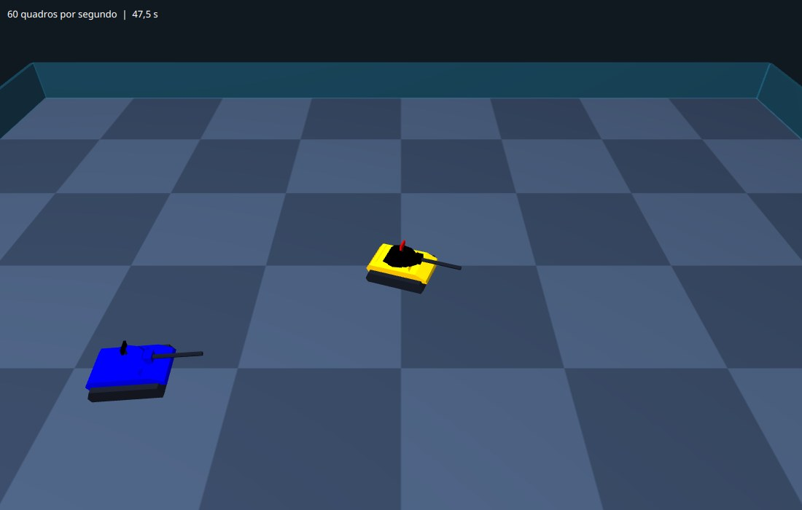
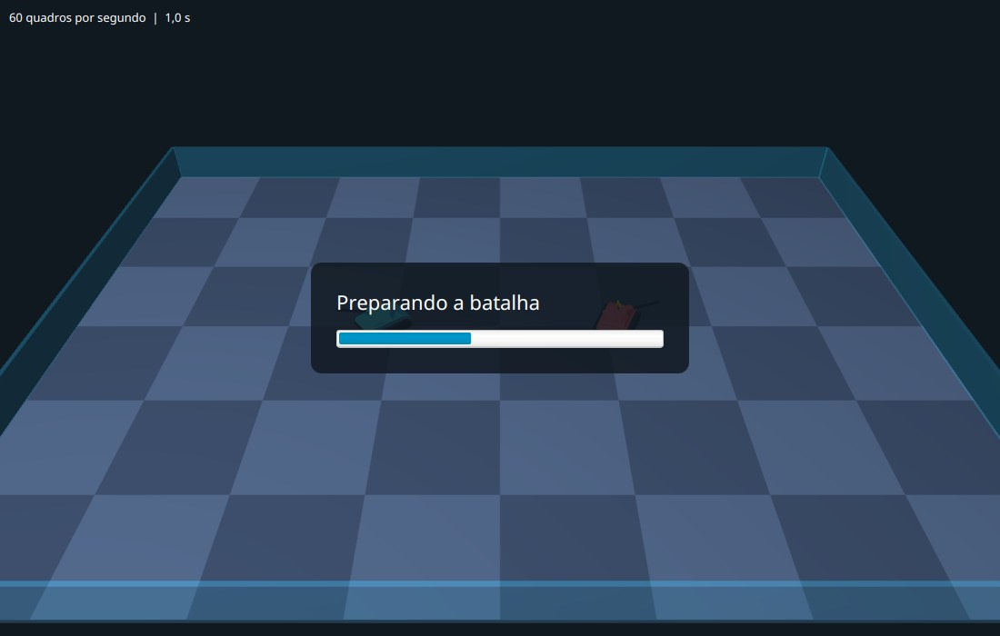
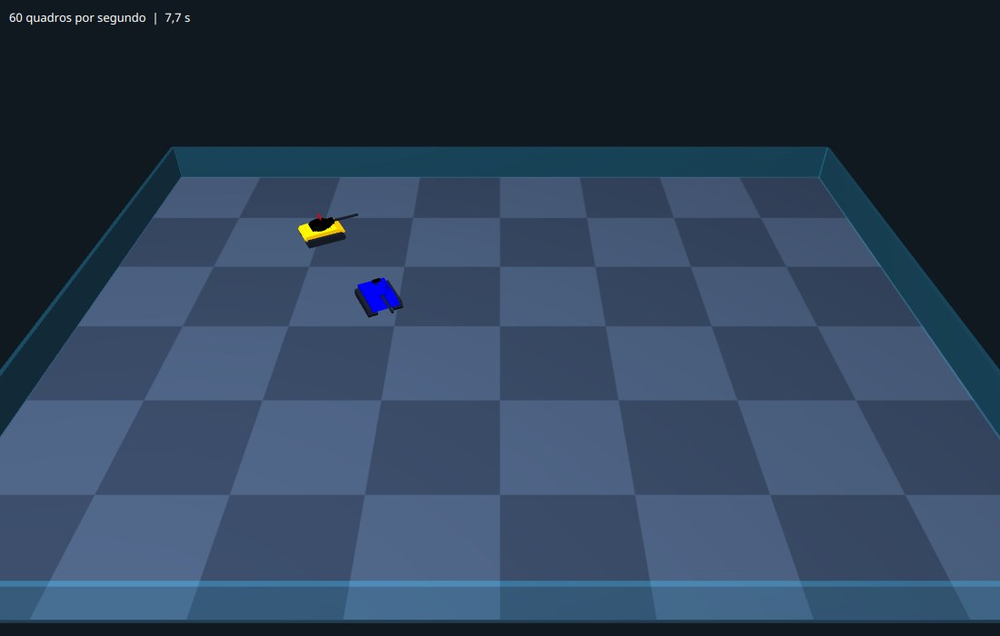

# Capítulo 6 — A batalha em movimento

## Objetivo

Reproduzir em 3D a gravação do capítulo 5: os tanques percorrem, turno a turno, o caminho que o Robocode simulou, enquanto uma barra de progresso mostra o andamento da simulação, que roda em segundo plano. No fim, o programa abre sozinho, roda uma batalha e a mostra.

## Passo 1 — Dois mapas, um mundo

O Robocode e o nosso mundo 3D descrevem posições de jeitos diferentes, e é preciso traduzir de um para o outro:

| | Robocode | Nosso mundo 3D |
|---|---|---|
| Origem | canto inferior esquerdo do campo | centro do campo |
| Direita | `x` cresce | `X` cresce |
| Norte | `y` cresce | `Z` cresce, para dentro da tela |
| Altura | não existe | `Y` cresce **para baixo** (o chão é `Y = 0`) |
| Ângulo | radianos, 0 no norte, sentido horário | o mesmo número, em graus, num `Rotate` em torno do eixo `Y` |

Atenção ao eixo `Y`, o falso amigo do 3D: na matemática que você aprendeu, o `y` do plano cresce para cima, e aqui o `Y` do JavaFX cresce **para baixo**, como as linhas de um texto. O `y` do Robocode, que é "o outro eixo do chão", vira o `Z` do nosso mundo, e o `Y` do nosso mundo fica livre para a altura.

As contas são só duas subtrações: o campo tem 800 por 600, e o centro dele, (400, 300), precisa virar a origem. O ângulo não precisa de conta nenhuma. O `Tanque` do capítulo 3 aponta para `+Z` quando o ângulo vale 0, e girar em torno do eixo `Y` com um ângulo positivo leva o `+Z` para o `+X`: do norte para o leste, que é o sentido horário visto de cima, como no Robocode.

Vamos guardar essas contas, e as da interpolação do próximo passo, numa classe que **não depende do JavaFX**. Assim os testes rodam sem abrir janela. **Crie o arquivo** `src/main/java/campeonato/cena/Geometria.java`:

<!-- arquivo: src/main/java/campeonato/cena/Geometria.java | criar -->
```java
package campeonato.cena;

/** Contas que não dependem do JavaFX: conversão de coordenadas e interpolação. */
public final class Geometria {

    private Geometria() {
    }

    /** O X do mundo para um x do Robocode. A origem do mundo é o centro do campo. */
    public static double mundoX(double x, double larguraDoCampo) {
        return x - larguraDoCampo / 2;
    }

    /** O Z do mundo para um y do Robocode, que cresce para o norte. */
    public static double mundoZ(double y, double alturaDoCampo) {
        return y - alturaDoCampo / 2;
    }
}
```

Teste. **Crie o arquivo** `src/test/java/campeonato/cena/GeometriaTest.java`:

<!-- arquivo: src/test/java/campeonato/cena/GeometriaTest.java | criar -->
```java
package campeonato.cena;

import static org.junit.jupiter.api.Assertions.assertEquals;

import org.junit.jupiter.api.Test;

class GeometriaTest {

    @Test
    void oCentroDoCampoViraAOrigem() {
        assertEquals(0, Geometria.mundoX(400, 800), 1e-9);
        assertEquals(0, Geometria.mundoZ(300, 600), 1e-9);
    }

    @Test
    void ocantoInferiorEsquerdoFicaEmMenosMetade() {
        assertEquals(-400, Geometria.mundoX(0, 800), 1e-9);
        assertEquals(-300, Geometria.mundoZ(0, 600), 1e-9);
    }

    @Test
    void ocantoSuperiorDireitoFicaEmMaisMetade() {
        assertEquals(400, Geometria.mundoX(800, 800), 1e-9);
        assertEquals(300, Geometria.mundoZ(600, 600), 1e-9);
    }
}
```

<!-- testar -->

O `1e-9` é a notação científica de 0,000000001, a tolerância da comparação de números decimais.

## Passo 2 — Entre um turno e o outro

O Robocode simula 30 turnos por segundo, e o JavaFX redesenha a tela 60 vezes por segundo. Se mostrássemos só o turno "atual", o tanque daria um salto a cada dois quadros e o movimento ficaria travado. A solução é **interpolar**: manter uma posição de turno com parte fracionária, `7,4` por exemplo, e mostrar o tanque a 40% do caminho entre o turno 7 e o turno 8.

A interpolação linear é a conta que você já viu em funções do primeiro grau: o valor a `t` do caminho entre `a` e `b` é `a + (b - a) * t`. Com `t = 0` dá `a`, com `t = 1` dá `b`, com `t = 0,4` dá 40% do caminho.

Para os **ângulos** há uma armadilha. O Robocode informa os ângulos sempre entre 0 e 2π (cerca de 6,28). Imagine o canhão girando de 6,2 radianos para 0,1 no turno seguinte: no círculo, são só 0,18 radiano de giro (6,2 → 6,28 = 0, e daí mais 0,1). Mas a interpolação linear vê o caminho de 6,2 para 0,1, no meio do qual passa por 3,15: o canhão daria **quase uma volta inteira para trás** e voltaria, a cada vez que o ângulo cruza o zero. O jeito de evitar isso é trocar a diferença `b - a` pela diferença **mais curta** entre os dois ângulos. A função `Math.IEEEremainder(x, y)` devolve o resto da divisão de `x` por `y` arredondando o quociente para o inteiro mais próximo, o que dá um resultado entre `-y/2` e `+y/2`. Com `y = 2π`, a diferença cai sempre entre `-π` e `+π`: o caminho curto. Para `b - a = -6,1`, o resultado é `0,183`.

**Acrescente ao final da classe** `Geometria`:

<!-- arquivo: src/main/java/campeonato/cena/Geometria.java | acrescentar -->
```java

    /** Um valor entre a e b: com t = 0 é a, com t = 1 é b. */
    public static double interpolar(double a, double b, double t) {
        return a + (b - a) * t;
    }

    /** Como interpolar, mas para ângulos em radianos: gira pelo caminho mais curto. */
    public static double interpolarAngulo(double a, double b, double t) {
        double diferenca = Math.IEEEremainder(b - a, 2 * Math.PI);
        return a + diferenca * t;
    }
```

E os testes. **Acrescente ao final da classe** `GeometriaTest`:

<!-- arquivo: src/test/java/campeonato/cena/GeometriaTest.java | acrescentar -->
```java

    @Test
    void interpolaEntreDoisValores() {
        assertEquals(10, Geometria.interpolar(10, 20, 0), 1e-9);
        assertEquals(14, Geometria.interpolar(10, 20, 0.4), 1e-9);
        assertEquals(20, Geometria.interpolar(10, 20, 1), 1e-9);
    }

    @Test
    void oAnguloVaiPeloCaminhoCurtoAoCruzarOZero() {
        // de 6,2 para 0,1 são só 0,183 radiano de giro: no meio do caminho, 6,2 + 0,0916
        assertEquals(6.2916, Geometria.interpolarAngulo(6.2, 0.1, 0.5), 0.001);
        // e no sentido contrário, o canhão volta pelo mesmo caminho curto
        assertEquals(0.0084, Geometria.interpolarAngulo(0.1, 6.2, 0.5), 0.001);
    }

    @Test
    void semCruzarOZeroOAnguloSeComportaComoQualquerNumero() {
        assertEquals(1.5, Geometria.interpolarAngulo(1.0, 2.0, 0.5), 1e-9);
    }
```

<!-- testar -->

No segundo teste, o resultado `6,2916` radianos é o mesmo ângulo que `0,0084`, uma volta a mais, e para girar um tanque tanto faz: o JavaFX aceita qualquer ângulo.

## Passo 3 — A cor do tanque

O Robocode informa as cores como um número inteiro ARGB (capítulo 4), e o `Tanque` quer uma `Color` do JavaFX. A conversão tira do número cada um dos quatro bytes. Um `int` tem 32 bits, que se dividem assim:

```text
AAAAAAAA RRRRRRRR GGGGGGGG BBBBBBBB      (opacidade, vermelho, verde, azul)
```

Para chegar ao vermelho, **deslocamos** os bits 16 casas para a direita com `>> 16`, o que joga fora o verde e o azul; sobra o byte do vermelho na ponta direita, mas com o byte da opacidade ainda à esquerda dele. Para ficar só com os 8 bits da direita, aplicamos uma **máscara**: `& 0xff`, que mantém apenas os 8 últimos bits (o `0xff` é 11111111 em binário). O verde faz o mesmo com `>> 8`, e o azul só precisa da máscara.

**Crie o arquivo** `src/main/java/campeonato/cena/Cores.java`:

<!-- arquivo: src/main/java/campeonato/cena/Cores.java | criar -->
```java
package campeonato.cena;

import javafx.scene.paint.Color;

/** Conversões de cor. */
public final class Cores {

    private Cores() {
    }

    /** Converte uma cor ARGB do Robocode (um int, com um byte para cada componente) em uma cor do JavaFX. */
    public static Color deArgb(int argb) {
        return Color.rgb((argb >> 16) & 0xff, (argb >> 8) & 0xff, argb & 0xff);
    }
}
```

E um teste. **Crie o arquivo** `src/test/java/campeonato/cena/CoresTest.java`:

<!-- arquivo: src/test/java/campeonato/cena/CoresTest.java | criar -->
```java
package campeonato.cena;

import static org.junit.jupiter.api.Assertions.assertEquals;

import javafx.scene.paint.Color;
import org.junit.jupiter.api.Test;

class CoresTest {

    @Test
    void separaOsTresComponentes() {
        assertEquals(Color.rgb(255, 77, 77), Cores.deArgb(0xffff4d4d));
        assertEquals(Color.rgb(46, 196, 255), Cores.deArgb(0xff2ec4ff));
    }

    @Test
    void entendeOsNumerosNegativosQueORobocodeEscreve() {
        // o laranja do Vigia, como aparece nas linhas #C
        assertEquals(Color.rgb(255, 200, 0), Cores.deArgb(-14336));
    }
}
```

<!-- testar -->

## Passo 4 — Reproduzir a gravação na arena

Agora o coração do capítulo, na `Arena3D`. Ela precisa de cinco coisas novas:

1. **Fases**: saber se está em exibição, carregando, reproduzindo, esperando a próxima rodada ou terminada.
2. **Os tanques da gravação**, um por robô, com as cores que o robô escolheu.
3. **A posição do turno**, o número com parte fracionária.
4. **`mostrarTurno`**: posicionar cada tanque no turno atual, interpolando.
5. **O relógio**: a cada quadro, avançar a posição do turno.

Primeiro, os `import`. **No topo do arquivo** `Arena3D.java`:

<!-- arquivo: src/main/java/campeonato/cena/Arena3D.java | importar -->
```java
import campeonato.robocode.Gravacao;
import java.util.HashMap;
import java.util.List;
import java.util.Map;
```

Depois, as fases e os dados da reprodução, e o método que começa a tocar uma gravação. **Acrescente ao final da classe** `Arena3D`:

<!-- arquivo: src/main/java/campeonato/cena/Arena3D.java | acrescentar -->
```java

    /** O que a arena está fazendo agora. */
    private enum Fase {
        /** Dois tanques de exibição girando, à espera de uma batalha. */
        VITRINE,
        /** A batalha está sendo simulada em segundo plano. */
        CARREGANDO,
        /** Os turnos de uma rodada estão sendo reproduzidos. */
        JOGANDO,
        /** A rodada acabou; espera um pouco antes da próxima. */
        FIM_DA_RODADA,
        /** A batalha toda foi reproduzida. */
        ENCERRADA
    }

    /** O Robocode simula 30 turnos por segundo na velocidade normal. */
    static final double TURNOS_POR_SEGUNDO = 30;

    /** Quanto a arena espera entre o fim de uma rodada e o começo da seguinte. */
    static final double SEGUNDOS_ENTRE_RODADAS = 2.5;

    private Fase fase = Fase.VITRINE;
    private Gravacao gravacao;
    private Runnable aoTerminar;
    private final Map<Integer, Tanque> tanques = new HashMap<>();
    private int rodada;
    /** O turno em que a reprodução está: a parte inteira é o turno, a fracionária é o caminho até o próximo. */
    private double posicaoDoTurno;
    private double esperaDoFimDaRodada;

    /** Começa a reproduzir a gravação. Quando a última rodada acabar, chama {@code aoTerminar} (pode ser null). */
    public void tocar(Gravacao gravacao, Runnable aoTerminar) {
        this.gravacao = gravacao;
        this.aoTerminar = aoTerminar;
        if (gravacao.rodadas().isEmpty()) {
            fase = Fase.ENCERRADA;
            return;
        }
        criarTanques();
        iniciarRodada(0);
    }

    /** Troca os tanques de exibição por um tanque para cada robô da gravação, com as cores dele. */
    private void criarTanques() {
        robos.getChildren().clear();
        tanques.clear();
        for (Gravacao.Robo robo : gravacao.robos()) {
            Tanque tanque = new Tanque(Cores.deArgb(robo.corCorpo()), Cores.deArgb(robo.corCanhao()), Cores.deArgb(robo.corRadar()));
            tanques.put(robo.indice(), tanque);
            robos.getChildren().add(tanque.no());
        }
    }

    private List<Gravacao.Turno> turnosDaRodada() {
        return gravacao.rodadas().get(rodada);
    }

    /** Volta ao primeiro turno da rodada e começa a reproduzi-la. */
    private void iniciarRodada(int numero) {
        rodada = numero;
        posicaoDoTurno = 0;
        if (turnosDaRodada().isEmpty()) {
            // uma rodada sem turnos não tem o que mostrar
            terminarRodada();
            return;
        }
        fase = Fase.JOGANDO;
        mostrarTurno();
    }
```

A `Fase` é um **enum**: um tipo cujos valores possíveis são uma lista fechada de nomes. É melhor do que usar números (`fase = 2`) ou textos, porque o compilador recusa um nome que não existe, e os nomes dizem o que significam.

Agora a parte principal, `mostrarTurno`. A posição do turno, por exemplo `412,3`, é lida assim: o turno **de baixo** é o de índice 412, o de cima é o 413, e a fração `0,3` diz a que ponto do caminho entre os dois os tanques estão. **Acrescente ao final da classe**:

<!-- arquivo: src/main/java/campeonato/cena/Arena3D.java | acrescentar -->
```java

    /** Põe cada tanque onde ele está na posição atual, no caminho entre o turno de baixo e o de cima. */
    private void mostrarTurno() {
        List<Gravacao.Turno> turnos = turnosDaRodada();
        int indice = Math.min((int) Math.floor(posicaoDoTurno), turnos.size() - 1);
        double fracao = posicaoDoTurno - indice;
        Gravacao.Turno atual = turnos.get(indice);
        Gravacao.Turno proximo = turnos.get(Math.min(indice + 1, turnos.size() - 1));

        for (Gravacao.EstadoDoRobo estado : atual.robos()) {
            Tanque tanque = tanques.get(estado.indice());
            if (tanque == null) {
                continue;
            }
            Gravacao.EstadoDoRobo depois = mesmoRobo(proximo.robos(), estado);
            tanque.posicionar(
                    Geometria.mundoX(Geometria.interpolar(estado.x(), depois.x(), fracao), gravacao.largura()),
                    Geometria.mundoZ(Geometria.interpolar(estado.y(), depois.y(), fracao), gravacao.altura()),
                    Geometria.interpolarAngulo(estado.anguloDoCorpo(), depois.anguloDoCorpo(), fracao),
                    Geometria.interpolarAngulo(estado.anguloDoCanhao(), depois.anguloDoCanhao(), fracao),
                    Geometria.interpolarAngulo(estado.anguloDoRadar(), depois.anguloDoRadar(), fracao));
            tanque.no().setVisible(!estado.morto());
        }
    }

    /** O estado do mesmo robô em outro turno, ou o próprio modelo se ele não aparecer lá. */
    private static Gravacao.EstadoDoRobo mesmoRobo(List<Gravacao.EstadoDoRobo> estados, Gravacao.EstadoDoRobo modelo) {
        for (Gravacao.EstadoDoRobo estado : estados) {
            if (estado.indice() == modelo.indice()) {
                return estado;
            }
        }
        return modelo;
    }
```

Pontos:

- `(int) Math.floor(posicaoDoTurno)` é o turno de baixo: o `(int)` converte o número decimal em inteiro (descartando a parte fracionária), e `Math.floor` arredonda para baixo.
- O `Math.min(..., turnos.size() - 1)` evita pedir um turno que não existe quando a posição chega ao último.
- Um robô morto continua aparecendo na gravação, com o estado "morto". Por enquanto só o escondemos com `setVisible(false)`; no próximo capítulo ele ganha uma explosão.

Falta fazer a posição andar. **Acrescente ao final da classe**:

<!-- arquivo: src/main/java/campeonato/cena/Arena3D.java | acrescentar -->
```java

    /** Faz o relógio dos turnos andar: 30 turnos por segundo. A rodada acaba no último turno. */
    private void avancarTurnos(double delta) {
        posicaoDoTurno += delta * TURNOS_POR_SEGUNDO;
        int ultimo = turnosDaRodada().size() - 1;
        if (posicaoDoTurno >= ultimo) {
            posicaoDoTurno = ultimo;
            mostrarTurno();
            terminarRodada();
        } else {
            mostrarTurno();
        }
    }

    private void terminarRodada() {
        fase = Fase.FIM_DA_RODADA;
        esperaDoFimDaRodada = 0;
    }

    /** Depois de uma pausa, começa a rodada seguinte ou, se foi a última, termina a batalha. */
    private void aguardarProximaRodada(double delta) {
        esperaDoFimDaRodada += delta;
        if (esperaDoFimDaRodada < SEGUNDOS_ENTRE_RODADAS) {
            return;
        }
        if (rodada + 1 < gravacao.rodadas().size()) {
            iniciarRodada(rodada + 1);
        } else {
            fase = Fase.ENCERRADA;
            if (aoTerminar != null) {
                aoTerminar.run();
            }
        }
    }
```

A conta `posicaoDoTurno += delta * TURNOS_POR_SEGUNDO` é a mesma ideia do capítulo 1: o `delta` é o tempo, em segundos, desde o quadro anterior, e multiplicado pelos turnos por segundo dá quantos turnos passaram. Com 60 quadros por segundo, `delta` vale cerca de 0,0167 e a posição avança meio turno por quadro. Se o computador engasgar e um quadro demorar mais, o `delta` é maior e a posição anda mais de uma vez: o tempo da batalha não depende da velocidade do computador.

Por fim, o `atualizar` passa a decidir o que fazer conforme a fase. **Substitua o método** `atualizar`:

<!-- arquivo: src/main/java/campeonato/cena/Arena3D.java | substituir-metodo atualizar -->
```java
    void atualizar(double delta) {
        tempoTotal += delta;
        tempoDoPeriodo += delta;
        quadrosDoPeriodo++;
        if (tempoDoPeriodo >= 0.5) {
            medidor.setText(String.format("%.0f quadros por segundo  |  %.1f s", quadrosDoPeriodo / tempoDoPeriodo, tempoTotal));
            tempoDoPeriodo = 0;
            quadrosDoPeriodo = 0;
        }

        switch (fase) {
        case VITRINE, CARREGANDO -> mostrarVitrine();
        case JOGANDO -> avancarTurnos(delta);
        case FIM_DA_RODADA -> aguardarProximaRodada(delta);
        case ENCERRADA -> {
        }
        }
    }
```

E o que antes ficava dentro do `atualizar`, a vitrine, vai para um método próprio. **Acrescente ao final da classe**:

<!-- arquivo: src/main/java/campeonato/cena/Arena3D.java | acrescentar -->
```java

    /** Os dois tanques de exibição giram, cada parte no seu ritmo (radianos). */
    private void mostrarVitrine() {
        azul.posicionar(-110, 0, tempoTotal * 0.6, -tempoTotal, tempoTotal * 3);
        vermelho.posicionar(110, 0, 1 - tempoTotal * 0.4, tempoTotal * 0.8, tempoTotal * 3);
    }
```

Compile:

<!-- compilar -->

Para ver o resultado antes de montar o restante do programa, tocamos na arena uma gravação de exemplo, de uma batalha entre o `Vigia` e o `SpinBot`, até o turno 375 da segunda rodada. Cada tanque tem as cores que o robô escolheu: o `Vigia` é amarelo-alaranjado (é assim o `Color.ORANGE` do Java), com o canhão preto e o radar vermelho; o `SpinBot` é azul, com o radar preto.

<!-- marco: 06-replay -->



## Passo 5 — Uma tela de "Preparando a batalha"

Simular a batalha leva alguns segundos, e nesse tempo a janela não pode ficar parada e vazia. Vamos fazer a arena mostrar um cartão com o título "Preparando a batalha" e uma barra de progresso, por cima dos tanques de exibição, que continuam girando por baixo.

O `ProgressBar` é o componente do JavaFX para isso. A propriedade `progress` dele vai de 0 a 1 e, se for `-1`, a barra fica em modo **indeterminado**: uma barrinha que corre de um lado para o outro, para quando ainda não se sabe quanto falta. **No topo do arquivo** `Arena3D.java`:

<!-- arquivo: src/main/java/campeonato/cena/Arena3D.java | importar -->
```java
import javafx.beans.property.ReadOnlyDoubleProperty;
import javafx.scene.control.ProgressBar;
import javafx.scene.layout.Region;
import javafx.scene.layout.VBox;
```

**Acrescente ao final da classe** `Arena3D`:

<!-- arquivo: src/main/java/campeonato/cena/Arena3D.java | acrescentar -->
```java

    private final Label tituloDoCarregamento = new Label("Preparando a batalha");
    private final ProgressBar barra = new ProgressBar(0);
    private final VBox carregamento = new VBox(14, tituloDoCarregamento, barra);

    private void montarCarregamento() {
        tituloDoCarregamento.setTextFill(Color.WHITE);
        tituloDoCarregamento.setStyle("-fx-font-size: 22px;");
        tituloDoCarregamento.setWrapText(true);
        tituloDoCarregamento.setMaxWidth(520);
        barra.setPrefWidth(360);
        carregamento.setAlignment(Pos.CENTER);
        carregamento.setMaxSize(Region.USE_PREF_SIZE, Region.USE_PREF_SIZE);
        carregamento.setStyle("-fx-background-color: rgba(16, 24, 32, 0.85); -fx-padding: 28; -fx-background-radius: 12;");
        carregamento.setVisible(false);
    }

    /** Mostra o cartão "Preparando a batalha"; a barra acompanha o progresso dado, de 0 a 1. */
    public void carregando(ReadOnlyDoubleProperty progresso) {
        fase = Fase.CARREGANDO;
        tituloDoCarregamento.setText("Preparando a batalha");
        barra.setManaged(true);
        barra.setVisible(true);
        barra.progressProperty().bind(progresso);
        carregamento.setVisible(true);
    }

    /** Mostra uma mensagem no lugar da barra, por exemplo a de um erro. */
    public void mostrarMensagem(String mensagem) {
        barra.progressProperty().unbind();
        barra.setManaged(false);
        barra.setVisible(false);
        tituloDoCarregamento.setText(mensagem);
        carregamento.setVisible(true);
    }
```

O `bind` liga uma propriedade a outra: a partir dali, toda vez que a `progresso` mudar, a da barra muda junto, sem nenhum código nosso. Mais um observador, agora escondido dentro do JavaFX. O `setManaged(false)` faz o componente deixar de ocupar espaço no cartão quando está escondido.

Quando a batalha estiver pronta e a reprodução começar, o cartão precisa sumir. **Substitua o método** `tocar`:

<!-- arquivo: src/main/java/campeonato/cena/Arena3D.java | substituir-metodo tocar -->
```java
    public void tocar(Gravacao gravacao, Runnable aoTerminar) {
        this.gravacao = gravacao;
        this.aoTerminar = aoTerminar;
        barra.progressProperty().unbind();
        carregamento.setVisible(false);
        if (gravacao.rodadas().isEmpty()) {
            fase = Fase.ENCERRADA;
            return;
        }
        criarTanques();
        iniciarRodada(0);
    }
```

E o cartão entra na arena, por cima de tudo. **Substitua o método** `Arena3D` (o construtor):

<!-- arquivo: src/main/java/campeonato/cena/Arena3D.java | substituir-metodo Arena3D -->
```java
    public Arena3D() {
        setStyle("-fx-background-color: #101820;");
        medidor.setTextFill(Color.WHITE);
        StackPane.setAlignment(medidor, Pos.TOP_LEFT);
        StackPane.setMargin(medidor, new Insets(10));

        montarMundo();
        montarCarregamento();
        cena3D.setCamera(camera.camera());
        cena3D.setFill(Color.web("#101820"));
        cena3D.widthProperty().bind(widthProperty());
        cena3D.heightProperty().bind(heightProperty());
        camera.instalarControles(this);
        // a cena 3D fica embaixo, o medidor no meio e o cartão por cima
        getChildren().addAll(cena3D, medidor, carregamento);

        // O relógio só roda enquanto a arena está dentro de uma janela
        sceneProperty().addListener((observavel, antiga, nova) -> {
            if (nova == null) {
                relogio.stop();
            } else {
                relogio.start();
            }
        });
    }
```

<!-- compilar -->
<!-- marco: 06-carregando -->



## Passo 6 — A batalha em segundo plano

Falta ligar as duas pontas: rodar o `ControleDeBatalha` e entregar o resultado à arena. Aqui entra uma regra central de todos os programas com janela.

O JavaFX desenha a janela e trata os cliques numa única **linha de execução** (*thread*), a *JavaFX Application Thread*. Uma linha de execução é uma sequência de instruções que o computador executa, e um programa pode ter várias ao mesmo tempo, como várias pessoas trabalhando em tarefas diferentes na mesma casa. Se a linha da janela ficar parada esperando o Robocode por alguns segundos, nenhum quadro é desenhado nesse tempo, nenhum clique é tratado, e o sistema pode até marcar o programa como "não está respondendo". Por isso o trabalho demorado vai para **outra** linha, e vale a regra: **só a linha do JavaFX mexe nos componentes da tela**.

A classe `Task` do JavaFX existe para esse padrão. Você escreve o trabalho demorado no método `call()`, que roda na linha de fundo; dentro dele, `updateProgress(feito, total)` informa o andamento de um jeito seguro para a tela; e os métodos `setOnSucceeded` e `setOnFailed` registram o que fazer quando o trabalho terminar, e esses sim rodam de volta na linha do JavaFX. A `progressProperty()` da tarefa é exatamente o que a barra espera.

**Crie o arquivo** `src/main/java/campeonato/ExecutorDeBatalha.java`:

<!-- arquivo: src/main/java/campeonato/ExecutorDeBatalha.java | criar -->
```java
package campeonato;

import campeonato.cena.Arena3D;
import campeonato.robocode.ControleDeBatalha;
import java.util.List;
import java.util.function.Consumer;
import javafx.concurrent.Task;

/** Roda uma batalha do Robocode em segundo plano, enquanto a arena mostra o progresso. */
final class ExecutorDeBatalha {

    private ExecutorDeBatalha() {
    }

    /**
     * Inicia a batalha e volta logo. Quando ela acabar, chama {@code aoTerminar} com o resultado ou
     * {@code aoFalhar} com o erro, sempre na linha de execução do JavaFX.
     */
    static void executar(Arena3D arena, List<String> robos, String pastaDoRobocode, int rodadas,
            Consumer<ControleDeBatalha.Desfecho> aoTerminar, Consumer<Throwable> aoFalhar) {
        Task<ControleDeBatalha.Desfecho> tarefa = new Task<>() {
            @Override
            protected ControleDeBatalha.Desfecho call() throws Exception {
                return ControleDeBatalha.rodar(robos, pastaDoRobocode, rodadas, progresso -> updateProgress(progresso, 1.0));
            }
        };
        arena.carregando(tarefa.progressProperty());
        tarefa.setOnSucceeded(evento -> aoTerminar.accept(tarefa.getValue()));
        tarefa.setOnFailed(evento -> aoFalhar.accept(tarefa.getException()));

        Thread linha = new Thread(tarefa, "batalha-robocode");
        linha.setDaemon(true);
        linha.start();
    }
}
```

Alguns detalhes:

- `new Task<>() { ... }` cria uma classe **anônima**: uma subclasse de `Task` que existe só aqui, sem nome, e sobrescreve o `call()`. O `<>` deixa o Java deduzir o tipo do resultado.
- Antes de o primeiro `updateProgress` chegar, a `progressProperty()` da tarefa vale `-1`, e a barra fica em modo indeterminado. Depois ela passa a mostrar a porcentagem.
- `Consumer<T>` é a interface do Java para "uma função que recebe um `T` e não devolve nada", parente do `DoubleConsumer` do capítulo 5. Quem chama o `executar` decide o que fazer com o resultado.
- A linha de execução é **daemon** (`setDaemon(true)`): ela não impede o programa de terminar. Se o usuário fechar a janela no meio da simulação, o programa encerra; uma linha não-daemon o manteria vivo, sem janela, até acabar.

Por último, o `Principal`. Ele lê a pasta do Robocode da variável `ROBOCODE`, a mesma que você definiu no capítulo 4. Se ela não existir, a arena mostra a instrução no cartão em vez de falhar em silêncio. **Crie o arquivo** `src/main/java/campeonato/Principal.java`, substituindo o anterior:

<!-- arquivo: src/main/java/campeonato/Principal.java | criar -->
```java
package campeonato;

import campeonato.cena.Arena3D;
import java.util.List;
import javafx.application.Application;
import javafx.scene.Scene;
import javafx.stage.Stage;

/** O programa: abre a janela, roda uma batalha em segundo plano e a reproduz em 3D. */
public class Principal extends Application {

    @Override
    public void start(Stage palco) {
        Arena3D arena = new Arena3D();
        palco.setTitle("Mini Campeonato de Robocode");
        palco.setScene(new Scene(arena, 1100, 700));
        palco.show();

        String pastaDoRobocode = System.getenv("ROBOCODE");
        if (pastaDoRobocode == null) {
            arena.mostrarMensagem("Defina a variável ROBOCODE com a pasta do Robocode (capítulo 4, passo 2).");
            return;
        }
        ExecutorDeBatalha.executar(arena, List.of("aluno.Vigia*", "sample.SpinBot"), pastaDoRobocode, 3,
                desfecho -> arena.tocar(desfecho.gravacao(), () -> System.out.println("Batalha encerrada.")),
                falha -> arena.mostrarMensagem("Não foi possível rodar a batalha:\n" + falha.getMessage()));
    }

    public static void main(String[] args) {
        launch(args);
    }
}
```

`System.getenv("ROBOCODE")` lê uma variável de ambiente, devolvendo `null` se ela não existe. As duas expressões com `->` são lambdas que dizem o que fazer no fim: reproduzir a gravação ou mostrar o erro.

<!-- compilar -->

Rode o programa **no mesmo terminal** em que a variável `ROBOCODE` foi definida:

<!-- executar: | rodar: 25 | proibe: Exception, ERROR -->
```bash
mvn javafx:run
```

A janela abre com o cartão "Preparando a batalha" por cima dos dois tanques de exibição. A barra anda enquanto o iniciador simula, e em poucos segundos o cartão some: os tanques de exibição saem de cena e o `Vigia` e o `SpinBot` aparecem nas posições iniciais da batalha, para correr pelo campo. Gire a câmera com o botão do mouse e use a roda para aproximar. Quando a última rodada termina, o programa escreve `Batalha encerrada.` no terminal.

<!-- marco: 06-pronto -->



Se a barra ficar em modo indeterminado e nada acontecer por mais de 30 segundos, ou se aparecer uma mensagem de erro no cartão, volte ao capítulo 5 e rode a `Demonstracao`: se ela funcionar sozinha, o problema está no caminho da variável `ROBOCODE` neste terminal.

## O que construímos

```text
src/main/java/campeonato/
├── Principal.java            abre a janela, roda a batalha e a reproduz
├── ExecutorDeBatalha.java    roda o ControleDeBatalha em segundo plano (Task)
└── cena/
    ├── Arena3D.java          agora com fases, cartão de carregamento e reprodução
    ├── Geometria.java        conversão de coordenadas e interpolação
    └── Cores.java            ARGB do Robocode para Color do JavaFX

src/test/java/campeonato/cena/
├── GeometriaTest.java
└── CoresTest.java
```

## Exercícios

**Fácil**

1. Mude `SEGUNDOS_ENTRE_RODADAS` para 5. O que acontece entre uma rodada e outra?
2. Mude `TURNOS_POR_SEGUNDO` para 10 e depois para 90. Com qual valor a batalha fica em câmera lenta? E qual deixa os tanques visivelmente mais rápidos que no Robocode?

**Médio**

3. Acrescente uma **velocidade** à reprodução: um campo `velocidade` (começa em 1), multiplicado no `avancarTurnos`, e as teclas `↑` e `↓` que a dobram e a dividem por dois, entre 0,25 e 4. Dica: `setOnKeyPressed` na arena, `KeyCode.UP` e `KeyCode.DOWN`, e `setFocusTraversable(true)` para ela receber o teclado.
4. Faça a **barra de espaço** pausar e retomar a reprodução. Dica: um campo `boolean pausado` que o `avancarTurnos` consulta.
5. Mostre num `Label` no canto superior direito o texto `Rodada 1 de 3` e atualize-o quando a rodada mudar.

**Difícil**

6. Faça a tecla `R` reiniciar a reprodução desde a primeira rodada. Cuidado com a fase em que a arena estiver quando a tecla for apertada.
7. Troque `Geometria.interpolarAngulo` por `Geometria.interpolar` no `mostrarTurno` e veja a batalha. O canhão ou o corpo do `SpinBot`, que gira sem parar, dá um tranco a cada volta? Explique, com os números da seção do passo 2, por que isso acontece, e depois desfaça a troca.

## Perguntas para fixação

1. Por que a posição do turno é um `double` e não um `int`?
2. Por que `interpolarAngulo` não pode ser a mesma conta de `interpolar`? Dê um exemplo numérico.
3. O que aconteceria com a janela se o `ControleDeBatalha.rodar` fosse chamado direto no método `start` do `Principal`?
4. Por que o `ExecutorDeBatalha` informa o progresso com `updateProgress` em vez de chamar `barra.setProgress(...)` de dentro do `call()`?

<details>
<summary>Respostas</summary>

1. Porque o JavaFX desenha mais quadros por segundo (60) do que o Robocode simula turnos (30). Entre dois turnos há vários quadros, e a parte fracionária diz em que ponto do caminho entre os dois turnos o quadro cai. Com um `int`, o tanque só poderia estar exatamente em um turno e o movimento ficaria travado.
2. Porque os ângulos são circulares: 0 e 6,28 radianos são a mesma direção. Ao passar de 6,2 para 0,1, a interpolação comum percorre o caminho de 6,2 a 0,1, quase uma volta inteira para trás, quando o giro real é de apenas 0,18 radiano para a frente. A `interpolarAngulo` usa a diferença mais curta, entre `-π` e `+π`.
3. Ela ficaria parada, sem desenhar nem tratar cliques, durante toda a simulação da batalha, porque o `start` roda na linha de execução do JavaFX. A janela só apareceria depois, e o sistema poderia marcá-la como "não está respondendo".
4. Porque só a linha do JavaFX pode mexer nos componentes da tela, e o `call()` roda em outra linha. O `updateProgress` repassa o valor de forma segura para a linha do JavaFX, e a barra, ligada à `progressProperty()` da tarefa, se atualiza sozinha.

</details>

No próximo capítulo, os tiros e as explosões entram na batalha.
