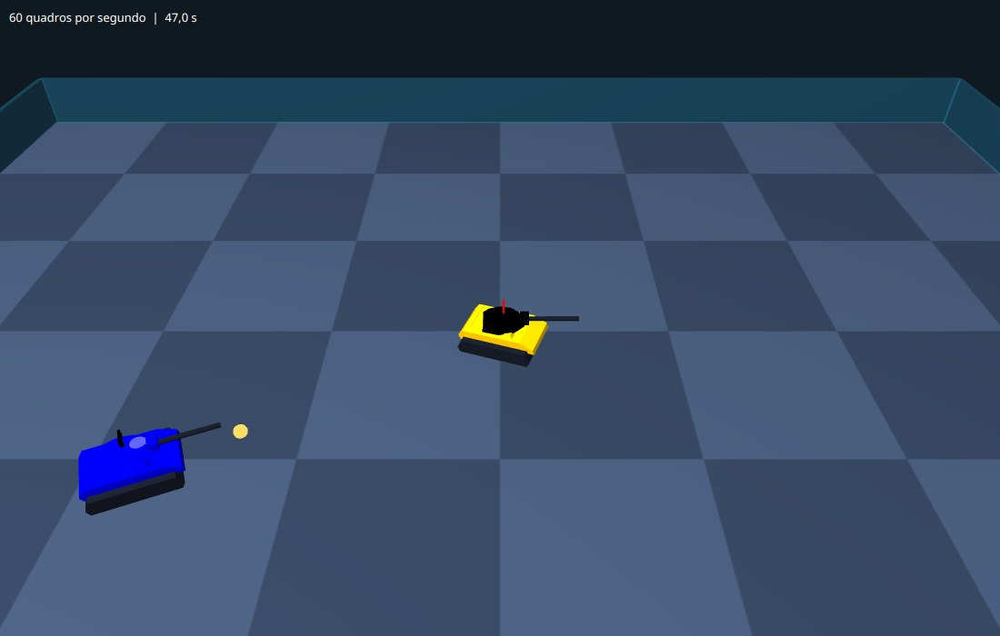
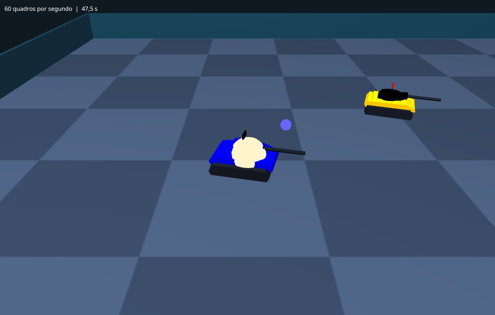
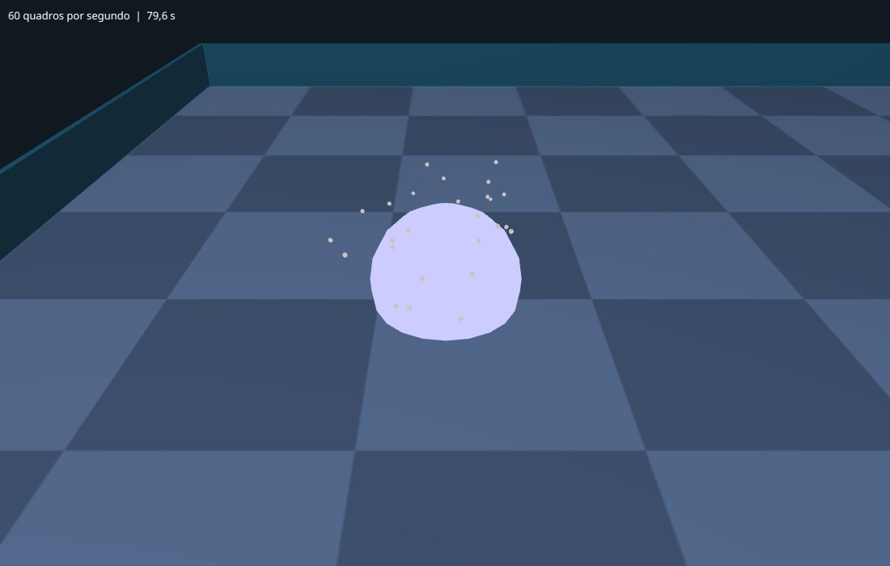
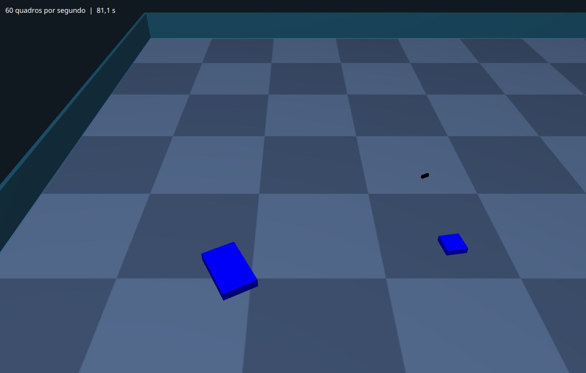

# Capítulo 7 — Tiros, explosões e destroços

## Objetivo

Mostrar na arena os tiros em voo, uma explosão em cada impacto e, quando um robô é destruído, uma explosão maior e os pedaços do tanque voando e caindo no chão, com a física de queda que você viu no ensino médio.

## Passo 1 — O que a gravação diz sobre um tiro

Antes de desenhar, é bom olhar para os dados. Este é o caminho de um tiro de verdade, tirado de uma gravação de teste. Cada linha é o mesmo tiro, em turnos consecutivos:

| Turno | x | y | estado |
|---|---|---|---|
| 372 | 275,5 | 202,4 | 1 (em voo) |
| 373 | 263,9 | 194,4 | 1 (em voo) |
| 374 | 252,4 | 186,4 | 1 (em voo) |
| 375 | 257,4 | 186,8 | 2 (acertou um robô) |
| 376 | 262,4 | 186,7 | 2 |
| 377 | 267,4 | 186,1 | 2 |

Três coisas chamam a atenção:

- Em voo, o tiro anda **14 unidades por turno** em linha reta. Não é por acaso: a velocidade de um tiro do Robocode é `20 - 3 × potência`, e esse tinha potência 2.
- No turno 375 o estado vira 2, "acertou um robô", e a posição passa a ser a do ponto de impacto.
- Depois do impacto, o tiro **continua aparecendo** na gravação, no estado 2, por mais uns 17 turnos (só alguns estão na tabela), com a posição acompanhando o robô atingido. São os quadros da animação de explosão da própria janela do Robocode.

Daí saem as regras do nosso desenho: um tiro em estado 0 ou 1 é desenhado como uma bola em voo, interpolada entre os turnos como os tanques; um tiro em estado de impacto (2, 3 ou 4, o `acertou()` do capítulo 5) **não** é desenhado como bola, e a **primeira** vez que o vemos assim criamos uma explosão. Para não criar uma explosão por turno, guardamos os `id` dos tiros que já explodiram.

## Passo 2 — A física de um pedaço que voa

As faíscas das explosões e os destroços do tanque têm em comum o movimento: são lançados para cima e para os lados e caem. É o **lançamento oblíquo**: na horizontal, a velocidade é constante; na vertical, a gravidade acelera o corpo para baixo. Com a velocidade vertical inicial `v` e a gravidade `g`, a altura depois de um tempo `t` é `h = v·t - g·t²/2`.

O computador não resolve essa fórmula de uma vez: ele avança o tempo em passos pequenos, os quadros do `atualizar`, e a cada passo atualiza a velocidade e depois a posição:

```text
velocidade += aceleração × delta
posição    += velocidade × delta
```

Esse método, o de **Euler**, dá um resultado bem próximo da fórmula quando o passo é pequeno. No nosso mundo, o eixo `Y` cresce **para baixo**, então a gravidade é um número positivo (acelera "para baixo") e subir é ter velocidade `vy` negativa. O chão é `y = 0`.

Quando o corpo bate no chão, três coisas acontecem: a posição é recolocada em cima do chão; a velocidade vertical se inverte e perde energia (o **quique**, cuja força é a elasticidade, entre 0 e 1); e a velocidade horizontal diminui (o **atrito**). Se o quique ficar muito fraco, o corpo para.

**Crie o arquivo** `src/main/java/campeonato/cena/CorpoLivre.java`. Ele não usa o JavaFX, só números:

<!-- arquivo: src/main/java/campeonato/cena/CorpoLivre.java | criar -->
```java
package campeonato.cena;

/** Um corpo que voa sob a gravidade e quica no chão. O Y cresce para baixo e o chão é y = 0. */
final class CorpoLivre {

    /** A gravidade, em unidades por segundo ao quadrado. Como o Y cresce para baixo, ela é positiva. */
    static final double GRAVIDADE = 700;

    double x;
    double y;
    double z;
    double vx;
    double vy;
    double vz;
    /** Distância do centro do corpo até a sua base: é nela que ele encosta no chão. */
    private final double meiaAltura;
    /** Quanto da velocidade o quique devolve, de 0 (não quica) a 1 (quica para sempre). */
    private final double elasticidade;

    CorpoLivre(double x, double y, double z, double vx, double vy, double vz, double meiaAltura, double elasticidade) {
        this.x = x;
        this.y = y;
        this.z = z;
        this.vx = vx;
        this.vy = vy;
        this.vz = vz;
        this.meiaAltura = meiaAltura;
        this.elasticidade = elasticidade;
    }

    /** Avança o movimento em 'delta' segundos. */
    void avancar(double delta) {
        vy += GRAVIDADE * delta;
        x += vx * delta;
        y += vy * delta;
        z += vz * delta;

        double chao = -meiaAltura;
        if (y > chao) {
            y = chao;
            vy = -vy * elasticidade;
            if (Math.abs(vy) < 30) {
                vy = 0;
            }
            // o atrito freia o deslizamento
            double atrito = Math.exp(-5 * delta);
            vx *= atrito;
            vz *= atrito;
        }
    }
}
```

Os campos de posição e velocidade não são `private`: a classe é pequena e só vive dentro do pacote, e deixá-los visíveis poupa uma dúzia de métodos de leitura. O `Math.exp(-5 * delta)` é um fator entre 0 e 1 que reduz a velocidade em cerca de 5 por cento do que ela vale, por centésimo de segundo, e que, diferente de uma multiplicação por um valor fixo, **não depende** de quantos quadros por segundo o computador consegue: aplicar o atrito em dois quadros de 0,01 s dá o mesmo resultado que em um quadro de 0,02 s.

Teste. **Crie o arquivo** `src/test/java/campeonato/cena/CorpoLivreTest.java`:

<!-- arquivo: src/test/java/campeonato/cena/CorpoLivreTest.java | criar -->
```java
package campeonato.cena;

import static org.junit.jupiter.api.Assertions.assertEquals;
import static org.junit.jupiter.api.Assertions.assertTrue;

import org.junit.jupiter.api.Test;

class CorpoLivreTest {

    @Test
    void caiComAGravidade() {
        CorpoLivre corpo = new CorpoLivre(0, -100, 0, 0, 0, 0, 1, 0.3);
        for (int i = 0; i < 250; i++) {
            corpo.avancar(0.001);
        }
        // em 0,25 s a queda livre desce g·t²/2 = 700 · 0,25² / 2 = 21,875
        assertEquals(-100 + 21.875, corpo.y, 0.2);
        assertEquals(700 * 0.25, corpo.vy, 1e-6);
    }

    @Test
    void naoAtravessaOChaoEFicaParado() {
        CorpoLivre corpo = new CorpoLivre(0, -50, 0, 120, 0, 0, 2, 0.35);
        for (int i = 0; i < 600; i++) {
            corpo.avancar(1.0 / 60);
        }
        assertEquals(-2, corpo.y, 1e-9);
        assertEquals(0, corpo.vy, 1e-9);
        // o atrito parou o deslizamento, mas ele andou um pouco para o lado antes disso
        assertEquals(0, corpo.vx, 0.01);
        assertTrue(corpo.x > 0);
    }

    @Test
    void quicaAoBaterNoChao() {
        CorpoLivre corpo = new CorpoLivre(0, -2, 0, 0, 300, 0, 2, 0.5);
        corpo.avancar(0.01);
        // estava descendo; agora sobe, ou seja, tem vy negativo
        assertTrue(corpo.vy < 0);
    }
}
```

<!-- testar -->

O primeiro teste compara o computador com a fórmula do livro: a diferença que sobra é o erro do método de Euler, e por isso a tolerância não é zero. O terceiro mostra o quique: um corpo que bate no chão descendo a 300 passa a subir.

## Passo 3 — Os tiros

O tiro em voo é uma esfera que brilha na cor do robô que atirou. "Brilhar" aqui tem um sentido preciso no JavaFX 3D. Um `PhongMaterial` tem um **mapa de autoiluminação** (*self-illumination map*): uma imagem cujas cores são **somadas** à superfície, venha luz ou não. Com o material difuso preto, a luz da cena não acrescenta nada, e a única cor que se vê é a do mapa. A esfera parece acesa, sem sombra, como um tiro de energia.

O mapa é uma imagem, e para uma cor só basta uma imagem de um pixel. **Crie o arquivo** `src/main/java/campeonato/cena/Materiais.java`:

<!-- arquivo: src/main/java/campeonato/cena/Materiais.java | criar -->
```java
package campeonato.cena;

import javafx.scene.image.WritableImage;
import javafx.scene.paint.Color;
import javafx.scene.paint.PhongMaterial;

/** Materiais usados por mais de uma classe da cena. */
final class Materiais {

    private Materiais() {
    }

    /** Um material que brilha sozinho na cor dada, sem depender de luz: os tiros, as faíscas e as explosões. */
    static PhongMaterial brilho(Color cor) {
        WritableImage amostra = new WritableImage(1, 1);
        amostra.getPixelWriter().setColor(0, 0, cor);
        PhongMaterial material = new PhongMaterial(Color.BLACK);
        material.setSelfIlluminationMap(amostra);
        return material;
    }
}
```

Agora a classe que desenha os tiros. A cada quadro ela recebe o turno atual e o seguinte, e decide, tiro por tiro: se já acertou algo, não desenha; se está em voo, acha ou cria a esfera dele e a posiciona entre as duas posições registradas. As esferas ficam num mapa, de `id` do tiro para esfera, para o mesmo tiro ser a mesma esfera em todos os quadros. Quando um `id` deixa de aparecer, a esfera dele sai da cena.

Reparar na remoção: não dá para remover itens de um mapa enquanto o percorremos num laço (o Java lança uma `ConcurrentModificationException`). Por isso primeiro **juntamos** numa lista os que devem sair, e só depois removemos.

**Crie o arquivo** `src/main/java/campeonato/cena/Tiros.java`:

<!-- arquivo: src/main/java/campeonato/cena/Tiros.java | criar -->
```java
package campeonato.cena;

import campeonato.robocode.Gravacao;
import java.util.HashMap;
import java.util.HashSet;
import java.util.List;
import java.util.Map;
import java.util.Set;
import javafx.scene.Group;
import javafx.scene.paint.Color;
import javafx.scene.shape.Sphere;

/** Os tiros em voo: uma esfera que brilha para cada tiro, na cor de quem atirou. */
final class Tiros {

    /** A altura do cano do canhão, de onde os tiros saem. O Y do mundo cresce para baixo. */
    static final double ALTURA_DO_CANO = -17.2;

    private final Group camada = new Group();
    private final Map<Integer, Sphere> esferas = new HashMap<>();
    /** A cor de cada robô, pelo índice dele: quem cria este objeto preenche o mapa. */
    private final Map<Integer, Color> coresDosDonos;

    Tiros(Map<Integer, Color> coresDosDonos) {
        this.coresDosDonos = coresDosDonos;
    }

    Group camada() {
        return camada;
    }

    void limpar() {
        camada.getChildren().clear();
        esferas.clear();
    }

    /** Mostra os tiros em voo do turno atual, no caminho até a posição que eles têm no turno seguinte. */
    void mostrar(Gravacao.Turno atual, Gravacao.Turno proximo, double fracao, double larguraDoCampo, double alturaDoCampo) {
        Set<Integer> emVoo = new HashSet<>();
        for (Gravacao.Tiro tiro : atual.tiros()) {
            if (tiro.acertou()) {
                // quem já acertou vira explosão, e não é mais desenhado como bola
                continue;
            }
            emVoo.add(tiro.id());
            Gravacao.Tiro depois = mesmoTiro(proximo.tiros(), tiro);
            Sphere esfera = esferas.computeIfAbsent(tiro.id(), id -> criarEsfera(tiro));
            esfera.setTranslateX(Geometria.mundoX(Geometria.interpolar(tiro.x(), depois.x(), fracao), larguraDoCampo));
            esfera.setTranslateY(ALTURA_DO_CANO);
            esfera.setTranslateZ(Geometria.mundoZ(Geometria.interpolar(tiro.y(), depois.y(), fracao), alturaDoCampo));
        }

        List<Integer> quePassaram = esferas.keySet().stream().filter(id -> !emVoo.contains(id)).toList();
        for (int id : quePassaram) {
            camada.getChildren().remove(esferas.remove(id));
        }
    }

    private Sphere criarEsfera(Gravacao.Tiro tiro) {
        Color cor = coresDosDonos.getOrDefault(tiro.dono(), Color.WHITE);
        Sphere esfera = new Sphere(1.5 + tiro.potencia(), 12);
        esfera.setMaterial(Materiais.brilho(cor.interpolate(Color.WHITE, 0.4)));
        camada.getChildren().add(esfera);
        return esfera;
    }

    /** O mesmo tiro em outro turno, ou o próprio modelo se ele não aparecer lá. */
    private static Gravacao.Tiro mesmoTiro(List<Gravacao.Tiro> tiros, Gravacao.Tiro modelo) {
        for (Gravacao.Tiro tiro : tiros) {
            if (tiro.id() == modelo.id()) {
                return tiro;
            }
        }
        return modelo;
    }
}
```

Dois detalhes do código:

- `computeIfAbsent(chave, função)` é um método do `Map`: se a chave já existe, devolve o valor guardado; se não, chama a função para criar o valor, guarda e devolve. É a forma curta de escrever "se não existe, cria".
- `cor.interpolate(Color.WHITE, 0.4)` mistura 40% de branco na cor do robô, para o tiro ficar mais claro que o tanque.

## Passo 4 — Um sistema de efeitos

As explosões e os destroços têm uma vida: nascem, mudam a cada quadro e, algumas, acabam. Em vez de espalhar esse controle pela arena, vamos criar uma **interface**, um contrato que diz o que um efeito sabe fazer, e um gerente que cuida de todos. A interface não diz **como**: uma explosão e um pedaço que cai se comportam de maneiras diferentes, mas o gerente trata os dois do mesmo jeito. Isso é **polimorfismo**: várias classes, uma interface.

**Crie o arquivo** `src/main/java/campeonato/cena/Efeito.java`:

<!-- arquivo: src/main/java/campeonato/cena/Efeito.java | criar -->
```java
package campeonato.cena;

import javafx.scene.Node;

/** Uma coisa que existe por um tempo na arena: uma explosão, um pedaço que voa. */
interface Efeito {

    /** Avança o efeito em 'delta' segundos. Devolve false quando ele acabou e deve sair da cena. */
    boolean atualizar(double delta);

    /** O nó do efeito, que o gerente põe na cena. */
    Node no();
}
```

**Crie o arquivo** `src/main/java/campeonato/cena/Efeitos.java`:

<!-- arquivo: src/main/java/campeonato/cena/Efeitos.java | criar -->
```java
package campeonato.cena;

import java.util.ArrayList;
import java.util.List;
import javafx.scene.Group;

/** Guarda os efeitos que estão acontecendo, atualiza todos a cada quadro e tira da cena os que acabaram. */
final class Efeitos {

    private final Group camada = new Group();
    private final List<Efeito> ativos = new ArrayList<>();

    Group camada() {
        return camada;
    }

    void adicionar(Efeito efeito) {
        ativos.add(efeito);
        camada.getChildren().add(efeito.no());
    }

    void atualizar(double delta) {
        List<Efeito> terminados = new ArrayList<>();
        for (Efeito efeito : ativos) {
            if (!efeito.atualizar(delta)) {
                terminados.add(efeito);
            }
        }
        for (Efeito efeito : terminados) {
            ativos.remove(efeito);
            camada.getChildren().remove(efeito.no());
        }
    }

    void limpar() {
        ativos.clear();
        camada.getChildren().clear();
    }
}
```

Agora a explosão. Uma explosão de verdade tem várias partes, e nós vamos imitar três:

1. Um **clarão**: uma esfera branca que cresce muito depressa até o tamanho cheio (0,12 segundo) e some até 0,4 segundo.
2. Uma **bola de fogo** laranja, que cresce mais devagar, até 70% do tamanho, e some até 0,7 segundo.
3. **Faíscas**: pequenas esferas lançadas para cima e para os lados, que caem como um `CorpoLivre`, encolhem com o tempo e somem.

Tudo é função da **idade** da explosão, o tempo que passou desde que ela nasceu. Não há animações programadas com cronômetro: a cada quadro, o `atualizar` soma o `delta` à idade e recalcula os tamanhos. Isso tem duas vantagens: se um dia a reprodução for pausada ou ganhar câmera lenta, as explosões acompanham sem trabalho extra, e é fácil conferir o que a explosão faz em qualquer instante.

O crescimento "rápido no começo e devagar no fim" tem nome, *ease-out*, e sai de uma conta simples: `1 - (1 - t)³`, que vale 0 em `t = 0`, 1 em `t = 1`, e anda muito mais no começo do que no fim.

**Crie o arquivo** `src/main/java/campeonato/cena/Explosao.java`:

<!-- arquivo: src/main/java/campeonato/cena/Explosao.java | criar -->
```java
package campeonato.cena;

import java.util.ArrayList;
import java.util.List;
import java.util.Random;
import javafx.scene.Group;
import javafx.scene.Node;
import javafx.scene.paint.Color;
import javafx.scene.shape.Sphere;

/** Uma explosão: um clarão, uma bola de fogo e faíscas que caem. */
final class Explosao implements Efeito {

    private static final double DURACAO = 1.2;

    private final Group no = new Group();
    private final Sphere clarao = new Sphere(1, 20);
    private final Sphere bola = new Sphere(1, 20);
    private final List<Fagulha> fagulhas = new ArrayList<>();
    private final double tamanho;
    private double idade;

    /**
     * @param y       a altura do centro da explosão (o Y do mundo cresce para baixo)
     * @param tamanho o raio que o clarão alcança, em unidades
     * @param cor     a cor de quem causou a explosão, misturada ao branco e ao laranja
     */
    Explosao(double x, double y, double z, double tamanho, Color cor, Random sorteio) {
        this.tamanho = tamanho;
        no.setTranslateX(x);
        no.setTranslateZ(z);
        clarao.setTranslateY(y);
        bola.setTranslateY(y);
        clarao.setMaterial(Materiais.brilho(Color.WHITE.interpolate(cor, 0.2)));
        bola.setMaterial(Materiais.brilho(Color.web("#ff8c1a").interpolate(cor, 0.25)));
        no.getChildren().addAll(bola, clarao);

        int quantas = (int) (6 + tamanho / 2);
        for (int i = 0; i < quantas; i++) {
            Fagulha fagulha = new Fagulha(y, tamanho, cor, sorteio);
            fagulhas.add(fagulha);
            no.getChildren().add(fagulha.forma);
        }
        atualizar(0);
    }

    @Override
    public Node no() {
        return no;
    }

    @Override
    public boolean atualizar(double delta) {
        idade += delta;
        // o clarão cresce até o tamanho cheio em 0,12 s e some até 0,4 s
        double raioDoClarao = tamanho * suave(idade / 0.12) * (1 - progresso(idade - 0.12, 0.28));
        mostrar(clarao, raioDoClarao);
        // a bola de fogo cresce até 70% em 0,25 s e some até 0,7 s
        double raioDoFogo = 0.7 * tamanho * suave(idade / 0.25) * (1 - progresso(idade - 0.25, 0.45));
        mostrar(bola, raioDoFogo);
        for (Fagulha fagulha : fagulhas) {
            fagulha.atualizar(delta, idade);
        }
        return idade < DURACAO;
    }

    /** Quanto de uma etapa de 'duracao' segundos já passou, de 0 a 1. */
    private static double progresso(double tempo, double duracao) {
        return Math.max(0, Math.min(1, tempo / duracao));
    }

    /** Começa rápido e desacelera até o fim (ease-out): vale 0 em t = 0 e 1 em t = 1. */
    private static double suave(double t) {
        double limitado = Math.max(0, Math.min(1, t));
        return 1 - Math.pow(1 - limitado, 3);
    }

    /** Dá à esfera de raio 1 o raio pedido; se for quase nada, esconde. */
    private static void mostrar(Sphere esfera, double raio) {
        esfera.setVisible(raio > 0.05);
        esfera.setScaleX(raio);
        esfera.setScaleY(raio);
        esfera.setScaleZ(raio);
    }

    /** Uma faísca: uma esfera pequena que sobe, cai e quica sob a gravidade, encolhendo até sumir. */
    private static final class Fagulha {

        final Sphere forma = new Sphere(1, 6);
        private final CorpoLivre corpo;
        private final double vida;

        Fagulha(double y, double tamanho, Color cor, Random sorteio) {
            double angulo = sorteio.nextDouble() * 2 * Math.PI;
            double velocidade = tamanho * (2 + 5 * sorteio.nextDouble());
            double subida = tamanho * (3 + 4 * sorteio.nextDouble());
            corpo = new CorpoLivre(0, y, 0, Math.cos(angulo) * velocidade, -subida, Math.sin(angulo) * velocidade, 1, 0.3);
            vida = 0.6 + 0.5 * sorteio.nextDouble();
            forma.setMaterial(Materiais.brilho(Color.web("#fff3b0").interpolate(cor, 0.2)));
        }

        void atualizar(double delta, double idade) {
            corpo.avancar(delta);
            forma.setTranslateX(corpo.x);
            forma.setTranslateY(corpo.y);
            forma.setTranslateZ(corpo.z);
            double escala = 1.3 * Math.max(0, 1 - idade / vida);
            forma.setVisible(escala > 0.05);
            forma.setScaleX(escala);
            forma.setScaleY(escala);
            forma.setScaleZ(escala);
        }
    }
}
```

Alguns pontos:

- `Random.nextDouble()` devolve um número sorteado entre 0 e 1. Cada faísca sorteia uma direção (`angulo`), uma velocidade para o lado e uma para cima, e por quanto tempo vive. Por isso duas explosões nunca são idênticas.
- A `Fagulha` é uma classe **aninhada** (`static class` dentro de `Explosao`): ela só faz sentido como parte da explosão, e ninguém de fora precisa conhecê-la.

## Passo 5 — A arena percebe os acontecimentos

Agora a `Arena3D` precisa fazer três coisas: pôr as camadas dos tiros e dos efeitos na cena, mostrar os tiros a cada turno e **perceber** os acontecimentos, ou seja, criar uma explosão quando um tiro acerta e uma maior quando um robô é destruído.

Os acontecimentos precisam de cuidado. Eles acontecem num **turno**, e o relógio passa por turnos a 30 por segundo (ou mais, se a reprodução for acelerada, ou se o computador engasgar e um quadro demorar). Se olhássemos só o turno em que o relógio está agora, perderíamos os acontecimentos dos turnos que ficaram para trás. Por isso guardamos o **último turno tratado** e, a cada quadro, tratamos todos os turnos desde o seguinte a ele até o atual.

Primeiro os `import`. **No topo do arquivo** `Arena3D.java`:

<!-- arquivo: src/main/java/campeonato/cena/Arena3D.java | importar -->
```java
import java.util.HashSet;
import java.util.Random;
import java.util.Set;
```

**Acrescente ao final da classe** `Arena3D`:

<!-- arquivo: src/main/java/campeonato/cena/Arena3D.java | acrescentar -->
```java

    /** A cor de cada robô da gravação, pelo índice dele: é a cor dos tiros e das explosões que ele causa. */
    private final Map<Integer, Color> coresDosRobos = new HashMap<>();
    private final Tiros tiros = new Tiros(coresDosRobos);
    private final Efeitos efeitos = new Efeitos();
    /** Os tiros e os efeitos, que ficam juntos na cena. */
    private final Group acao = new Group(tiros.camada(), efeitos.camada());
    private final Random sorteio = new Random();

    /** A altura do centro de uma explosão: a do meio do casco do tanque. */
    private static final double ALTURA_DAS_EXPLOSOES = -12;

    /** O último turno da rodada cujos acontecimentos já foram tratados. */
    private int ultimoTurnoTratado = -1;
    /** Os tiros que já explodiram nesta rodada: um tiro fica vários turnos no estado de impacto. */
    private final Set<Integer> tirosExplodidos = new HashSet<>();

    /** Trata os acontecimentos dos turnos que o relógio acabou de atravessar: impactos e destruições. */
    private void tratarAcontecimentos(List<Gravacao.Turno> turnos, int indice) {
        for (int t = ultimoTurnoTratado + 1; t <= indice; t++) {
            Gravacao.Turno turno = turnos.get(t);
            Gravacao.Turno anterior = t == 0 ? null : turnos.get(t - 1);
            for (Gravacao.Tiro tiro : turno.tiros()) {
                // o conjunto devolve true só na primeira vez que o id entra nele
                if (tiro.acertou() && tirosExplodidos.add(tiro.id())) {
                    explodirTiro(tiro);
                }
            }
            for (Gravacao.EstadoDoRobo estado : turno.robos()) {
                boolean jaEstavaMorto = anterior != null && mesmoRobo(anterior.robos(), estado).morto();
                if (estado.morto() && !jaEstavaMorto) {
                    destruirRobo(estado);
                }
            }
        }
        ultimoTurnoTratado = Math.max(ultimoTurnoTratado, indice);
    }

    /** Uma explosão no ponto onde o tiro acertou, tanto maior quanto mais potente era o tiro. */
    private void explodirTiro(Gravacao.Tiro tiro) {
        Color cor = coresDosRobos.getOrDefault(tiro.dono(), Color.WHITE);
        double x = Geometria.mundoX(tiro.x(), gravacao.largura());
        double z = Geometria.mundoZ(tiro.y(), gravacao.altura());
        efeitos.adicionar(new Explosao(x, ALTURA_DAS_EXPLOSOES, z, 5 + 4 * tiro.potencia(), cor, sorteio));
    }

    /** Um robô foi destruído: uma explosão grande no lugar dele. */
    private void destruirRobo(Gravacao.EstadoDoRobo estado) {
        Color cor = coresDosRobos.getOrDefault(estado.indice(), Color.WHITE);
        double x = Geometria.mundoX(estado.x(), gravacao.largura());
        double z = Geometria.mundoZ(estado.y(), gravacao.altura());
        efeitos.adicionar(new Explosao(x, ALTURA_DAS_EXPLOSOES, z, 45, cor, sorteio));
    }
```

Observe no `tratarAcontecimentos`:

- `ultimoTurnoTratado + 1` começa do turno seguinte ao último já tratado, e `t <= indice` vai até o turno atual. Normalmente é um turno por quadro; com a reprodução rápida podem ser vários.
- `tirosExplodidos.add(tiro.id())` faz duas coisas ao mesmo tempo: guarda o `id` e devolve `true` se ele era novo. É o mesmo truque do `coloridos` do capítulo 5.
- Um robô morto continua morto em todos os turnos seguintes da rodada. A condição `estado.morto() && !jaEstavaMorto` pega só o turno da **transição**, em que ele estava vivo no turno anterior e está morto agora.

A `destruirRobo` ainda é simples; os destroços entram no próximo passo. Os métodos antigos que precisam mudar: o `montarMundo`, que põe a camada `acao` na cena; o `criarTanques`, que guarda as cores; o `iniciarRodada`, que zera o estado da rodada; o `mostrarTurno`, que mostra os tiros e chama `tratarAcontecimentos`; e o `atualizar`, que atualiza os efeitos.

A camada `acao` entra no mundo **antes do vidro** da cerca. Lembre do capítulo 2: o vidro é transparente e precisa ser desenhado por último, senão esconde o que está atrás dele. **Substitua o método** `montarMundo`:

<!-- arquivo: src/main/java/campeonato/cena/Arena3D.java | substituir-metodo montarMundo -->
```java
    private void montarMundo() {
        PointLight sol = new PointLight(Color.WHITE);
        sol.getTransforms().add(new Translate(-300, -900, -500));
        mundo.getChildren().addAll(new AmbientLight(Color.gray(0.45)), sol, camera.camera());

        chao.getChildren().add(criarChao());
        cerca.getChildren().add(criarCerca());

        robos.getChildren().addAll(azul.no(), vermelho.no());

        // tiros e efeitos ficam depois dos tanques e antes do vidro, que é desenhado por último
        mundo.getChildren().add(mundo.getChildren().indexOf(cerca), acao);
    }
```

**Substitua o método** `criarTanques`:

<!-- arquivo: src/main/java/campeonato/cena/Arena3D.java | substituir-metodo criarTanques -->
```java
    private void criarTanques() {
        robos.getChildren().clear();
        tanques.clear();
        coresDosRobos.clear();
        for (Gravacao.Robo robo : gravacao.robos()) {
            Tanque tanque = new Tanque(Cores.deArgb(robo.corCorpo()), Cores.deArgb(robo.corCanhao()), Cores.deArgb(robo.corRadar()));
            tanques.put(robo.indice(), tanque);
            coresDosRobos.put(robo.indice(), Cores.deArgb(robo.corCorpo()));
            robos.getChildren().add(tanque.no());
        }
    }
```

**Substitua o método** `iniciarRodada`:

<!-- arquivo: src/main/java/campeonato/cena/Arena3D.java | substituir-metodo iniciarRodada -->
```java
    private void iniciarRodada(int numero) {
        rodada = numero;
        posicaoDoTurno = 0;
        ultimoTurnoTratado = -1;
        tirosExplodidos.clear();
        tiros.limpar();
        efeitos.limpar();
        if (turnosDaRodada().isEmpty()) {
            // uma rodada sem turnos não tem o que mostrar
            terminarRodada();
            return;
        }
        fase = Fase.JOGANDO;
        mostrarTurno();
    }
```

**Substitua o método** `mostrarTurno`:

<!-- arquivo: src/main/java/campeonato/cena/Arena3D.java | substituir-metodo mostrarTurno -->
```java
    private void mostrarTurno() {
        List<Gravacao.Turno> turnos = turnosDaRodada();
        int indice = Math.min((int) Math.floor(posicaoDoTurno), turnos.size() - 1);
        double fracao = posicaoDoTurno - indice;
        Gravacao.Turno atual = turnos.get(indice);
        Gravacao.Turno proximo = turnos.get(Math.min(indice + 1, turnos.size() - 1));

        tratarAcontecimentos(turnos, indice);

        for (Gravacao.EstadoDoRobo estado : atual.robos()) {
            Tanque tanque = tanques.get(estado.indice());
            if (tanque == null) {
                continue;
            }
            Gravacao.EstadoDoRobo depois = mesmoRobo(proximo.robos(), estado);
            tanque.posicionar(
                    Geometria.mundoX(Geometria.interpolar(estado.x(), depois.x(), fracao), gravacao.largura()),
                    Geometria.mundoZ(Geometria.interpolar(estado.y(), depois.y(), fracao), gravacao.altura()),
                    Geometria.interpolarAngulo(estado.anguloDoCorpo(), depois.anguloDoCorpo(), fracao),
                    Geometria.interpolarAngulo(estado.anguloDoCanhao(), depois.anguloDoCanhao(), fracao),
                    Geometria.interpolarAngulo(estado.anguloDoRadar(), depois.anguloDoRadar(), fracao));
            tanque.no().setVisible(!estado.morto());
        }

        tiros.mostrar(atual, proximo, fracao, gravacao.largura(), gravacao.altura());
    }
```

E o `atualizar` passa a atualizar os efeitos em todos os quadros, em qualquer fase, para uma explosão do fim da rodada não ficar congelada. **Substitua o método** `atualizar`:

<!-- arquivo: src/main/java/campeonato/cena/Arena3D.java | substituir-metodo atualizar -->
```java
    void atualizar(double delta) {
        tempoTotal += delta;
        tempoDoPeriodo += delta;
        quadrosDoPeriodo++;
        if (tempoDoPeriodo >= 0.5) {
            medidor.setText(String.format("%.0f quadros por segundo  |  %.1f s", quadrosDoPeriodo / tempoDoPeriodo, tempoTotal));
            tempoDoPeriodo = 0;
            quadrosDoPeriodo = 0;
        }

        switch (fase) {
        case VITRINE, CARREGANDO -> mostrarVitrine();
        case JOGANDO -> avancarTurnos(delta);
        case FIM_DA_RODADA -> aguardarProximaRodada(delta);
        case ENCERRADA -> {
        }
        }
        efeitos.atualizar(delta);
    }
```

<!-- compilar -->

Para ver o resultado, usamos a gravação de exemplo. Primeiro, a rodada 1, turno 372, que é um dos turnos da tabela do passo 1: a bola amarelada, do `Vigia`, cruza o campo na direção do `SpinBot`. As bolas brilham na cor de quem atirou, um pouco clareada.

<!-- marco: 07-tiros -->



No turno 375 o tiro acerta, e a explosão nasce:

<!-- marco: 07-impacto -->



Quando a energia de um robô chega a zero, ele é destruído: um turno com o estado "morto" e uma explosão grande. Por enquanto o tanque simplesmente desaparece dentro dela.

<!-- marco: 07-destruicao -->



## Passo 6 — Os pedaços do tanque

Para o tanque destruído não sumir do nada, ele se despedaça em três: o casco, a torre e o radar voam em direções diferentes, caem, quicam e ficam no chão até o fim da rodada. Cada pedaço é uma caixa na cor da parte, movida por um `CorpoLivre`. Um `Efeito` pode durar o quanto quiser: o `atualizar` dos destroços devolve sempre `true`, e eles só saem da cena quando a rodada recomeça e o `Efeitos.limpar()` os leva embora.

Cada pedaço também gira enquanto voa, como uma peça de verdade lançada pelo ar, em torno de um eixo **horizontal** sorteado. Ao parar no chão, ele se **deita**: o ângulo vai se ajustando para o múltiplo de 180 graus mais próximo. Girar uma caixa 180 graus em torno de um eixo horizontal só a vira de cabeça para baixo, e ela continua deitada. Um ângulo qualquer deixaria a caixa em pé, com meia aresta enfiada no chão. **Crie o arquivo** `src/main/java/campeonato/cena/Destroco.java`:

<!-- arquivo: src/main/java/campeonato/cena/Destroco.java | criar -->
```java
package campeonato.cena;

import java.util.ArrayList;
import java.util.List;
import java.util.Random;
import javafx.geometry.Point3D;
import javafx.scene.Node;
import javafx.scene.paint.Color;
import javafx.scene.paint.PhongMaterial;
import javafx.scene.shape.Box;

/** Um pedaço de um tanque destruído, que voa, quica e fica no chão. */
final class Destroco implements Efeito {

    private final Box caixa;
    private final CorpoLivre corpo;
    /** A velocidade do giro no ar, em graus por segundo. */
    private final double giro;
    private double angulo;

    private Destroco(Box caixa, CorpoLivre corpo, double giro, Point3D eixo) {
        this.caixa = caixa;
        this.corpo = corpo;
        this.giro = giro;
        caixa.setRotationAxis(eixo);
    }

    /** As três partes de um tanque destruído, no lugar dele: o casco, a torre e o radar. */
    static List<Destroco> doTanque(double x, double z, Color casco, Color torre, Color radar, Random sorteio) {
        List<Destroco> pecas = new ArrayList<>();
        pecas.add(peca(new Box(27, 7, 44), x, -10, z, casco, sorteio));
        pecas.add(peca(new Box(17, 5, 17), x, -17, z, torre, sorteio));
        pecas.add(peca(new Box(8, 3, 2), x, -26, z, radar, sorteio));
        return pecas;
    }

    private static Destroco peca(Box caixa, double x, double y, double z, Color cor, Random sorteio) {
        PhongMaterial material = new PhongMaterial(cor.darker());
        material.setSpecularColor(cor);
        caixa.setMaterial(material);

        double direcao = sorteio.nextDouble() * 2 * Math.PI;
        double velocidade = 70 + 100 * sorteio.nextDouble();
        double subida = 180 + 140 * sorteio.nextDouble();
        CorpoLivre corpo = new CorpoLivre(x, y, z, Math.cos(direcao) * velocidade, -subida, Math.sin(direcao) * velocidade, caixa.getHeight() / 2, 0.35);
        double direcaoDoEixo = sorteio.nextDouble() * 2 * Math.PI;
        Point3D eixo = new Point3D(Math.cos(direcaoDoEixo), 0, Math.sin(direcaoDoEixo));
        Destroco destroco = new Destroco(caixa, corpo, 200 + 500 * sorteio.nextDouble(), eixo);
        destroco.atualizar(0);
        return destroco;
    }

    @Override
    public Node no() {
        return caixa;
    }

    /** Move o pedaço. Devolve sempre true: ele fica no chão até o fim da rodada. */
    @Override
    public boolean atualizar(double delta) {
        corpo.avancar(delta);
        caixa.setTranslateX(corpo.x);
        caixa.setTranslateY(corpo.y);
        caixa.setTranslateZ(corpo.z);
        boolean parado = corpo.vy == 0 && corpo.y >= -caixa.getHeight() / 2;
        if (parado) {
            // ao parar, o pedaço se deita: o ângulo vai para o múltiplo de 180 graus mais próximo
            double deitado = Math.round(angulo / 180) * 180;
            angulo += (deitado - angulo) * (1 - Math.exp(-10 * delta));
        } else {
            angulo += giro * delta;
        }
        caixa.setRotate(angulo);
        return true;
    }
}
```

O `Point3D` é um ponto (ou vetor) com três coordenadas; usamos um deles como **eixo de giro** do pedaço. Com `(cos a, 0, sen a)`, o eixo fica sempre no plano do chão, apontando numa direção sorteada. O `Math.round(angulo / 180) * 180` arredonda o ângulo para o múltiplo de 180 mais próximo, e a conta `angulo += (deitado - angulo) * (1 - Math.exp(-10 * delta))` aproxima o ângulo desse valor um pouco a cada quadro, sem pulos, e, como o atrito do `CorpoLivre`, não depende da quantidade de quadros por segundo.

Falta chamar a criação dos destroços quando um robô é destruído. Precisamos das três cores do robô, que estão no `Gravacao.Robo`. **Acrescente ao final da classe** `Arena3D`:

<!-- arquivo: src/main/java/campeonato/cena/Arena3D.java | acrescentar -->
```java

    /** O robô da gravação com o índice dado, ou null se não existir. */
    private Gravacao.Robo procurarRobo(int indice) {
        for (Gravacao.Robo robo : gravacao.robos()) {
            if (robo.indice() == indice) {
                return robo;
            }
        }
        return null;
    }
```

E o `destruirRobo` ganha os pedaços. **Substitua o método** `destruirRobo`:

<!-- arquivo: src/main/java/campeonato/cena/Arena3D.java | substituir-metodo destruirRobo -->
```java
    private void destruirRobo(Gravacao.EstadoDoRobo estado) {
        Color cor = coresDosRobos.getOrDefault(estado.indice(), Color.WHITE);
        double x = Geometria.mundoX(estado.x(), gravacao.largura());
        double z = Geometria.mundoZ(estado.y(), gravacao.altura());
        efeitos.adicionar(new Explosao(x, ALTURA_DAS_EXPLOSOES, z, 45, cor, sorteio));

        Gravacao.Robo robo = procurarRobo(estado.indice());
        if (robo != null) {
            for (Destroco peca : Destroco.doTanque(x, z, Cores.deArgb(robo.corCorpo()), Cores.deArgb(robo.corCanhao()), Cores.deArgb(robo.corRadar()), sorteio)) {
                efeitos.adicionar(peca);
            }
        }
    }
```

<!-- compilar -->

Um instante depois da explosão, os pedaços estão no ar; mais um pouco, e estão espalhados no chão:

<!-- marco: 07-destrocos -->



Rode o programa como no capítulo 6. Os tiros agora cruzam o campo, cada impacto tem sua explosão e o robô vencido se despedaça.

<!-- executar: | rodar: 25 | proibe: Exception, ERROR -->
```bash
mvn javafx:run
```

## O que construímos

```text
src/main/java/campeonato/cena/
├── Arena3D.java       agora percebe impactos e destruições
├── CorpoLivre.java    a física de queda e quique
├── Materiais.java     material que brilha sozinho
├── Tiros.java         as esferas dos tiros em voo
├── Efeito.java        o contrato de tudo o que vive um tempo na arena
├── Efeitos.java       guarda e atualiza os efeitos
├── Explosao.java      clarão, bola de fogo e faíscas
└── Destroco.java      um pedaço de tanque que voa e quica

src/test/java/campeonato/cena/
└── CorpoLivreTest.java
```

## Exercícios

**Fácil**

1. Mude a gravidade em `CorpoLivre.GRAVIDADE` para 150 e depois 2000. Como as faíscas e os destroços se comportam em cada caso? (Pense na Lua e em Júpiter.)
2. Faça os tiros maiores: aumente o raio da esfera em `Tiros.criarEsfera`. Por que um tiro muito grande atrapalha ver o tanque que ele acerta?

**Médio**

3. Mude as cores da explosão: o clarão azulado, a bola de fogo vermelha. Depois compare uma explosão causada por um robô amarelo com uma causada por um azul: de onde vem a diferença?
4. Dê às explosões uma luz: um `PointLight` que acende no instante da explosão, na altura dela, e se apaga em meio segundo. Dica: a cor da luz vai de uma cor clara até `Color.BLACK`, uma luz preta não ilumina nada. Um `PointLight` fica na cena como qualquer outro nó; se criar um por explosão, lembre de tirá-lo ao fim.
5. Faça o tiro deixar um rastro: a cada turno, uma esfera menor e mais fraca atrás da esfera do tiro. Dica: um efeito curto, criado pela arena no mesmo momento em que a esfera é criada.

**Difícil**

6. Faça os destroços do tanque herdarem a velocidade do tanque antes de explodir, como acontece com um carro de verdade: o corpo continua na direção que estava indo. Dica: compare a posição do robô no turno da morte e no turno anterior.
7. Um tiro que acerta a parede deve fazer só faíscas pequenas, sem o clarão e a bola de fogo. Mude o `explodirTiro` para distinguir os estados `TIRO_ACERTOU_ROBO` e `TIRO_ACERTOU_PAREDE`. Dica: um segundo construtor de `Explosao`, ou um parâmetro que diz quais partes criar.

## Perguntas para fixação

1. Por que o código trata todos os turnos entre o `ultimoTurnoTratado` e o turno atual, em vez de tratar só o turno atual?
2. Por que a explosão é calculada a partir da **idade**, e não com uma animação que simplesmente roda por 1,2 segundo?
3. O que muda no primeiro teste do `CorpoLivre` se o passo for 0,05 s em vez de 0,001 s, e por quê?
4. Para que serve a interface `Efeito`, já que só existem duas classes que a implementam?

<details>
<summary>Respostas</summary>

1. Porque o relógio pode passar por mais de um turno entre dois quadros: com a reprodução acelerada, ou quando um quadro demora mais que o normal. Tratar só o turno atual perderia os impactos e as destruições dos turnos que ficaram no meio do caminho.
2. Porque assim a explosão acompanha o relógio da arena: se a reprodução for pausada ou ganhar câmera lenta (basta multiplicar o `delta`), a explosão também pausa ou desacelera. Uma animação com tempo próprio ignoraria isso. Também ajuda a conferir o resultado: dado o instante, sabe-se exatamente como a explosão está.
3. O erro do método de Euler cresce com o passo. Com passos grandes, o valor calculado se afasta mais de `g·t²/2` e o teste, que aceita só 0,2 de diferença, falharia. Passo menor é mais preciso, mas custa mais contas.
4. Para a classe `Efeitos` tratar todas do mesmo jeito sem saber qual é qual: ela só precisa saber que todo efeito se atualiza e tem um nó. Amanhã é possível criar um novo efeito (fumaça, raio) sem mexer no gerente.

</details>

No próximo capítulo, o placar: nomes, barras de energia e a contagem de rodadas.
