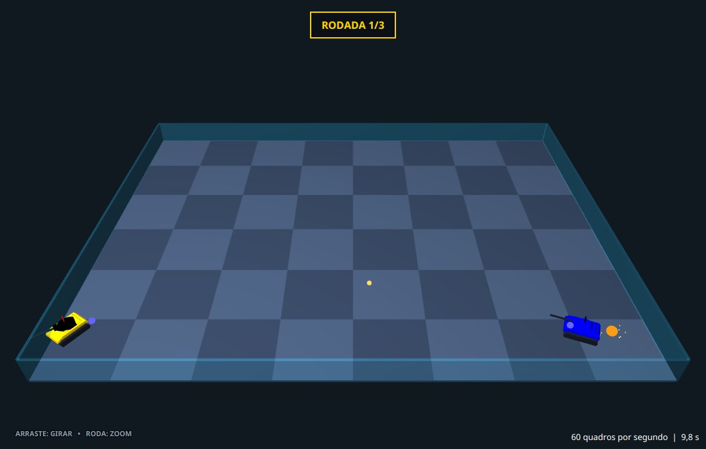
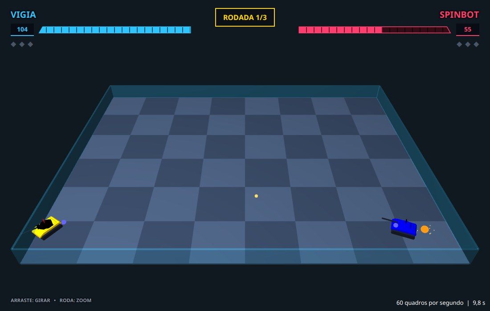
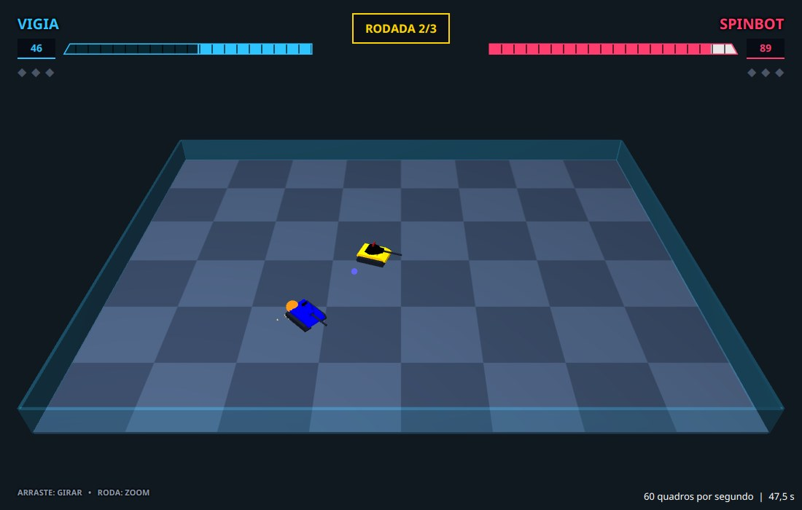
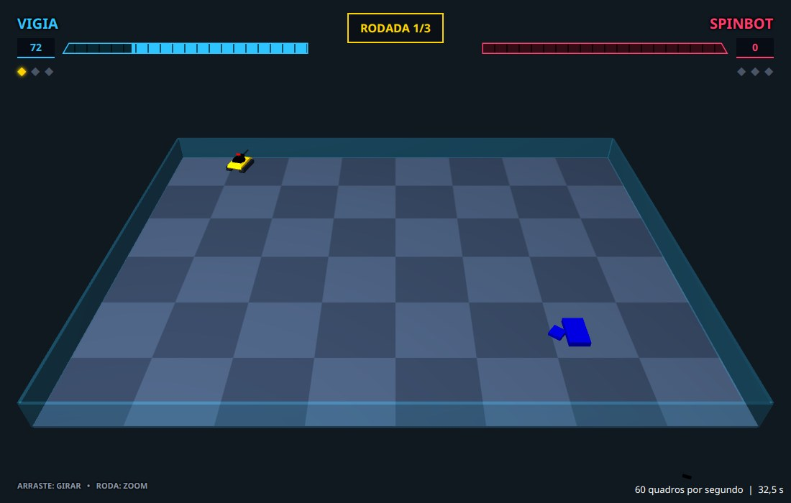
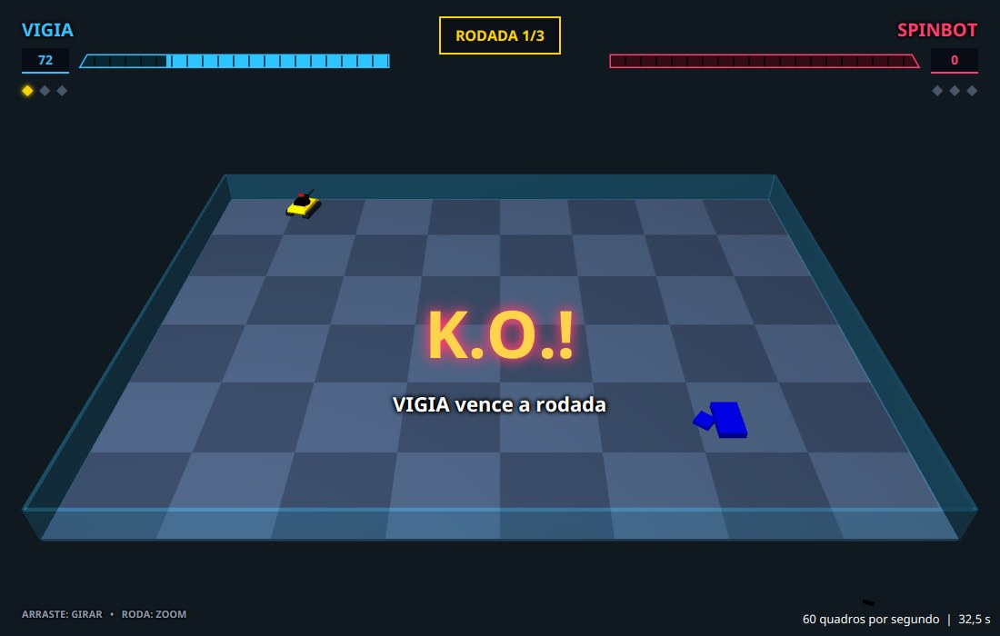
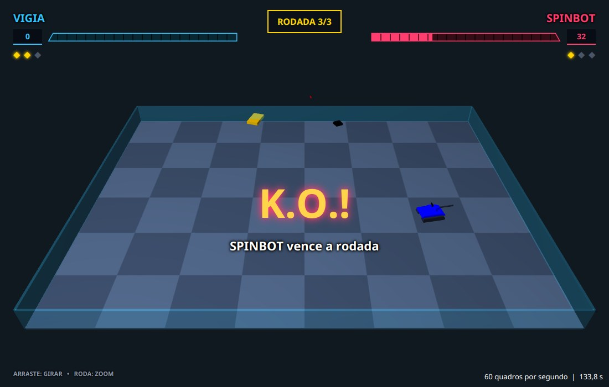

# Capítulo 8 — O placar

## Objetivo

Desenhar por cima da arena 3D o placar de uma luta de videogame: o nome e a barra de energia de cada robô, o número da rodada, um losango para cada rodada vencida e um "K.O.!" no fim de cada rodada. Quando um robô leva um tiro, a barra deixa um rastro claro do dano, que desce devagar até alcançar a energia que sobrou.

## Passo 1 — Uma camada por cima do 3D

Até aqui, tudo o que a arena mostra está dentro do mundo 3D: o chão, o vidro, os tanques, os tiros. O placar é diferente, ele **não pertence ao mundo**. Se fosse um objeto 3D, giraria junto com a câmera, encolheria quando a câmera se afastasse e sumiria atrás de um tanque. O placar precisa ficar **colado na tela**, do mesmo tamanho e no mesmo lugar, para onde quer que a câmera olhe.

Por isso ele é feito com os controles comuns do JavaFX (`Label`, `HBox`, `BorderPane`, os mesmos de uma janela com textos e botões) e fica numa camada **por cima** da cena 3D. Lembre do capítulo 1: a `Arena3D` é um `StackPane`, que empilha os filhos, o primeiro embaixo e o último por cima. Hoje a pilha tem a cena 3D, o medidor de quadros e o cartão "Preparando a batalha". O placar entra entre a cena 3D e o medidor.

A gravação já guarda a energia de cada robô: é o sétimo campo de cada robô nas linhas `#T` (capítulo 4) e o `energia()` do `EstadoDoRobo` (capítulo 5). Antes de desenhar, veja como ela se comporta num trecho real da gravação de exemplo, a mesma dos capítulos 6 e 7 (a sua batalha terá outros números). É a primeira rodada da gravação, a de número 0, e o tiro número 4 é do Vigia:

| Turno | Energia do Vigia | Energia do SpinBot | Tiro 4 (do Vigia, potência 2) |
|---|---|---|---|
| 178 | 92 | 94 | em voo (estado 1) |
| 179 | 98 | 84 | acertou um robô (estado 2) |

No turno 179, de uma só vez, a energia do Vigia sobe 6 e a do SpinBot cai 10. Esses números vêm das regras do Robocode, descritas na documentação do método `fire`: um tiro causa `4 × potência` de dano, mais `2 × (potência − 1)` quando a potência é maior que 1, e quem acerta **recebe de volta** `3 × potência`. Com potência 2, o dano é 4 × 2 + 2 × 1 = 10 e o ganho é 3 × 2 = 6. Atirar também custa: a potência do tiro sai da energia de quem atira. Por isso a energia do Vigia cai de 94 para 92 no turno 167, o turno em que nasce o tiro 5, também de potência 2.

Duas consequências para o placar:

- A energia muda **aos saltos**. Se a barra só acompanhasse o número, o dano apareceria como um tranco, difícil de perceber. O rastro do passo 5 resolve isso.
- A energia pode **passar de 100**: nesses mesmos dados aparecem 102 e 104, de quem acertou vários tiros. A barra não pode passar do tamanho dela.

Este capítulo cria sete classes. Duas delas só fazem contas, e outras duas guardam regras do jogo: essas quatro não usam o JavaFX e têm testes. As outras três desenham.

| Classe | O que faz |
|---|---|
| `Energia` | transforma a energia em largura de barra e em texto |
| `Nomes` | transforma `aluno.Vigia*` em `VIGIA` |
| `RastroDeDano` | a regra do rastro claro que desce atrás da barra |
| `Vitorias` | quem venceu cada rodada e quantas vitórias cada robô tem |
| `PainelDoJogador` | o nome, a barra, o número e os losangos de um jogador |
| `Aviso` | o "K.O.!" no meio da tela |
| `Placar` | junta tudo por cima da arena |

## Passo 2 — Um placar vazio

Vamos começar pelo menor placar possível: o número da rodada no alto e uma linha de ajuda embaixo. Isso já resolve o essencial, que é pôr uma camada de interface por cima da cena 3D.

O `Placar` é um `BorderPane`, um painel dividido em cinco regiões: topo, base, esquerda, direita e centro. O centro ocupa o que sobrar. Vamos usar o topo para os painéis dos jogadores, a base para a ajuda e, no passo 7, o centro para o aviso. **Crie o arquivo** `src/main/java/campeonato/cena/Placar.java`:

<!-- arquivo: src/main/java/campeonato/cena/Placar.java | criar -->
```java
package campeonato.cena;

import campeonato.robocode.Gravacao;
import javafx.geometry.Insets;
import javafx.geometry.Pos;
import javafx.scene.control.Label;
import javafx.scene.layout.BorderPane;
import javafx.scene.layout.HBox;

/** Tudo o que a arena mostra por cima do 3D: o número da rodada, os painéis dos jogadores, os avisos e a ajuda. */
final class Placar extends BorderPane {

    private final HBox linhaDeCima = new HBox();
    private final Label rodada = new Label();
    /** Quantas rodadas a batalha tem: o "3" de "RODADA 1/3". */
    private int totalDeRodadas;

    Placar() {
        rodada.setStyle("-fx-text-fill: #ffd400; -fx-font-size: 16px; -fx-font-weight: bold; -fx-padding: 8 16 8 16;"
                + " -fx-background-color: rgba(11, 14, 20, 0.8); -fx-border-color: #ffd400; -fx-border-width: 2;");
        linhaDeCima.setAlignment(Pos.TOP_CENTER);
        linhaDeCima.setPadding(new Insets(18, 24, 0, 24));
        linhaDeCima.getChildren().add(rodada);

        Label ajuda = new Label("ARRASTE: GIRAR   •   RODA: ZOOM");
        ajuda.setStyle("-fx-text-fill: #8b98ab; -fx-font-size: 11px; -fx-font-weight: bold;"
                + " -fx-effect: dropshadow(gaussian, rgba(0, 0, 0, 0.9), 4, 0.6, 0, 0);");
        BorderPane.setMargin(ajuda, new Insets(0, 24, 16, 24));

        setTop(linhaDeCima);
        setBottom(ajuda);
        // o placar é só para olhar: o mouse passa direto por ele
        setMouseTransparent(true);
        // e só aparece quando há uma batalha para mostrar
        setVisible(false);
    }

    /** Prepara o placar para a batalha da gravação e o mostra. */
    void montar(Gravacao gravacao) {
        totalDeRodadas = gravacao.rodadas().size();
        setVisible(true);
    }

    /** Escreve "RODADA 2/3". */
    void mostrarRodada(int numero) {
        rodada.setText("RODADA " + numero + "/" + totalDeRodadas);
    }
}
```

Alguns detalhes do código:

- O `setStyle` usa a linguagem de estilos do JavaFX, parecida com o CSS das páginas da web, que você já viu no capítulo 1. Os valores novos: `-fx-padding: 8 16 8 16` são as margens de dentro, na ordem **cima, direita, baixo, esquerda**; `rgba(11, 14, 20, 0.8)` é uma cor com vermelho, verde e azul de 0 a 255 e a **opacidade** de 0 a 1 (0,8 deixa um pouco do fundo aparecer); e `dropshadow(gaussian, cor, raio, espalhamento, deslocamentoX, deslocamentoY)` desenha uma sombra atrás do texto. Uma sombra preta e pequena dá contraste sobre o 3D, e uma sombra colorida e grande faz o texto parecer brilhar. O `Insets(18, 24, 0, 24)` segue a mesma ordem: cima, direita, baixo, esquerda.
- `setMouseTransparent(true)` faz o mouse atravessar o placar, como se ele fosse de vidro. Sem isso, o placar, que cobre a tela toda, seria o alvo de cada clique e de cada arrasto, e a cena 3D, embaixo dele, nunca os receberia. No nosso programa a câmera escuta o mouse na própria `Arena3D`, que é o pai do placar, e por isso ela funcionaria mesmo assim. Ainda assim, uma camada que serve só para olhar não deve bloquear a de baixo, e vale a pena ter esse hábito.
- `setVisible(false)` esconde o placar até o `montar`: enquanto os tanques de exibição giram ou o cartão de carregamento está na tela, não há placar para mostrar.

Agora a `Arena3D`. A primeira mudança é criar o placar. **Acrescente ao final da classe** `Arena3D`:

<!-- arquivo: src/main/java/campeonato/cena/Arena3D.java | acrescentar -->
```java

    private final Placar placar = new Placar();
```

A segunda é o construtor, que põe o placar na pilha entre a cena 3D e o medidor. O medidor de quadros por segundo estava no canto de cima, à esquerda, exatamente onde vai ficar o painel do primeiro robô, e por isso vai para o canto de baixo, à direita. **Substitua o construtor** `Arena3D`:

<!-- arquivo: src/main/java/campeonato/cena/Arena3D.java | substituir-metodo Arena3D -->
```java
    public Arena3D() {
        setStyle("-fx-background-color: #101820;");
        medidor.setTextFill(Color.WHITE);
        // o canto de cima agora é do placar: o medidor vai para o canto de baixo, à direita
        StackPane.setAlignment(medidor, Pos.BOTTOM_RIGHT);
        StackPane.setMargin(medidor, new Insets(10));

        montarMundo();
        montarCarregamento();
        cena3D.setCamera(camera.camera());
        cena3D.setFill(Color.web("#101820"));
        cena3D.widthProperty().bind(widthProperty());
        cena3D.heightProperty().bind(heightProperty());
        camera.instalarControles(this);
        // de baixo para cima: a cena 3D, o placar, o medidor e o cartão de carregamento
        getChildren().addAll(cena3D, placar, medidor, carregamento);

        // O relógio só roda enquanto a arena está dentro de uma janela
        sceneProperty().addListener((observavel, antiga, nova) -> {
            if (nova == null) {
                relogio.stop();
            } else {
                relogio.start();
            }
        });
    }
```

A terceira mudança é a arena avisar o placar quando a batalha começa e quando cada rodada começa. **Acrescente a linha** abaixo logo depois de `criarTanques();`, no método `tocar`:

<!-- arquivo: src/main/java/campeonato/cena/Arena3D.java | inserir-depois criarTanques(); -->
```java
        placar.montar(gravacao);
```

E esta, logo depois de `efeitos.limpar();`, no método `iniciarRodada`:

<!-- arquivo: src/main/java/campeonato/cena/Arena3D.java | inserir-depois efeitos.limpar(); -->
```java
        placar.mostrarRodada(numero + 1);
```

O `+ 1` merece atenção. No código, e na gravação, a primeira rodada é a de número **0**, como o primeiro elemento de qualquer lista. Para as pessoas, a primeira rodada é a 1. A conversão acontece num lugar só, na hora de mostrar, e todo o resto do programa continua contando a partir de zero.

<!-- compilar -->

Rode o programa como no capítulo 6, ou veja o que a gravação de exemplo mostra no turno 300 da primeira rodada:

<!-- marco: 08-rodada -->



O quadro amarelo no alto diz `RODADA 1/3`. A ajuda ficou embaixo, à esquerda, e o medidor de quadros foi para a direita. Os tanques continuam jogando por baixo de tudo isso.

## Passo 3 — Duas contas pequenas, com testes

Antes de desenhar a barra, vamos às contas dela. Como as de `Geometria` e `Cores`, elas ficam numa classe só com métodos `static`, sem JavaFX, e por isso são fáceis de testar.

**A energia vira largura.** Uma barra cheia vale 100 de energia. Se a barra inteira tem 340 pixels, a parte colorida de um robô com energia 55 deve ter `340 × 55 / 100 = 187` pixels, uma regra de três. Dois cuidados, os dois vindos dos dados do passo 1: a energia **passa de 100** (a barra não pode ficar mais do que cheia, e por isso o `Math.min(1, ...)`), e uma energia negativa não pode virar uma largura negativa (por isso o `Math.max(0, ...)`).

**A energia vira texto.** O número ao lado da barra é a energia arredondada **para cima**. Um robô com 0,3 de energia ainda está vivo, e escrever "0" diria que ele morreu. Em Java, `Math.ceil` arredonda para cima, e o `(int)` descarta a parte decimal que sobra, que é zero. **Crie o arquivo** `src/main/java/campeonato/cena/Energia.java`:

<!-- arquivo: src/main/java/campeonato/cena/Energia.java | criar -->
```java
package campeonato.cena;

/** As contas da barra de energia: quanto da barra encher e que número escrever. */
final class Energia {

    /** A energia com que um robô começa a batalha: uma barra cheia representa este valor. */
    static final double INICIAL = 100;

    private Energia() {
    }

    /** A largura da parte colorida da barra. Uma energia acima de 100 enche a barra, mas não passa dela. */
    static double largura(double energia, double larguraTotal) {
        return larguraTotal * Math.min(1, Math.max(0, energia) / INICIAL);
    }

    /** O número ao lado da barra. Arredonda para cima: com 0,3 de energia o robô ainda está vivo, e "0" diria o contrário. */
    static String texto(double energia) {
        return String.valueOf((int) Math.ceil(Math.max(0, energia)));
    }
}
```

**O nome.** O nome que o Robocode dá a um robô é o nome completo da classe, com o pacote e, para os robôs em desenvolvimento, o asterisco do capítulo 4: `aluno.Vigia*`. Na tela queremos só `VIGIA`. O método tira o asterisco, tira tudo até o último ponto (o `lastIndexOf('.')` devolve `-1` quando não há ponto, e o `+ 1` faz o `substring` começar do zero) e passa para maiúsculas.

O `toUpperCase(Locale.ROOT)` tem uma armadilha por trás. Sem o argumento, `toUpperCase()` usa o **idioma do computador**, e há idiomas em que as letras não se comportam como no português. Em turco, o "i" minúsculo vira "İ", com um ponto em cima, e `Vigia` viraria `VİGİA`. Um programa que se comporta diferente em cada computador é um programa difícil de consertar. `Locale.ROOT` é o "idioma neutro": a regra é sempre a mesma. **Crie o arquivo** `src/main/java/campeonato/cena/Nomes.java`:

<!-- arquivo: src/main/java/campeonato/cena/Nomes.java | criar -->
```java
package campeonato.cena;

import java.util.Locale;

/** Como os nomes dos robôs aparecem na tela. */
final class Nomes {

    private Nomes() {
    }

    /** "aluno.Vigia*" vira "VIGIA": sem o pacote, sem o asterisco que marca um robô em desenvolvimento, em maiúsculas. */
    static String curto(String nomeCompleto) {
        String nome = nomeCompleto.endsWith("*") ? nomeCompleto.substring(0, nomeCompleto.length() - 1) : nomeCompleto;
        nome = nome.substring(nome.lastIndexOf('.') + 1);
        return nome.toUpperCase(Locale.ROOT);
    }
}
```

Os testes. O primeiro confere a regra de três e os dois cuidados; o segundo, o arredondamento; o terceiro, o do turco: ele **muda o idioma do computador** só durante o teste, e o `finally` o devolve ao que era, para não atrapalhar os outros testes. **Crie o arquivo** `src/test/java/campeonato/cena/EnergiaTest.java`:

<!-- arquivo: src/test/java/campeonato/cena/EnergiaTest.java | criar -->
```java
package campeonato.cena;

import static org.junit.jupiter.api.Assertions.assertEquals;

import org.junit.jupiter.api.Test;

class EnergiaTest {

    @Test
    void aLarguraEProporcionalAEnergia() {
        assertEquals(0, Energia.largura(0, 400), 1e-9);
        assertEquals(100, Energia.largura(25, 400), 1e-9);
        assertEquals(400, Energia.largura(100, 400), 1e-9);
    }

    @Test
    void umaEnergiaAcimaDeCemEncheAbarraSemPassarDela() {
        // o robô ganha energia quando acerta tiros, e a gravação mostra valores como 102
        assertEquals(400, Energia.largura(102, 400), 1e-9);
    }

    @Test
    void umaEnergiaNegativaNaoTemLargura() {
        assertEquals(0, Energia.largura(-3, 400), 1e-9);
    }

    @Test
    void oNumeroArredondaParaCima() {
        assertEquals("46", Energia.texto(46));
        assertEquals("46", Energia.texto(45.2));
        assertEquals("1", Energia.texto(0.3));
        assertEquals("0", Energia.texto(0));
        assertEquals("0", Energia.texto(-2));
    }
}
```

<!-- arquivo: src/test/java/campeonato/cena/NomesTest.java | criar -->
```java
package campeonato.cena;

import static org.junit.jupiter.api.Assertions.assertEquals;

import java.util.Locale;
import org.junit.jupiter.api.Test;

class NomesTest {

    @Test
    void tiraOPacoteEOAsteriscoEPoeEmMaiusculas() {
        assertEquals("VIGIA", Nomes.curto("aluno.Vigia*"));
        assertEquals("SPINBOT", Nomes.curto("sample.SpinBot"));
    }

    @Test
    void umNomeSemPacoteSoFicaEmMaiusculas() {
        assertEquals("VIGIA", Nomes.curto("Vigia"));
    }

    @Test
    void naoDependeDoIdiomaDoComputador() {
        // em turco, "i".toUpperCase() daria "İ"; com Locale.ROOT dá sempre "I"
        Locale padrao = Locale.getDefault();
        try {
            Locale.setDefault(Locale.forLanguageTag("tr"));
            assertEquals("VIGIA", Nomes.curto("aluno.Vigia"));
        } finally {
            Locale.setDefault(padrao);
        }
    }
}
```

Rode os testes (`mvn test`). Todos passam.

<!-- testar -->

## Passo 4 — O painel de um jogador

O painel de um jogador é uma pilha vertical (`VBox`, o V é de vertical) de três linhas. Uma linha horizontal (`HBox`) enfileira os filhos para o lado:

```text
VIGIA                         <- o nome
[104] [██████████▌        ]   <- o número e a barra de energia
◆ ◆ ◆                         <- um losango por rodada
```

A barra é a parte trabalhosa. Ela é uma **pilha** (`StackPane`) de quatro camadas retangulares, uma sobre a outra, de baixo para cima:

1. o **fundo**, uma versão bem escura da cor do jogador;
2. o **rastro**, uma faixa quase branca, que mostra o dano que acabou de acontecer (por enquanto ela só acompanha a energia, escondida atrás dela, e ganha vida no passo 5);
3. a **energia**, a parte colorida, cuja largura é a energia do robô;
4. a **grade**, linhas finas e escuras a cada 5% da barra, como as divisões de uma barra de vida de videogame.

Depois a pilha é **recortada** (`setClip`) por um `Polygon`: o que cair fora do polígono não é desenhado. O polígono é um retângulo com um dos cantos de cima cortado na diagonal, o canto de fora, que é o da esquerda para o jogador da esquerda e o da direita para o outro. Por cima de tudo vai um contorno do mesmo formato, só a linha, na cor do jogador.

Falta saber como a parte colorida encolhe. O `StackPane` estica cada filho até o **tamanho máximo** dele; então, para a região colorida ter 120 pixels de largura, basta dizer que o `maxWidth` dela é 120. E o `StackPane.setAlignment(energia, Pos.CENTER_RIGHT)` diz onde a região fica quando é mais estreita que a pilha: encostada à direita, e centralizada na altura. Para o jogador da esquerda, isso quer dizer que a parte colorida fica junto do centro da tela e a barra esvazia pela ponta de fora. O jogador da direita é o espelho.

Vamos montar a classe em três pedaços. O primeiro tem as constantes, os campos e o construtor, que monta as três linhas. Enquanto você não escrever o segundo pedaço (a `montarBarra`), o código não compila, e isso é esperado. **Crie o arquivo** `src/main/java/campeonato/cena/PainelDoJogador.java`:

<!-- arquivo: src/main/java/campeonato/cena/PainelDoJogador.java | criar -->
```java
package campeonato.cena;

import javafx.geometry.Pos;
import javafx.scene.control.Label;
import javafx.scene.layout.HBox;
import javafx.scene.layout.Region;
import javafx.scene.layout.StackPane;
import javafx.scene.layout.VBox;
import javafx.scene.paint.Color;
import javafx.scene.shape.Polygon;

/** O painel de um jogador no alto da tela: o nome, a barra de energia com o seu número e os losangos das rodadas vencidas. */
final class PainelDoJogador extends VBox {

    static final double LARGURA_DA_BARRA = 340;
    private static final double ALTURA_DA_BARRA = 14;
    /** Quanto o canto de fora da barra é cortado na diagonal. */
    private static final double INCLINACAO = 8;

    private final Region energia = new Region();
    private final Region rastro = new Region();
    private final Label numero = new Label("100");
    private final HBox losangos = new HBox(6);
    private final int rodadas;

    /**
     * @param nome       o nome que aparece em cima da barra
     * @param cor        a cor do jogador, no formato "#rrggbb"
     * @param naEsquerda true para o jogador da esquerda da tela, false para o da direita
     * @param rodadas    quantos losangos desenhar: o número de rodadas da batalha
     */
    PainelDoJogador(String nome, String cor, boolean naEsquerda, int rodadas) {
        super(6);
        this.rodadas = rodadas;

        Label rotulo = new Label(nome);
        rotulo.setTextFill(Color.web(cor));
        rotulo.setStyle("-fx-font-size: 20px; -fx-font-weight: bold; -fx-effect: dropshadow(gaussian, rgba(0, 0, 0, 0.9), 6, 0.6, 0, 0);");
        HBox linhaDoNome = new HBox(rotulo);
        linhaDoNome.setAlignment(naEsquerda ? Pos.BOTTOM_LEFT : Pos.BOTTOM_RIGHT);

        numero.setStyle("-fx-text-fill: " + cor + "; -fx-border-color: " + cor + "; -fx-border-width: 0 0 2 0;"
                + " -fx-background-color: rgba(8, 10, 18, 0.85); -fx-font-size: 14px; -fx-font-weight: bold;"
                + " -fx-min-width: 52; -fx-alignment: center; -fx-padding: 3 6 3 6;");
        StackPane barra = montarBarra(cor, naEsquerda);
        // o número fica do lado de fora da barra: à esquerda dela para o jogador da esquerda, à direita para o outro
        HBox linhaDaBarra = naEsquerda ? new HBox(10, numero, barra) : new HBox(10, barra, numero);
        linhaDaBarra.setAlignment(Pos.CENTER);

        losangos.setAlignment(naEsquerda ? Pos.CENTER_LEFT : Pos.CENTER_RIGHT);
        getChildren().addAll(linhaDoNome, linhaDaBarra, losangos);
        setAlignment(naEsquerda ? Pos.TOP_LEFT : Pos.TOP_RIGHT);
        mostrarVitorias(0);
    }
}
```

O `naEsquerda ? a : b` é o operador condicional, o mesmo do relógio do capítulo 1: vale `a` se a condição for verdadeira e `b` se não. Graças a ele, o mesmo construtor serve para os dois jogadores, só espelhado.

O segundo pedaço é a barra. Os comentários dentro do código dizem o que cada linha faz. **Acrescente ao final da classe** `PainelDoJogador`:

<!-- arquivo: src/main/java/campeonato/cena/PainelDoJogador.java | acrescentar -->
```java

    /**
     * A barra: um fundo escuro, o rastro do dano, a energia e uma grade de linhas finas a cada 5%, tudo recortado
     * num formato de quadro de videogame, com o canto de fora cortado na diagonal, e um contorno por cima.
     */
    private StackPane montarBarra(String cor, boolean naEsquerda) {
        Region fundo = new Region();
        // derive(cor, -80%) é a mesma cor, 80% mais escura
        fundo.setStyle("-fx-background-color: derive(" + cor + ", -80%);");
        rastro.setStyle("-fx-background-color: rgba(255, 255, 255, 0.9);");
        energia.setStyle("-fx-background-color: " + cor + ";");

        // a grade é um degradê que se repete: a cada 5% da barra, 88% transparente e 12% de uma linha escura
        Region grade = new Region();
        double celula = LARGURA_DA_BARRA / 20;
        grade.setStyle("-fx-background-color: linear-gradient(from 0px 0px to " + celula + "px 0px, repeat,"
                + " transparent 0%, transparent 88%, rgba(0, 0, 0, 0.6) 88%, rgba(0, 0, 0, 0.6) 100%);");

        StackPane camadas = new StackPane(fundo, rastro, energia, grade);
        camadas.setMinSize(LARGURA_DA_BARRA, ALTURA_DA_BARRA);
        camadas.setPrefSize(LARGURA_DA_BARRA, ALTURA_DA_BARRA);
        camadas.setMaxSize(LARGURA_DA_BARRA, ALTURA_DA_BARRA);
        // a parte colorida fica encostada no lado de dentro (o do meio da tela) e encolhe em direção ao de fora
        Pos encosto = naEsquerda ? Pos.CENTER_RIGHT : Pos.CENTER_LEFT;
        StackPane.setAlignment(rastro, encosto);
        StackPane.setAlignment(energia, encosto);

        // o retângulo da barra, com o canto de cima do lado de fora cortado na diagonal
        double[] pontos = naEsquerda
                ? new double[] { INCLINACAO, 0, LARGURA_DA_BARRA, 0, LARGURA_DA_BARRA, ALTURA_DA_BARRA, 0, ALTURA_DA_BARRA }
                : new double[] { 0, 0, LARGURA_DA_BARRA - INCLINACAO, 0, LARGURA_DA_BARRA, ALTURA_DA_BARRA, 0, ALTURA_DA_BARRA };
        camadas.setClip(new Polygon(pontos));
        Polygon contorno = new Polygon(pontos);
        contorno.setFill(Color.TRANSPARENT);
        contorno.setStroke(Color.web(cor));
        contorno.setStrokeWidth(1.5);
        return new StackPane(camadas, contorno);
    }
```

O `new Polygon(pontos)` recebe os vértices como uma lista de números: `x1, y1, x2, y2, x3, y3, ...`. Os do jogador da esquerda, em ordem, são o canto de cima (deslocado 8 para dentro, o corte), o canto de cima à direita, o de baixo à direita e o de baixo à esquerda. A grade usa `LARGURA_DA_BARRA / 20`, que é 5% da barra: 17 pixels.

O terceiro pedaço são os dois métodos que o resto do programa usa: o `atualizar`, que põe a barra e o número de acordo com a energia, e o `mostrarVitorias`, que desenha os losangos, um por rodada da batalha. Eles ficam acesos para as rodadas já vencidas, e por enquanto ninguém venceu nada. **Acrescente ao final da classe** `PainelDoJogador`:

<!-- arquivo: src/main/java/campeonato/cena/PainelDoJogador.java | acrescentar -->
```java

    /** Põe a barra e o número de acordo com a energia. */
    void atualizar(double valor) {
        double largura = Energia.largura(valor, LARGURA_DA_BARRA);
        energia.setMaxWidth(largura);
        rastro.setMaxWidth(largura);
        numero.setText(Energia.texto(valor));
    }

    /** Desenha os losangos: um para cada rodada da batalha, acesos para as que o jogador já venceu. */
    void mostrarVitorias(int vitorias) {
        losangos.getChildren().clear();
        for (int i = 0; i < rodadas; i++) {
            Label losango = new Label("◆");
            losango.setStyle(i < vitorias
                    ? "-fx-text-fill: #ffd400; -fx-font-size: 16px; -fx-effect: dropshadow(gaussian, rgba(255, 212, 0, 0.8), 8, 0.3, 0, 0);"
                    : "-fx-text-fill: #4a5568; -fx-font-size: 16px;");
            losangos.getChildren().add(losango);
        }
    }
```

Agora o `Placar` passa a montar os painéis. Primeiro os `import` novos. **No topo do arquivo** `Placar.java`:

<!-- arquivo: src/main/java/campeonato/cena/Placar.java | importar -->
```java
import java.util.HashMap;
import java.util.List;
import java.util.Map;
import javafx.scene.layout.Priority;
import javafx.scene.layout.Region;
```

O `montar` agora cria um painel para cada um dos dois primeiros robôs da gravação. **Substitua o método** `montar`:

<!-- arquivo: src/main/java/campeonato/cena/Placar.java | substituir-metodo montar -->
```java
    /** Monta um painel para cada um dos dois primeiros robôs da gravação e mostra o placar. */
    void montar(Gravacao gravacao) {
        totalDeRodadas = gravacao.rodadas().size();
        linhaDeCima.getChildren().clear();
        paineis.clear();
        energias.clear();
        List<Gravacao.Robo> robos = gravacao.robos();
        for (int i = 0; i < robos.size() && i < CORES.length; i++) {
            Gravacao.Robo robo = robos.get(i);
            PainelDoJogador painel = new PainelDoJogador(Nomes.curto(robo.nome()), CORES[i], i == 0, totalDeRodadas);
            paineis.put(robo.indice(), painel);
            energias.put(robo.indice(), Energia.INICIAL);
            if (i == 1) {
                // o número da rodada fica entre os dois painéis
                linhaDeCima.getChildren().addAll(espacador(), rodada, espacador());
            }
            linhaDeCima.getChildren().add(painel);
        }
        if (robos.size() < 2) {
            linhaDeCima.getChildren().add(rodada);
        }
        setVisible(true);
    }
```

E os campos e métodos que ele usa. **Acrescente ao final da classe** `Placar`:

<!-- arquivo: src/main/java/campeonato/cena/Placar.java | acrescentar -->
```java

    /** As cores dos jogadores, na ordem em que eles aparecem na gravação. Não são as dos tanques: um tanque pode ser preto. */
    private static final String[] CORES = { "#2ec4ff", "#ff3d6e" };

    /** O painel de cada jogador, pelo índice do robô. */
    private final Map<Integer, PainelDoJogador> paineis = new HashMap<>();
    /** A energia mais recente de cada robô, pelo índice. */
    private final Map<Integer, Double> energias = new HashMap<>();

    /** Um espaço elástico: cresce para ocupar todo o espaço livre da linha e empurra os vizinhos para as pontas. */
    private static Region espacador() {
        Region espaco = new Region();
        HBox.setHgrow(espaco, Priority.ALWAYS);
        return espaco;
    }

    /** Guarda a energia de cada robô neste instante; é o que as barras mostram no próximo quadro. */
    void definirEnergias(Map<Integer, Double> novas) {
        energias.putAll(novas);
    }

    /** Põe a energia de cada robô no painel dele. Por enquanto o 'delta' não é usado; o passo 5 precisa dele. */
    void atualizar(double delta) {
        paineis.forEach((indice, painel) -> painel.atualizar(energias.getOrDefault(indice, 0.0)));
    }
```

Pontos do código:

- O `CORES` guarda só duas cores, e por isso o `for` para em `i < CORES.length`: o placar mostra os dois primeiros robôs da batalha. As cores dos jogadores **não** são as dos tanques. Um robô pode ser preto, e uma barra preta sumiria no fundo escuro. Os dois jogadores têm sempre as mesmas cores, um azul e um rosa.
- O `espacador()` devolve uma `Region` vazia com `HBox.setHgrow(espaco, Priority.ALWAYS)`: ela cresce até ocupar todo o espaço livre da linha. Com um espaçador de cada lado do número da rodada, o painel do jogador 0 vai para a ponta esquerda, o do jogador 1 vai para a ponta direita, e o número fica no meio.
- Um `Map<Integer, ...>` é um "dicionário": `paineis.put(indice, painel)` guarda e `paineis.get(indice)` recupera pelo índice do robô. O `energias.getOrDefault(indice, 0.0)` devolve a energia guardada, ou 0 se o robô não tiver nenhuma.
- O `paineis.forEach((indice, painel) -> ...)` repete o que está depois da seta para cada par do mapa.

A `Arena3D` agora calcula a energia de cada robô. **Substitua o método** `mostrarTurno`. A única novidade é o mapa `energias`: a energia anda suavemente entre um turno e o seguinte, como as posições, e um robô morto fica com zero:

<!-- arquivo: src/main/java/campeonato/cena/Arena3D.java | substituir-metodo mostrarTurno -->
```java
    private void mostrarTurno() {
        List<Gravacao.Turno> turnos = turnosDaRodada();
        int indice = Math.min((int) Math.floor(posicaoDoTurno), turnos.size() - 1);
        double fracao = posicaoDoTurno - indice;
        Gravacao.Turno atual = turnos.get(indice);
        Gravacao.Turno proximo = turnos.get(Math.min(indice + 1, turnos.size() - 1));

        tratarAcontecimentos(turnos, indice);

        Map<Integer, Double> energias = new HashMap<>();
        for (Gravacao.EstadoDoRobo estado : atual.robos()) {
            Tanque tanque = tanques.get(estado.indice());
            if (tanque == null) {
                continue;
            }
            Gravacao.EstadoDoRobo depois = mesmoRobo(proximo.robos(), estado);
            tanque.posicionar(
                    Geometria.mundoX(Geometria.interpolar(estado.x(), depois.x(), fracao), gravacao.largura()),
                    Geometria.mundoZ(Geometria.interpolar(estado.y(), depois.y(), fracao), gravacao.altura()),
                    Geometria.interpolarAngulo(estado.anguloDoCorpo(), depois.anguloDoCorpo(), fracao),
                    Geometria.interpolarAngulo(estado.anguloDoCanhao(), depois.anguloDoCanhao(), fracao),
                    Geometria.interpolarAngulo(estado.anguloDoRadar(), depois.anguloDoRadar(), fracao));
            tanque.no().setVisible(!estado.morto());
            // a energia também anda suavemente de um turno ao outro; um robô morto fica com zero
            energias.put(estado.indice(), estado.morto() ? 0 : Geometria.interpolar(estado.energia(), depois.energia(), fracao));
        }
        placar.definirEnergias(energias);

        tiros.mostrar(atual, proximo, fracao, gravacao.largura(), gravacao.altura());
    }
```

E o relógio. Em todo quadro, o placar também precisa ser atualizado, em qualquer fase da arena. **Acrescente a linha** abaixo antes de `efeitos.atualizar(delta);`, no método `atualizar`:

<!-- arquivo: src/main/java/campeonato/cena/Arena3D.java | inserir-antes efeitos.atualizar(delta); -->
```java
        placar.atualizar(delta);
```

<!-- compilar -->

Veja o resultado no turno 300 da primeira rodada, em que o Vigia tem 104 de energia e o SpinBot, 55:

<!-- marco: 08-barras -->



O Vigia, no painel azul da esquerda, tem a barra cheia, apesar dos 104: a barra não passa do tamanho dela. O SpinBot, no painel rosa da direita, está com um pouco mais da metade: a parte colorida fica do lado de dentro, junto do número da rodada, e o resto da barra é o fundo escuro, com as linhas de 5% em 5%. Os três losangos de cada um estão apagados, porque ninguém venceu uma rodada ainda.

## Passo 5 — O rastro do dano

Quando a energia cai de 94 para 84, a barra do SpinBot encurta num instante. Para o olho perceber **quanto** foi o dano, os jogos de luta deixam atrás da barra um rastro claro: ele fica aceso por um momento, no tamanho que a barra tinha, e depois desce até alcançar a barra nova.

```text
tempo desde o dano:  0 ──────── 0,45 ────────────────────── 1,0 s
o rastro:            parado       desce, cada vez mais rápido   chegou
```

Isso é uma regra com **memória**: o rastro precisa saber se já está descendo, de onde saiu e para onde vai. Um objeto com esses campos e um método `atualizar(delta, ...)`, chamado a cada quadro, é um jeito simples de guardar essa memória, e, como a classe não usa o JavaFX, dá para testá-la. (O programa completo faz o mesmo com uma `Timeline` do JavaFX, uma animação pronta; aqui o rastro anda com o relógio da arena, como todo o resto, e a regra fica nos testes.)

A cada quadro, `atualizar(delta, larguraDaEnergia)` recebe o tempo que passou e a largura que a barra de energia tem agora, e decide entre três situações:

1. **A energia subiu** (o robô acertou um tiro) ou uma rodada nova começou, com todos de volta à energia cheia: o rastro vai junto, na hora. Não há dano para mostrar.
2. **A energia caiu e o rastro ainda não estava descendo**: um dano novo começou. Guardamos de onde o rastro sai (`deLargura`), para onde vai (`paraLargura`) e zeramos o tempo. O `descendo` é o marcador de "já começou". Sem ele, a cada quadro o método acharia que um dano **novo** começou e zeraria o tempo, e o rastro ficaria parado para sempre.
3. **Uma descida está em andamento**: o tempo avança. Até 0,45 s o rastro fica parado; depois desce até 1,0 s; depois chegou.

Na descida, a fração do caminho já andado é `andado = (tempo - ESPERA) / (DURACAO - ESPERA)`, de 0 a 1. A largura usa `andado * andado`: elevar ao quadrado um número entre 0 e 1 o deixa menor, mas mantém o 0 e o 1 onde estão (no meio, 0,5 vira 0,25). O resultado é um rastro que começa devagar e **acelera**, como algo que cai. **Crie o arquivo** `src/main/java/campeonato/cena/RastroDeDano.java`:

<!-- arquivo: src/main/java/campeonato/cena/RastroDeDano.java | criar -->
```java
package campeonato.cena;

/**
 * O rastro claro que fica atrás da barra de energia e mostra o dano que acabou de acontecer.
 * Quando a energia cai, o rastro continua aceso por um instante e depois desce até alcançá-la.
 */
final class RastroDeDano {

    /** Quanto tempo o rastro fica parado, aceso, depois de um dano (segundos). */
    static final double ESPERA = 0.45;

    /** O tempo total, desde o dano, para o rastro alcançar a energia (segundos). */
    static final double DURACAO = 1.0;

    private double largura;
    private boolean descendo;
    private double tempo;
    private double deLargura;
    private double paraLargura;

    RastroDeDano(double larguraInicial) {
        this.largura = larguraInicial;
    }

    double largura() {
        return largura;
    }

    /** Avança 'delta' segundos, sabendo a largura que a barra de energia tem agora. */
    void atualizar(double delta, double larguraDaEnergia) {
        if (larguraDaEnergia >= largura) {
            // a energia subiu, ou uma rodada nova começou com a energia cheia: o rastro vai junto, na hora
            largura = larguraDaEnergia;
            descendo = false;
            return;
        }
        if (!descendo) {
            // um dano começou: o rastro vai descer até a energia de agora
            descendo = true;
            tempo = 0;
            deLargura = largura;
            paraLargura = larguraDaEnergia;
        }
        tempo += delta;
        if (tempo < ESPERA) {
            largura = deLargura;
        } else if (tempo < DURACAO) {
            double andado = (tempo - ESPERA) / (DURACAO - ESPERA);
            // andado ao quadrado: começa devagar e acelera
            largura = deLargura + (paraLargura - deLargura) * andado * andado;
        } else {
            largura = paraLargura;
            descendo = false;
        }
    }
}
```

O teste simula quadros de 1/100 de segundo, com o método auxiliar `passar`. Repare que os testes usam as constantes `ESPERA` e `DURACAO`, e não os números 0,45 e 1,0: se você mudar o tempo do rastro, os testes continuam valendo. **Crie o arquivo** `src/test/java/campeonato/cena/RastroDeDanoTest.java`:

<!-- arquivo: src/test/java/campeonato/cena/RastroDeDanoTest.java | criar -->
```java
package campeonato.cena;

import static org.junit.jupiter.api.Assertions.assertEquals;
import static org.junit.jupiter.api.Assertions.assertTrue;

import org.junit.jupiter.api.Test;

class RastroDeDanoTest {

    /** Deixa 'segundos' passarem, em quadros de 1/100 s, com a barra de energia na largura dada. */
    private static void passar(RastroDeDano rastro, double segundos, double larguraDaEnergia) {
        int quadros = (int) Math.round(segundos * 100);
        for (int i = 0; i < quadros; i++) {
            rastro.atualizar(0.01, larguraDaEnergia);
        }
    }

    @Test
    void comecaNaLarguraInicial() {
        assertEquals(340, new RastroDeDano(340).largura(), 1e-9);
    }

    @Test
    void semDanoOrastroNaoSeMexe() {
        RastroDeDano rastro = new RastroDeDano(340);
        passar(rastro, 3, 340);
        assertEquals(340, rastro.largura(), 1e-9);
    }

    @Test
    void depoisDeUmDanoOrastroFicaAcesoPorUmInstante() {
        RastroDeDano rastro = new RastroDeDano(340);
        passar(rastro, RastroDeDano.ESPERA / 2, 300);
        assertEquals(340, rastro.largura(), 1e-9);
    }

    @Test
    void depoisDaEsperaOrastroDesce() {
        RastroDeDano rastro = new RastroDeDano(340);
        passar(rastro, (RastroDeDano.ESPERA + RastroDeDano.DURACAO) / 2, 300);
        assertTrue(rastro.largura() < 340);
        assertTrue(rastro.largura() > 300);
    }

    @Test
    void noFimOrastroAlcancaAEnergia() {
        RastroDeDano rastro = new RastroDeDano(340);
        passar(rastro, RastroDeDano.DURACAO + 0.1, 300);
        assertEquals(300, rastro.largura(), 1e-9);
    }

    @Test
    void quandoAEnergiaSobeOrastroVaiJuntoNaHora() {
        RastroDeDano rastro = new RastroDeDano(200);
        rastro.atualizar(0.016, 340);
        assertEquals(340, rastro.largura(), 1e-9);
    }

    @Test
    void umNovoDanoDepoisDoFimComecaUmaNovaDescida() {
        RastroDeDano rastro = new RastroDeDano(340);
        passar(rastro, RastroDeDano.DURACAO + 0.1, 300);
        passar(rastro, RastroDeDano.ESPERA / 2, 250);
        assertEquals(300, rastro.largura(), 1e-9);
        passar(rastro, RastroDeDano.DURACAO, 250);
        assertEquals(250, rastro.largura(), 1e-9);
    }
}
```

<!-- testar -->

Agora o painel usa o rastro. Em vez de pôr a camada do rastro na mesma largura da energia, o painel pergunta a largura ao `RastroDeDano`. Primeiro o campo. **Acrescente a linha** abaixo logo depois de `private final int rodadas;`, no `PainelDoJogador`:

<!-- arquivo: src/main/java/campeonato/cena/PainelDoJogador.java | inserir-depois private final int rodadas; -->
```java
    private final RastroDeDano rastroDeDano = new RastroDeDano(LARGURA_DA_BARRA);
```

E o `atualizar`, que passa a receber o tempo que passou. **Substitua o método** `atualizar` do `PainelDoJogador`:

<!-- arquivo: src/main/java/campeonato/cena/PainelDoJogador.java | substituir-metodo atualizar -->
```java
    /** Põe a barra, o rastro e o número de acordo com a energia, e avança a animação do rastro em 'delta' segundos. */
    void atualizar(double valor, double delta) {
        double largura = Energia.largura(valor, LARGURA_DA_BARRA);
        rastroDeDano.atualizar(delta, largura);
        energia.setMaxWidth(largura);
        rastro.setMaxWidth(rastroDeDano.largura());
        numero.setText(Energia.texto(valor));
    }
```

No `Placar`, agora o `delta` é usado. **Substitua o método** `atualizar` do `Placar`:

<!-- arquivo: src/main/java/campeonato/cena/Placar.java | substituir-metodo atualizar -->
```java
    /** Põe a energia de cada robô no painel dele e anima os rastros: 'delta' é o tempo desde o último quadro. */
    void atualizar(double delta) {
        paineis.forEach((indice, painel) -> painel.atualizar(energias.getOrDefault(indice, 0.0), delta));
    }
```

<!-- compilar -->

Para ver o rastro, vamos ao turno 377 da segunda rodada da gravação (a de número 1), logo depois de um tiro do Vigia que tirou 10 de energia do SpinBot, e esperar um quinto de segundo:

<!-- marco: 08-dano -->



A faixa clara na ponta da barra do SpinBot é o rastro. Ele ficaria assim por quase meio segundo e depois desceria até a barra. Repare também na barra do Vigia: a energia dele **subiu** (acertou o tiro), e a barra e o rastro foram juntos, sem rastro nenhum.

## Passo 6 — Quem venceu a rodada

Os losangos mostram quantas rodadas cada robô já venceu, e para isso precisamos saber **quem venceu cada rodada**. A regra do Robocode é simples: a rodada acaba quando só resta um robô vivo, e ele é o vencedor. Na gravação, isso quer dizer que no **último turno** da rodada só um robô não está no estado "morto". (O Robocode ainda grava cerca de 150 turnos depois da última morte, e o último turno é o que vale.)

Veja a regra nos dados de verdade, as três rodadas da gravação de exemplo, cada uma no último turno:

| Rodada | Vigia | SpinBot | Vencedor |
|---|---|---|---|
| 0 | 72 de energia, vivo | 0, morto | Vigia |
| 1 | 18 de energia, vivo | 0, morto | Vigia |
| 2 | 0, morto | 32 de energia, vivo | SpinBot |

O Vigia ganhou duas rodadas e o SpinBot, uma, e é isso que a classificação gravada no fim da gravação de exemplo diz: `aluno.Vigia*` com 2 primeiros lugares e `sample.SpinBot` com 1. E se os dois morrem no mesmo turno, ou nenhum morre? Então ninguém venceu a rodada: devolvemos `NINGUEM`, que vale `-1`, um índice de robô que não existe.

A classe `Vitorias` tem a regra, `vencedorDaRodada`, e a contagem. Ela vai na pasta `robocode`, junto com a `Gravacao`, de onde vêm os dados. O método usa um **fluxo** (`stream`) para achar os vivos: pense numa esteira de fábrica em que a lista de robôs do último turno passa por duas estações. O `filter` deixa passar só quem não está morto, e o `map` troca cada robô pelo seu índice, para ficar com a lista de índices dos vivos (o `toList()` recolhe o que saiu da esteira). Se sobrou um só, ele é o vencedor. **Crie o arquivo** `src/main/java/campeonato/robocode/Vitorias.java`:

<!-- arquivo: src/main/java/campeonato/robocode/Vitorias.java | criar -->
```java
package campeonato.robocode;

import java.util.HashMap;
import java.util.List;
import java.util.Map;

/** Quantas rodadas cada robô já venceu na batalha que está sendo reproduzida. */
public final class Vitorias {

    /** O valor de "ninguém": a rodada terminou sem um único sobrevivente. */
    public static final int NINGUEM = -1;

    private final Map<Integer, Integer> contagem = new HashMap<>();

    /** O vencedor de uma rodada é o único robô vivo no último turno dela; se não for um só, ninguém venceu. */
    public static int vencedorDaRodada(List<Gravacao.Turno> turnos) {
        if (turnos.isEmpty()) {
            return NINGUEM;
        }
        List<Integer> vivos = turnos.get(turnos.size() - 1).robos().stream()
                .filter(estado -> !estado.morto())
                .map(Gravacao.EstadoDoRobo::indice)
                .toList();
        return vivos.size() == 1 ? vivos.get(0) : NINGUEM;
    }

    /** Soma uma vitória ao robô de índice dado. */
    public void contar(int indice) {
        contagem.merge(indice, 1, Integer::sum);
    }

    /** Quantas rodadas o robô já venceu. */
    public int de(int indice) {
        return contagem.getOrDefault(indice, 0);
    }

    /** Volta tudo a zero, para uma batalha nova. */
    public void zerar() {
        contagem.clear();
    }
}
```

O `contagem.merge(indice, 1, Integer::sum)` quer dizer: "se o robô ainda não está no mapa, guarde 1; se já está, some 1 ao que estava". É o mesmo truque de contar que usaremos mais vezes. Os testes montam rodadas pequenas à mão, só com o último turno que importa. **Crie o arquivo** `src/test/java/campeonato/robocode/VitoriasTest.java`:

<!-- arquivo: src/test/java/campeonato/robocode/VitoriasTest.java | criar -->
```java
package campeonato.robocode;

import static org.junit.jupiter.api.Assertions.assertEquals;

import java.util.List;
import org.junit.jupiter.api.Test;

class VitoriasTest {

    private static Gravacao.EstadoDoRobo robo(int indice, double energia, int estado) {
        return new Gravacao.EstadoDoRobo(indice, 0, 0, 0, 0, 0, energia, estado);
    }

    private static List<Gravacao.Turno> rodadaCom(Gravacao.EstadoDoRobo... noUltimoTurno) {
        Gravacao.Turno primeiro = new Gravacao.Turno(0, 0, List.of(robo(0, 100, 0), robo(1, 100, 0)), List.of());
        Gravacao.Turno ultimo = new Gravacao.Turno(0, 1, List.of(noUltimoTurno), List.of());
        return List.of(primeiro, ultimo);
    }

    @Test
    void vencedorEOUnicoRoboVivoNoUltimoTurno() {
        assertEquals(0, Vitorias.vencedorDaRodada(rodadaCom(robo(0, 72, 0), robo(1, 0, Gravacao.ROBO_MORTO))));
        assertEquals(1, Vitorias.vencedorDaRodada(rodadaCom(robo(0, 0, Gravacao.ROBO_MORTO), robo(1, 32, 0))));
    }

    @Test
    void comDoisVivosOuNenhumNinguemVenceu() {
        assertEquals(Vitorias.NINGUEM, Vitorias.vencedorDaRodada(rodadaCom(robo(0, 50, 0), robo(1, 40, 0))));
        assertEquals(Vitorias.NINGUEM, Vitorias.vencedorDaRodada(rodadaCom(robo(0, 0, Gravacao.ROBO_MORTO), robo(1, 0, Gravacao.ROBO_MORTO))));
    }

    @Test
    void umaRodadaSemTurnosNaoTemVencedor() {
        assertEquals(Vitorias.NINGUEM, Vitorias.vencedorDaRodada(List.of()));
    }

    @Test
    void contaAsVitoriasDeCadaRobo() {
        Vitorias vitorias = new Vitorias();
        assertEquals(0, vitorias.de(0));
        vitorias.contar(0);
        vitorias.contar(0);
        vitorias.contar(1);
        assertEquals(2, vitorias.de(0));
        assertEquals(1, vitorias.de(1));
        vitorias.zerar();
        assertEquals(0, vitorias.de(0));
    }
}
```

<!-- testar -->

Agora ligamos a regra aos losangos. No `Placar`, mais um `import`, no topo do arquivo:

<!-- arquivo: src/main/java/campeonato/cena/Placar.java | importar -->
```java
import campeonato.robocode.Vitorias;
```

E o método que acende os losangos de cada jogador. **Acrescente ao final da classe** `Placar`:

<!-- arquivo: src/main/java/campeonato/cena/Placar.java | acrescentar -->
```java

    /** Acende os losangos de cada jogador conforme as rodadas que ele já venceu. */
    void mostrarVitorias(Vitorias vitorias) {
        paineis.forEach((indice, painel) -> painel.mostrarVitorias(vitorias.de(indice)));
    }
```

Na `Arena3D`, o `import`, a contagem e o fim da rodada. **No topo do arquivo** `Arena3D.java`:

<!-- arquivo: src/main/java/campeonato/cena/Arena3D.java | importar -->
```java
import campeonato.robocode.Vitorias;
```

**Acrescente ao final da classe** `Arena3D`:

<!-- arquivo: src/main/java/campeonato/cena/Arena3D.java | acrescentar -->
```java

    private final Vitorias vitorias = new Vitorias();
```

A contagem volta a zero quando uma batalha nova começa. **Acrescente a linha** abaixo antes de `placar.montar(gravacao);`, no método `tocar`:

<!-- arquivo: src/main/java/campeonato/cena/Arena3D.java | inserir-antes placar.montar(gravacao); -->
```java
        vitorias.zerar();
```

E, no fim da rodada, quem venceu ganha uma vitória e os losangos são redesenhados. **Substitua o método** `terminarRodada`:

<!-- arquivo: src/main/java/campeonato/cena/Arena3D.java | substituir-metodo terminarRodada -->
```java
    private void terminarRodada() {
        fase = Fase.FIM_DA_RODADA;
        esperaDoFimDaRodada = 0;

        int vencedor = Vitorias.vencedorDaRodada(turnosDaRodada());
        if (vencedor != Vitorias.NINGUEM) {
            vitorias.contar(vencedor);
            placar.mostrarVitorias(vitorias);
        }
    }
```

<!-- compilar -->

Pouco depois do último turno da primeira rodada, o Vigia está vivo e o SpinBot, destruído:

<!-- marco: 08-losangos -->



O primeiro losango do Vigia acendeu, amarelo, e a barra do SpinBot está vazia, com o número 0. No chão ficaram os destroços do capítulo 7.

## Passo 7 — O "K.O.!"

Acender um losango é discreto. Os jogos de luta anunciam o fim de uma rodada com uma frase grande no meio da tela. É o papel do `Aviso`: um título grande e uma linha menor embaixo, que aparecem no fim da rodada e somem quando a próxima começa.

Para o título não surgir de repente, ele **entra**: começa grande, 2,5 vezes o tamanho normal, e encolhe até o tamanho normal em 0,35 segundo, o que dá a impressão de um carimbo batendo na tela. A conta usa a mesma ideia do capítulo 7, o movimento que começa rápido e desacelera, vista do outro lado: `restante` vai de 1 a 0 com o tempo, e a escala é `1 + 1,5 × restante³`. No início `restante³` vale 1, e a escala, 2,5; no fim vale 0, e a escala, 1. Como o cubo de um número perto de 1 muda rápido e perto de 0 muda devagar, o título encolhe depressa no começo e assenta devagar no fim.

O `Aviso` é um `VBox` com dois `Label`. **Crie o arquivo** `src/main/java/campeonato/cena/Aviso.java`:

<!-- arquivo: src/main/java/campeonato/cena/Aviso.java | criar -->
```java
package campeonato.cena;

import javafx.geometry.Pos;
import javafx.scene.control.Label;
import javafx.scene.layout.VBox;

/** O aviso grande no meio da tela, como o "K.O.!" do fim de uma rodada: o título entra grande e encolhe até o tamanho normal. */
final class Aviso extends VBox {

    /** Quanto tempo o título leva para encolher até o tamanho normal (segundos). */
    private static final double DURACAO_DA_ENTRADA = 0.35;

    private final Label titulo = new Label();
    private final Label complemento = new Label();
    private double idade;

    Aviso() {
        super(10);
        titulo.setStyle("-fx-font-size: 72px; -fx-font-weight: bold; -fx-text-fill: #ffd54a;"
                + " -fx-effect: dropshadow(gaussian, rgba(255, 61, 110, 0.9), 22, 0.4, 0, 0);");
        complemento.setStyle("-fx-font-size: 22px; -fx-font-weight: bold; -fx-text-fill: white;"
                + " -fx-effect: dropshadow(gaussian, rgba(0, 0, 0, 0.9), 8, 0.6, 0, 0);");
        getChildren().addAll(titulo, complemento);
        setAlignment(Pos.CENTER);
        setVisible(false);
    }

    /** Mostra o aviso. O complemento é opcional: com "" só o título aparece. */
    void mostrar(String texto, String textoComplementar) {
        titulo.setText(texto);
        complemento.setText(textoComplementar);
        idade = 0;
        setVisible(true);
        atualizar(0);
    }

    void esconder() {
        setVisible(false);
    }

    /** Avança a entrada do título: a escala vai de 2,5 a 1, começando rápido e desacelerando. */
    void atualizar(double delta) {
        if (!isVisible()) {
            return;
        }
        idade = Math.min(DURACAO_DA_ENTRADA, idade + delta);
        double restante = 1 - idade / DURACAO_DA_ENTRADA;
        double escala = 1 + 1.5 * restante * restante * restante;
        titulo.setScaleX(escala);
        titulo.setScaleY(escala);
    }
}
```

O `mostrar` chama `atualizar(0)` no fim para o título já aparecer no tamanho certo para a idade 0, sem esperar o próximo quadro. A mudança de escala (`setScaleX` e `setScaleY`) não mexe no espaço que o título ocupa no layout: o texto cresce em volta do centro, sem empurrar nada.

O `Placar` ganha o aviso no centro, o repasse do tempo e dois métodos. Primeiro o campo. **Acrescente a linha** abaixo logo depois de `private final Label rodada = new Label();`, no `Placar`:

<!-- arquivo: src/main/java/campeonato/cena/Placar.java | inserir-depois private final Label rodada = new Label(); -->
```java
    private final Aviso aviso = new Aviso();
```

Depois, no construtor, o aviso vai para a região central. **Acrescente a linha** abaixo antes de `setBottom(ajuda);`:

<!-- arquivo: src/main/java/campeonato/cena/Placar.java | inserir-antes setBottom(ajuda); -->
```java
        setCenter(aviso);
```

O `atualizar` passa a animar o aviso também. **Substitua o método** `atualizar` do `Placar`:

<!-- arquivo: src/main/java/campeonato/cena/Placar.java | substituir-metodo atualizar -->
```java
    /** Põe a energia de cada robô no painel dele e anima os rastros e o aviso: 'delta' é o tempo desde o último quadro. */
    void atualizar(double delta) {
        paineis.forEach((indice, painel) -> painel.atualizar(energias.getOrDefault(indice, 0.0), delta));
        aviso.atualizar(delta);
    }
```

E os dois métodos que a arena usa. **Acrescente ao final da classe** `Placar`:

<!-- arquivo: src/main/java/campeonato/cena/Placar.java | acrescentar -->
```java

    /** Mostra o aviso grande no meio da tela. */
    void avisar(String texto, String complemento) {
        aviso.mostrar(texto, complemento);
    }

    void limparAviso() {
        aviso.esconder();
    }
```

Na `Arena3D`, a rodada nova apaga o aviso da anterior. **Acrescente a linha** abaixo logo depois de `placar.mostrarRodada(numero + 1);`, no método `iniciarRodada`:

<!-- arquivo: src/main/java/campeonato/cena/Arena3D.java | inserir-depois placar.mostrarRodada(numero + 1); -->
```java
        placar.limparAviso();
```

E o `terminarRodada` ganha o aviso. Se alguém venceu, o texto é "K.O.!" e o nome do vencedor, que a arena busca com o `procurarRobo` do capítulo 7. Se ninguém venceu, é "FIM DA RODADA". **Substitua o método** `terminarRodada`:

<!-- arquivo: src/main/java/campeonato/cena/Arena3D.java | substituir-metodo terminarRodada -->
```java
    private void terminarRodada() {
        fase = Fase.FIM_DA_RODADA;
        esperaDoFimDaRodada = 0;

        int vencedor = Vitorias.vencedorDaRodada(turnosDaRodada());
        if (vencedor == Vitorias.NINGUEM) {
            placar.avisar("FIM DA RODADA", "");
            return;
        }
        vitorias.contar(vencedor);
        placar.mostrarVitorias(vitorias);
        Gravacao.Robo robo = procurarRobo(vencedor);
        String nome = robo == null ? "O robô " + vencedor : Nomes.curto(robo.nome());
        placar.avisar("K.O.!", nome + " vence a rodada");
    }
```

<!-- compilar -->

No fim da primeira rodada, meio segundo depois do último turno:

<!-- marco: 08-ko -->



## Passo 8 — A batalha de verdade

Rode o programa como no capítulo 6. Depois da barra de carregamento, a primeira rodada começa com os dois painéis cheios. Observe: a cada tiro certeiro, a barra de quem foi atingido encurta e deixa o rastro claro; a barra de quem acertou **sobe**; no fim de cada rodada o "K.O.!" entra batendo na tela e um losango acende; a próxima rodada começa com o aviso apagado, as barras cheias e o número da rodada mudado.

<!-- executar: | rodar: 25 | proibe: Exception, ERROR -->
```bash
mvn javafx:run
```

Na gravação de exemplo, no fim da terceira e última rodada, o placar mostra o resultado da batalha toda: o Vigia com dois losangos acesos, o SpinBot com um, e o aviso da última rodada, que o SpinBot venceu:

<!-- marco: 08-final -->



## O que construímos

```text
src/main/java/campeonato/
├── cena/
│   ├── Arena3D.java          agora calcula a energia, conta as vitórias e anuncia o fim da rodada
│   ├── Placar.java           a camada de interface por cima do 3D
│   ├── PainelDoJogador.java  nome, barra, número e losangos de um jogador
│   ├── Aviso.java            o "K.O.!" que entra batendo na tela
│   ├── Energia.java          energia em largura e em texto
│   ├── Nomes.java            "aluno.Vigia*" em "VIGIA"
│   └── RastroDeDano.java     a regra do rastro claro
└── robocode/
    └── Vitorias.java         quem venceu cada rodada e a contagem

src/test/java/campeonato/
├── cena/
│   ├── EnergiaTest.java
│   ├── NomesTest.java
│   └── RastroDeDanoTest.java
└── robocode/
    └── VitoriasTest.java
```

## Exercícios

**Fácil**

1. Troque as cores dos jogadores em `Placar.CORES` por um verde (`"#5af08f"`) e um roxo (`"#c86bff"`). Os tanques mudam de cor? Por quê?
2. Quando os dois robôs morrem no mesmo turno, o aviso diz "FIM DA RODADA". Troque por "EMPATE", em maiúsculas, e confira o que acontece com os losangos nesse caso. Dica: o teste `comDoisVivosOuNenhumNinguemVenceu` mostra o que `vencedorDaRodada` devolve.
3. Deixe o rastro mais demorado: `ESPERA = 1.0` e `DURACAO = 2.0` em `RastroDeDano`. Rode os testes. Eles continuam passando? O que isso diz sobre como foram escritos?

**Médio**

4. Faça a barra **pulsar** quando a energia fica abaixo de 25, para avisar do perigo. Escreva primeiro, em `Energia`, um método `opacidade(double energia, double segundos)` que devolve 1 quando a energia é 25 ou mais, e, abaixo disso, um valor que oscila entre 0,6 e 1. Dica: `0.6 + 0.4 * Math.abs(Math.sin(segundos * 5))`. Escreva os testes (em `t = 0` o seno vale 0, e o resultado, 0,6; o `Math.abs` nunca deixa passar de 1) e ligue ao `PainelDoJogador.atualizar` com `energia.setOpacity(...)`. O relógio dos "segundos" já existe: é o `tempoTotal` da `Arena3D`, que você passa pelo `Placar.atualizar`.
5. Mostre, embaixo do número da rodada, **quantos segundos** a rodada já durou. O turno atual dividido por `Arena3D.TURNOS_POR_SEGUNDO` dá os segundos. Dica: um `Label` novo no `Placar` e um método `mostrarTempo(double segundos)`, chamado no `mostrarTurno`. Para o novo `Label` ficar embaixo do número da rodada, ponha os dois dentro de um `VBox` e use esse `VBox` no lugar de `rodada` na linha de cima. Com `String.format("%.0f s", segundos)` você escreve o número sem casas decimais.

**Difícil**

6. A barra de espaço deve **pausar** a reprodução e mostrar a palavra "PAUSA" em algum lugar do placar enquanto estiver pausada. Dica: um campo `pausado` na `Arena3D`, que a tecla alterna, e um `Label` escondido no `Placar` que um método `mostrarPausa(boolean pausado)` mostra ou esconde. No `atualizar`, calcule um `passo` que vale 0 quando estiver pausado e `delta` no resto do tempo, e use o `passo` para avançar os turnos, a espera entre as rodadas e os efeitos; deixe o `placar.atualizar(delta)` como está, para o aviso não congelar. Para escutar a tecla, use `scene.setOnKeyPressed` com `KeyCode.SPACE`. O `Scene` só existe depois que a arena entra numa janela: o lugar certo é o `sceneProperty().addListener` do construtor.
7. O placar só tem painéis para os dois primeiros robôs. Troque a lista do `Principal` por `aluno.Vigia*`, `sample.SpinBot` e `sample.Walls` e rode: o terceiro robô luta, mas ninguém mostra a energia dele. Faça o `Placar` mostrar um painel para cada robô, até quatro. Dica: acrescente cores ao `CORES`; ponha os painéis em duas colunas (um `VBox` para cada lado), os robôs de índice par na coluna da esquerda e os de índice ímpar na da direita; e monte a linha de cima com a coluna da esquerda, o número da rodada e a coluna da direita.

## Perguntas para fixação

1. Por que `Energia.largura` usa `Math.min(1, ...)`? Que dado da gravação mostra que isso é necessário, e o que acontece com o rastro do dano se a conta devolvesse uma largura maior que a da barra?
2. Por que o número da energia é arredondado **para cima** em vez de simplesmente cortado? Em que situação isso faz diferença?
3. Por que o `Nomes.curto` passa `Locale.ROOT` para o `toUpperCase`? O que poderia acontecer sem isso?
4. Por que a `Arena3D` soma 1 ao número da rodada só na hora de mostrá-lo, em vez de contar as rodadas a partir de 1 no programa inteiro?
5. O placar é feito com `Label` e `HBox` e fica em cima da cena 3D, em vez de ser feito com objetos 3D dentro dela. O que você perderia, na tela, se ele estivesse dentro da cena 3D?

<details>
<summary>Respostas</summary>

1. Porque a energia pode passar de 100 (no exemplo aparecem 102 e 104, de quem acertou vários tiros). Sem o limite, a conta devolveria, por exemplo, 357 pixels para uma barra de 340. A tela cortaria o excesso, mas o resto do código passaria a trabalhar com uma largura que não existe: o rastro do dano começaria a descer de 357, e o começo da descida ficaria escondido, fora da barra, o que faria o rastro parecer menor do que deveria.
2. Porque um robô com 0,3 de energia está vivo. Cortando a parte decimal, o número mostraria 0 e diria que ele morreu. Arredondando para cima, o 0 só aparece quando a energia é mesmo zero. Isso faz diferença nos últimos instantes de um robô, quando a energia tem decimais, por exemplo depois de bater numa parede.
3. Porque o `toUpperCase()` sem argumento usa o idioma do computador, e em alguns idiomas as regras mudam. Em turco, o "i" vira "İ", e `Vigia` viraria `VİGİA`. O teste `naoDependeDoIdiomaDoComputador` mostra isso. Com `Locale.ROOT` o resultado é o mesmo em qualquer computador.
4. Porque as listas do Java começam em 0 (`rodadas().get(0)` é a primeira rodada), e misturar duas formas de contar espalharia `+ 1` e `- 1` por todo o código, um convite a erros de uma unidade. Convertendo só na fronteira com a pessoa, na hora de escrever na tela, o resto do programa conta de um jeito só.
5. Ele giraria junto com a câmera, mudaria de tamanho quando a câmera se afastasse ou se aproximasse e poderia ficar escondido atrás de um tanque ou da parede de vidro. O placar precisa estar sempre no mesmo lugar da janela, do mesmo tamanho e na frente de tudo, e é isso que uma camada de interface por cima da cena dá.

</details>

No próximo capítulo, o dano aparece também no próprio tanque: fumaça e faíscas, feitas com partículas.
