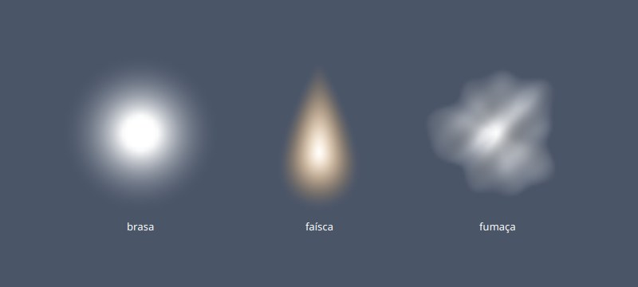
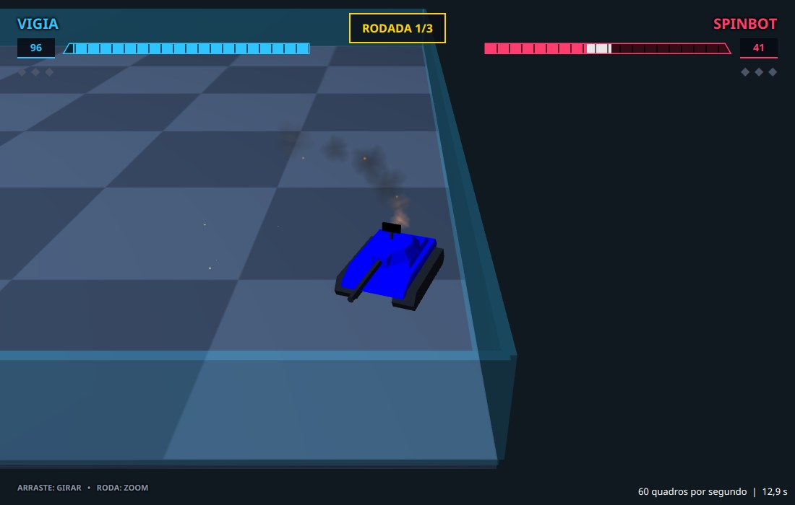
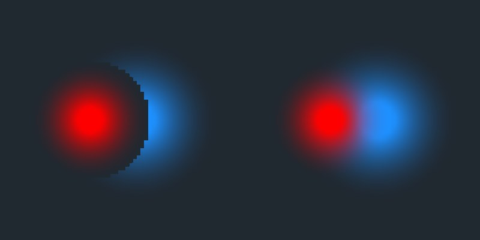
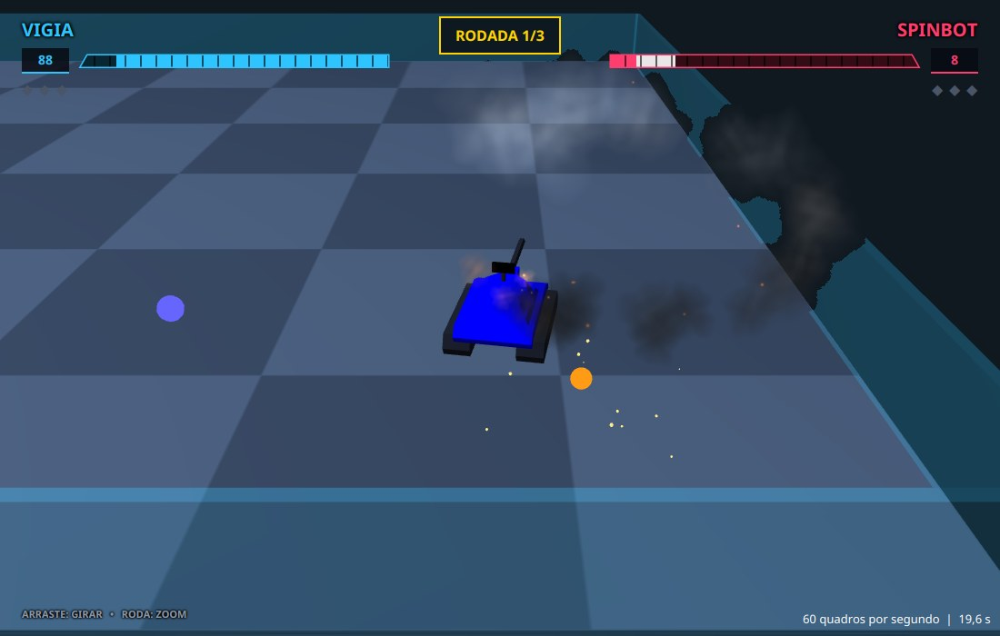

# Capítulo 9 — Fumaça, brasas e faíscas

## Objetivo

Fazer um robô que está perdendo a luta soltar fumaça, brasas e faíscas: quanto menos energia ele tem, mais partículas solta, e mais escura é a fumaça. No caminho, você constrói um **sistema de partículas** e descobre por que o JavaFX precisa de uma ajuda para desenhar coisas transparentes.

## Passo 1 — Muitas coisas pequenas

Fumaça, brasa e faísca têm uma coisa em comum: cada pedacinho dura pouco, e o efeito vem da quantidade. Um jeito comum de fazer isso é o **sistema de partículas**. Uma **partícula** é um objeto pequeno que tem uma posição, uma velocidade, uma **idade** e uma **vida** (quanto tempo ela dura). Ela nasce num ponto, a cada quadro se move e muda de aparência conforme envelhece, e some quando a idade chega à vida. Um sistema de partículas é quem cria, move, desenha e remove todas elas.

A gravação de exemplo mostra por que isso importa. Na primeira rodada, a energia do SpinBot cai abaixo de 50 no turno 379, está em 8 no turno 600 e ele é destruído no turno 826. Entre esses turnos o robô precisa parecer cada vez pior: no começo uma fumaça fina, no fim fumaça pesada e muitas faíscas. A regra que usaremos é a do programa completo: **abaixo de 50 de energia o robô pega fogo**, e a partir daí, quanto menos energia, mais partículas por segundo.

Este capítulo ainda não tem chamas, só o que sai delas: a fumaça sobe e escurece, as brasas sobem e apagam, as faíscas voam em todas as direções e caem no chão. As chamas vêm nos capítulos 10 e 11.

| Classe | O que faz |
|---|---|
| `Avaria` | diz o quanto um robô está avariado, de 0 a 1 |
| `Dosador` | transforma uma taxa ("9 por segundo") em um número inteiro de partículas por quadro |
| `Aparencia` | o tamanho e a cor de cada tipo de partícula em cada momento da vida |
| `Velocidade` | a velocidade de um robô, estimada de um quadro ao outro |
| `TexturasDeFogo` | as imagens das partículas, desenhadas pixel a pixel |
| `Particula` | uma partícula: um quadrado com uma imagem, sempre de frente para a câmera |
| `Particulas` | o sistema: cria, move, desenha e recicla as partículas |
| `Queima` | o fogo de um robô: de onde as partículas saem e quantas |
| `Galeria`, `Experimento` | duas janelas de teste, que mostram as imagens e um problema do 3D |

## Passo 2 — Quando o robô pega fogo

A **avaria** é um número de 0 a 1 que diz o quanto o robô está mal: 0 é "sem fogo" e 1 é "sem energia nenhuma". Abaixo de 50 de energia, a avaria sobe em linha reta: com 25 de energia vale 0,5, e com 0 vale 1. O número de **pontos do casco** que queimam também depende dela: um até 30% de avaria, dois até 60%, três acima disso.

Os dois cálculos usam `Math.max` e `Math.min` para ficar entre 0 e 1, como no `Energia.largura` do capítulo 8. **Crie o arquivo** `src/main/java/campeonato/cena/Avaria.java`:

<!-- arquivo: src/main/java/campeonato/cena/Avaria.java | criar -->
```java
package campeonato.cena;

/** O quanto um robô está avariado: abaixo de metade da energia ele pega fogo, e quanto menos energia, pior. */
final class Avaria {

    /** O robô pega fogo abaixo desta energia. */
    static final double ENERGIA_DO_FOGO = 50;

    private Avaria() {
    }

    /** A avaria de 0 (sem fogo) a 1 (sem energia nenhuma). */
    static double deEnergia(double energia) {
        return Math.max(0, Math.min(1, (ENERGIA_DO_FOGO - energia) / ENERGIA_DO_FOGO));
    }

    /** Em quantos pontos do casco há fogo: 1 até 30% de avaria, 2 até 60%, 3 acima disso. */
    static int pontosQueimando(double avaria) {
        return avaria < 0.3 ? 1 : avaria < 0.6 ? 2 : 3;
    }
}
```

O teste usa a constante `ENERGIA_DO_FOGO`, e não o número 50, para continuar valendo se você mudar o limite. **Crie o arquivo** `src/test/java/campeonato/cena/AvariaTest.java`:

<!-- arquivo: src/test/java/campeonato/cena/AvariaTest.java | criar -->
```java
package campeonato.cena;

import static org.junit.jupiter.api.Assertions.assertEquals;

import org.junit.jupiter.api.Test;

class AvariaTest {

    @Test
    void semAvariaDeMetadeDaEnergiaParaCima() {
        assertEquals(0, Avaria.deEnergia(Avaria.ENERGIA_DO_FOGO), 1e-9);
        assertEquals(0, Avaria.deEnergia(100), 1e-9);
        // a energia pode passar de 100 (capítulo 8)
        assertEquals(0, Avaria.deEnergia(104), 1e-9);
    }

    @Test
    void aAvariaSobeEmLinhaRetaAbaixoDoLimite() {
        assertEquals(0.5, Avaria.deEnergia(Avaria.ENERGIA_DO_FOGO / 2), 1e-9);
        assertEquals(1, Avaria.deEnergia(0), 1e-9);
    }

    @Test
    void aAvariaNaoPassaDeUm() {
        assertEquals(1, Avaria.deEnergia(-5), 1e-9);
    }

    @Test
    void quantoMaisAvariadoMaisPontosQueimam() {
        assertEquals(1, Avaria.pontosQueimando(0.1));
        assertEquals(2, Avaria.pontosQueimando(0.3));
        assertEquals(2, Avaria.pontosQueimando(0.59));
        assertEquals(3, Avaria.pontosQueimando(0.6));
        assertEquals(3, Avaria.pontosQueimando(1));
    }
}
```

## Passo 3 — Quantas partículas por quadro

Queremos "9 partículas por segundo". Mas o programa não trabalha em segundos: trabalha em **quadros**, e um quadro dura 1/60 de segundo (ou mais, se o computador engasgar). Em um quadro, 9 por segundo dão `9 × 1/60 = 0,15` partícula, e não existe 0,15 partícula. Se arredondássemos para 0 a cada quadro, nunca nasceria nada; se arredondássemos para 1, nasceriam 60 por segundo, e o efeito dependeria da velocidade do computador.

A solução é guardar o que é **devido** e ainda não virou uma partícula inteira. A cada quadro somamos `taxa × delta` ao devido; se passou de 1, nasce uma partícula (ou mais) e o que sobra fica guardado para o quadro seguinte. É como pagar uma dívida em moedas inteiras: de 0,15 em 0,15, a sétima parcela passa de 1 e então paga-se uma moeda. Assim a quantidade por segundo é a mesma, a 30, a 60 ou a 144 quadros por segundo. **Crie o arquivo** `src/main/java/campeonato/cena/Dosador.java`:

<!-- arquivo: src/main/java/campeonato/cena/Dosador.java | criar -->
```java
package campeonato.cena;

/** Transforma uma taxa, como "9 por segundo", em um número inteiro de partículas por quadro, sem perder a parte que sobra. */
final class Dosador {

    /** O que já é devido, mas ainda não deu uma partícula inteira. */
    private double devido;

    /** Quantas partículas devem nascer neste quadro, sabendo a taxa (por segundo) e a duração do quadro. */
    int quantos(double delta, double taxa) {
        devido += delta * taxa;
        int inteiras = (int) devido;
        devido -= inteiras;
        return inteiras;
    }

    /** Esquece o que era devido. */
    void zerar() {
        devido = 0;
    }
}
```

O `(int) devido` descarta a parte decimal (para números positivos, é o mesmo que arredondar para baixo). Os testes usam números que o computador representa sem erro (0,25; 0,5; 1,5), para as contas darem exatas. O segundo teste é o importante: a mesma taxa dá o mesmo total com quadros de tamanhos diferentes. **Crie o arquivo** `src/test/java/campeonato/cena/DosadorTest.java`:

<!-- arquivo: src/test/java/campeonato/cena/DosadorTest.java | criar -->
```java
package campeonato.cena;

import static org.junit.jupiter.api.Assertions.assertEquals;

import org.junit.jupiter.api.Test;

class DosadorTest {

    @Test
    void oQueSobraNaoSePerde() {
        Dosador dosador = new Dosador();
        // 2 por segundo, em quadros de 0,25 s: meia partícula por quadro
        assertEquals(0, dosador.quantos(0.25, 2));
        assertEquals(1, dosador.quantos(0.25, 2));
        assertEquals(0, dosador.quantos(0.25, 2));
        assertEquals(1, dosador.quantos(0.25, 2));
    }

    @Test
    void oTotalPorSegundoNaoDependeDoTamanhoDoQuadro() {
        Dosador quadrosCurtos = new Dosador();
        int curtos = 0;
        for (int i = 0; i < 4; i++) {
            curtos += quadrosCurtos.quantos(0.25, 6);
        }
        Dosador quadrosLongos = new Dosador();
        int longos = 0;
        for (int i = 0; i < 2; i++) {
            longos += quadrosLongos.quantos(0.5, 6);
        }
        assertEquals(6, curtos);
        assertEquals(6, longos);
    }

    @Test
    void umQuadroLongoPodeDarMaisDeUmaParticula() {
        assertEquals(3, new Dosador().quantos(0.5, 6));
    }

    @Test
    void zerarEsqueceODevido() {
        Dosador dosador = new Dosador();
        dosador.quantos(0.25, 2);
        dosador.zerar();
        assertEquals(0, dosador.quantos(0.25, 2));
    }
}
```

Rode os testes (`mvn test`). Todos passam.

<!-- testar -->

## Passo 4 — A cara de cada partícula

Cada tipo de partícula muda de tamanho e de cor ao longo da vida. Para descrever isso, usamos o **momento da vida** `t`: um número de 0, quando a partícula nasce, a 1, quando ela morre (é a idade dividida pela vida). Dado o `t`, cada tipo sabe o seu tamanho e a sua cor:

- **Fumaça.** Nasce **laranja**, ainda com a cor do fogo, e em 12% da vida vira cinza (tanto mais escuro quanto menor o `tom`). Cresce de 0,6 vezes o tamanho a 3,2 vezes, e some devagar. A opacidade é `min(1, t × 6) × (1 − t)^1,4 × 0,7`: nos primeiros 1/6 da vida ela **aparece** (o `t × 6`), depois desaparece, mais devagar no começo e mais depressa no fim (o `(1 − t)^1,4`), sem passar de 70% (o 0,7), para a fumaça ser vista através.
- **Faísca.** Branca e amarela, **encolhe** até a metade e apaga: a opacidade é `1 − t²`, que fica perto de 1 por bastante tempo e cai rápido no final.
- **Brasa.** Acende em 10% da vida e depois apaga devagar, ficando mais vermelha. Ela também **cintila**: o tamanho oscila um pouco, com um número sorteado a cada quadro, que entra como parâmetro (`cintilar`) para a conta continuar sem sorte dentro dela, e portanto testável.

Tudo isso é uma conta pura: entra o momento da vida, saem o tamanho e a cor. O `record Visual` agrupa as três respostas (largura, altura e cor). **Crie o arquivo** `src/main/java/campeonato/cena/Aparencia.java`:

<!-- arquivo: src/main/java/campeonato/cena/Aparencia.java | criar -->
```java
package campeonato.cena;

import javafx.scene.paint.Color;

/** Como cada tipo de partícula é, de tamanho e de cor, em cada momento da sua vida (t vai de 0, o nascimento, a 1, o fim). */
final class Aparencia {

    /** O tamanho e a cor de uma partícula num momento. */
    record Visual(double largura, double altura, Color cor) {
    }

    private Aparencia() {
    }

    private static Color comOpacidade(Color cor, double opacidade) {
        return Color.color(cor.getRed(), cor.getGreen(), cor.getBlue(), Math.max(0, Math.min(1, opacidade)));
    }

    /**
     * Uma nuvem de fumaça: nasce laranja, do fogo, e em 12% da vida vira cinza (tanto mais escuro quanto menor o
     * 'tom'); cresce, e some devagar.
     */
    static Visual fumaca(double tamanho, double tom, double t) {
        double largura = tamanho * (0.6 + 2.6 * Math.sqrt(t));
        Color cinza = Color.gray(Math.min(1, tom));
        Color base = t < 0.12
                ? Color.web("#ff7a2a").interpolate(cinza, t / 0.12)
                : cinza.interpolate(Color.gray(Math.min(0.4, tom + 0.12)), (t - 0.12) / 0.88);
        // surge nos primeiros 1/6 da vida e depois some, mais devagar no começo e mais depressa no fim
        double opacidade = Math.min(1, t * 6) * Math.pow(1 - t, 1.4) * 0.7;
        return new Visual(largura, largura, comOpacidade(base, opacidade));
    }

    /** Uma faísca: branca e amarela, encolhe até a metade e apaga. */
    static Visual faisca(double tamanho, double t) {
        double largura = tamanho * (1 - 0.5 * t);
        return new Visual(largura, largura, Color.color(1, 0.85 - 0.4 * t, 0.4 - 0.3 * t, 1 - t * t));
    }

    /** Uma brasa: acende em 10% da vida, depois apaga; vai ficando mais vermelha. 'cintilar' (de 0 a 1) a faz tremer de tamanho. */
    static Visual brasa(double tamanho, double t, double cintilar) {
        double largura = tamanho * (1 - 0.3 * t) * (0.7 + 0.3 * cintilar);
        double brilho = (t < 0.1 ? t * 10 : 1 - (t - 0.1) / 0.9) * 0.95;
        return new Visual(largura, largura, Color.color(1, 0.62 - 0.4 * t, 0.15 - 0.1 * t, Math.max(0, brilho)));
    }
}
```

Alguns detalhes:

- `Color.color(r, g, b, opacidade)` cria uma cor com os canais de 0 a 1. O JavaFX **recusa** (lança uma exceção) um canal fora dessa faixa, por isso o `comOpacidade` limita a opacidade com `Math.max` e `Math.min`. Nas faíscas e nas brasas, as contas já ficam dentro da faixa para qualquer `t` de 0 a 1.
- `Color.interpolate(outra, fração)` devolve uma cor entre as duas: com fração 0 é a primeira, com fração 1 é a outra. É a mesma ideia do `Geometria.interpolar`, para cores.
- `Math.sqrt(t)` faz a fumaça crescer **depressa no começo e devagar depois**, como uma nuvem que se espalha.

Os testes conferem os pontos que importam de cada curva: o começo, o fim e o que fica no meio. **Crie o arquivo** `src/test/java/campeonato/cena/AparenciaTest.java`:

<!-- arquivo: src/test/java/campeonato/cena/AparenciaTest.java | criar -->
```java
package campeonato.cena;

import static org.junit.jupiter.api.Assertions.assertEquals;
import static org.junit.jupiter.api.Assertions.assertTrue;

import javafx.scene.paint.Color;
import org.junit.jupiter.api.Test;

class AparenciaTest {

    /** O JavaFX guarda cada canal de uma Color num float, que tem menos dígitos que um double. */
    private static final double ERRO_DA_COR = 1e-6;

    @Test
    void aFumacaNasceInvisivelELaranja() {
        Aparencia.Visual nasce = Aparencia.fumaca(10, 0.15, 0);
        assertEquals(0, nasce.cor().getOpacity(), ERRO_DA_COR);
        assertEquals(Color.web("#ff7a2a").getRed(), nasce.cor().getRed(), ERRO_DA_COR);
        assertEquals(Color.web("#ff7a2a").getBlue(), nasce.cor().getBlue(), ERRO_DA_COR);
        assertEquals(6, nasce.largura(), 1e-9);
    }

    @Test
    void aFumacaViraCinzaEDepoisSome() {
        Aparencia.Visual cinza = Aparencia.fumaca(10, 0.15, 0.12);
        assertEquals(cinza.cor().getRed(), cinza.cor().getGreen(), ERRO_DA_COR);
        assertEquals(cinza.cor().getGreen(), cinza.cor().getBlue(), ERRO_DA_COR);
        assertTrue(cinza.cor().getOpacity() > 0.4);
        assertEquals(0, Aparencia.fumaca(10, 0.15, 1).cor().getOpacity(), ERRO_DA_COR);
        assertEquals(32, Aparencia.fumaca(10, 0.15, 1).largura(), 1e-9);
    }

    @Test
    void aFumacaCrescePorTodaAVida() {
        double anterior = 0;
        for (double t = 0; t <= 1; t += 0.1) {
            double largura = Aparencia.fumaca(10, 0.15, t).largura();
            assertTrue(largura > anterior);
            anterior = largura;
        }
    }

    @Test
    void aFaiscaNasceBrilhanteEApagaEncolhendo() {
        assertEquals(1, Aparencia.faisca(2, 0).cor().getOpacity(), ERRO_DA_COR);
        assertEquals(2, Aparencia.faisca(2, 0).largura(), 1e-9);
        assertEquals(0, Aparencia.faisca(2, 1).cor().getOpacity(), ERRO_DA_COR);
        assertEquals(1, Aparencia.faisca(2, 1).largura(), 1e-9);
    }

    @Test
    void aBrasaAcendeEmUmDecimoDaVidaEDepoisApaga() {
        assertEquals(0, Aparencia.brasa(2, 0, 0.5).cor().getOpacity(), ERRO_DA_COR);
        assertEquals(0.95, Aparencia.brasa(2, 0.1, 0.5).cor().getOpacity(), ERRO_DA_COR);
        assertTrue(Aparencia.brasa(2, 0.5, 0.5).cor().getOpacity() < 0.95);
        assertEquals(0, Aparencia.brasa(2, 1, 0.5).cor().getOpacity(), ERRO_DA_COR);
    }

    @Test
    void aBrasaCintilaDentroDeUmaFaixa() {
        double apagada = Aparencia.brasa(10, 0.2, 0).largura();
        double acesa = Aparencia.brasa(10, 0.2, 1).largura();
        assertEquals(0.7, apagada / acesa, 1e-9);
    }
}
```

Os testes de cor usam uma tolerância maior que a dos outros: `1e-6`, e não `1e-9`. O JavaFX guarda cada canal de uma `Color` em um `float`, o tipo de 32 bits, que tem metade dos dígitos de um `double`. O `0.95` que entra volta como `0.949999988079071`. Se você usar `1e-9` nesses testes, eles falham, e a mensagem do JUnit mostra os dois números: `expected: <0.95> but was: <0.949999988079071>`. Como no capítulo 5, o terceiro argumento do `assertEquals` é o tamanho do erro aceito, e aqui ele precisa ser do tamanho do erro do `float`.

<!-- testar -->

## Passo 5 — Um quadrado que olha para a câmera

Como desenhar uma nuvem de fumaça em 3D? Uma esfera cinza não ficaria boa, e uma fumaça de verdade tem milhares de pontos. O truque usado nos jogos é o **cartaz** (*billboard*, em inglês): um **quadrado plano** com a imagem de uma nuvem, que **sempre fica de frente para a câmera**. Visto de qualquer lado, o quadrado mostra a sua face inteira, e a imagem parece ter volume. Várias nuvens-cartaz, uma sobre a outra, dão a ilusão de uma massa de fumaça.

Em JavaFX um quadrado é uma malha de dois triângulos (`TriangleMesh`) com a imagem esticada sobre ela, como o piso do capítulo 2. O quadrado tem lado 1 e todas as partículas compartilham a mesma malha. O tamanho de cada uma vem de uma **escala**.

Para virar o quadrado para a câmera, damos a ele **os mesmos giro e inclinação** que a câmera tem. A câmera é uma cadeia de transformações (capítulo 2): vai para o foco, gira, inclina e se afasta. O quadrado só precisa do giro e da inclinação: com a mesma orientação da câmera, ele fica perpendicular ao olhar dela.

O JavaFX aplica as transformações de um nó **da última para a primeira da lista**. Na lista `(giro, inclinacao, rotacao, escala)` da partícula, acontece primeiro a escala (o quadrado de lado 1 vira um retângulo do tamanho da partícula), depois a `rotacao` (o quadrado roda sobre si mesmo, em torno do eixo Z, que atravessa o quadrado: a fumaça gira devagar), e então a inclinação e o giro, os da câmera.

Para isso a `CameraOrbital` precisa dizer os dois ângulos. Ela também vai dizer **onde está** a câmera (o `olho`), o que usaremos no passo 9. O `olho` é o resultado da cadeia inteira aplicada ao ponto (0, 0, 0): o foco, mais o giro e a inclinação aplicados ao ponto 900 unidades atrás do foco. Em vez de fazer a conta de trigonometria à mão, deixamos o JavaFX fazer: `createConcatenation` junta duas transformações numa só, e `transform` aplica o resultado a um ponto. **No topo do arquivo** `CameraOrbital.java`:

<!-- arquivo: src/main/java/campeonato/cena/CameraOrbital.java | importar -->
```java
import javafx.geometry.Point3D;
import javafx.scene.transform.Transform;
```

**Acrescente ao final da classe** `CameraOrbital`:

<!-- arquivo: src/main/java/campeonato/cena/CameraOrbital.java | acrescentar -->
```java

    /** O giro da câmera em volta do foco, em graus. */
    public double giro() {
        return giro.getAngle();
    }

    /** A inclinação da câmera, em graus (negativa: a câmera está acima do chão, olhando para baixo). */
    public double inclinacao() {
        return inclinacao.getAngle();
    }

    /** Onde a câmera está, no mundo: o ponto de saída da cadeia de transformações. */
    public Point3D olho() {
        Transform total = foco.createConcatenation(giro).createConcatenation(inclinacao).createConcatenation(afastamento);
        return total.transform(0, 0, 0);
    }
```

Os testes conferem os números com a conta de trigonometria feita à mão: a câmera começa a 900 de distância, inclinada 38 graus para baixo. Isso a coloca `900 × sen 38°` acima do foco e `900 × cos 38°` atrás dele; o foco está a 10 unidades de altura. **Crie o arquivo** `src/test/java/campeonato/cena/CameraOrbitalTest.java`:

<!-- arquivo: src/test/java/campeonato/cena/CameraOrbitalTest.java | criar -->
```java
package campeonato.cena;

import static org.junit.jupiter.api.Assertions.assertEquals;

import javafx.geometry.Point3D;
import org.junit.jupiter.api.Test;

class CameraOrbitalTest {

    @Test
    void aCameraComecaAtrasEEmCimaDoFoco() {
        CameraOrbital camera = new CameraOrbital();
        Point3D olho = camera.olho();
        // 900 de distância, inclinada 38 graus para baixo; o foco está em (0, -10, 0)
        assertEquals(0, olho.getX(), 1e-6);
        assertEquals(-10 - 900 * Math.sin(Math.toRadians(38)), olho.getY(), 1e-6);
        assertEquals(-900 * Math.cos(Math.toRadians(38)), olho.getZ(), 1e-6);
    }

    @Test
    void girarAcameraMudaOLugarDoOlhoMasNaoASuaAltura() {
        CameraOrbital camera = new CameraOrbital();
        double altura = camera.olho().getY();
        camera.girar(90);
        Point3D olho = camera.olho();
        assertEquals(altura, olho.getY(), 1e-6);
        // um quarto de volta: o olho que estava atrás (em -z) passa para o lado (em -x)
        assertEquals(-900 * Math.cos(Math.toRadians(38)), olho.getX(), 1e-6);
        assertEquals(0, olho.getZ(), 1e-6);
    }

    @Test
    void osAngulosSaoOsQueACameraTem() {
        CameraOrbital camera = new CameraOrbital();
        camera.girar(30);
        camera.inclinar(10);
        assertEquals(30, camera.giro(), 1e-9);
        assertEquals(-28, camera.inclinacao(), 1e-9);
    }
}
```

Agora a partícula. Ela guarda a **posição** e a **velocidade** (`x`, `y`, `z`, `vx`, `vy`, `vz`), a **idade** e a **vida**, o `tamanho`, a `velocidadeDeRotacao`, o `tom` (um número que diferencia uma partícula da outra: na fumaça, o tom de cinza) e a `distancia` até a câmera, para o passo 9. O `Tipo` diz o que ela é. A `forma` é o quadrado (`MeshView`), o `material` guarda a imagem e a cor. O `CullFace.NONE` faz as duas faces do quadrado aparecerem; por padrão o JavaFX esconde a face de trás. Os campos não são `private` para a classe `Particulas`, do mesmo pacote, poder mexer neles direto. **Crie o arquivo** `src/main/java/campeonato/cena/Particula.java`:

<!-- arquivo: src/main/java/campeonato/cena/Particula.java | criar -->
```java
package campeonato.cena;

import javafx.scene.paint.Color;
import javafx.scene.paint.PhongMaterial;
import javafx.scene.shape.CullFace;
import javafx.scene.shape.MeshView;
import javafx.scene.shape.TriangleMesh;
import javafx.scene.transform.Rotate;
import javafx.scene.transform.Scale;

/**
 * Uma partícula do fogo (a fumaça, a faísca, a brasa): um quadrado com uma imagem, sempre de frente para a câmera.
 * Em geral vive no mundo, e não presa ao robô: um robô que anda deixa para trás um rastro de fumaça.
 */
final class Particula {

    /** O que a partícula é. */
    enum Tipo {
        FUMACA, FAISCA, BRASA
    }

    /** Um quadrado de lado 1, de frente para o eixo -z, que todas as partículas compartilham. */
    static final TriangleMesh QUADRADO = quadrado();

    final MeshView forma = new MeshView(QUADRADO);
    final PhongMaterial material = new PhongMaterial();
    /** Viram o quadrado para a câmera (giro e inclinacao), o fazem rodar sobre si mesmo (rotacao) e o esticam (escala). */
    final Rotate giro = new Rotate(0, Rotate.Y_AXIS);
    final Rotate inclinacao = new Rotate(0, Rotate.X_AXIS);
    final Rotate rotacao = new Rotate(0, Rotate.Z_AXIS);
    final Scale escala = new Scale(1, 1, 1);

    Tipo tipo;
    double x;
    double y;
    double z;
    double vx;
    double vy;
    double vz;
    /** Há quantos segundos nasceu e quantos segundos vive. */
    double idade;
    double vida;
    double tamanho;
    /** Quantos graus por segundo o quadrado roda sobre si mesmo. */
    double velocidadeDeRotacao;
    /** Um número que diferencia cada partícula: na fumaça, o tom de cinza. */
    double tom;
    /** O quadrado da distância até a câmera, para desenhar as de longe antes das de perto. */
    double distancia;

    Particula() {
        forma.setMaterial(material);
        // as duas faces aparecem
        forma.setCullFace(CullFace.NONE);
        // a ordem importa: a escala é aplicada primeiro, o giro por último
        forma.getTransforms().addAll(giro, inclinacao, rotacao, escala);
    }

    /** Anda junto com quem a soltou: soma a velocidade dele à dela. */
    void herdar(double velocidadeX, double velocidadeZ) {
        vx += velocidadeX;
        vz += velocidadeZ;
    }

    /** O quadrado: quatro pontos, dois triângulos e as coordenadas da imagem em cada ponto. */
    private static TriangleMesh quadrado() {
        TriangleMesh malha = new TriangleMesh();
        malha.getPoints().addAll(-0.5f, -0.5f, 0, 0.5f, -0.5f, 0, 0.5f, 0.5f, 0, -0.5f, 0.5f, 0);
        malha.getTexCoords().addAll(0, 0, 1, 0, 1, 1, 0, 1);
        malha.getFaces().addAll(0, 0, 2, 2, 1, 1, 0, 0, 3, 3, 2, 2);
        return malha;
    }
}
```

A malha segue o formato do capítulo 3: os pontos são `x, y, z` (quatro, os cantos do quadrado), as coordenadas da imagem são `u, v` (a imagem vai de 0 a 1 nos dois eixos) e cada face é uma lista de pares `ponto, coordenada`. As duas faces são os triângulos 0-2-1 e 0-3-2, que juntos cobrem o quadrado. O `quadrado()` é `static` e roda uma vez só, ao carregar a classe.

## Passo 6 — As imagens das partículas

Uma partícula é um quadrado, e quem faz dele uma nuvem ou uma faísca é a **imagem** (a *textura*) colada nele. Como no tabuleiro do capítulo 2, desenhamos as imagens pelo programa, pixel a pixel, com um `WritableImage`. Cada pixel tem uma cor e uma **opacidade** (o canal alfa), e a forma de cada imagem está em como a opacidade varia pelo quadrado:

- **Brasa.** Um ponto branco macio. A opacidade vale 1 no centro e cai até 0 na borda: `1 − raio`, onde `raio` é a distância ao centro (0 no centro, 1 na borda). Elevada ao quadrado, `alfa²`, ela cai devagar no meio e rápido perto da borda, e fica mais concentrada.
- **Faísca.** Uma gota de fogo: redonda embaixo e pontuda em cima, branca no meio (quente) e amarelada nas bordas. A largura da gota diminui com a altura, o que dá a ponta. O `alfa × alfa × (3 − 2 × alfa)` é a curva suave de Hermite, que sobe devagar, depois depressa, depois devagar de novo, e deixa a borda sem quinas.
- **Fumaça.** Uma nuvem cinza de borda irregular. A borda é um círculo de raio 0,78 com três ondas somadas (de 3, 5 e 9 lóbulos), por isso não parece uma bola. Dentro, manchas mais claras e mais escuras vêm de senos multiplicados.

O `Random(7)` com **semente** fixa garante que a fumaça seja sempre a mesma nuvem, em todos os computadores: um gerador de números aleatórios com a mesma semente produz sempre a mesma sequência. **Crie o arquivo** `src/main/java/campeonato/cena/TexturasDeFogo.java`:

<!-- arquivo: src/main/java/campeonato/cena/TexturasDeFogo.java | criar -->
```java
package campeonato.cena;

import java.util.Random;
import javafx.scene.image.Image;
import javafx.scene.image.WritableImage;
import javafx.scene.paint.Color;

/** As imagens das partículas, desenhadas uma vez, pixel a pixel: a brasa, a faísca e a nuvem de fumaça. */
final class TexturasDeFogo {

    /** Um ponto branco macio, para as brasas: opaco no centro e transparente na borda. */
    static final Image DE_BRASA = brasa();

    /** Uma pequena língua de fogo, branca e quente no meio, redonda embaixo e pontuda em cima. */
    static final Image DE_FAISCA = faisca();

    /** Uma nuvem cinza de borda irregular, com manchas mais claras e mais escuras. */
    static final Image DE_FUMACA = fumaca();

    private TexturasDeFogo() {
    }

    private static Image brasa() {
        int lado = 32;
        WritableImage imagem = new WritableImage(lado, lado);
        for (int y = 0; y < lado; y++) {
            for (int x = 0; x < lado; x++) {
                // a distância ao centro, de 0 (no centro) a 1 (na borda)
                double raio = Math.hypot((x + 0.5) / lado * 2 - 1, (y + 0.5) / lado * 2 - 1);
                double alfa = Math.max(0, 1 - raio);
                imagem.getPixelWriter().setColor(x, y, Color.color(1, 1, 1, Math.min(1, alfa * alfa * 1.6)));
            }
        }
        return imagem;
    }

    private static Image faisca() {
        int lado = 64;
        WritableImage imagem = new WritableImage(lado, lado);
        for (int y = 0; y < lado; y++) {
            for (int x = 0; x < lado; x++) {
                double u = (x + 0.5) / lado * 2 - 1;
                // 1 em cima, -1 embaixo
                double v = 1 - (y + 0.5) / lado * 2;
                // mais estreita quanto mais alta
                double largura = 0.62 * Math.pow(Math.max(0, (1 - v) / 2), 0.55) + 0.04;
                double centro = -0.25;
                double dx = u / largura;
                double dy = v < centro ? (v - centro) / 0.75 : (v - centro) / 1.2;
                double distancia = Math.sqrt(dx * dx + dy * dy);
                double alfa = Math.max(0, 1 - distancia);
                // a curva suave 3a² - 2a³: sobe devagar, depressa e devagar de novo
                alfa = alfa * alfa * (3 - 2 * alfa);
                double calor = Math.max(0, 1 - distancia * 1.4);
                imagem.getPixelWriter().setColor(x, y, Color.color(1, 0.75 + 0.25 * calor, 0.45 + 0.55 * calor, Math.min(1, alfa)));
            }
        }
        return imagem;
    }

    private static Image fumaca() {
        int lado = 64;
        WritableImage imagem = new WritableImage(lado, lado);
        Random sorteio = new Random(7);
        double[] fase = new double[6];
        for (int i = 0; i < fase.length; i++) {
            fase[i] = sorteio.nextDouble() * Math.PI * 2;
        }
        for (int y = 0; y < lado; y++) {
            for (int x = 0; x < lado; x++) {
                double u = (x + 0.5) / lado * 2 - 1;
                double v = (y + 0.5) / lado * 2 - 1;
                double angulo = Math.atan2(v, u);
                double raio = Math.hypot(u, v);
                // a borda é um círculo com ondas de 3, 5 e 9 lóbulos, para não parecer uma bola
                double borda = 0.78 + 0.08 * Math.sin(3 * angulo + fase[0]) + 0.06 * Math.sin(5 * angulo + fase[1]) + 0.04 * Math.sin(9 * angulo + fase[2]);
                double alfa = Math.pow(Math.max(0, 1 - raio / borda), 0.8);
                // manchas mais claras e mais escuras por dentro
                double mancha = 0.85 + 0.15 * Math.sin(u * 7 + fase[3]) * Math.sin(v * 6 + fase[4]) + 0.08 * Math.sin((u + v) * 11 + fase[5]);
                double cinza = Math.max(0, Math.min(1, mancha));
                imagem.getPixelWriter().setColor(x, y, Color.color(cinza, cinza, cinza, Math.min(1, alfa * (0.75 + 0.25 * mancha))));
            }
        }
        return imagem;
    }
}
```

Para ver as imagens, uma janela de teste: a `Galeria` mostra as três ampliadas sobre um fundo cinza, que deixa ver o que é transparente (sobre um fundo branco, o branco sumiria). **Crie o arquivo** `src/main/java/campeonato/cena/Galeria.java`:

<!-- arquivo: src/main/java/campeonato/cena/Galeria.java | criar -->
```java
package campeonato.cena;

import javafx.application.Application;
import javafx.geometry.Insets;
import javafx.geometry.Pos;
import javafx.scene.Parent;
import javafx.scene.Scene;
import javafx.scene.control.Label;
import javafx.scene.image.Image;
import javafx.scene.image.ImageView;
import javafx.scene.layout.HBox;
import javafx.scene.layout.VBox;
import javafx.scene.paint.Color;
import javafx.stage.Stage;

/** Uma janela para ver as imagens que o programa desenha, ampliadas, sobre um fundo cinza que deixa ver o que é transparente. */
public class Galeria extends Application {

    /** Uma imagem ampliada, com o seu nome embaixo. */
    private static VBox quadro(String nome, Image imagem) {
        ImageView vista = new ImageView(imagem);
        vista.setFitWidth(200);
        vista.setPreserveRatio(true);
        Label legenda = new Label(nome);
        legenda.setTextFill(Color.WHITE);
        VBox quadro = new VBox(8, vista, legenda);
        quadro.setAlignment(Pos.CENTER);
        return quadro;
    }

    /** O conteúdo da janela: as imagens lado a lado. */
    static Parent montar() {
        HBox caixa = new HBox(24,
                quadro("brasa", TexturasDeFogo.DE_BRASA),
                quadro("faísca", TexturasDeFogo.DE_FAISCA),
                quadro("fumaça", TexturasDeFogo.DE_FUMACA));
        caixa.setAlignment(Pos.CENTER);
        caixa.setPadding(new Insets(24));
        caixa.setStyle("-fx-background-color: #4a5568;");
        return caixa;
    }

    @Override
    public void start(Stage palco) {
        palco.setTitle("Galeria de imagens");
        palco.setScene(new Scene(montar(), 800, 360));
        palco.show();
    }

    public static void main(String[] args) {
        launch(args);
    }
}
```

<!-- compilar -->

Agora, uma coisa nova. Até aqui o `mvn javafx:run` abriu sempre o `Principal`. Como o `classe.principal` do `pom.xml` (capítulo 1) é uma propriedade, uma opção `-D` na linha de comando troca a classe que o plugin abre, sem mexer no arquivo:

<!-- executar: | rodar: 12 | proibe: Exception, ERROR -->
```bash
mvn javafx:run -Dclasse.principal=campeonato.cena.Galeria
```

<!-- marco: 09-texturas -->



A brasa é um ponto de luz, a faísca é uma gota pontuda, e a fumaça é uma nuvem de borda irregular. Elas só ficam bonitas quando as partículas as movem, envelhecem, aumentam e apagam.

## Passo 7 — O sistema de partículas

O sistema, a classe `Particulas`, faz quatro coisas:

1. **Cria** uma partícula (`criar`), do tipo e no ponto pedidos, com um pouco de **sorte** em cada característica (vida, tamanho, velocidade), para duas fumaças nunca serem iguais.
2. **Move** cada partícula a cada quadro (`mover`): a velocidade vira posição, o ar freia, a faísca cai, a brasa balança.
3. **Desenha** (`posicionar`): põe o quadrado no lugar, do tamanho e da cor que a `Aparencia` diz para aquele momento da vida, virado para a câmera.
4. **Recicla**: quando a partícula morre, ela não é jogada fora, vai para uma lista de **reserva**, e a próxima que nascer reaproveita o mesmo objeto. Num fogo nascem dezenas de partículas por segundo, e criar e descartar um objeto cada vez deixaria o programa cheio de lixo para o Java recolher, o que causa pequenas pausas. Reaproveitar é mais barato. É o mesmo cuidado do `Efeitos`, mas aqui é por desempenho.

O movimento segue a física do capítulo 7, com dois detalhes:

- **O arrasto.** `Math.exp(-k * delta)` é um fator entre 0 e 1 que reduz a velocidade a cada quadro. Como o atrito do `CorpoLivre`, ele não depende de quantos quadros por segundo o computador faz. O `k` vale 0,6 na fumaça (que flutua), 1,5 na faísca (que é pequena e pesada) e a brasa **não tem** arrasto: ela sobe com a velocidade que nasceu.
- **O chão.** O eixo Y cresce para baixo (capítulo 2), então "para cima" é `vy` negativo e o chão é `y = 0`. O `Math.min(-1, ...)` impede qualquer partícula de passar de `y = -1`, um pouco acima do chão. E uma faísca que chega ao chão (`y >= -1` e `vy > 0`, ou seja, caindo) apaga na hora, no `particula.idade = particula.vida`.

A lista `vivas` é percorrida **de trás para a frente** (`for (int i = vivas.size() - 1; i >= 0; i--)`). Assim `vivas.remove(i)` não atrapalha os elementos que ainda faltam: removendo do fim para o começo, os índices que ainda não visitamos não mudam.

O método `desenhar` põe os quadrados na `camada`, um grupo do JavaFX que fica no mundo, na ordem da lista `vivas`. Só troca os filhos se a lista mudou (`equals`), porque trocar a cada quadro, sem precisar, é trabalho à toa. **Crie o arquivo** `src/main/java/campeonato/cena/Particulas.java`:

<!-- arquivo: src/main/java/campeonato/cena/Particulas.java | criar -->
```java
package campeonato.cena;

import campeonato.cena.Particula.Tipo;
import java.util.ArrayList;
import java.util.List;
import java.util.Random;
import javafx.geometry.Point3D;
import javafx.scene.Group;
import javafx.scene.Node;

/** O sistema de partículas: cria, move, desenha e recicla as partículas do fogo. */
final class Particulas {

    /** Passando disto, as partículas novas são feitas, mas não aparecem. */
    private static final int LIMITE = 900;

    private final Group camada = new Group();
    /** As partículas que estão vivas, e as que já morreram, guardadas para serem reaproveitadas. */
    private final List<Particula> vivas = new ArrayList<>();
    private final List<Particula> reserva = new ArrayList<>();
    /** Reaproveitada a cada quadro, para não gerar lixo. */
    private final List<Node> vistas = new ArrayList<>();
    private final Random sorteio;

    Particulas(Random sorteio) {
        this.sorteio = sorteio;
    }

    /** O grupo com os quadrados de todas as partículas, que se põe no mundo. */
    Group camada() {
        return camada;
    }

    /**
     * Cria uma partícula num ponto do mundo.
     *
     * @param avaria de 0 a 1: quanto mais avariado o robô de onde ela sai, mais escura a fumaça
     */
    Particula criar(Tipo tipo, double x, double y, double z, double avaria) {
        // uma partícula morta é reaproveitada: criar centenas de objetos por segundo pesaria na memória
        Particula particula = reserva.isEmpty() ? new Particula() : reserva.remove(reserva.size() - 1);
        particula.tipo = tipo;
        particula.x = x;
        particula.y = y;
        particula.z = z;
        particula.idade = 0;
        particula.rotacao.setAngle(sorteio.nextDouble() * 360);
        iniciar(particula, avaria);
        if (vivas.size() < LIMITE) {
            vivas.add(particula);
        } else {
            reserva.add(particula);
        }
        return particula;
    }

    /** Dá a cada tipo a sua vida, o seu tamanho, a sua velocidade e a sua imagem, com um pouco de sorte. */
    private void iniciar(Particula particula, double avaria) {
        switch (particula.tipo) {
        case FUMACA -> {
            particula.vida = 1.6 + sorteio.nextDouble() * 1.4;
            particula.tamanho = 9 + sorteio.nextDouble() * 6;
            // sobe (o y negativo é para cima) e vai um pouco para o lado, levada pelo vento
            particula.vx = (sorteio.nextDouble() - 0.5) * 8 + 6;
            particula.vz = (sorteio.nextDouble() - 0.5) * 8 + 3;
            particula.vy = -(20 + sorteio.nextDouble() * 14);
            particula.velocidadeDeRotacao = (sorteio.nextDouble() - 0.5) * 70;
            // quanto mais avariado o robô, mais escura a fumaça
            particula.tom = 0.16 - 0.1 * avaria + sorteio.nextDouble() * 0.06;
            particula.material.setDiffuseMap(TexturasDeFogo.DE_FUMACA);
        }
        case BRASA -> {
            particula.vida = 0.9 + sorteio.nextDouble() * 0.9;
            particula.tamanho = 1.3 + sorteio.nextDouble() * 1.2;
            particula.vx = (sorteio.nextDouble() - 0.5) * 12;
            particula.vz = (sorteio.nextDouble() - 0.5) * 12;
            particula.vy = -(18 + sorteio.nextDouble() * 24);
            particula.velocidadeDeRotacao = 0;
            particula.tom = sorteio.nextDouble();
            particula.material.setDiffuseMap(TexturasDeFogo.DE_BRASA);
        }
        case FAISCA -> {
            particula.vida = 0.5 + sorteio.nextDouble() * 0.5;
            particula.tamanho = 1.6 + sorteio.nextDouble() * 1.4;
            // jogada para todos os lados, em círculo, e para cima
            double angulo = sorteio.nextDouble() * Math.PI * 2;
            double velocidade = 30 + sorteio.nextDouble() * 50;
            particula.vx = Math.cos(angulo) * velocidade;
            particula.vz = Math.sin(angulo) * velocidade;
            particula.vy = -(60 + sorteio.nextDouble() * 70);
            particula.velocidadeDeRotacao = 0;
            particula.material.setDiffuseMap(TexturasDeFogo.DE_FAISCA);
        }
        }
    }

    /** Move e desenha todas as partículas, tira as que morreram e põe as outras na camada. */
    void atualizar(double delta, CameraOrbital camera) {
        Point3D olho = camera.olho();
        for (int i = vivas.size() - 1; i >= 0; i--) {
            Particula particula = vivas.get(i);
            particula.idade += delta;
            if (particula.idade >= particula.vida) {
                vivas.remove(i);
                reserva.add(particula);
                continue;
            }
            mover(particula, delta);
            posicionar(particula, camera, olho);
        }
        desenhar();
    }

    /** O movimento de uma partícula: o ar a freia, a faísca cai, a brasa balança. */
    private void mover(Particula particula, double delta) {
        // brasas não são freadas; a fumaça é freada de leve; a faísca, mais forte
        double arrasto = particula.tipo == Tipo.BRASA ? 1 : Math.exp(-(particula.tipo == Tipo.FUMACA ? 0.6 : 1.5) * delta);
        particula.vx *= arrasto;
        particula.vz *= arrasto;
        if (particula.tipo == Tipo.FAISCA) {
            // a gravidade puxa para baixo (o y positivo é para baixo)
            particula.vy += 160 * delta;
        }
        particula.x += particula.vx * delta;
        // nunca abaixo do chão
        particula.y = Math.min(-1, particula.y + particula.vy * delta);
        // a faísca que cai no chão apaga
        if (particula.tipo == Tipo.FAISCA && particula.y >= -1 && particula.vy > 0) {
            particula.idade = particula.vida;
        }
        if (particula.tipo == Tipo.BRASA) {
            particula.x += Math.sin(particula.idade * 3 + particula.tom * 6) * 9 * delta;
        }
        particula.z += particula.vz * delta;
        particula.rotacao.setAngle(particula.rotacao.getAngle() + particula.velocidadeDeRotacao * delta);
    }

    /** Põe o quadrado no lugar, do tamanho e da cor do momento, virado para a câmera. */
    private void posicionar(Particula particula, CameraOrbital camera, Point3D olho) {
        double t = particula.idade / particula.vida;
        Aparencia.Visual visual = switch (particula.tipo) {
        case FUMACA -> Aparencia.fumaca(particula.tamanho, particula.tom, t);
        case FAISCA -> Aparencia.faisca(particula.tamanho, t);
        case BRASA -> Aparencia.brasa(particula.tamanho, t, sorteio.nextDouble());
        };
        particula.material.setDiffuseColor(visual.cor());
        particula.forma.setTranslateX(particula.x);
        particula.forma.setTranslateY(particula.y);
        particula.forma.setTranslateZ(particula.z);
        // com os mesmos giro e inclinação da câmera, o quadrado fica de frente para ela
        particula.giro.setAngle(camera.giro());
        particula.inclinacao.setAngle(camera.inclinacao());
        particula.escala.setX(Math.max(0.01, visual.largura()));
        particula.escala.setY(Math.max(0.01, visual.altura()));
        double dx = particula.x - olho.getX();
        double dy = particula.y - olho.getY();
        double dz = particula.z - olho.getZ();
        particula.distancia = dx * dx + dy * dy + dz * dz;
    }

    /** Põe na camada, na ordem da lista, os quadrados das partículas vivas. */
    private void desenhar() {
        vistas.clear();
        for (Particula particula : vivas) {
            vistas.add(particula.forma);
        }
        // só troca os filhos da camada se a lista mudou: trocar a cada quadro, sem precisar, é trabalho à toa
        if (!camada.getChildren().equals(vistas)) {
            camada.getChildren().setAll(vistas);
        }
    }

    /** Tira todas as partículas da cena e as guarda para reaproveitar. */
    void limpar() {
        reserva.addAll(vivas);
        vivas.clear();
        camada.getChildren().clear();
    }
}
```

Observações sobre o código:

- O `switch` com `->` que **devolve** um valor (`Aparencia.Visual visual = switch (...) {...};`) é a forma do capítulo 4, agora com `case FUMACA -> ...` para cada tipo. O compilador exige que todos os tipos estejam cobertos.
- Na `posicionar` a `distancia` é o **quadrado** da distância até a câmera (`dx² + dy² + dz²`), sem a raiz. Para comparar qual de duas partículas está mais longe, a raiz quadrada é desnecessária (se `a² > b²`, então `a > b`), e a raiz é uma conta cara que o programa faria centenas de vezes por quadro.
- Os limites: `LIMITE = 900` evita que um fogo muito intenso encha a tela de quadrados e deixe o programa lento.

Agora a `Arena3D`. A camada das partículas vai para o mundo logo antes do vidro da cerca, como a dos tiros e a dos efeitos. **Acrescente ao final da classe** `Arena3D`:

<!-- arquivo: src/main/java/campeonato/cena/Arena3D.java | acrescentar -->
```java

    private final Particulas particulas = new Particulas(sorteio);
```

**Acrescente a linha** abaixo logo depois de `mundo.getChildren().add(mundo.getChildren().indexOf(cerca), acao);`, no método `montarMundo`:

<!-- arquivo: src/main/java/campeonato/cena/Arena3D.java | inserir-depois indexOf(cerca), acao); -->
```java
        mundo.getChildren().add(mundo.getChildren().indexOf(cerca), particulas.camada());
```

A rodada nova apaga as partículas da anterior. **Acrescente a linha** abaixo logo depois de `efeitos.limpar();`, no método `iniciarRodada`:

<!-- arquivo: src/main/java/campeonato/cena/Arena3D.java | inserir-depois efeitos.limpar(); -->
```java
        particulas.limpar();
```

E, em todo quadro, as partículas se atualizam. **Acrescente a linha** abaixo antes de `efeitos.atualizar(delta);`, no método `atualizar`:

<!-- arquivo: src/main/java/campeonato/cena/Arena3D.java | inserir-antes efeitos.atualizar(delta); -->
```java
        particulas.atualizar(delta, camera);
```

<!-- compilar -->

O sistema está pronto, mas ninguém cria partículas ainda. Falta o fogo de cada robô.

## Passo 8 — O robô queimando

A classe `Queima` cuida do fogo de **um** robô. Ela guarda onde o robô está, para onde aponta, com quanta energia e se está vivo (`definir`, que a arena chama a cada turno), e a cada quadro (`atualizar`) decide quantas partículas soltar.

Três ideias novas:

**1. Pontos do casco.** Um fogo não sai do centro do tanque, sai de pontos do casco: o motor atrás, uma lateral e a torre. `PONTOS` dá esses três pontos nas coordenadas do **corpo** do tanque: `x` para o lado, `y` para cima (negativo) e `z` para a frente, tudo a partir do centro do tanque. Quanto maior a avaria, mais deles queimam (`Avaria.pontosQueimando`).

**2. Do corpo para o mundo.** O tanque gira. Se o motor está 11 unidades atrás do centro, onde ele fica no mundo depende de para onde o tanque aponta. Girar um ponto em torno do eixo vertical é uma conta de trigonometria (uma **rotação**): para o ângulo `a`, o ponto `(x, z)` vai para `(x cos a + z sen a, -x sen a + z cos a)`. É exatamente o que o JavaFX faz com um `Rotate` em torno do eixo Y, e por isso o fogo gira junto com o casco. **Acrescente ao final da classe** `Geometria`:

<!-- arquivo: src/main/java/campeonato/cena/Geometria.java | acrescentar -->
```java

    /**
     * Gira o ponto (x, z) em volta do eixo vertical, do mesmo jeito que o JavaFX gira um nó em torno do eixo Y:
     * é como um ponto do corpo do tanque, medido a partir do centro dele, vai parar no mundo.
     *
     * @return o novo x e o novo z
     */
    public static double[] girar(double x, double z, double angulo) {
        double cos = Math.cos(angulo);
        double sen = Math.sin(angulo);
        return new double[] { x * cos + z * sen, -x * sen + z * cos };
    }
```

Teste os casos fáceis: com ângulo 0 nada muda; com um quarto de volta, o que estava à frente (`+z`) vai para o lado `+x` (um robô com ângulo π/2 aponta para `+x`, no Robocode e no nosso mundo); e a distância ao centro nunca muda. **Acrescente ao final da classe** `GeometriaTest`:

<!-- arquivo: src/test/java/campeonato/cena/GeometriaTest.java | acrescentar -->
```java

    @Test
    void girarComAnguloZeroNaoMudaNada() {
        double[] ponto = Geometria.girar(3, 4, 0);
        assertEquals(3, ponto[0], 1e-9);
        assertEquals(4, ponto[1], 1e-9);
    }

    @Test
    void umQuartoDeVoltaLevaAFrenteParaOLado() {
        double[] frente = Geometria.girar(0, 10, Math.PI / 2);
        assertEquals(10, frente[0], 1e-9);
        assertEquals(0, frente[1], 1e-9);
        double[] lado = Geometria.girar(5, 0, Math.PI / 2);
        assertEquals(0, lado[0], 1e-9);
        assertEquals(-5, lado[1], 1e-9);
    }

    @Test
    void girarNaoMudaADistanciaAoCentro() {
        double[] ponto = Geometria.girar(3, 4, 1.234);
        assertEquals(5, Math.hypot(ponto[0], ponto[1]), 1e-9);
    }
```

**3. A velocidade do robô.** Uma fumaça que sai de um tanque em movimento deve herdar um pouco da velocidade dele: sem isso, ela parece largada no ar. O programa não recebe a velocidade pronta, só a posição em cada turno. Estimamos a velocidade pela posição: `(posição nova − posição velha) / delta`. Essa medida de um quadro só é **nervosa**: como a gravação tem 30 turnos por segundo e a tela 60 quadros, a posição se mexe em degraus, e a velocidade medida pula entre dois valores. A solução é a **suavização exponencial**: a cada quadro, o valor guardado anda uma **parte** do caminho até a medida nova: `valor += (medida − valor) × parte`, com `parte = 1 − e^(−12 × delta)`. Como no atrito, a `parte` não depende dos quadros por segundo.

Há ainda um cuidado: no começo de uma rodada os robôs aparecem em lugares novos, e a posição **pula**. Um passo maior que 60 unidades de um quadro para outro não é uma velocidade, é um **salto**, e a medida é ignorada. **Crie o arquivo** `src/main/java/campeonato/cena/Velocidade.java`:

<!-- arquivo: src/main/java/campeonato/cena/Velocidade.java | criar -->
```java
package campeonato.cena;

/** A velocidade de um robô, estimada pelo quanto ele andou de um quadro ao outro e suavizada ao longo dos quadros. */
final class Velocidade {

    /** Um passo desta distância, ou maior, é um salto (uma rodada nova começou), não um movimento. */
    private static final double SALTO = 60;

    private double x;
    private double z;
    private double vx;
    private double vz;
    private boolean conhece;

    double vx() {
        return vx;
    }

    double vz() {
        return vz;
    }

    /** Dá o lugar do robô neste quadro, 'delta' segundos depois do quadro anterior. */
    void atualizar(double delta, double novoX, double novoZ) {
        if (delta <= 0) {
            return;
        }
        double instantaneaX = conhece ? (novoX - x) / delta : 0;
        double instantaneaZ = conhece ? (novoZ - z) / delta : 0;
        if (Math.hypot(instantaneaX, instantaneaZ) * delta > SALTO) {
            instantaneaX = 0;
            instantaneaZ = 0;
        }
        // suavização exponencial: o valor anda uma parte do caminho até a medida, e essa parte não depende do 'delta'
        double parte = 1 - Math.exp(-12 * delta);
        vx += (instantaneaX - vx) * parte;
        vz += (instantaneaZ - vz) * parte;
        x = novoX;
        z = novoZ;
        conhece = true;
    }

    /** Esquece o lugar e a velocidade: o robô parou de queimar, ou a rodada recomeçou. */
    void esquecer() {
        conhece = false;
        vx = 0;
        vz = 0;
    }
}
```

O teste simula um robô a 120 unidades por segundo, em quadros de 1/60 s. Depois de um segundo, a velocidade estimada deve estar muito perto de 120. O segundo teste dá um salto de 100 unidades e confere que ele **não** vira velocidade. **Crie o arquivo** `src/test/java/campeonato/cena/VelocidadeTest.java`:

<!-- arquivo: src/test/java/campeonato/cena/VelocidadeTest.java | criar -->
```java
package campeonato.cena;

import static org.junit.jupiter.api.Assertions.assertEquals;

import org.junit.jupiter.api.Test;

class VelocidadeTest {

    @Test
    void convergeParaAVelocidadeReal() {
        Velocidade velocidade = new Velocidade();
        double x = 0;
        // 120 unidades por segundo, em quadros de 1/60 s: 2 unidades por quadro
        for (int quadro = 0; quadro < 60; quadro++) {
            velocidade.atualizar(1.0 / 60, x, 0);
            x += 2;
        }
        assertEquals(120, velocidade.vx(), 1);
        assertEquals(0, velocidade.vz(), 1e-9);
    }

    @Test
    void umSaltoNaoViraVelocidade() {
        Velocidade velocidade = new Velocidade();
        velocidade.atualizar(1.0 / 60, 0, 0);
        velocidade.atualizar(1.0 / 60, 100, 0);
        assertEquals(0, velocidade.vx(), 1e-9);
    }

    @Test
    void esquecerZeraTudo() {
        Velocidade velocidade = new Velocidade();
        velocidade.atualizar(1.0 / 60, 0, 0);
        velocidade.atualizar(1.0 / 60, 2, 0);
        velocidade.esquecer();
        assertEquals(0, velocidade.vx(), 1e-9);
        // sem lugar conhecido, o primeiro quadro depois de esquecer não mede nada
        velocidade.atualizar(1.0 / 60, 50, 0);
        assertEquals(0, velocidade.vx(), 1e-9);
    }
}
```

<!-- testar -->

Agora o fogo. O método `atualizar` da `Queima` faz, a cada quadro:

1. Calcula a **avaria**. Um robô morto, ou com 50 ou mais de energia, tem avaria 0: o `Dosador` é zerado, a velocidade esquecida, e nada nasce.
2. Atualiza a velocidade e escolhe o número de pontos queimando.
3. Pergunta ao `Dosador` da **fumaça** quantas partículas nascem neste quadro, com a taxa `5 + 16 × avaria` por segundo: de 5 por segundo (começo) a 21 (sem energia). Cada uma nasce num ponto do casco, **6 unidades acima** dele (`ponto[1] - 6`: o `y` negativo é para cima), e herda 15% da velocidade do robô.
4. Faz o mesmo com os **pedaços**, a taxa `3 + 10 × avaria`: 65% são brasas (sobem) e 35% são faíscas (voam e caem, herdando 30% da velocidade do robô).

O ponto de saída (`pontoQueimando`) é um dos pontos queimando, sorteado, com um tremido de até 3 unidades para cada lado (para as partículas não saírem de um ponto exato), e depois girado para o mundo com a `Geometria.girar`. **Crie o arquivo** `src/main/java/campeonato/cena/Queima.java`:

<!-- arquivo: src/main/java/campeonato/cena/Queima.java | criar -->
```java
package campeonato.cena;

import campeonato.cena.Particula.Tipo;
import java.util.Random;

/** O fogo de um robô: quando ele está avariado, solta partículas dos pontos queimando do casco. */
final class Queima {

    /**
     * Os pontos do casco que queimam, nas coordenadas do corpo do tanque, a partir do centro dele: x para o lado,
     * y para cima (negativo) e z para a frente. São o motor, a lateral e a torre.
     */
    private static final double[][] PONTOS = { { 0, -15, -11 }, { 8, -15, 3 }, { -5, -23, 1 } };

    /** Dos pedaços que saem do fogo, esta parte são brasas, que sobem, e o resto são faíscas, que caem. */
    private static final double PARTE_DE_BRASAS = 0.65;

    private final Dosador fumaca = new Dosador();
    private final Dosador pedacos = new Dosador();
    private final Velocidade velocidade = new Velocidade();
    private final Random sorteio;

    private double x;
    private double z;
    private double rumo;
    private double energia = Energia.INICIAL;
    private boolean vivo = true;

    Queima(Random sorteio) {
        this.sorteio = sorteio;
    }

    /** Guarda como o robô está agora: onde, virado para onde (em radianos), com quanta energia e se está vivo. */
    void definir(double x, double z, double rumo, double energia, boolean vivo) {
        this.x = x;
        this.z = z;
        this.rumo = rumo;
        this.energia = energia;
        this.vivo = vivo;
    }

    /** Esquece tudo: uma rodada nova começou. */
    void reiniciar() {
        fumaca.zerar();
        pedacos.zerar();
        velocidade.esquecer();
        energia = Energia.INICIAL;
        vivo = true;
    }

    /** Solta, neste quadro de 'delta' segundos, as partículas que o fogo deve soltar. */
    void atualizar(double delta, Particulas particulas) {
        double avaria = vivo ? Avaria.deEnergia(energia) : 0;
        if (avaria <= 0) {
            fumaca.zerar();
            pedacos.zerar();
            velocidade.esquecer();
            return;
        }
        velocidade.atualizar(delta, x, z);
        int pontos = Avaria.pontosQueimando(avaria);
        // quanto mais avariado, mais partículas por segundo
        for (int i = fumaca.quantos(delta, 5 + 16 * avaria); i > 0; i--) {
            double[] ponto = pontoQueimando(pontos);
            particulas.criar(Tipo.FUMACA, ponto[0], ponto[1] - 6, ponto[2], avaria)
                    .herdar(velocidade.vx() * 0.15, velocidade.vz() * 0.15);
        }
        for (int i = pedacos.quantos(delta, 3 + 10 * avaria); i > 0; i--) {
            double[] ponto = pontoQueimando(pontos);
            if (sorteio.nextDouble() < PARTE_DE_BRASAS) {
                particulas.criar(Tipo.BRASA, ponto[0], ponto[1] - 6, ponto[2], avaria);
            } else {
                particulas.criar(Tipo.FAISCA, ponto[0], ponto[1], ponto[2], avaria)
                        .herdar(velocidade.vx() * 0.3, velocidade.vz() * 0.3);
            }
        }
    }

    /** Um dos pontos queimando, um pouco tremido, já no mundo: x, y e z. */
    private double[] pontoQueimando(int pontos) {
        double[] ponto = PONTOS[sorteio.nextInt(pontos)];
        double lx = ponto[0] + (sorteio.nextDouble() - 0.5) * 6;
        double lz = ponto[2] + (sorteio.nextDouble() - 0.5) * 6;
        // o ponto gira junto com o corpo do tanque
        double[] girado = Geometria.girar(lx, lz, rumo);
        return new double[] { x + girado[0], ponto[1], z + girado[1] };
    }
}
```

Observe que a `Queima` **não cria nada** quando a avaria é zero, e que o robô morto também não queima: no capítulo 7, a destruição já o despedaça. As partículas que já estavam no ar simplesmente terminam a vida delas.

A `Arena3D` agora tem uma `Queima` por robô, como tem um `Tanque` por robô. Primeiro o campo. **Acrescente ao final da classe** `Arena3D`:

<!-- arquivo: src/main/java/campeonato/cena/Arena3D.java | acrescentar -->
```java

    /** O fogo de cada robô, pelo índice dele. */
    private final Map<Integer, Queima> queimas = new HashMap<>();
```

Os métodos da arena que mudam: `criarTanques` cria também a `Queima` de cada robô. **Substitua o método** `criarTanques`:

<!-- arquivo: src/main/java/campeonato/cena/Arena3D.java | substituir-metodo criarTanques -->
```java
    private void criarTanques() {
        robos.getChildren().clear();
        tanques.clear();
        queimas.clear();
        coresDosRobos.clear();
        for (Gravacao.Robo robo : gravacao.robos()) {
            Tanque tanque = new Tanque(Cores.deArgb(robo.corCorpo()), Cores.deArgb(robo.corCanhao()), Cores.deArgb(robo.corRadar()));
            tanques.put(robo.indice(), tanque);
            queimas.put(robo.indice(), new Queima(sorteio));
            coresDosRobos.put(robo.indice(), Cores.deArgb(robo.corCorpo()));
            robos.getChildren().add(tanque.no());
        }
    }
```

Uma rodada nova também reinicia o fogo. **Acrescente a linha** abaixo logo depois de `particulas.limpar();`, no método `iniciarRodada`:

<!-- arquivo: src/main/java/campeonato/cena/Arena3D.java | inserir-depois particulas.limpar(); -->
```java
        queimas.values().forEach(Queima::reiniciar);
```

O `mostrarTurno` calcula a posição, o ângulo e a energia de cada robô. Para repassá-los à `Queima`, os valores que iam direto para o `tanque.posicionar` passam a ter nome. **Substitua o método** `mostrarTurno`:

<!-- arquivo: src/main/java/campeonato/cena/Arena3D.java | substituir-metodo mostrarTurno -->
```java
    private void mostrarTurno() {
        List<Gravacao.Turno> turnos = turnosDaRodada();
        int indice = Math.min((int) Math.floor(posicaoDoTurno), turnos.size() - 1);
        double fracao = posicaoDoTurno - indice;
        Gravacao.Turno atual = turnos.get(indice);
        Gravacao.Turno proximo = turnos.get(Math.min(indice + 1, turnos.size() - 1));

        tratarAcontecimentos(turnos, indice);

        Map<Integer, Double> energias = new HashMap<>();
        for (Gravacao.EstadoDoRobo estado : atual.robos()) {
            Tanque tanque = tanques.get(estado.indice());
            if (tanque == null) {
                continue;
            }
            Gravacao.EstadoDoRobo depois = mesmoRobo(proximo.robos(), estado);
            double x = Geometria.mundoX(Geometria.interpolar(estado.x(), depois.x(), fracao), gravacao.largura());
            double z = Geometria.mundoZ(Geometria.interpolar(estado.y(), depois.y(), fracao), gravacao.altura());
            double corpo = Geometria.interpolarAngulo(estado.anguloDoCorpo(), depois.anguloDoCorpo(), fracao);
            tanque.posicionar(x, z, corpo,
                    Geometria.interpolarAngulo(estado.anguloDoCanhao(), depois.anguloDoCanhao(), fracao),
                    Geometria.interpolarAngulo(estado.anguloDoRadar(), depois.anguloDoRadar(), fracao));
            tanque.no().setVisible(!estado.morto());
            // a energia também anda suavemente de um turno ao outro; um robô morto fica com zero
            double energia = estado.morto() ? 0 : Geometria.interpolar(estado.energia(), depois.energia(), fracao);
            energias.put(estado.indice(), energia);
            queimas.get(estado.indice()).definir(x, z, corpo, energia, !estado.morto());
        }
        placar.definirEnergias(energias);

        tiros.mostrar(atual, proximo, fracao, gravacao.largura(), gravacao.altura());
    }
```

E a cada quadro, cada robô solta o que tem de soltar, antes de as partículas serem atualizadas. **Acrescente a linha** abaixo antes de `particulas.atualizar(delta, camera);`, no método `atualizar`:

<!-- arquivo: src/main/java/campeonato/cena/Arena3D.java | inserir-antes particulas.atualizar(delta, camera); -->
```java
        queimas.values().forEach(queima -> queima.atualizar(delta, particulas));
```

<!-- compilar -->

Veja um robô com avaria pequena: no turno 400 da primeira rodada, o SpinBot tem 41 de energia, e avaria 0,18, um só ponto queimando:

<!-- marco: 09-fumaca -->



O tanque azul é o SpinBot: a cor do tanque é a do robô, e não a do painel (capítulo 8). Um fio de fumaça fina sai do casco e fica **para trás**, no lugar onde o robô esteve, porque as partículas vivem no mundo e não presas a ele. É o rastro de fumaça de um robô que anda. Com zoom, aparecem as brasas laranja e, mais raras, as faíscas.

O código parece certo, e a olho nu quase está. Mas há um defeito escondido, que o próximo passo caça com um experimento.

## Passo 9 — A ordem de desenho

Um problema clássico do 3D com coisas transparentes. O JavaFX desenha os objetos **na ordem em que eles estão na lista de filhos** do grupo. Para saber o que fica na frente do quê, ele guarda, para cada pixel da tela, a **distância** da coisa mais perto que já foi desenhada ali (o *buffer de profundidade*, ou *z-buffer*). Um objeto que chega depois só aparece onde está **mais perto** do que o que já está lá.

Para objetos sólidos isso funciona perfeitamente, em qualquer ordem. Para os transparentes, não: um pixel **quase transparente** conta como se fosse sólido. Ele marca o lugar dele no buffer, e o que chegar depois, por trás dele, é cortado, mesmo que a pessoa quase não enxergue o pixel que o corta.

Vamos ver isso. O `Experimento` desenha duas bolas macias, usando a mesma malha e a mesma imagem de brasa das partículas: uma vermelha, pequena, perto da câmera, e uma azul, grande, atrás dela e um pouco para o lado. À esquerda, a bola de perto é desenhada **primeiro**; à direita, a de longe. **Crie o arquivo** `src/main/java/campeonato/cena/Experimento.java`:

<!-- arquivo: src/main/java/campeonato/cena/Experimento.java | criar -->
```java
package campeonato.cena;

import javafx.application.Application;
import javafx.scene.AmbientLight;
import javafx.scene.Group;
import javafx.scene.Parent;
import javafx.scene.PerspectiveCamera;
import javafx.scene.Scene;
import javafx.scene.SceneAntialiasing;
import javafx.scene.SubScene;
import javafx.scene.layout.HBox;
import javafx.scene.paint.Color;
import javafx.scene.paint.PhongMaterial;
import javafx.scene.shape.CullFace;
import javafx.scene.shape.MeshView;
import javafx.scene.transform.Scale;
import javafx.scene.transform.Translate;
import javafx.stage.Stage;

/**
 * Um experimento com transparência: uma bola vermelha perto da câmera e uma azul, maior, atrás dela.
 * À esquerda a bola de perto é desenhada primeiro; à direita, a de longe.
 */
public class Experimento extends Application {

    /** Um quadrado com a imagem de uma bola macia, na cor dada, no ponto (x, 0, z) do mundo. */
    private static MeshView bola(Color cor, double x, double z, double lado) {
        MeshView forma = new MeshView(Particula.QUADRADO);
        PhongMaterial material = new PhongMaterial(cor);
        material.setDiffuseMap(TexturasDeFogo.DE_BRASA);
        forma.setMaterial(material);
        forma.setCullFace(CullFace.NONE);
        forma.getTransforms().addAll(new Translate(x, 0, z), new Scale(lado, lado, 1));
        return forma;
    }

    /** Uma cena com as duas bolas; a ordem dos filhos do grupo é a ordem em que elas são desenhadas. */
    private static SubScene cena(boolean pertoPrimeiro) {
        MeshView perto = bola(Color.RED, 0, 0, 120);
        // a bola de longe fica atrás e um pouco para o lado: o centro dela aparece ao lado da de perto
        MeshView longe = bola(Color.DODGERBLUE, 55, 200, 240);
        Group raiz = pertoPrimeiro ? new Group(perto, longe) : new Group(longe, perto);
        raiz.getChildren().add(new AmbientLight(Color.WHITE));
        SubScene cena = new SubScene(raiz, 400, 400, true, SceneAntialiasing.BALANCED);
        PerspectiveCamera camera = new PerspectiveCamera(true);
        camera.setNearClip(1);
        camera.setFarClip(5000);
        camera.getTransforms().add(new Translate(30, 0, -450));
        cena.setCamera(camera);
        cena.setFill(Color.web("#202830"));
        return cena;
    }

    /** O conteúdo da janela: a ordem errada à esquerda, a certa à direita. */
    static Parent montar() {
        return new HBox(cena(true), cena(false));
    }

    @Override
    public void start(Stage palco) {
        palco.setTitle("Experimento: a ordem de desenho");
        palco.setScene(new Scene(montar(), 800, 400));
        palco.show();
    }

    public static void main(String[] args) {
        launch(args);
    }
}
```

O `new SubScene(raiz, 400, 400, true, ...)` tem o `true` que liga o buffer de profundidade, o mesmo do mundo da arena (capítulo 2). A `AmbientLight` branca ilumina tudo por igual, para as cores aparecerem como são.

<!-- compilar -->

<!-- executar: | rodar: 12 | proibe: Exception, ERROR -->
```bash
mvn javafx:run -Dclasse.principal=campeonato.cena.Experimento
```

<!-- marco: 09-experimento -->



À esquerda, a bola azul, que está **atrás**, aparece cortada por uma borda dura em volta da vermelha: onde a vermelha tem até o mais leve resto de opacidade, a azul some. Na direita, com a azul desenhada primeiro, as duas se misturam como deveriam.

A regra que sai do experimento é a mesma do pintor que pinta o céu antes das montanhas: **primeiro o que está mais longe, por último o que está mais perto**. As partículas são transparentes e se sobrepõem o tempo todo, e por isso o sistema precisa **ordená-las** a cada quadro pela distância à câmera. É para isso que serve o `olho()` e o campo `distancia`. A comparação usa um `Comparator` que decide, para duas partículas, qual vem antes: aqui, a que tem a distância **maior**. O `vivas.sort(...)` ordena a lista com ele, antes de os quadrados irem para a camada.

Primeiro o `import`. **No topo do arquivo** `Particulas.java`:

<!-- arquivo: src/main/java/campeonato/cena/Particulas.java | importar -->
```java
import java.util.Comparator;
```

Depois o comparador, como constante. **Acrescente a linha** abaixo logo depois de `private static final int LIMITE = 900;`:

<!-- arquivo: src/main/java/campeonato/cena/Particulas.java | inserir-depois private static final int LIMITE = 900; -->
```java

    /** Da mais longe para a mais perto: as de longe são desenhadas primeiro, e as de perto se misturam por cima delas. */
    private static final Comparator<Particula> DA_MAIS_LONGE_PARA_A_MAIS_PERTO = (a, b) -> Double.compare(b.distancia, a.distancia);
```

O `(a, b) -> Double.compare(b.distancia, a.distancia)` é uma **função** que recebe duas partículas e devolve um número: negativo se `a` deve vir antes de `b`, zero se tanto faz, positivo se `b` vem antes. Como comparamos `b` com `a`, e não `a` com `b`, a ordem sai invertida: do maior para o menor. **Substitua o método** `desenhar`:

<!-- arquivo: src/main/java/campeonato/cena/Particulas.java | substituir-metodo desenhar -->
```java
    /** Põe na camada, da mais longe para a mais perto, os quadrados das partículas vivas. */
    private void desenhar() {
        vivas.sort(DA_MAIS_LONGE_PARA_A_MAIS_PERTO);
        vistas.clear();
        for (Particula particula : vivas) {
            vistas.add(particula.forma);
        }
        // só troca os filhos da camada se a lista mudou: trocar a cada quadro, sem precisar, é trabalho à toa
        if (!camada.getChildren().equals(vistas)) {
            camada.getChildren().setAll(vistas);
        }
    }
```

<!-- compilar -->

Reordenar centenas de partículas a cada quadro parece caro, mas não é. Num teste, a ordenação de 900 partículas levou cerca de 0,02 milissegundo quando a lista já vinha quase ordenada, que é o caso de todo quadro (as partículas quase não mudam de lugar entre um quadro e o outro), e cerca de 0,2 milissegundo com a lista toda embaralhada. Um quadro, a 60 por segundo, dura 16,7 milissegundos. O que pesa é o desenho.

## Passo 10 — O fogo na batalha de verdade

Rode o programa como no capítulo 6. Quando um robô passar de 50 de energia para baixo, ele começa a soltar fumaça, brasas e faíscas, e fica pior a cada tiro. Veja, na gravação de exemplo, o SpinBot no turno 600 da primeira rodada, com 8 de energia, a avaria em 0,84, os três pontos queimando e a fumaça escura:

<!-- executar: | rodar: 25 | proibe: Exception, ERROR -->
```bash
mvn javafx:run
```

<!-- marco: 09-muito -->



Compare com a imagem do passo 8: com 41 de energia, um fio de fumaça; com 8, uma nuvem escura e muitas brasas. É a mesma `Queima`, e o que muda é a avaria: ela decide a taxa de partículas, os pontos que queimam e o tom da fumaça.

## O que construímos

```text
src/main/java/campeonato/cena/
├── Arena3D.java          agora tem as partículas e um fogo por robô
├── CameraOrbital.java    agora diz seu giro, sua inclinação e onde está
├── Geometria.java        agora gira um ponto em torno do eixo vertical
├── Avaria.java           o quanto o robô está avariado
├── Dosador.java          taxa por segundo em partículas inteiras por quadro
├── Aparencia.java        tamanho e cor de cada partícula ao longo da vida
├── Velocidade.java       a velocidade do robô, suavizada
├── TexturasDeFogo.java   as imagens das partículas
├── Particula.java        um quadrado virado para a câmera
├── Particulas.java       o sistema de partículas
├── Queima.java           o fogo de um robô
├── Galeria.java          janela que mostra as imagens
└── Experimento.java      janela que mostra o problema da transparência

src/test/java/campeonato/cena/
├── AvariaTest.java
├── DosadorTest.java
├── AparenciaTest.java
├── CameraOrbitalTest.java
├── VelocidadeTest.java
└── GeometriaTest.java    ganhou três testes
```

## Exercícios

**Fácil**

1. Mude `PARTE_DE_BRASAS` na `Queima` para 0,1 e depois para 0,95. Como o fogo muda de aparência? Qual das duas dá mais faíscas, e qual dá mais brasas?
2. Mude `Avaria.ENERGIA_DO_FOGO` para 80. Os robôs passam a pegar fogo mais cedo. Rode os testes: eles continuam passando? Por quê? (Releia como o `AvariaTest` foi escrito.)
3. Confira o `olho()` com o que o JavaFX calcula. Acrescente ao `CameraOrbitalTest` um teste que gira a câmera 40 graus, inclina 10 e compara as três coordenadas de `camera.olho()` com as de `camera.camera().localToScene(0, 0, 0)`, o ponto onde o JavaFX diz que a câmera está. Elas devem bater.

**Médio**

4. Quando um robô é destruído, solte uma **coluna de fumaça**: 30 partículas de fumaça com avaria 1 (a mais escura) em pontos sorteados em volta do lugar da explosão. Dica: no `destruirRobo` da `Arena3D`, um `for` que chama `particulas.criar(Particula.Tipo.FUMACA, x + sorteio.nextGaussian() * 6, ALTURA_DAS_EXPLOSOES, z + sorteio.nextGaussian() * 6, 1)`. O `nextGaussian()` dá números perto de zero, mais raramente longe: é a forma de uma nuvem.
5. Mostre, no medidor de quadros por segundo, **quantas partículas** estão vivas. Dica: um método `int quantas()` na `Particulas`, e o `Arena3D.atualizar` escrevendo o número junto do texto do `medidor`. Num robô com muito fogo, quantas partículas há ao mesmo tempo? E depois que o robô morre?

**Difícil**

6. Faça as faíscas **quicarem** no chão em vez de apagar, como os destroços do capítulo 7. Com a vida de hoje, de 0,5 a 1 segundo, quase nenhuma faísca chega ao chão: ela apaga no ar. Primeiro, no `iniciar`, aumente a vida das faíscas para `1.5 + sorteio.nextDouble() * 0.5`. Depois, no `mover` da `Particulas`, troque o `particula.idade = particula.vida` por uma inversão da velocidade vertical, diminuída (`particula.vy = -particula.vy * 0.4`). Para a faísca não ficar quicando para sempre, deixe-a apagar de vez quando bater com velocidade menor que 25. Que faísca fica mais interessante: a que quica ou a que apaga? Por quê?

## Perguntas para fixação

1. Por que o `Dosador` guarda o que sobra em vez de arredondar a quantidade de partículas a cada quadro? O que aconteceria com o fogo num computador mais rápido, se arredondássemos para 1 a cada quadro?
2. Por que as partículas **vivem no mundo**, e não presas ao robô, e que efeito isso tem num robô que anda?
3. Por que a partícula guarda o **quadrado** da distância à câmera, em vez da distância?
4. O que o experimento do passo 9 mostra sobre transparência no JavaFX, e por que o sistema de partículas ordena as partículas a cada quadro?
5. Por que o `Velocidade` ignora passos de mais de 60 unidades? Em que momento da batalha acontece um passo assim?

<details>
<summary>Respostas</summary>

1. Se a conta arredondasse a cada quadro, `0,15` partícula viraria 0 (e nada nasceria nunca) ou 1 (e nasceriam 60 por segundo a 60 quadros por segundo, 144 a 144 quadros por segundo). Guardando o que sobra, a quantidade por segundo é a mesma em qualquer computador. É o mesmo princípio de usar o `delta` para o movimento (capítulo 1).
2. Porque a fumaça que já saiu não deve acompanhar o robô: ela fica no ar, onde nasceu, enquanto sobe e se espalha. Num robô que anda, cada partícula nasce num ponto diferente do caminho e fica lá, e o resultado é um rastro de fumaça atrás dele, como num tanque de verdade.
3. Porque, para saber qual de duas partículas está mais longe, basta comparar os quadrados: se `a² > b²` então `a > b`. A raiz quadrada é uma conta cara, e o programa a faria para cada partícula a cada quadro sem ganhar nada.
4. Mostra que o JavaFX decide o que aparece na frente pela ordem de desenho e pelo buffer de profundidade, e que mesmo um pixel quase transparente conta como sólido para o que for desenhado depois e estiver atrás dele. Por isso as partículas, que são transparentes e se sobrepõem, precisam ser desenhadas da mais longe para a mais perto: ordenar a cada quadro, porque a câmera pode se mover e a ordem muda.
5. Porque no começo de cada rodada os robôs aparecem em lugares novos: a posição pula de um quadro para outro, e a conta "posição nova menos velha, dividida pelo tempo" daria uma velocidade enorme, que lançaria a fumaça longe. Um robô de verdade nunca anda mais que 8 unidades por turno (ou perto de 2 por quadro a 60 quadros por segundo), muito abaixo das 60 do limite.

</details>

No próximo capítulo, as chamas: primeiro, a imagem de uma chama desenhada pelo programa.
