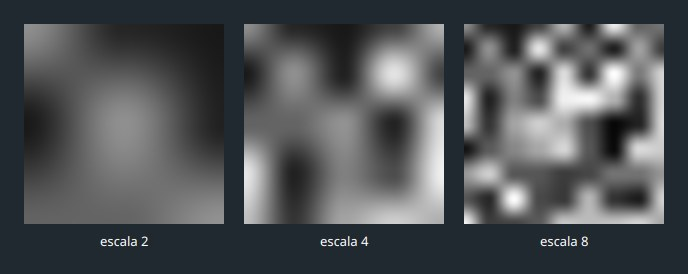
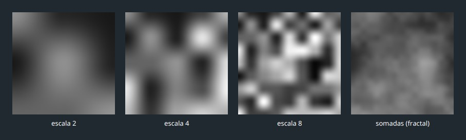
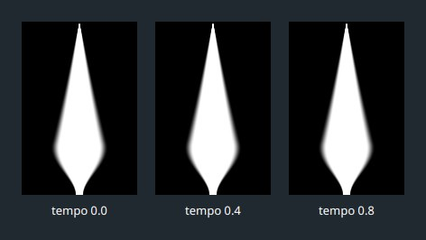
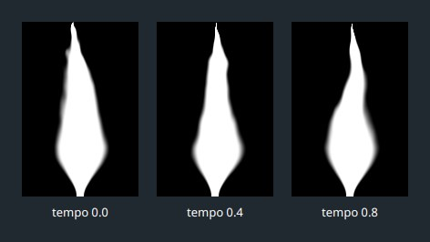
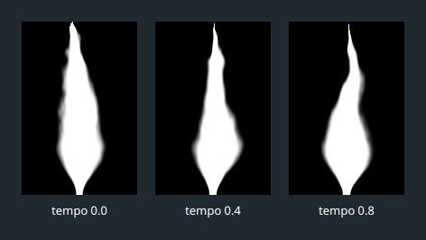
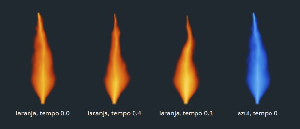
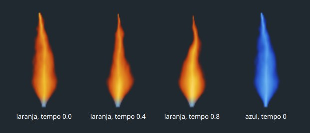
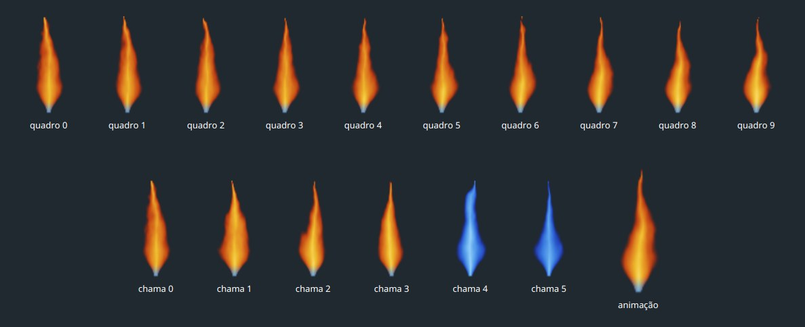

# Capítulo 10 — A imagem da chama

## Objetivo

Desenhar, pixel a pixel, a imagem de uma chama: uma língua de fogo redonda embaixo e fina em cima, com as bordas rasgadas, que vai do vermelho ao amarelo e nasce azul. No fim, o programa terá seis chamas diferentes, com dez quadros de animação cada uma. O capítulo 11 cola essas imagens nos robôs.

## Passo 1 — Um shader feito pelo processador

Nos jogos, uma chama costuma ser desenhada por um **shader**: um pequeno programa que roda na placa de vídeo, uma vez para cada pixel, e decide a cor dele a partir da posição do pixel e do tempo. Cada pixel calcula a sua cor sozinho, sem saber o que o vizinho fez, e é por isso que a placa de vídeo consegue calcular milhões deles por quadro.

O JavaFX 21 não oferece um modo de escrever shaders para objetos 3D: o único material que a documentação lista é o `PhongMaterial`. Então vamos fazer a mesma conta no **processador**, uma vez, quando o programa começa, e guardar o resultado em imagens (`WritableImage`, como no capítulo 9). A cena 3D só vai colar essas imagens nas partículas.

Isso traz duas consequências:

- A conta não pode ser repetida a cada quadro. Uma imagem de chama leva alguns milissegundos para ser calculada, e um quadro do programa tem 16,7 milissegundos. Por isso calculamos poucas imagens, uma só vez, e as reaproveitamos em todas as chamas.
- Para a chama se mexer, calculamos várias imagens do mesmo desenho em momentos diferentes e as mostramos em sequência, como as folhas de um caderninho de desenho animado.

A receita tem quatro ingredientes:

1. um **ruído**, números que parecem sorteados mas variam com suavidade pelo desenho, e que sobe com o tempo: ele entorta a chama e rasga as bordas;
2. uma **máscara em forma de gota**, redonda embaixo e fina em cima;
3. a **densidade**, que é a gota mais o ruído: onde ela é alta há chama, onde é baixa há ar;
4. uma **rampa de cores**: da densidade sai o calor, e do calor sai a cor.

| Classe | O que faz |
|---|---|
| `Ruido` | o ruído: números que parecem sorteados, mas variam com suavidade |
| `ImagemDaChama` | a densidade, as cores e o desenho de um quadro da chama |
| `Atelie` | uma janela de teste, para ver tudo de perto |
| `TexturasDeFogo` | já existe: passa a guardar também as chamas prontas |

Cada pixel da imagem, que tem 64 de largura e 96 de altura, recebe dois números: a `lateral`, que vai de -1 (borda esquerda) a 1 (borda direita), e a `subida`, que vai de 0 (embaixo) a 1 (em cima). A linha 0 de uma imagem é a de cima, então `subida = 1 - (y + 0.5) / ALTURA`; o `+ 0.5` mede o pixel pelo centro dele.

## Passo 2 — Uma subida suave

Vamos precisar várias vezes de uma função que vai de 0 a 1 sem pressa nas pontas: devagar no começo, depressa no meio, devagar no fim. Uma reta também vai de 0 a 1, mas tem uma **quina** em cada ponta, onde a inclinação muda de repente, e as quinas aparecem no desenho como linhas retas e losangos. A curva `3f² - 2f³`, para `f` de 0 a 1, começa e termina com inclinação zero:

| `f` | reta | `3f² - 2f³` |
|---|---|---|
| 0,10 | 0,10 | 0,028 |
| 0,25 | 0,25 | 0,156 |
| 0,50 | 0,50 | 0,500 |
| 0,75 | 0,75 | 0,844 |
| 0,90 | 0,90 | 0,972 |

O `degrauSuave(borda0, borda1, valor)` vale 0 até `borda0`, vale 1 a partir de `borda1` e, no meio, faz essa curva. Primeiro ele descobre em que ponto do caminho entre as duas bordas o `valor` está (`fracao`), preso entre 0 e 1 com o mesmo `Math.max` e `Math.min` do `Energia.largura` do capítulo 8. **Crie o arquivo** `src/main/java/campeonato/cena/Ruido.java`:

<!-- arquivo: src/main/java/campeonato/cena/Ruido.java | criar -->
```java
package campeonato.cena;

/** Ruído: números que parecem sorteados, mas dependem só da posição e mudam com suavidade de um ponto ao vizinho. */
final class Ruido {

    private Ruido() {
    }

    /** Sobe de 0, na primeira borda, a 1, na segunda, com suavidade: devagar no começo, depressa no meio e devagar no fim. */
    static double degrauSuave(double borda0, double borda1, double valor) {
        double fracao = Math.max(0, Math.min(1, (valor - borda0) / (borda1 - borda0)));
        return fracao * fracao * (3 - 2 * fracao);
    }
}
```

O teste confere as pontas, o meio e a diferença para uma reta. **Crie o arquivo** `src/test/java/campeonato/cena/RuidoTest.java`:

<!-- arquivo: src/test/java/campeonato/cena/RuidoTest.java | criar -->
```java
package campeonato.cena;

import static org.junit.jupiter.api.Assertions.assertEquals;

import org.junit.jupiter.api.Test;

class RuidoTest {

    @Test
    void oDegrauSuaveVaiDeZeroAUm() {
        assertEquals(0, Ruido.degrauSuave(2, 6, 1), 1e-9);
        assertEquals(0, Ruido.degrauSuave(2, 6, 2), 1e-9);
        assertEquals(0.5, Ruido.degrauSuave(2, 6, 4), 1e-9);
        assertEquals(1, Ruido.degrauSuave(2, 6, 6), 1e-9);
        assertEquals(1, Ruido.degrauSuave(2, 6, 9), 1e-9);
    }

    @Test
    void oDegrauSuaveEMaisLentoNasPontasQueUmaReta() {
        // a 10% do caminho, uma reta estaria em 0,1; o degrau suave ainda está em 0,028
        assertEquals(0.028, Ruido.degrauSuave(0, 1, 0.1), 1e-9);
        assertEquals(0.972, Ruido.degrauSuave(0, 1, 0.9), 1e-9);
    }
}
```

<!-- testar -->

## Passo 3 — Números que parecem sorteados

O ruído precisa de números sem relação entre si, mas com uma regra: **a mesma posição dá sempre o mesmo número**. Um `Random` não serve, porque cada chamada devolve um número diferente, e a chama seria redesenhada de um jeito novo a cada pergunta: o quadro 4 da animação não teria nada a ver com o quadro 3. O que precisamos é de uma **função**: entra a posição, sai um número que parece sorteado e, para a mesma entrada, sai sempre o mesmo. Funções assim se chamam **hash**.

Dividimos o plano numa grade de quadradinhos, as **células**, e damos um número de 0 a 1 para cada ponto de cruzamento da grade. A `semente` escolhe uma grade entre várias possíveis, como a semente do `Random` do capítulo 9. **Acrescente ao final da classe** `Ruido`:

<!-- arquivo: src/main/java/campeonato/cena/Ruido.java | acrescentar -->
```java

    /** Um número "sorteado" de 0 a 1 para uma célula da grade: a mesma célula dá sempre o mesmo número. */
    static double daCelula(int celulaX, int celulaY, long semente) {
        long bits = celulaX * 374761393L + celulaY * 668265263L + semente * 2246822519L;
        bits = (bits ^ (bits >>> 13)) * 1274126177L;
        bits ^= bits >>> 16;
        return (bits & 0xffffff) / (double) 0x1000000;
    }
```

Você não precisa entender por que esses números específicos funcionam: são constantes de funções de embaralhar. O que importa é o que cada linha faz:

- A primeira linha multiplica as coordenadas por números grandes e soma. O `L` no fim de cada número o torna um `long`, de 64 bits; sem ele a multiplicação seria feita em 32 bits.
- Quando um `long` passa do maior valor possível, o Java não avisa: o resultado **dá a volta**, como o odômetro de um carro que passa de 999999. Por exemplo, `Long.MAX_VALUE + 1` dá `-9223372036854775808`. Aqui isso é bom, porque ajuda a embaralhar.
- `>>>` empurra os bits para a direita (`bits >>> 13` empurra 13 casas, trazendo os bits de cima para baixo). `^` é o "ou exclusivo", que combina dois números bit a bit: o resultado tem 1 onde os bits dos dois são diferentes. As duas linhas do meio misturam os bits de cima com os de baixo.
- `bits & 0xffffff` guarda só os 24 bits de baixo, um número de 0 a 16 777 215. Dividindo por `0x1000000` (que é 16 777 216, ou 2²⁴), sai um número de 0 (incluído) a 1 (excluído).

Os testes conferem as três propriedades: a mesma célula dá o mesmo número, o número fica entre 0 e 1, e células ou sementes diferentes dão números diferentes. O `Set` é o do capítulo 7: ele ignora elementos repetidos, e então `size()` conta quantos números diferentes saíram. **Acrescente os imports** no topo do arquivo `RuidoTest.java`:

<!-- arquivo: src/test/java/campeonato/cena/RuidoTest.java | importar -->
```java
import static org.junit.jupiter.api.Assertions.assertNotEquals;
import static org.junit.jupiter.api.Assertions.assertTrue;

import java.util.HashSet;
import java.util.Set;
```

**Acrescente ao final da classe** `RuidoTest`:

<!-- arquivo: src/test/java/campeonato/cena/RuidoTest.java | acrescentar -->
```java

    @Test
    void aMesmaCelulaDaSempreOMesmoNumero() {
        assertEquals(Ruido.daCelula(3, -7, 42), Ruido.daCelula(3, -7, 42), 0);
    }

    @Test
    void osNumerosDasCelulasFicamEntreZeroEUm() {
        for (int x = -20; x < 20; x++) {
            for (int y = -20; y < 20; y++) {
                double numero = Ruido.daCelula(x, y, 5);
                assertTrue(numero >= 0 && numero < 1, "fora da faixa: " + numero);
            }
        }
    }

    @Test
    void celulasESementesDiferentesDaoNumerosDiferentes() {
        Set<Double> numeros = new HashSet<>();
        for (int x = 0; x < 10; x++) {
            for (int y = 0; y < 10; y++) {
                numeros.add(Ruido.daCelula(x, y, 1));
            }
        }
        // 100 células, praticamente 100 números diferentes
        assertTrue(numeros.size() > 95, "só " + numeros.size() + " números diferentes");
        assertNotEquals(Ruido.daCelula(2, 2, 1), Ruido.daCelula(2, 2, 2));
    }
```

O segundo argumento do `assertTrue` é uma mensagem, mostrada só se a condição falhar.

<!-- testar -->

## Passo 4 — Ruído suave

Os números das células, sozinhos, formam um tabuleiro de quadrados, com saltos bruscos de uma célula para a vizinha. Para ter uma paisagem suave, misturamos os números dos quatro cantos da célula em que o ponto está:

1. `celulaX` e `celulaY` dizem em que célula o ponto cai (`Math.floor` arredonda para baixo, inclusive para números negativos);
2. `fracaoX` e `fracaoY`, de 0 a 1, dizem em que lugar da célula ele está, e passam pelo `degrauSuave` para a mistura não ter quinas;
3. misturamos os dois cantos de cima, depois os dois de baixo, pela `fracaoX`, e por fim os dois resultados pela `fracaoY`.

"Misturar" é o `Geometria.interpolar(a, b, t)` do capítulo 6: dá `a` quando `t` é 0 e `b` quando `t` é 1. Com a semente 1, os quatro cantos da célula (0, 0) valem 0,5594; 0,1432; 0,0985 e 0,5614. No meio da célula, as frações valem 0,5 e a mistura é a média dos quatro: 0,3406. **Acrescente ao final da classe** `Ruido`:

<!-- arquivo: src/main/java/campeonato/cena/Ruido.java | acrescentar -->
```java

    /** Ruído suave de 0 a 1: os números das células da grade, misturados com suavidade de uma célula à vizinha. */
    static double simples(double x, double y, long semente) {
        int celulaX = (int) Math.floor(x);
        int celulaY = (int) Math.floor(y);
        double fracaoX = degrauSuave(0, 1, x - celulaX);
        double fracaoY = degrauSuave(0, 1, y - celulaY);
        double cima = Geometria.interpolar(daCelula(celulaX, celulaY, semente), daCelula(celulaX + 1, celulaY, semente), fracaoX);
        double baixo = Geometria.interpolar(daCelula(celulaX, celulaY + 1, semente), daCelula(celulaX + 1, celulaY + 1, semente), fracaoX);
        return Geometria.interpolar(cima, baixo, fracaoY);
    }
```

Três testes: no cruzamento da grade o ruído é o número da célula; no meio da célula é a média dos cantos; e andando de 0,01 em 0,01 o ruído nunca dá um salto maior que 0,02. Se a mistura fosse trocada por "pegar o número da célula", o salto na fronteira seria de até 1. **Acrescente ao final da classe** `RuidoTest`:

<!-- arquivo: src/test/java/campeonato/cena/RuidoTest.java | acrescentar -->
```java

    @Test
    void noPontoDeUmaCelulaORuidoEIgualAoNumeroDela() {
        assertEquals(Ruido.daCelula(3, 5, 7), Ruido.simples(3, 5, 7), 1e-12);
        assertEquals(Ruido.daCelula(-2, 4, 7), Ruido.simples(-2, 4, 7), 1e-12);
    }

    @Test
    void noMeioDaCelulaORuidoEAMediaDosQuatroCantos() {
        double media = (Ruido.daCelula(0, 0, 1) + Ruido.daCelula(1, 0, 1) + Ruido.daCelula(0, 1, 1) + Ruido.daCelula(1, 1, 1)) / 4;
        assertEquals(media, Ruido.simples(0.5, 0.5, 1), 1e-12);
    }

    @Test
    void oRuidoMudaPoucoQuandoOPontoAndaPouco() {
        double anterior = Ruido.simples(0, 0.5, 9);
        for (double x = 0.01; x < 6; x += 0.01) {
            double atual = Ruido.simples(x, 0.5, 9);
            assertTrue(Math.abs(atual - anterior) < 0.02, "salto de " + Math.abs(atual - anterior) + " em x = " + x);
            anterior = atual;
        }
    }
```

<!-- testar -->

Para ver o ruído, vamos fazer a janela `Atelie`, uma bancada de testes que vai crescer nos próximos passos. Ela tem quatro funções de apoio:

- `mapa` pinta uma imagem em tons de cinza. Ela recebe uma **função** que, dada a posição `(u, v)` de um pixel (de 0 a 1 em cada eixo), devolve um valor de 0 (preto) a 1 (branco). `DoubleBinaryOperator` é o tipo dessa função: recebe dois `double` e devolve um `double`; chamamos a função com `valor.applyAsDouble(u, v)`.
- `ampliada` mostra uma imagem em tamanho maior.
- `figura` põe uma legenda embaixo de uma imagem.
- `linha` põe várias figuras lado a lado, sobre um fundo escuro.

O `...` em `VBox... figuras` quer dizer "zero ou mais `VBox`": o método aceita quantas figuras você passar, ou um vetor delas.

No `montar`, a função de cada mapa é uma lambda, como a do `Comparator` do capítulo 9: `(u, v) -> Ruido.simples(u * escala, v * escala, 1)`. Multiplicar a posição pela `escala` coloca mais células no mesmo desenho: com escala 2 há 2 por 2 células, com escala 8, 8 por 8. O `int escala = escalas[i]` dentro do laço existe porque uma lambda só pode usar variáveis que não mudam depois de criadas, e o `i` muda a cada volta do laço. **Crie o arquivo** `src/main/java/campeonato/cena/Atelie.java`:

<!-- arquivo: src/main/java/campeonato/cena/Atelie.java | criar -->
```java
package campeonato.cena;

import java.util.function.DoubleBinaryOperator;
import javafx.application.Application;
import javafx.geometry.Insets;
import javafx.geometry.Pos;
import javafx.scene.Parent;
import javafx.scene.Scene;
import javafx.scene.control.Label;
import javafx.scene.image.Image;
import javafx.scene.image.ImageView;
import javafx.scene.image.WritableImage;
import javafx.scene.layout.HBox;
import javafx.scene.layout.VBox;
import javafx.scene.paint.Color;
import javafx.stage.Stage;

/** Uma bancada para olhar de perto o que o programa desenha: o ruído, a forma e as cores da chama. */
public class Atelie extends Application {

    /** Uma imagem em tons de cinza: o brilho de cada pixel é o valor que a função dá para ele, de 0 (preto) a 1 (branco). */
    private static Image mapa(int largura, int altura, DoubleBinaryOperator valor) {
        WritableImage imagem = new WritableImage(largura, altura);
        for (int y = 0; y < altura; y++) {
            for (int x = 0; x < largura; x++) {
                // a posição do centro do pixel, de 0 a 1 em cada eixo
                double u = (x + 0.5) / largura;
                double v = (y + 0.5) / altura;
                double brilho = Math.max(0, Math.min(1, valor.applyAsDouble(u, v)));
                imagem.getPixelWriter().setColor(x, y, Color.gray(brilho));
            }
        }
        return imagem;
    }

    /** Uma vista da imagem, ampliada pela escala. */
    private static ImageView ampliada(Image imagem, double escala) {
        ImageView vista = new ImageView(imagem);
        vista.setFitWidth(imagem.getWidth() * escala);
        vista.setPreserveRatio(true);
        return vista;
    }

    /** Uma vista com a legenda embaixo. */
    private static VBox figura(String legenda, ImageView vista) {
        Label texto = new Label(legenda);
        texto.setTextFill(Color.WHITE);
        VBox caixa = new VBox(8, vista, texto);
        caixa.setAlignment(Pos.CENTER);
        return caixa;
    }

    /** Uma linha de figuras sobre o fundo escuro da bancada. */
    private static HBox linha(VBox... figuras) {
        HBox caixa = new HBox(20, figuras);
        caixa.setAlignment(Pos.CENTER);
        caixa.setPadding(new Insets(24));
        caixa.setStyle("-fx-background-color: #202830;");
        return caixa;
    }

    /** O conteúdo da janela: o mesmo ruído em três escalas. */
    static Parent montar() {
        VBox[] figuras = new VBox[3];
        int[] escalas = { 2, 4, 8 };
        for (int i = 0; i < escalas.length; i++) {
            int escala = escalas[i];
            figuras[i] = figura("escala " + escala, ampliada(mapa(200, 200, (u, v) -> Ruido.simples(u * escala, v * escala, 1)), 1));
        }
        return linha(figuras);
    }

    @Override
    public void start(Stage palco) {
        palco.setTitle("Ateliê");
        palco.setScene(new Scene(montar()));
        palco.show();
    }

    public static void main(String[] args) {
        launch(args);
    }
}
```

<!-- compilar -->

Rode a bancada com a opção `-Dclasse.principal` do capítulo 9:

<!-- executar: | rodar: 12 | proibe: Exception, ERROR -->
```bash
mvn javafx:run -Dclasse.principal=campeonato.cena.Atelie
```

<!-- marco: 10-ruido -->



Na escala 2 há manchas grandes e suaves; na 4, manchas menores; na 8, manchas ainda menores. Em nenhuma delas há quinas. Mas nenhuma parece uma nuvem, uma fumaça ou um fogo: falta detalhe.

## Passo 5 — Muitas escalas

As coisas da natureza têm detalhes em vários tamanhos: uma nuvem tem grandes volumes, volumes menores dentro deles e fiapos dentro dos menores. Para imitar isso, **somamos o ruído em várias escalas**, cada uma com o dobro da escala (e por isso com manchas pela metade do tamanho) e com a metade da força da anterior. Cada escala se chama **oitava**, como na música, em que uma oitava tem o dobro da frequência. Usamos 4 oitavas, com forças 1/2, 1/4, 1/8 e 1/16, que somam 0,9375. Dividindo a soma por esse número, o resultado volta a ficar entre 0 e 1. Cada oitava usa uma semente diferente (`semente + oitava`), para as camadas não serem cópias umas das outras.

Primeiro as duas constantes. **Acrescente as linhas** abaixo logo depois de `final class Ruido {`:

<!-- arquivo: src/main/java/campeonato/cena/Ruido.java | inserir-depois final class Ruido { -->
```java

    /** Quantas escalas o ruído fractal soma. */
    private static final int OITAVAS = 4;

    /** A soma das forças das oitavas (1/2 + 1/4 + 1/8 + 1/16): dividir por ela deixa o ruído fractal de 0 a 1. */
    private static final double FORCA_TOTAL = 1 - Math.pow(0.5, OITAVAS);
```

O `1 - Math.pow(0.5, OITAVAS)` é a soma de todas as forças, escrita de um jeito que continua certo se você mudar o número de oitavas. Agora o método. **Acrescente ao final da classe** `Ruido`:

<!-- arquivo: src/main/java/campeonato/cena/Ruido.java | acrescentar -->
```java

    /** O ruído de muitas escalas, cada uma com metade do tamanho e da força da anterior: de 0 a 1. */
    static double fractal(double x, double y, long semente) {
        double soma = 0;
        double forca = 0.5;
        double escala = 1;
        for (int oitava = 0; oitava < OITAVAS; oitava++) {
            soma += forca * simples(x * escala, y * escala, semente + oitava);
            forca /= 2;
            escala *= 2;
        }
        return soma / FORCA_TOTAL;
    }
```

Os testes conferem que os dois ruídos ficam entre 0 e 1 e que o fractal também é função só da posição e da semente. **Acrescente ao final da classe** `RuidoTest`:

<!-- arquivo: src/test/java/campeonato/cena/RuidoTest.java | acrescentar -->
```java

    @Test
    void oRuidoEOFractalFicamEntreZeroEUm() {
        for (double x = -5; x < 5; x += 0.37) {
            for (double y = -5; y < 5; y += 0.41) {
                double simples = Ruido.simples(x, y, 3);
                double fractal = Ruido.fractal(x, y, 3);
                assertTrue(simples >= 0 && simples <= 1, "simples fora da faixa: " + simples);
                assertTrue(fractal >= 0 && fractal <= 1, "fractal fora da faixa: " + fractal);
            }
        }
    }

    @Test
    void oFractalTambemEFuncaoSoDaPosicao() {
        assertEquals(Ruido.fractal(1.5, 2.5, 8), Ruido.fractal(1.5, 2.5, 8), 0);
        assertNotEquals(Ruido.fractal(1.5, 2.5, 8), Ruido.fractal(1.5, 2.5, 9));
    }
```

<!-- testar -->

Na bancada, acrescentamos uma quarta imagem, a soma das escalas. **Substitua o método** `montar` da classe `Atelie`:

<!-- arquivo: src/main/java/campeonato/cena/Atelie.java | substituir-metodo montar -->
```java
    /** O conteúdo da janela: o ruído em três escalas e, no fim, as escalas somadas. */
    static Parent montar() {
        VBox[] figuras = new VBox[4];
        int[] escalas = { 2, 4, 8 };
        for (int i = 0; i < escalas.length; i++) {
            int escala = escalas[i];
            figuras[i] = figura("escala " + escala, ampliada(mapa(200, 200, (u, v) -> Ruido.simples(u * escala, v * escala, 1)), 1));
        }
        figuras[3] = figura("somadas (fractal)", ampliada(mapa(200, 200, (u, v) -> Ruido.fractal(u * 2, v * 2, 1)), 1));
        return linha(figuras);
    }
```

<!-- compilar -->

<!-- marco: 10-fractal -->



A imagem da direita tem manchas grandes e detalhes finos ao mesmo tempo, como uma nuvem. É esse ruído que vai entortar e rasgar a chama.

## Passo 6 — A gota

Agora a chama. Uma chama parada, sem vento, tem a forma de uma gota de cabeça para baixo: redonda embaixo, onde está o combustível, e cada vez mais fina para cima. Vamos descrevê-la por uma função da altura, `larguraDaGota(subida)`, que diz a **meia-largura** da gota em cada altura (a imagem toda vai de -1 a 1, então 0,5 é a metade da imagem):

```text
larguraDaGota(subida) = 0,8 × (1 - subida)^0,9 × (0,1 + 0,9 × degrauSuave(0, 0,3, subida))
```

Os dois fatores fazem trabalhos diferentes:

- `0,8 × (1 - subida)^0,9` estreita a gota para o topo: vale 0,8 embaixo e 0 em cima.
- `0,1 + 0,9 × degrauSuave(0, 0,3, subida)` **fecha a base**: nos primeiros 30% da altura ele sobe de 0,1 a 1, e a gota termina embaixo numa ponta, em vez de ficar cortada reta.

| `subida` | 0 | 0,15 | 0,3 | 0,6 | 0,9 | 1 |
|---|---|---|---|---|---|---|
| `larguraDaGota` | 0,080 | 0,380 | 0,580 | 0,351 | 0,101 | 0 |

A parte mais larga fica perto de 30% da altura. Para cada ponto, a medida do **corpo** é `1 - |lateral| / largura`: vale 1 no centro da gota, 0 na borda dela e fica negativa fora. A **densidade** é o corpo, um pouco reforçado (`× 1,15`), menos um desconto que cresce com a altura (`- subida × 0,3`), para a chama ficar mais rala no topo. O `Math.max(largura, 1e-3)` evita a divisão por zero no topo, onde a largura é 0.

A densidade ainda tem dois parâmetros que não usamos: o `tempo` e a `semente`. Eles entram nos próximos passos. **Crie o arquivo** `src/main/java/campeonato/cena/ImagemDaChama.java`:

<!-- arquivo: src/main/java/campeonato/cena/ImagemDaChama.java | criar -->
```java
package campeonato.cena;

/** O desenho de uma chama, ponto por ponto: onde ela é densa, que cor tem e como se mexe. */
final class ImagemDaChama {

    private ImagemDaChama() {
    }

    /** A meia-largura da gota, a cada altura de 0 (embaixo) a 1 (em cima); a imagem toda vai de -1 a 1. */
    static double larguraDaGota(double subida) {
        return 0.8 * Math.pow(1 - subida, 0.9) * (0.1 + 0.9 * Ruido.degrauSuave(0, 0.3, subida));
    }

    /**
     * A densidade da chama num ponto: acima de 0,4 é chama, abaixo de 0,1 é ar, e no meio a borda é macia.
     *
     * @param lateral de -1 (esquerda) a 1 (direita)
     * @param subida de 0 (embaixo) a 1 (em cima)
     * @param tempo faz o ruído subir: o quadro seguinte é um pouco mais tarde
     * @param semente faz cada chama ser diferente das outras
     */
    static double densidadeEm(double lateral, double subida, double tempo, long semente) {
        double corpo = 1 - Math.abs(lateral) / Math.max(larguraDaGota(subida), 1e-3);
        return corpo * 1.15 - subida * 0.3;
    }
}
```

Um teste para a gota. **Crie o arquivo** `src/test/java/campeonato/cena/ImagemDaChamaTest.java`:

<!-- arquivo: src/test/java/campeonato/cena/ImagemDaChamaTest.java | criar -->
```java
package campeonato.cena;

import static org.junit.jupiter.api.Assertions.assertEquals;
import static org.junit.jupiter.api.Assertions.assertTrue;

import org.junit.jupiter.api.Test;

class ImagemDaChamaTest {

    @Test
    void aGotaComecaFinaCresceEFechaNoTopo() {
        assertEquals(0.08, ImagemDaChama.larguraDaGota(0), 1e-9);
        assertEquals(0, ImagemDaChama.larguraDaGota(1), 1e-9);
        // a parte mais larga fica perto de 30% da altura
        assertTrue(ImagemDaChama.larguraDaGota(0.3) > ImagemDaChama.larguraDaGota(0.05));
        assertTrue(ImagemDaChama.larguraDaGota(0.3) > ImagemDaChama.larguraDaGota(0.9));
    }
}
```

Para ver a densidade, a bancada pinta, para três momentos, **onde há chama**: `degrauSuave(0.1, 0.4, densidade)` é 0 (preto) onde a densidade é menor que 0,1, e 1 (branco) onde é maior que 0,4. Na posição `(u, v)` do pixel, a `lateral` é `u * 2 - 1` e a `subida` é `1 - v`, porque `v` cresce para baixo. **Substitua o método** `montar` da classe `Atelie`:

<!-- arquivo: src/main/java/campeonato/cena/Atelie.java | substituir-metodo montar -->
```java
    /** O conteúdo da janela: onde há chama (branco) e onde há ar (preto), em três momentos. */
    static Parent montar() {
        VBox[] figuras = new VBox[3];
        double[] tempos = { 0, 0.4, 0.8 };
        for (int i = 0; i < tempos.length; i++) {
            double tempo = tempos[i];
            figuras[i] = figura("tempo " + tempo,
                    ampliada(mapa(128, 192, (u, v) -> Ruido.degrauSuave(0.1, 0.4, ImagemDaChama.densidadeEm(u * 2 - 1, 1 - v, tempo, 5))), 1));
        }
        return linha(figuras);
    }
```

<!-- compilar -->

<!-- marco: 10-gota -->



É uma gota de cabeça para baixo, arredondada, com a ponta de baixo fechada e o topo fino. Os três momentos saem iguais, porque ainda não usamos o `tempo`.

## Passo 7 — O vento

Uma chama de verdade balança. Para imitar isso, deslocamos o **corpo** da gota para os lados por um ruído fractal, o `vento`:

<!-- ilustrativo -->
```java
double vento = (Ruido.fractal(lateral * 1.3 + 3.7, subida * 1.8 - tempo * 2.2, semente) - 0.5) * 0.9 * subida;
```

Cada pedaço tem uma razão:

- O ruído vai de 0 a 1, e o `- 0.5` o centra em zero, para empurrar tanto para a direita quanto para a esquerda.
- O `× subida` faz o empurrão **crescer com a altura**: a base da chama está presa ao combustível e não se move; o topo é livre.
- O `subida * 1.8 - tempo * 2.2` é a posição em que olhamos o ruído. Se o tempo cresce, o número diminui, e para continuarmos a ver a mesma mancha do ruído precisamos subir: o desenho do ruído **sobe com o tempo**, como o ar quente.
- O `lateral * 1.3 + 3.7` escolhe uma região do ruído, e o `semente` escolhe uma grade. Mudar o 3,7 muda o desenho, sem mudar a ideia.

O corpo passa a ser medido a partir da lateral já empurrada: `lateral + vento`. **Substitua o método** `densidadeEm` da classe `ImagemDaChama`:

<!-- arquivo: src/main/java/campeonato/cena/ImagemDaChama.java | substituir-metodo densidadeEm -->
```java
    /**
     * A densidade da chama num ponto: acima de 0,4 é chama, abaixo de 0,1 é ar, e no meio a borda é macia.
     *
     * @param lateral de -1 (esquerda) a 1 (direita)
     * @param subida de 0 (embaixo) a 1 (em cima)
     * @param tempo faz o ruído subir: o quadro seguinte é um pouco mais tarde
     * @param semente faz cada chama ser diferente das outras
     */
    static double densidadeEm(double lateral, double subida, double tempo, long semente) {
        // o ar empurra a chama para os lados, mais quanto mais alto
        double vento = (Ruido.fractal(lateral * 1.3 + 3.7, subida * 1.8 - tempo * 2.2, semente) - 0.5) * 0.9 * subida;
        double corpo = 1 - Math.abs(lateral + vento) / Math.max(larguraDaGota(subida), 1e-3);
        return corpo * 1.15 - subida * 0.3;
    }
```

<!-- compilar -->

<!-- marco: 10-vento -->



Agora os três momentos são diferentes. A base continua no mesmo lugar, e a ponta de cima se curva para um lado, depois para o outro.

## Passo 8 — O rasgo

Falta o que faz a chama parecer fogo e não uma gota de tinta: as bordas rasgadas e os buracos. Usamos outro ruído fractal, o `rasgo`, mais fino que o do vento (os multiplicadores 2,6 e 3,2 são maiores, então as manchas são menores) e mais rápido (3,0, contra 2,2). A semente é `semente + 11`, para ele não ser uma cópia do vento. Ele é somado à densidade, mais forte para cima:

<!-- ilustrativo -->
```java
rasgo * 0.9 * (0.35 + 0.65 * subida)
```

Onde o ruído do rasgo é alto, a densidade sobe, e onde é baixo, ela desce, e a borda da chama, que fica no limite entre 0,1 e 0,4, **se mexe e se rasga**. A base, onde o fator vale só 0,35, quase não é afetada. **Substitua o método** `densidadeEm` da classe `ImagemDaChama`:

<!-- arquivo: src/main/java/campeonato/cena/ImagemDaChama.java | substituir-metodo densidadeEm -->
```java
    /**
     * A densidade da chama num ponto: acima de 0,4 é chama, abaixo de 0,1 é ar, e no meio a borda é macia.
     *
     * @param lateral de -1 (esquerda) a 1 (direita)
     * @param subida de 0 (embaixo) a 1 (em cima)
     * @param tempo faz o ruído subir: o quadro seguinte é um pouco mais tarde
     * @param semente faz cada chama ser diferente das outras
     */
    static double densidadeEm(double lateral, double subida, double tempo, long semente) {
        // o ar empurra a chama para os lados, mais quanto mais alto
        double vento = (Ruido.fractal(lateral * 1.3 + 3.7, subida * 1.8 - tempo * 2.2, semente) - 0.5) * 0.9 * subida;
        double corpo = 1 - Math.abs(lateral + vento) / Math.max(larguraDaGota(subida), 1e-3);
        // a turbulência que rasga a chama, mais forte para cima
        double rasgo = Ruido.fractal(lateral * 2.6, subida * 3.2 - tempo * 3.0, semente + 11) - 0.5;
        return corpo * 1.15 - subida * 0.3 + rasgo * 0.9 * (0.35 + 0.65 * subida);
    }
```

Os testes da densidade: o centro é mais denso que a borda; a chama afina no topo (a 30% da altura o centro é chama, e no topo é ar); e o tempo e a semente mudam o resultado, mas os mesmos argumentos dão sempre a mesma resposta. **Acrescente o import** no topo do arquivo `ImagemDaChamaTest.java`:

<!-- arquivo: src/test/java/campeonato/cena/ImagemDaChamaTest.java | importar -->
```java
import static org.junit.jupiter.api.Assertions.assertNotEquals;
```

**Acrescente ao final da classe** `ImagemDaChamaTest`:

<!-- arquivo: src/test/java/campeonato/cena/ImagemDaChamaTest.java | acrescentar -->
```java

    @Test
    void aDensidadeEMaiorNoCentroDoQueNaBorda() {
        double centro = ImagemDaChama.densidadeEm(0, 0.3, 0, 5);
        double borda = ImagemDaChama.densidadeEm(0.95, 0.3, 0, 5);
        assertTrue(centro > borda);
    }

    @Test
    void aChamaAfinaParaOTopo() {
        // a 30% da altura o centro é chama (mais de 0,4); no topo é ar (menos de 0,1)
        assertTrue(ImagemDaChama.densidadeEm(0, 0.3, 0, 5) > 0.4);
        assertTrue(ImagemDaChama.densidadeEm(0, 1, 0, 5) < 0.1);
    }

    @Test
    void oTempoEASementeMudamADensidadeMasOMesmoPedidoDaAMesmaResposta() {
        double base = ImagemDaChama.densidadeEm(0.2, 0.6, 0, 5);
        assertNotEquals(base, ImagemDaChama.densidadeEm(0.2, 0.6, 0.4, 5));
        assertNotEquals(base, ImagemDaChama.densidadeEm(0.2, 0.6, 0, 6));
        assertEquals(base, ImagemDaChama.densidadeEm(0.2, 0.6, 0, 5), 0);
    }
```

<!-- testar -->

<!-- marco: 10-rasgo -->



Compare com a figura do passo anterior: agora as bordas são irregulares, com recortes e pontas pequenas que mudam de um momento para o outro, principalmente na parte de cima. A base continua lisa. É uma silhueta de chama, só falta a cor.

## Passo 9 — As cores

Uma chama tem cores diferentes em cada parte: o centro é o mais quente e o mais claro, as bordas são mais frias e mais escuras. Para dar cor, usamos uma **rampa**: uma lista de cores chamadas **paradas**, e um número de 0 a 1, o **calor**, que escolhe um ponto da rampa. Entre duas paradas misturamos as cores com o `Color.interpolate` do capítulo 9. Fazemos duas rampas: a laranja, da borda ao núcleo (vermelho escuro, vermelho, laranja, amarelo e amarelo claro), e a azul (azul profundo, azul, azul claro, azul pálido e branco).

Com 5 paradas há 4 trechos, e o calor 0,5 cai exatamente na terceira parada (`0,5 × 4 = 2`, e a parada de índice 2 é a terceira, o laranja). O `(int) posicao` descobre em qual trecho o calor está, e `posicao - indice` diz em que ponto do trecho. O `Math.min(paradas.length - 2, ...)` impede o calor 1 de procurar uma parada que não existe.

Vamos também deixar pronto o que o `quadro` precisa. **Acrescente os imports** no topo de `ImagemDaChama.java`:

<!-- arquivo: src/main/java/campeonato/cena/ImagemDaChama.java | importar -->
```java
import javafx.scene.image.Image;
import javafx.scene.image.WritableImage;
import javafx.scene.paint.Color;
```

**Acrescente as linhas** abaixo logo depois de `final class ImagemDaChama {`:

<!-- arquivo: src/main/java/campeonato/cena/ImagemDaChama.java | inserir-depois final class ImagemDaChama { -->
```java

    /** O tamanho de um quadro, em pixels. */
    static final int LARGURA = 64;
    static final int ALTURA = 96;

    /** A cor da chama da borda ao núcleo: vermelho escuro, vermelho, laranja, amarelo e amarelo claro. */
    private static final Color[] CALOR = { Color.web("#8f1604"), Color.web("#e03408"), Color.web("#ff8a1c"), Color.web("#ffc92e"), Color.web("#ffe98a") };

    /** O mesmo para as chamas que queimam azuis o tempo todo: azul profundo, azul, azul claro, azul pálido e branco. */
    private static final Color[] CALOR_AZUL = { Color.web("#0a1a8a"), Color.web("#1f3fe0"), Color.web("#3f8cff"), Color.web("#6fbcff"), Color.web("#b8e4ff") };
```

A cor de cada ponto sai do calor, e o calor sai da densidade: quanto mais densa a chama, mais quente. A conta é `0,2 + (densidade - 0,3) × 0,75`, mais um pouco de calor na base (`0,08 × (1 - subida)`), presa entre 0 e 0,9 (o teto de 0,9 impede o amarelo de virar quase branco). Uma densidade de 0,3, no limite da borda, dá calor 0,24, um vermelho-alaranjado; uma densidade de 1, no centro, dá 0,765, um amarelo.

Depois vem o desenho do quadro: dois laços, um para cada linha `y` e um para cada coluna `x` da imagem. Para cada pixel:

1. a `subida` e a `lateral` vêm da posição do pixel, como vimos no passo 1;
2. a `opacidade` é `degrauSuave(0.1, 0.4, densidade)`, que é 1 onde há chama e 0 onde há ar, vezes `degrauSuave(0, 0.02, subida)`, que faz a base se dissolver no ar nos primeiros 2% da altura (cerca de dois pixels), em vez de terminar num corte seco;
3. a cor vem da rampa, e a opacidade final é a `opacidade` vezes `0,7 + 0,3 × calor`: as partes mais quentes são um pouco mais opacas.

O `Color.color(vermelho, verde, azul, opacidade)` junta as quatro partes. **Acrescente ao final da classe** `ImagemDaChama`:

<!-- arquivo: src/main/java/campeonato/cena/ImagemDaChama.java | acrescentar -->
```java

    /** A cor da chama para um calor de 0 (a borda) a 1 (o núcleo), na rampa laranja ou na azul. */
    static Color corDoCalor(double calor, boolean azul) {
        Color[] paradas = azul ? CALOR_AZUL : CALOR;
        double posicao = Math.max(0, Math.min(1, calor)) * (paradas.length - 1);
        int indice = Math.min(paradas.length - 2, (int) posicao);
        return paradas[indice].interpolate(paradas[indice + 1], posicao - indice);
    }

    /** O calor da chama, de 0 a 0,9: quanto mais densa, mais quente, e a base é um pouco mais quente. */
    static double calorDaDensidade(double densidade, double subida) {
        return Math.max(0, Math.min(0.9, 0.2 + (densidade - 0.3) * 0.75 + 0.08 * (1 - subida)));
    }

    /**
     * Um quadro de uma chama.
     *
     * @param semente faz cada chama ser diferente das outras
     * @param tempo o momento do quadro, nas unidades do avanço do ruído
     * @param azul a chama queima azul o tempo todo, e não só na base
     */
    static Image quadro(long semente, double tempo, boolean azul) {
        WritableImage imagem = new WritableImage(LARGURA, ALTURA);
        for (int y = 0; y < ALTURA; y++) {
            for (int x = 0; x < LARGURA; x++) {
                double subida = 1 - (y + 0.5) / ALTURA;
                double densidade = densidadeEm((x + 0.5) / LARGURA * 2 - 1, subida, tempo, semente);
                double calor = calorDaDensidade(densidade, subida);
                // bordas nítidas, só um pouco macias; a base se dissolve no ar
                double opacidade = Ruido.degrauSuave(0.1, 0.4, densidade) * Ruido.degrauSuave(0, 0.02, subida);
                Color cor = corDoCalor(calor, azul);
                imagem.getPixelWriter().setColor(x, y, Color.color(cor.getRed(), cor.getGreen(), cor.getBlue(), Math.min(1, opacidade * (0.7 + 0.3 * calor))));
            }
        }
        return imagem;
    }
```

Os testes: a rampa começa e termina nas paradas certas e fica na ponta quando o calor sai da faixa; entre duas paradas a cor é uma mistura; o quadro tem o tamanho certo, os cantos saem transparentes e o meio aparece cheio; a chama laranja é quente (mais vermelho que azul) e a azul é fria; e um tempo diferente dá um quadro diferente, enquanto o mesmo tempo dá o mesmo quadro. Como no capítulo 9, o JavaFX guarda os canais de uma `Color` em `float`, e por isso a tolerância é `1e-6`. **Acrescente os imports** no topo de `ImagemDaChamaTest.java`:

<!-- arquivo: src/test/java/campeonato/cena/ImagemDaChamaTest.java | importar -->
```java
import static org.junit.jupiter.api.Assertions.assertFalse;

import javafx.scene.image.Image;
import javafx.scene.paint.Color;
```

**Acrescente as linhas** abaixo logo depois de `class ImagemDaChamaTest {`:

<!-- arquivo: src/test/java/campeonato/cena/ImagemDaChamaTest.java | inserir-depois class ImagemDaChamaTest { -->
```java

    /** O JavaFX guarda cada canal de uma Color num float. */
    private static final double ERRO_DA_COR = 1e-6;

    private static void assertCor(Color esperada, Color obtida) {
        assertEquals(esperada.getRed(), obtida.getRed(), ERRO_DA_COR);
        assertEquals(esperada.getGreen(), obtida.getGreen(), ERRO_DA_COR);
        assertEquals(esperada.getBlue(), obtida.getBlue(), ERRO_DA_COR);
    }

    /** Verdadeiro se algum pixel é diferente. */
    private static boolean diferem(Image a, Image b) {
        for (int y = 0; y < ImagemDaChama.ALTURA; y++) {
            for (int x = 0; x < ImagemDaChama.LARGURA; x++) {
                if (!a.getPixelReader().getColor(x, y).equals(b.getPixelReader().getColor(x, y))) {
                    return true;
                }
            }
        }
        return false;
    }
```

**Acrescente ao final da classe** `ImagemDaChamaTest`:

<!-- arquivo: src/test/java/campeonato/cena/ImagemDaChamaTest.java | acrescentar -->
```java

    @Test
    void aRampaComecaNaBordaEAcabaNoNucleo() {
        assertCor(Color.web("#8f1604"), ImagemDaChama.corDoCalor(0, false));
        assertCor(Color.web("#ff8a1c"), ImagemDaChama.corDoCalor(0.5, false));
        assertCor(Color.web("#ffe98a"), ImagemDaChama.corDoCalor(1, false));
        assertCor(Color.web("#0a1a8a"), ImagemDaChama.corDoCalor(0, true));
        assertCor(Color.web("#b8e4ff"), ImagemDaChama.corDoCalor(1, true));
    }

    @Test
    void foraDaFaixaACorFicaNaPontaDaRampa() {
        assertCor(ImagemDaChama.corDoCalor(0, false), ImagemDaChama.corDoCalor(-3, false));
        assertCor(ImagemDaChama.corDoCalor(1, false), ImagemDaChama.corDoCalor(7, false));
    }

    @Test
    void entreDuasParadasACorEUmaMistura() {
        Color meio = ImagemDaChama.corDoCalor(0.125, false);
        assertCor(Color.web("#8f1604").interpolate(Color.web("#e03408"), 0.5), meio);
    }

    @Test
    void oCalorFicaEntreZeroENoveDecimos() {
        assertEquals(0, ImagemDaChama.calorDaDensidade(-5, 0.5), 1e-9);
        assertEquals(0.9, ImagemDaChama.calorDaDensidade(50, 0.5), 1e-9);
    }

    @Test
    void oQuadroTemOTamanhoCerto() {
        Image quadro = ImagemDaChama.quadro(5, 0, false);
        assertEquals(ImagemDaChama.LARGURA, quadro.getWidth(), 0);
        assertEquals(ImagemDaChama.ALTURA, quadro.getHeight(), 0);
    }

    @Test
    void osCantosDoQuadroSaemTransparentesEOMeioApareceCheio() {
        Image quadro = ImagemDaChama.quadro(5, 0, false);
        int meio = ImagemDaChama.LARGURA / 2;
        assertEquals(0, quadro.getPixelReader().getColor(0, 0).getOpacity(), ERRO_DA_COR);
        assertEquals(0, quadro.getPixelReader().getColor(ImagemDaChama.LARGURA - 1, ImagemDaChama.ALTURA - 1).getOpacity(), ERRO_DA_COR);
        assertEquals(0, quadro.getPixelReader().getColor(meio, 0).getOpacity(), ERRO_DA_COR);
        assertTrue(quadro.getPixelReader().getColor(meio, 60).getOpacity() > 0.6);
    }

    @Test
    void aChamaLaranjaEQuenteEAAzulEFria() {
        int meio = ImagemDaChama.LARGURA / 2;
        Color laranja = ImagemDaChama.quadro(5, 0, false).getPixelReader().getColor(meio, 50);
        Color azul = ImagemDaChama.quadro(5, 0, true).getPixelReader().getColor(meio, 50);
        assertTrue(laranja.getRed() > laranja.getBlue());
        assertTrue(azul.getBlue() > azul.getRed());
    }

    @Test
    void tempoDiferenteDaQuadroDiferenteEOMesmoTempoDaOMesmoQuadro() {
        assertTrue(diferem(ImagemDaChama.quadro(5, 0, false), ImagemDaChama.quadro(5, 0.08, false)));
        assertFalse(diferem(ImagemDaChama.quadro(5, 0.16, false), ImagemDaChama.quadro(5, 0.16, false)));
        assertTrue(diferem(ImagemDaChama.quadro(5, 0, false), ImagemDaChama.quadro(6, 0, false)));
    }
```

<!-- testar -->

Na bancada, mostramos agora quadros coloridos: três momentos de uma chama laranja e um quadro de uma chama azul. **Substitua o método** `montar` da classe `Atelie`:

<!-- arquivo: src/main/java/campeonato/cena/Atelie.java | substituir-metodo montar -->
```java
    /** O conteúdo da janela: quadros de uma chama laranja, em três momentos, e de uma chama azul. */
    static Parent montar() {
        VBox[] figuras = new VBox[4];
        double[] tempos = { 0, 0.4, 0.8 };
        for (int i = 0; i < tempos.length; i++) {
            figuras[i] = figura("laranja, tempo " + tempos[i], ampliada(ImagemDaChama.quadro(5, tempos[i], false), 2));
        }
        figuras[3] = figura("azul, tempo 0", ampliada(ImagemDaChama.quadro(5, 0, true), 2));
        return linha(figuras);
    }
```

<!-- compilar -->

<!-- marco: 10-cores -->



O núcleo é amarelo e as bordas vão ao laranja e ao vermelho. A chama azul usa a outra rampa, do azul profundo ao branco.

## Passo 10 — Azul onde nasce

Olhe a base de uma vela: ela é azul, embora o resto da chama seja amarelo e laranja. A página da Wikipédia sobre a chama (*Flame*) explica que o amarelo vem da luz de partículas finíssimas de fuligem aquecidas dentro da chama, e o azul vem de moléculas excitadas, como o radical CH e o carbono diatômico C₂, que aparece onde há pouca fuligem, como na base da vela. É uma explicação simplificada, mas é o suficiente para o desenho.

Fazemos o mesmo nas chamas laranjas: perto da base, a cor é misturada com um azul claro, o `AZUL_DA_BASE`. A mistura é forte no pé da chama (85%) e some até 14% da altura: `0,85 × (1 - degrauSuave(0, 0,14, subida))`. As chamas azuis não precisam disso, porque já são azuis o tempo todo. **Acrescente a linha** abaixo logo depois da linha que declara o `CALOR_AZUL`:

<!-- arquivo: src/main/java/campeonato/cena/ImagemDaChama.java | inserir-depois private static final Color[] CALOR_AZUL -->
```java

    /** Toda chama é azul onde nasce, como num fogo de verdade. */
    private static final Color AZUL_DA_BASE = Color.web("#5aa9ff");
```

**Substitua o método** `quadro`:

<!-- arquivo: src/main/java/campeonato/cena/ImagemDaChama.java | substituir-metodo quadro -->
```java
    /**
     * Um quadro de uma chama.
     *
     * @param semente faz cada chama ser diferente das outras
     * @param tempo o momento do quadro, nas unidades do avanço do ruído
     * @param azul a chama queima azul o tempo todo, e não só na base
     */
    static Image quadro(long semente, double tempo, boolean azul) {
        WritableImage imagem = new WritableImage(LARGURA, ALTURA);
        for (int y = 0; y < ALTURA; y++) {
            for (int x = 0; x < LARGURA; x++) {
                double subida = 1 - (y + 0.5) / ALTURA;
                double densidade = densidadeEm((x + 0.5) / LARGURA * 2 - 1, subida, tempo, semente);
                double calor = calorDaDensidade(densidade, subida);
                // bordas nítidas, só um pouco macias; a base se dissolve no ar
                double opacidade = Ruido.degrauSuave(0.1, 0.4, densidade) * Ruido.degrauSuave(0, 0.02, subida);
                Color cor = corDoCalor(calor, azul);
                if (!azul) {
                    // azul onde nasce
                    cor = cor.interpolate(AZUL_DA_BASE, 0.85 * (1 - Ruido.degrauSuave(0, 0.14, subida)));
                }
                imagem.getPixelWriter().setColor(x, y, Color.color(cor.getRed(), cor.getGreen(), cor.getBlue(), Math.min(1, opacidade * (0.7 + 0.3 * calor))));
            }
        }
        return imagem;
    }
```

O teste olha um pixel três linhas acima do pé da imagem, onde a mistura azul é forte. **Acrescente ao final da classe** `ImagemDaChamaTest`:

<!-- arquivo: src/test/java/campeonato/cena/ImagemDaChamaTest.java | acrescentar -->
```java

    @Test
    void aBaseDaChamaLaranjaNasceAzul() {
        int meio = ImagemDaChama.LARGURA / 2;
        Color base = ImagemDaChama.quadro(5, 0, false).getPixelReader().getColor(meio, ImagemDaChama.ALTURA - 3);
        assertTrue(base.getBlue() > base.getRed(), "a base devia ser azul: " + base);
    }
```

<!-- testar -->

<!-- marco: 10-azul -->



A chama laranja agora tem um pé azul claro, que vai se tornando amarelo e laranja para cima.

## Passo 11 — Dez quadros e seis chamas

Resta transformar o `quadro` numa animação. Chamar `quadro(semente, tempo, azul)` com `tempo` igual a 0; 0,08; 0,16 e assim por diante dá os quadros de **uma mesma chama**, que muda aos poucos, porque o ruído sobe um pouco entre um quadro e o seguinte. O `tempo` não é em segundos: é só um número que anda para a frente, e 0,08 por quadro foi o passo que deu uma chama que se mexe sem dar saltos. Dez quadros cobrem 0,72 de ruído.

Uma `semente` diferente dá **outra chama**. Se todas as chamas de um robô fossem a mesma imagem, o fogo parecia carimbado. Fazemos quatro chamas laranjas e duas azuis, cada uma com os seus dez quadros, numa tabela `CHAMAS[variante][quadro]`. As variantes de índice 4 e 5 são as azuis (`variante >= VARIANTES`), e a semente de cada uma é `31 × variante + 5`. **Acrescente as linhas** abaixo logo depois da linha que declara o `DE_FUMACA` em `TexturasDeFogo.java`:

<!-- arquivo: src/main/java/campeonato/cena/TexturasDeFogo.java | inserir-depois static final Image DE_FUMACA = fumaca(); -->
```java

    /** Quantas chamas diferentes existem, para o fogo não se repetir, e quantas delas queimam azuis o tempo todo. */
    static final int VARIANTES = 4;
    static final int VARIANTES_AZUIS = 2;

    /** Quantos quadros tem a animação de uma chama. */
    static final int QUADROS = 10;

    /** Quanto o ruído da chama avança de um quadro ao seguinte. */
    private static final double TEMPO_DO_QUADRO = 0.08;

    /** As chamas, desenhadas uma vez: para cada variante, os quadros da animação dela; as últimas variantes são as azuis. */
    static final Image[][] CHAMAS = chamas();
```

**Acrescente ao final da classe** `TexturasDeFogo`:

<!-- arquivo: src/main/java/campeonato/cena/TexturasDeFogo.java | acrescentar -->
```java

    private static Image[][] chamas() {
        Image[][] chamas = new Image[VARIANTES + VARIANTES_AZUIS][QUADROS];
        for (int variante = 0; variante < chamas.length; variante++) {
            for (int quadro = 0; quadro < QUADROS; quadro++) {
                chamas[variante][quadro] = ImagemDaChama.quadro(31L * variante + 5, quadro * TEMPO_DO_QUADRO, variante >= VARIANTES);
            }
        }
        return chamas;
    }
```

Um `Image[][]` é uma tabela: um vetor de vetores. `CHAMAS[2][7]` é o quadro 7 da variante 2. Um teste confere o formato da tabela. **Crie o arquivo** `src/test/java/campeonato/cena/TexturasDeFogoTest.java`:

<!-- arquivo: src/test/java/campeonato/cena/TexturasDeFogoTest.java | criar -->
```java
package campeonato.cena;

import static org.junit.jupiter.api.Assertions.assertEquals;

import javafx.scene.image.Image;
import org.junit.jupiter.api.Test;

class TexturasDeFogoTest {

    @Test
    void haSeisChamasDeDezQuadrosDoTamanhoCerto() {
        assertEquals(TexturasDeFogo.VARIANTES + TexturasDeFogo.VARIANTES_AZUIS, TexturasDeFogo.CHAMAS.length);
        for (Image[] quadros : TexturasDeFogo.CHAMAS) {
            assertEquals(TexturasDeFogo.QUADROS, quadros.length);
            for (Image quadro : quadros) {
                assertEquals(ImagemDaChama.LARGURA, quadro.getWidth(), 0);
                assertEquals(ImagemDaChama.ALTURA, quadro.getHeight(), 0);
            }
        }
    }
}
```

<!-- testar -->

Na bancada, o resultado final: os dez quadros de uma chama, as seis variantes e uma chama que se mexe. O `animar` troca a imagem de uma vista a cada 80 milissegundos, com o `AnimationTimer` do capítulo 1. O `handle` recebe o tempo em **nanossegundos**, e 80 milissegundos são 80 milhões deles; dividir o tempo por isso dá um número que sobe de um em um a cada 80 ms, e o `%` (resto da divisão) faz o número voltar ao zero depois do último quadro. **Acrescente o import** no topo de `Atelie.java`:

<!-- arquivo: src/main/java/campeonato/cena/Atelie.java | importar -->
```java
import javafx.animation.AnimationTimer;
```

**Acrescente ao final da classe** `Atelie`:

<!-- arquivo: src/main/java/campeonato/cena/Atelie.java | acrescentar -->
```java

    /** Troca o quadro da vista a cada 80 milissegundos: a chama se mexe. */
    private static void animar(ImageView vista, Image[] quadros) {
        new AnimationTimer() {
            @Override
            public void handle(long agora) {
                // 'agora' é dado em nanossegundos: 80 milissegundos são 80 milhões
                vista.setImage(quadros[(int) (agora / 80_000_000L % quadros.length)]);
            }
        }.start();
    }
```

**Substitua o método** `montar` da classe `Atelie`:

<!-- arquivo: src/main/java/campeonato/cena/Atelie.java | substituir-metodo montar -->
```java
    /** O conteúdo da janela: os dez quadros de uma chama, as seis chamas diferentes e uma chama que se mexe. */
    static Parent montar() {
        VBox[] quadros = new VBox[TexturasDeFogo.QUADROS];
        for (int i = 0; i < quadros.length; i++) {
            quadros[i] = figura("quadro " + i, ampliada(TexturasDeFogo.CHAMAS[0][i], 1.5));
        }
        VBox[] variantes = new VBox[TexturasDeFogo.CHAMAS.length];
        for (int i = 0; i < variantes.length; i++) {
            variantes[i] = figura("chama " + i, ampliada(TexturasDeFogo.CHAMAS[i][0], 1.5));
        }
        // a segunda linha tem as seis chamas e, no fim, uma que se mexe
        ImageView movimento = ampliada(TexturasDeFogo.CHAMAS[0][0], 2);
        animar(movimento, TexturasDeFogo.CHAMAS[0]);
        HBox segunda = linha(variantes);
        segunda.getChildren().add(figura("animação", movimento));
        VBox raiz = new VBox(linha(quadros), segunda);
        raiz.setStyle("-fx-background-color: #202830;");
        return raiz;
    }
```

<!-- compilar -->

<!-- executar: | rodar: 12 | proibe: Exception, ERROR -->
```bash
mvn javafx:run -Dclasse.principal=campeonato.cena.Atelie
```

<!-- marco: 10-quadros -->



Na primeira linha estão os dez quadros da chama 0: cada um é um pouco diferente do anterior, e juntos, em sequência, fazem a chama dançar. Na segunda, as quatro chamas laranjas e as duas azuis, todas diferentes, e à direita a chama 0 em movimento: o programa troca de quadro a cada 80 milissegundos, 12,5 vezes por segundo.

O custo disso tudo é pago uma vez só. As 60 imagens (6 chamas, 10 quadros) são desenhadas quando a classe `TexturasDeFogo` é usada pela primeira vez, e num teste feito para este capítulo isso levou cerca de 0,23 segundo, ou 3,5 milissegundos por quadro depois de a máquina virtual do Java esquentar. Ocupam cerca de 1,4 megabyte: 60 imagens de 64 por 96 pixels, com 4 bytes por pixel.

## O que construímos

```text
src/main/java/campeonato/cena/
├── Ruido.java            ruído que parece sorteado, suave e de muitas escalas
├── ImagemDaChama.java    a densidade, as cores e o desenho de um quadro da chama
├── Atelie.java           bancada para ver o ruído e a chama de perto
└── TexturasDeFogo.java   agora também guarda as seis chamas de dez quadros

src/test/java/campeonato/cena/
├── RuidoTest.java
├── ImagemDaChamaTest.java
└── TexturasDeFogoTest.java
```

## Exercícios

**Fácil**

1. Troque a rampa `CALOR` por uma verde, com as paradas `#0b3d0b`, `#1f8f1f`, `#4fe04f`, `#a8ff8a` e `#eaffd8`, e rode o `Atelie`. A base azul continua bonita sobre a chama verde? Por quê?
2. Em `larguraDaGota`, troque o `0.8` por `0.5` e depois por `1.6`. Descreva a chama nos dois casos. Por que a de `1.6` fica cortada nas laterais?
3. Troque o `TEMPO_DO_QUADRO` por `0.02` e depois por `0.3`. Em qual dos dois a animação parece mais suave? Em qual os quadros são bem diferentes entre si?

**Médio**

4. Em `Ruido.simples`, troque `degrauSuave(0, 1, x - celulaX)` por `x - celulaX` (e o mesmo para o `y`), de modo que a mistura use uma reta, e rode o `Atelie`. O que aparece no ruído da escala 8? Por que o `degrauSuave` evita isso?
5. Mude `OITAVAS` de 4 para 1 e depois para 7. Como a chama muda? Os testes continuam passando? (Releia por que o `FORCA_TOTAL` é calculado a partir de `OITAVAS`.)

**Difícil**

6. Troque o `boolean azul` por um número de **paleta**: 0 é a laranja, 1 é a azul e 2 é uma nova, verde. Dica: guarde as rampas numa tabela `Color[][] RAMPAS`; `corDoCalor(calor, paleta)` e `quadro(semente, tempo, paleta)` passam a receber um `int`; a base azul só vale para a paleta 0; e em `TexturasDeFogo` a conta `variante >= VARIANTES` vira `variante >= VARIANTES ? 1 : 0`. O compilador vai apontar cada lugar que precisa mudar, inclusive nos testes. Quando tudo compilar e os testes passarem, faça uma sétima chama verde.

## Perguntas para fixação

1. Por que o ruído é uma função da posição, e não uma sequência de números do `Random`? O que aconteceria com a chama se a posição (3, 5) desse um número diferente a cada pergunta?
2. Por que o vento é multiplicado pela `subida`?
3. Para que servem as várias escalas do ruído fractal? O que a imagem da última figura do passo 5 tem que as outras não têm?
4. O que o `tempo` faz na chama, e o que aconteceria com a animação se o `TEMPO_DO_QUADRO` fosse zero?
5. Por que o programa desenha as chamas uma vez, no começo, em vez de calcular a imagem de cada chama a cada quadro?

<details>
<summary>Respostas</summary>

1. Porque o ruído precisa dar o mesmo valor para a mesma posição: é isso que faz os quadros da animação terem relação entre si (o quadro 4 é o quadro 3 com o ruído um pouco mais para cima). Se o valor fosse sorteado a cada pergunta, cada pixel mudaria de cor ao acaso a cada quadro, e a imagem seria uma chuvisco de pontos, sem forma de chama.
2. Porque a base da chama está presa ao combustível e não se mexe, e o topo é livre. Multiplicando por `subida`, o empurrão é zero embaixo e vai crescendo até o topo.
3. As escalas grandes dão o formato geral das manchas, e as pequenas dão os detalhes finos. Somadas, se parecem mais com coisas da natureza, como nuvens e fogo, que têm detalhes em vários tamanhos. A imagem somada tem manchas grandes e fiapos ao mesmo tempo, e cada escala sozinha só tem um tamanho de mancha.
4. O `tempo` faz o ruído subir, e é isso que mexe a chama de um quadro para o outro. Com `TEMPO_DO_QUADRO` igual a zero, os dez quadros seriam idênticos e a chama ficaria parada, embora ainda parecesse uma chama.
5. Porque calcular uma imagem leva alguns milissegundos (3,5 ms, medidos), e um quadro do programa tem 16,7 ms. Um robô em chamas tem dezenas de chamas ao mesmo tempo, e calcular uma imagem para cada uma, a cada quadro, estouraria o tempo do quadro muitas vezes. Desenhar poucas imagens uma vez e reaproveitá-las custa quase nada.

</details>

No próximo capítulo, as chamas ganham corpo: uma fita que se dobra, um rastro que deixa a chama pender para trás quando o robô anda, e a ordem de desenho que impede a fumaça de cobrir o fogo.
