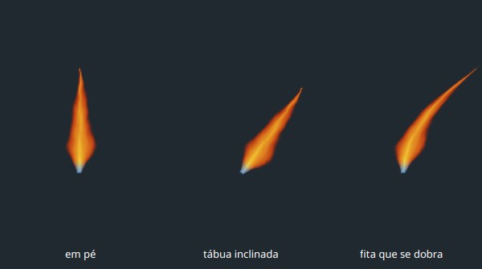
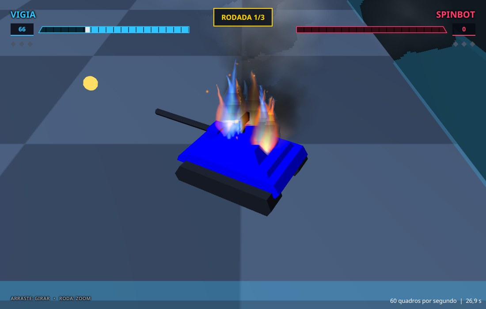
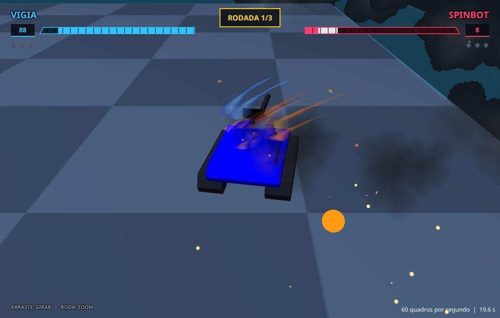
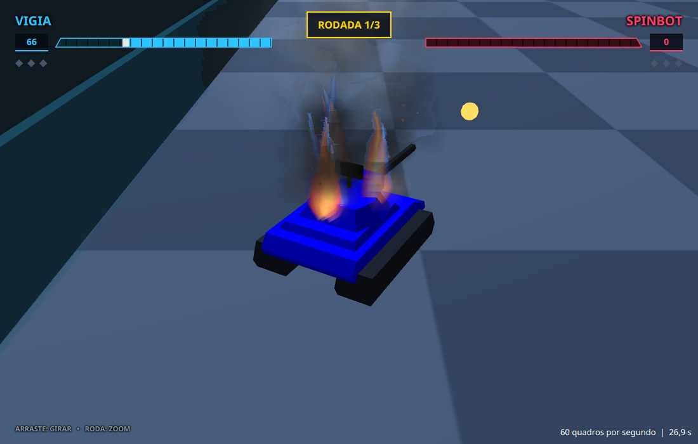
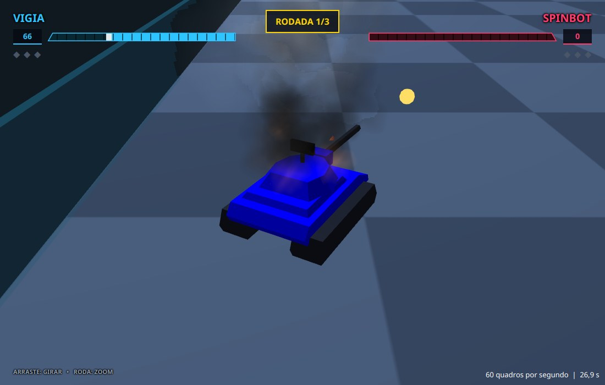
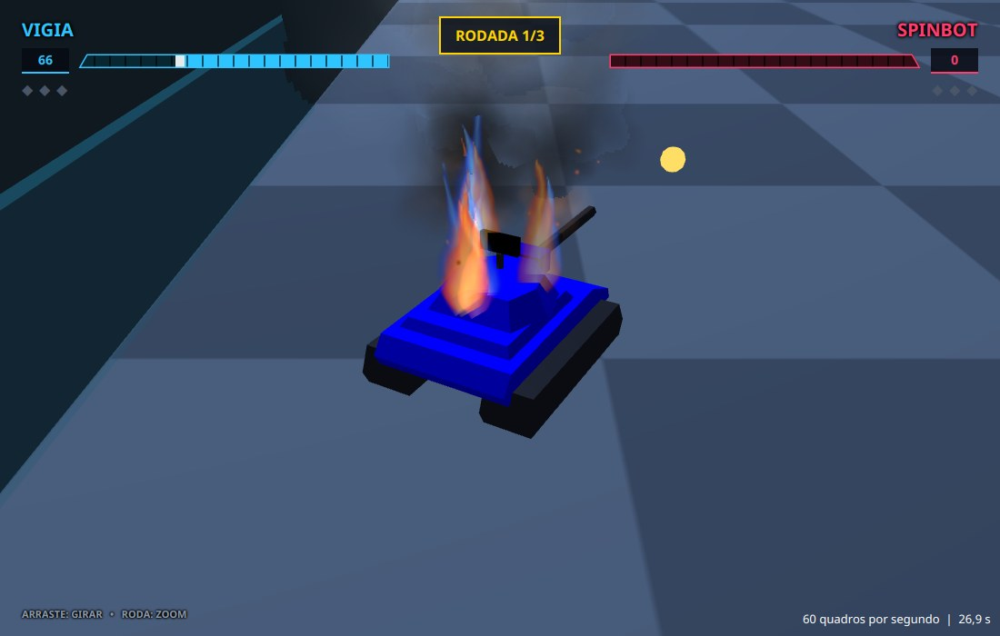

# Capítulo 11 — O corpo da chama

## Objetivo

Prender as chamas do capítulo 10 aos robôs. Cada chama vira uma fita que se dobra, presa a um ponto do casco que queima. Quando o robô anda, a chama se arrasta pelo caminho que ele fez, como o fogo de verdade, e quando ele para, a chama fica em pé. No fim, a fumaça passa a ser desenhada por trás do fogo, em vez de cobri-lo.

## Passo 1 — O que uma chama precisa

No capítulo 9, cada partícula nasce num ponto do mundo e fica no ar enquanto vive, e o robô segue o caminho dele. É o que se quer de uma fumaça ou de uma brasa, que se soltam do robô. Uma chama é diferente, e a diferença aparece em três coisas que se veem numa vela ou numa fogueira:

1. **A base não se solta.** A chama nasce no combustível e fica ligada a ele. Se fosse uma partícula do mundo, um robô que anda a deixaria para trás, solta no ar, como faz com a fumaça.
2. **A chama se dobra.** A imagem do capítulo 10 é reta. Se a inclinássemos inteira, de uma vez só, ela continuaria reta e pareceria uma tábua encostada na parede. Numa chama de verdade a base sobe em pé e só a ponta é levada pelo ar: a chama se curva.
3. **O gás fica onde foi deixado.** O gás quente sai do combustível e sobe. Depois de sair, ele não acompanha mais o robô: cada altura da chama está onde o robô estava quando aquele gás saiu. Quanto mais alto, mais cedo o gás saiu, e mais para trás, no caminho do robô, ele está. Com o robô parado, a chama fica em pé. Com o robô andando, ela se arrasta pelo caminho que ele fez: pende para trás e demora para acompanhar uma curva.

A chama continuará sendo uma partícula como as outras (nasce, vive, morre e é reaproveitada), de um tipo novo, o `CHAMA`, com três diferenças: ela fica **presa** a um robô, é desenhada numa **fita que se dobra** em vez de num quadrado, e a fita segue o **caminho** do robô. O fim do capítulo trata de um quarto problema, que o capítulo 9 deixou preparado: a fumaça é grande e transparente, e às vezes cobre o fogo em vez de se misturar com ele.

| Classe | O que faz |
|---|---|
| `FitaDeChama` | nova: a malha em que a chama é desenhada, e que se dobra |
| `Fitas` | nova: uma janela de teste que compara a fita com uma tábua inclinada |
| `RastroDoRobo` | nova: por onde o robô andou nos últimos instantes |
| `CameraOrbital` | agora diz para onde fica a direita dela |
| `Particula`, `Aparencia`, `Particulas` | ganham o tipo `CHAMA` |
| `Queima` | agora também solta chamas, presas ao casco, e guarda o caminho do robô |

## Passo 2 — Uma fita em vez de um quadrado

O quadrado das partículas tem quatro pontos e dois triângulos, e não há onde dobrar. A `FitaDeChama` é uma malha mais cortada: **8 linhas** de dois pontos (um à esquerda e outro à direita), uma sobre a outra, de baixo para cima. Entre cada duas linhas há um pedaço, e a fita tem **7 pedaços**, cada um com dois triângulos. A linha 0 é a base e a linha 7 é a ponta. Para dobrar a fita, basta mover cada linha de lado, um pouco mais que a de baixo.

Os números da malha seguem o formato do capítulo 3, o mesmo do quadrado do capítulo 9:

- **Pontos**: três números (x, y, z) por ponto. A linha `i` tem o ponto da esquerda no índice `2i` e o da direita no `2i + 1`. O `y` negativo é para cima (capítulo 2), então a base está em `y = 0` e a ponta em `y = −altura`.
- **Coordenadas da imagem**: dois números (u, v) por ponto. A esquerda tem `u = 0` e a direita `u = 1`. Na base, `v = 1`, a borda de baixo da imagem, e na ponta, `v = 0`, a borda de cima. Elas só dependem da linha e nunca mudam, por isso são escritas uma vez, no construtor.
- **Faces**: cada pedaço é um quadrilátero entre a linha `i` e a linha `i + 1`, e vira dois triângulos. Cada vértice de um triângulo é um par (índice do ponto, índice da coordenada da imagem). Como o ponto `k` usa a coordenada `k`, os dois números do par são iguais.

O método `moldar` calcula onde fica cada ponto e é chamado a cada quadro, porque a fita muda o tempo todo. Ele recebe a largura e a altura da chama, a direção da **direita da câmera** no chão (o passo 5 explica o motivo) e o **balanço**, que é quanto a ponta balança, como fração da altura. Para cada linha, ele calcula primeiro o centro: o desvio que quem usa a fita pediu (`desvioX` e `desvioZ`, dois vetores com um número por linha) mais o balanço. O balanço é multiplicado por `subida × subida`, e `subida` vai de 0 na base a 1 na ponta: a base não balança, o meio (0,5) balança um quarto do que a ponta balança, e a ponta balança tudo. Depois ele põe o ponto da esquerda meia largura para um lado do centro, e o da direita meia largura para o outro, ao longo da direção da direita da câmera.

O vetor `pontos` guarda os 48 números (8 linhas, 2 pontos, 3 coordenadas), e o `set` do `ObservableFloatArray` copia o vetor para a malha numa chamada só. Os métodos `base` e `ponta` dizem onde estão a base e a ponta da fita, e servem aos testes. **Crie o arquivo** `src/main/java/campeonato/cena/FitaDeChama.java`:

<!-- arquivo: src/main/java/campeonato/cena/FitaDeChama.java | criar -->
```java
package campeonato.cena;

import javafx.scene.shape.TriangleMesh;

/**
 * A fita em que uma chama é desenhada: fica em pé no chão, sempre de frente para a câmera, e é cortada em pedaços que
 * podem se dobrar. Uma imagem plana inclinada de uma vez só pareceria uma tábua; a fita se dobra, como a língua de um
 * fogo de verdade sob o vento. A base dela fica sempre na origem e não se mexe.
 */
final class FitaDeChama {

    /** Em quantos pedaços a fita é cortada. */
    static final int SECOES = 7;

    /** A fita: dois pontos para cada linha, e a primeira linha é a base. */
    final TriangleMesh malha = new TriangleMesh();
    private final float[] pontos = new float[(SECOES + 1) * 2 * 3];

    /** O quanto cada linha da fita está para o lado da vertical da base, no chão: quem usa a fita preenche antes de moldá-la. */
    final double[] desvioX = new double[SECOES + 1];
    final double[] desvioZ = new double[SECOES + 1];

    /** Faz a fita em pé, com a imagem da chama sobre ela: a ponta no alto da imagem. */
    FitaDeChama() {
        for (int linha = 0; linha <= SECOES; linha++) {
            // a coordenada v da imagem vai de 1, embaixo, a 0, em cima
            float v = 1 - (float) linha / SECOES;
            malha.getTexCoords().addAll(0, v, 1, v);
        }
        for (int secao = 0; secao < SECOES; secao++) {
            int esquerda = 2 * secao;
            int direita = esquerda + 1;
            int paraCimaEsquerda = esquerda + 2;
            int paraCimaDireita = esquerda + 3;
            // dois triângulos por pedaço; cada ponto tem a coordenada da imagem de mesmo número
            malha.getFaces().addAll(esquerda, esquerda, direita, direita, paraCimaDireita, paraCimaDireita,
                    esquerda, esquerda, paraCimaDireita, paraCimaDireita, paraCimaEsquerda, paraCimaEsquerda);
        }
        malha.getPoints().resize(pontos.length);
        moldar(1, 1, 1, 0, 0);
    }

    /**
     * Dobra a fita: para cima a partir da base e para o lado conforme sobe, tanto quanto pedido para cada linha em
     * {@link #desvioX} e {@link #desvioZ}, que quem usa preenche antes.
     *
     * @param largura da fita
     * @param altura da fita, da base à ponta
     * @param direitaX para onde fica a direita da câmera, no chão
     * @param direitaZ idem
     * @param balanco o quanto a ponta balança para o lado da câmera, como fração da altura
     */
    void moldar(double largura, double altura, double direitaX, double direitaZ, double balanco) {
        for (int linha = 0; linha <= SECOES; linha++) {
            double subida = (double) linha / SECOES;
            // o balanço cresce com o quadrado da subida: a base não se mexe e a ponta balança bastante
            double balancar = balanco * altura * subida * subida;
            double centroX = desvioX[linha] + direitaX * balancar;
            double centroZ = desvioZ[linha] + direitaZ * balancar;
            double alto = -subida * altura;
            ponto(2 * linha, centroX - direitaX * largura / 2, alto, centroZ - direitaZ * largura / 2);
            ponto(2 * linha + 1, centroX + direitaX * largura / 2, alto, centroZ + direitaZ * largura / 2);
        }
        malha.getPoints().set(0, pontos, 0, pontos.length);
    }

    /** Escreve um ponto da fita. */
    private void ponto(int indice, double x, double y, double z) {
        pontos[3 * indice] = (float) x;
        pontos[3 * indice + 1] = (float) y;
        pontos[3 * indice + 2] = (float) z;
    }

    /** Onde está a base da fita, no meio da primeira linha, no chão: x e z. */
    double[] base() {
        return new double[] { (pontos[0] + pontos[3]) / 2, (pontos[2] + pontos[5]) / 2 };
    }

    /** Onde está a ponta da fita, no meio da última linha: x, y e z. */
    double[] ponta() {
        int ultima = 2 * SECOES * 3;
        return new double[] { (pontos[ultima] + pontos[ultima + 3]) / 2, (pontos[ultima + 1] + pontos[ultima + 4]) / 2,
                (pontos[ultima + 2] + pontos[ultima + 5]) / 2 };
    }
}
```

O `(double) linha / SECOES` pede uma explicação. Em Java, a divisão de dois inteiros dá um inteiro: `3 / 7` vale 0. O `(double)` na frente converte o primeiro número em decimal, e então a divisão passa a ser decimal: `3.0 / 7` vale 0,4286. Sem ele, `subida` seria 0 em toda linha, menos na última.

<!-- compilar -->

Os testes conferem o formato da malha, a base e a ponta da fita em pé, o efeito de `moldar` e dos desvios, e o balanço. **Crie o arquivo** `src/test/java/campeonato/cena/FitaDeChamaTest.java`:

<!-- arquivo: src/test/java/campeonato/cena/FitaDeChamaTest.java | criar -->
```java
package campeonato.cena;

import static org.junit.jupiter.api.Assertions.assertEquals;

import org.junit.jupiter.api.Test;

class FitaDeChamaTest {

    @Test
    void aFitaTemOitoLinhasDeDoisPontosEDoisTriangulosPorSecao() {
        FitaDeChama fita = new FitaDeChama();
        int linhas = FitaDeChama.SECOES + 1;
        // cada ponto tem x, y e z; cada triângulo tem 3 pares de (ponto, coordenada da imagem)
        assertEquals(linhas * 2 * 3, fita.malha.getPoints().size());
        assertEquals(linhas * 2 * 2, fita.malha.getTexCoords().size());
        assertEquals(FitaDeChama.SECOES * 2 * 6, fita.malha.getFaces().size());
    }

    @Test
    void aFitaNasceEmPeComABaseNaOrigem() {
        FitaDeChama fita = new FitaDeChama();
        assertEquals(0, fita.base()[0], 1e-6);
        assertEquals(0, fita.base()[1], 1e-6);
        // o y negativo é para cima: a ponta de uma fita de altura 1 está em y = -1
        assertEquals(-1, fita.ponta()[1], 1e-6);
    }

    @Test
    void moldarDaALarguraEAAltura() {
        FitaDeChama fita = new FitaDeChama();
        fita.moldar(10, 50, 1, 0, 0);
        assertEquals(-50, fita.ponta()[1], 1e-6);
        // a primeira linha vai de -5 a 5 no eixo da direita
        assertEquals(-5, fita.malha.getPoints().get(0), 1e-6);
        assertEquals(5, fita.malha.getPoints().get(3), 1e-6);
    }

    @Test
    void aFitaSeAlargaPeloLadoDireitoDaCamera() {
        FitaDeChama fita = new FitaDeChama();
        // com a direita da câmera no eixo z, a fita se alarga em z
        fita.moldar(10, 50, 0, 1, 0);
        assertEquals(0, fita.malha.getPoints().get(0), 1e-6);
        assertEquals(-5, fita.malha.getPoints().get(2), 1e-6);
        assertEquals(5, fita.malha.getPoints().get(5), 1e-6);
    }

    @Test
    void osDesviosEntortamAFitaMasABaseFicaOndeEstava() {
        FitaDeChama fita = new FitaDeChama();
        fita.desvioX[FitaDeChama.SECOES] = 20;
        fita.moldar(10, 50, 1, 0, 0);
        assertEquals(20, fita.ponta()[0], 1e-6);
        assertEquals(0, fita.base()[0], 1e-6);
    }

    @Test
    void oBalancoSoMexeNaPonta() {
        FitaDeChama fita = new FitaDeChama();
        fita.moldar(10, 50, 1, 0, 0.1);
        // 0,1 de 50 de altura, e a base não se mexe
        assertEquals(5, fita.ponta()[0], 1e-6);
        assertEquals(0, fita.base()[0], 1e-6);
    }
}
```

<!-- testar -->

Antes de usar a fita nos robôs, vale ver a diferença entre dobrar e inclinar. A janela `Fitas` mostra a mesma imagem, o quadro 3 da chama 0 do capítulo 10, de três jeitos:

- **em pé**, numa fita sem desvio;
- numa **tábua inclinada**: o quadrado do capítulo 9, esticado, com o pé na origem, e inclinado inteiro de uma vez em torno do eixo Z, por 35 graus (o ângulo cuja tangente é 0,7);
- numa **fita que se dobra**: cada linha vai para o lado `0,7 × altura × subida²`. A base sobe em pé e a ponta vai longe: o desvio cresce com o quadrado da subida, como o balanço.

A ponta da tábua e a da fita ficam na mesma direção, vistas do pé. Na tábua, a ordem em que o JavaFX aplica as transformações (da última para a primeira da lista, como no capítulo 9) é esticar, subir o quadrado até o pé ficar na origem, inclinar e levar até o lugar. A câmera olha no sentido +z e tem o +x à direita, por isso a direita da câmera, para a fita, é `(1, 0)`. **Crie o arquivo** `src/main/java/campeonato/cena/Fitas.java`:

<!-- arquivo: src/main/java/campeonato/cena/Fitas.java | criar -->
```java
package campeonato.cena;

import javafx.application.Application;
import javafx.geometry.Insets;
import javafx.geometry.Pos;
import javafx.scene.AmbientLight;
import javafx.scene.Group;
import javafx.scene.Parent;
import javafx.scene.PerspectiveCamera;
import javafx.scene.Scene;
import javafx.scene.SceneAntialiasing;
import javafx.scene.SubScene;
import javafx.scene.control.Label;
import javafx.scene.layout.HBox;
import javafx.scene.layout.VBox;
import javafx.scene.paint.Color;
import javafx.scene.paint.PhongMaterial;
import javafx.scene.shape.CullFace;
import javafx.scene.shape.MeshView;
import javafx.scene.transform.Rotate;
import javafx.scene.transform.Scale;
import javafx.scene.transform.Translate;
import javafx.stage.Stage;

/** Um experimento: a mesma chama numa fita em pé, numa tábua inclinada e numa fita que se dobra. */
public class Fitas extends Application {

    private static final double LARGURA = 40;
    private static final double ALTURA = 60;

    /** O material com o quadro 3 da chama 0. */
    private static PhongMaterial material() {
        PhongMaterial material = new PhongMaterial(Color.WHITE);
        material.setDiffuseMap(TexturasDeFogo.CHAMAS[0][3]);
        return material;
    }

    /** Uma fita em pé em x; a 'curvatura' diz o quanto a ponta fica para o lado, como fração da altura. */
    private static MeshView fita(double x, double curvatura) {
        FitaDeChama fita = new FitaDeChama();
        for (int linha = 0; linha <= FitaDeChama.SECOES; linha++) {
            double subida = (double) linha / FitaDeChama.SECOES;
            // cada linha vai um pouco mais para o lado que a de baixo, e a ponta vai mais
            fita.desvioX[linha] = curvatura * ALTURA * subida * subida;
        }
        // nesta cena a direita da câmera é o +x
        fita.moldar(LARGURA, ALTURA, 1, 0, 0);
        MeshView vista = new MeshView(fita.malha);
        vista.setMaterial(material());
        vista.setCullFace(CullFace.NONE);
        vista.setTranslateX(x);
        return vista;
    }

    /** Uma tábua: o quadrado todo inclinado de uma vez, pelo pé, na direção da ponta da fita. */
    private static MeshView tabua(double x, double curvatura) {
        MeshView vista = new MeshView(Particula.QUADRADO);
        vista.setMaterial(material());
        vista.setCullFace(CullFace.NONE);
        double angulo = Math.toDegrees(Math.atan(curvatura));
        // o último é aplicado primeiro: estica, sobe o quadrado para o pé ficar na origem, inclina e leva até x
        vista.getTransforms().addAll(new Translate(x, 0, 0), new Rotate(angulo, Rotate.Z_AXIS), new Translate(0, -ALTURA / 2, 0),
                new Scale(LARGURA, ALTURA, 1));
        return vista;
    }

    /** Uma cena 3D com as três chamas lado a lado. */
    private static SubScene cena() {
        Group raiz = new Group(fita(-90, 0), tabua(0, 0.7), fita(90, 0.7), new AmbientLight(Color.WHITE));
        SubScene cena = new SubScene(raiz, 600, 300, true, SceneAntialiasing.BALANCED);
        PerspectiveCamera camera = new PerspectiveCamera(true);
        camera.setNearClip(1);
        camera.setFarClip(2000);
        camera.getTransforms().add(new Translate(0, -ALTURA / 2, -250));
        cena.setCamera(camera);
        cena.setFill(Color.web("#202830"));
        return cena;
    }

    private static Label legenda(String texto) {
        Label legenda = new Label(texto);
        legenda.setTextFill(Color.WHITE);
        legenda.setMinWidth(200);
        legenda.setAlignment(Pos.CENTER);
        return legenda;
    }

    /** O conteúdo da janela: a cena e, embaixo, o nome de cada chama. */
    static Parent montar() {
        HBox nomes = new HBox(legenda("em pé"), legenda("tábua inclinada"), legenda("fita que se dobra"));
        VBox raiz = new VBox(8, cena(), nomes);
        raiz.setStyle("-fx-background-color: #202830;");
        raiz.setPadding(new Insets(0, 0, 10, 0));
        return raiz;
    }

    @Override
    public void start(Stage palco) {
        palco.setTitle("Fitas");
        palco.setScene(new Scene(montar()));
        palco.show();
    }

    public static void main(String[] args) {
        launch(args);
    }
}
```

<!-- compilar -->

<!-- executar: | rodar: 12 | proibe: Exception, ERROR -->
```bash
mvn javafx:run -Dclasse.principal=campeonato.cena.Fitas
```

<!-- marco: 11-fitas -->



À esquerda, a chama em pé. No meio, a tábua: a chama inteira ficou reta e deitada, com a base inclinada junto. À direita, a fita: a base continua em pé e a chama se curva, como o fogo de verdade quando o vento o empurra. A base azul clara que você fez no capítulo 10 também ficou no lugar certo, no pé da fita.

## Passo 3 — Por onde o robô andou

Para saber onde cada altura da chama deve ficar, precisamos responder a uma pergunta: onde o robô estava 0,2 segundo atrás? O programa só conhece o lugar de agora, então a `RastroDoRobo` **guarda os últimos lugares**, cada um com o momento em que foi registrado, e sabe responder a pergunta com uma conta entre dois lugares guardados.

Os lugares ficam num **vetor circular**. Um vetor comum tem um fim; quando ele enche, ou paramos de guardar, ou jogamos tudo fora e começamos de novo, ou mudamos todos os lugares uma casa para trás, o que é trabalho demais a cada quadro. O vetor circular resolve de outro jeito: escrevemos sempre na casa seguinte à última escrita, e quando passamos da última casa voltamos à casa 0 e escrevemos por cima do lugar mais velho. É como um caderno em que, ao acabarem as folhas, se volta à primeira e se apaga o que estava escrito. O operador `%`, o resto da divisão, faz a volta: `(indice + 1) % 96` vale 1, 2 e assim até 95, e depois volta a 0. O vetor tem 96 casas, o que a 60 quadros por segundo dá 1,6 segundo de caminho, bem mais que os 0,4 segundo que vamos usar.

Para andar para trás no vetor usamos `(indice - 1 + CAPACIDADE) % CAPACIDADE`. Em Java o resto de um número negativo é negativo: `-1 % 96` vale `-1`, e não 95, como seria em Python. Somar a capacidade antes do `%` impede o índice negativo.

O método `lugarEm(tempo)` anda do lugar mais novo para o mais velho até achar o primeiro lugar registrado **antes** do momento pedido. O momento está então entre esse lugar e o seguinte, e o lugar do robô é uma mistura dos dois (`Geometria.interpolar`, do capítulo 6), na proporção em que o momento está do caminho entre eles. Se o momento pedido é mais novo que todos os lugares guardados, o resultado é o mais novo; se é mais velho que todos, o mais velho. Se nada foi guardado, o resultado é `null`.

Há um cuidado, o mesmo do `Velocidade` do capítulo 9: no começo de cada rodada os robôs reaparecem em lugares novos, e o lugar **salta**. Um passo de 60 unidades ou mais não é um movimento, e então o rastro esquece o que tinha. **Crie o arquivo** `src/main/java/campeonato/cena/RastroDoRobo.java`:

<!-- arquivo: src/main/java/campeonato/cena/RastroDoRobo.java | criar -->
```java
package campeonato.cena;

/**
 * Por onde um robô andou nos últimos instantes, para o fogo dele: uma chama é feita do gás quente que sai do seu ponto e
 * fica onde foi deixado enquanto sobe. Então, quanto mais alto está um pedaço da chama, mais velho ele é e mais para
 * trás, no caminho do robô, ele fica.
 */
final class RastroDoRobo {

    /** Quantos lugares ficam guardados; os mais velhos são esquecidos. */
    private static final int CAPACIDADE = 96;

    /** Um passo desta distância, ou maior, é um salto (uma rodada nova começou) e não um movimento. */
    private static final double SALTO = 60;

    private final double[] tempos = new double[CAPACIDADE];
    private final double[] lugares = new double[2 * CAPACIDADE];
    private int quantos;
    /** O índice do lugar mais novo. */
    private int maisNovo;

    /** Esquece por onde o robô andou. */
    void limpar() {
        quantos = 0;
    }

    /**
     * Guarda o lugar do robô num momento; os momentos só crescem. Um salto do robô faz esquecer o caminho anterior.
     */
    void registrar(double tempo, double x, double z) {
        if (quantos > 0 && Math.hypot(x - lugares[2 * maisNovo], z - lugares[2 * maisNovo + 1]) >= SALTO) {
            quantos = 0;
        }
        // o vetor é circular: depois da última posição, a gravação volta à primeira e apaga o lugar mais velho
        maisNovo = (maisNovo + 1) % CAPACIDADE;
        tempos[maisNovo] = tempo;
        lugares[2 * maisNovo] = x;
        lugares[2 * maisNovo + 1] = z;
        quantos = Math.min(quantos + 1, CAPACIDADE);
    }

    /**
     * Onde o robô estava num momento, entre os lugares guardados: x e z. Um momento mais velho que todos dá o lugar mais
     * velho, e um mais novo que todos dá o mais novo.
     *
     * @return o lugar, ou null se nada está guardado
     */
    double[] lugarEm(double tempo) {
        if (quantos == 0) {
            return null;
        }
        int indice = maisNovo;
        for (int passo = 0; passo < quantos; passo++) {
            if (tempos[indice] <= tempo) {
                if (passo == 0) {
                    return new double[] { lugares[2 * indice], lugares[2 * indice + 1] };
                }
                int depois = (indice + 1) % CAPACIDADE;
                double intervalo = tempos[depois] - tempos[indice];
                double fracao = intervalo > 1e-9 ? (tempo - tempos[indice]) / intervalo : 1;
                return new double[] {
                        Geometria.interpolar(lugares[2 * indice], lugares[2 * depois], fracao),
                        Geometria.interpolar(lugares[2 * indice + 1], lugares[2 * depois + 1], fracao) };
            }
            // um passo para trás no vetor circular; o + CAPACIDADE evita um índice negativo
            indice = (indice - 1 + CAPACIDADE) % CAPACIDADE;
        }
        int maisVelho = (maisNovo - quantos + 1 + CAPACIDADE) % CAPACIDADE;
        return new double[] { lugares[2 * maisVelho], lugares[2 * maisVelho + 1] };
    }
}
```

<!-- compilar -->

Os testes cobrem cada caminho do `lugarEm`: sem nada guardado, com um lugar só, entre dois lugares, momentos mais novos e mais velhos que tudo, o salto, o vetor que enche e dá a volta, e o `limpar`. No teste do vetor cheio, 200 lugares entram num vetor de 96, e só os 96 últimos (do 104 ao 199) ficam. **Crie o arquivo** `src/test/java/campeonato/cena/RastroDoRoboTest.java`:

<!-- arquivo: src/test/java/campeonato/cena/RastroDoRoboTest.java | criar -->
```java
package campeonato.cena;

import static org.junit.jupiter.api.Assertions.assertEquals;
import static org.junit.jupiter.api.Assertions.assertNull;

import org.junit.jupiter.api.Test;

class RastroDoRoboTest {

    @Test
    void semNadaGuardadoNaoHaLugar() {
        assertNull(new RastroDoRobo().lugarEm(1));
    }

    @Test
    void comUmLugarSoQualquerMomentoDaOMesmoLugar() {
        RastroDoRobo rastro = new RastroDoRobo();
        rastro.registrar(1, 5, 6);
        for (double tempo : new double[] { 0, 1, 7 }) {
            double[] lugar = rastro.lugarEm(tempo);
            assertEquals(5, lugar[0], 1e-9);
            assertEquals(6, lugar[1], 1e-9);
        }
    }

    @Test
    void entreDoisLugaresOCaminhoEUmaReta() {
        RastroDoRobo rastro = new RastroDoRobo();
        rastro.registrar(0, 0, 0);
        rastro.registrar(1, 10, 20);
        double[] quarto = rastro.lugarEm(0.25);
        assertEquals(2.5, quarto[0], 1e-9);
        assertEquals(5, quarto[1], 1e-9);
        double[] metade = rastro.lugarEm(0.5);
        assertEquals(5, metade[0], 1e-9);
        assertEquals(10, metade[1], 1e-9);
    }

    @Test
    void umMomentoMaisNovoQueTudoDaOLugarMaisNovo() {
        RastroDoRobo rastro = new RastroDoRobo();
        rastro.registrar(0, 0, 0);
        rastro.registrar(1, 10, 0);
        assertEquals(10, rastro.lugarEm(99)[0], 1e-9);
    }

    @Test
    void umMomentoMaisVelhoQueTudoDaOLugarMaisVelho() {
        RastroDoRobo rastro = new RastroDoRobo();
        rastro.registrar(5, 3, 0);
        rastro.registrar(6, 10, 0);
        assertEquals(3, rastro.lugarEm(-100)[0], 1e-9);
    }

    @Test
    void umSaltoFazEsquecerOCaminhoAnterior() {
        RastroDoRobo rastro = new RastroDoRobo();
        rastro.registrar(0, 0, 0);
        rastro.registrar(1, 10, 0);
        // a rodada nova põe o robô a centenas de unidades dali
        rastro.registrar(2, 500, 0);
        assertEquals(500, rastro.lugarEm(0.5)[0], 1e-9);
        assertEquals(500, rastro.lugarEm(2)[0], 1e-9);
    }

    @Test
    void quandoOVetorEncheOsLugaresMaisVelhosSaem() {
        RastroDoRobo rastro = new RastroDoRobo();
        // 200 lugares, um a cada 0,01 s, andando 1 unidade por vez: só ficam os 96 últimos (do 104 ao 199)
        for (int i = 0; i < 200; i++) {
            rastro.registrar(i * 0.01, i, 0);
        }
        assertEquals(104, rastro.lugarEm(0)[0], 1e-9);
        assertEquals(150, rastro.lugarEm(1.5)[0], 1e-9);
        assertEquals(150.5, rastro.lugarEm(1.505)[0], 1e-9);
        assertEquals(199, rastro.lugarEm(5)[0], 1e-9);
    }

    @Test
    void limparEsqueceTudo() {
        RastroDoRobo rastro = new RastroDoRobo();
        rastro.registrar(0, 1, 1);
        rastro.limpar();
        assertNull(rastro.lugarEm(0));
    }
}
```

<!-- testar -->

## Passo 4 — A fita segue o caminho

Agora a ligação entre o rastro e a fita. O método `seguir` preenche os desvios da fita, linha por linha, de baixo para cima. Para a linha de `subida` `s` (0 na base, 1 na ponta):

1. Calcula a **idade** do gás daquela altura: `0,4 × s^1,5` segundos. O 0,4 segundo é a idade do gás na ponta: um valor que, medido a olho, dá um arrasto bem visível sem deitar a chama. O expoente 1,5 faz o gás do meio da chama ser bem mais novo que o da ponta: na metade da altura a idade é 35% da idade da ponta, e não 50%. Por isso a chama pende pouco perto da base e muito perto da ponta, como a de verdade.
2. Pergunta ao rastro onde o robô estava naquele momento (`agora − idade`), e subtrai o lugar de agora. O resultado, `ladoX` e `ladoZ`, é o **desvio** da linha: um vetor que aponta de onde o robô está para onde ele estava, ou seja, para trás.
3. Limita o desvio. Se o robô for muito rápido, o desvio da ponta seria maior que a própria chama, que ficaria deitada no chão. Medimos a inclinação pela **tangente**: no desvio de uma linha, a tangente do ângulo de inclinação é `desvio ÷ altura da linha`. A tangente de 45 graus é 1 (a linha anda para o lado tanto quanto sobe), e a de 50 graus vale cerca de 1,19. Limitar a chama a 50 graus é limitar o desvio da linha a `tan(50°) × altura × s`. Quando o desvio é maior que esse limite, ele é **encolhido** na mesma direção até caber, multiplicando `ladoX` e `ladoZ` por `limite ÷ longe`.

Se o rastro não tem nada guardado (`null`), o desvio é zero, e a chama fica em pé. Primeiro as duas constantes. **Acrescente as linhas** abaixo logo depois de `static final int SECOES = 7;`:

<!-- arquivo: src/main/java/campeonato/cena/FitaDeChama.java | inserir-depois static final int SECOES = 7; -->
```java

    /** O quanto uma chama pode se inclinar para trás, no máximo, em graus. */
    private static final double INCLINACAO_MAXIMA = 50;

    /** Há quantos segundos o gás da ponta da chama saiu do robô: a ponta fica onde o robô estava há tanto tempo. */
    private static final double SEGUNDOS_DE_RASTRO = 0.4;
```

**Acrescente ao final da classe** `FitaDeChama`:

<!-- arquivo: src/main/java/campeonato/cena/FitaDeChama.java | acrescentar -->
```java

    /**
     * Preenche os desvios com o caminho que o robô fez: quanto mais alta a linha, mais velha ela é e mais para trás,
     * no caminho, ela fica; e nunca mais para trás do que a inclinação máxima permite.
     *
     * @param rastro por onde o robô andou
     * @param agora o momento de agora, o mesmo relógio do rastro
     * @param roboX onde o robô está agora
     * @param roboZ idem
     * @param altura da chama
     */
    void seguir(RastroDoRobo rastro, double agora, double roboX, double roboZ, double altura) {
        double maisInclinada = Math.tan(Math.toRadians(INCLINACAO_MAXIMA));
        for (int linha = 0; linha <= SECOES; linha++) {
            double subida = (double) linha / SECOES;
            // a linha mais alta é a mais velha; o expoente 1,5 faz o gás do meio ser bem mais novo que o da ponta
            double[] antes = rastro.lugarEm(agora - SEGUNDOS_DE_RASTRO * Math.pow(subida, 1.5));
            double ladoX = antes == null ? 0 : antes[0] - roboX;
            double ladoZ = antes == null ? 0 : antes[1] - roboZ;
            double longe = Math.hypot(ladoX, ladoZ);
            double limite = maisInclinada * altura * subida;
            if (longe > limite && longe > 1e-9) {
                ladoX *= limite / longe;
                ladoZ *= limite / longe;
            }
            desvioX[linha] = ladoX;
            desvioZ[linha] = ladoZ;
        }
    }
```

Os testes usam um robô de mentira: parado em (5, 6), ou andando 100 unidades por segundo no sentido de x, registrado a cada 0,05 segundo por 1 segundo. Com o robô parado, todos os desvios são zero. Andando, a chama pende para o lado negativo de x e, quanto mais alta a linha, mais para trás; na linha 4, o desvio confere com a conta feita à mão: `−40 × (4/7)^1,5`, porque o robô anda 100 por segundo e o gás dessa linha tem `0,4 × (4/7)^1,5` segundo. O terceiro teste confere o limite de inclinação, e o quarto o caso do rastro vazio. **Acrescente o import** no topo de `FitaDeChamaTest.java`:

<!-- arquivo: src/test/java/campeonato/cena/FitaDeChamaTest.java | importar -->
```java
import static org.junit.jupiter.api.Assertions.assertTrue;
```

**Acrescente ao final da classe** `FitaDeChamaTest`:

<!-- arquivo: src/test/java/campeonato/cena/FitaDeChamaTest.java | acrescentar -->
```java

    @Test
    void comORoboParadoAFitaFicaEmPe() {
        RastroDoRobo rastro = new RastroDoRobo();
        for (int i = 0; i <= 20; i++) {
            rastro.registrar(i * 0.05, 5, 6);
        }
        FitaDeChama fita = new FitaDeChama();
        fita.seguir(rastro, 1.0, 5, 6, 30);
        for (int linha = 0; linha <= FitaDeChama.SECOES; linha++) {
            assertEquals(0, fita.desvioX[linha], 1e-9);
            assertEquals(0, fita.desvioZ[linha], 1e-9);
        }
    }

    @Test
    void comORoboAndandoAChamaPendeParaTras() {
        RastroDoRobo rastro = new RastroDoRobo();
        // anda 100 unidades por segundo no sentido de x
        for (int i = 0; i <= 20; i++) {
            rastro.registrar(i * 0.05, 100 * i * 0.05, 0);
        }
        FitaDeChama fita = new FitaDeChama();
        fita.seguir(rastro, 1.0, 100, 0, 30);
        assertEquals(0, fita.desvioX[0], 1e-9);
        for (int linha = 1; linha <= FitaDeChama.SECOES; linha++) {
            // para trás é o sentido negativo de x, e quanto mais alta a linha, mais para trás
            assertTrue(fita.desvioX[linha] < fita.desvioX[linha - 1]);
            assertEquals(0, fita.desvioZ[linha], 1e-9);
        }
        // a linha 4 está a 4/7 da altura: o gás tem 0,4 × (4/7)^1,5 s, e nesse tempo o robô andou 100 vezes isso
        double subida = 4.0 / FitaDeChama.SECOES;
        assertEquals(-40 * Math.pow(subida, 1.5), fita.desvioX[4], 1e-6);
    }

    @Test
    void aChamaNaoPendeMaisQueAInclinacaoMaxima() {
        RastroDoRobo rastro = new RastroDoRobo();
        // muito rápido: 100 por segundo daria 40 unidades de desvio na ponta, mais que o limite
        for (int i = 0; i <= 20; i++) {
            rastro.registrar(i * 0.05, 100 * i * 0.05, 0);
        }
        FitaDeChama fita = new FitaDeChama();
        fita.seguir(rastro, 1.0, 100, 0, 30);
        // o limite é tan(50 graus) × altura
        assertEquals(-Math.tan(Math.toRadians(50)) * 30, fita.desvioX[FitaDeChama.SECOES], 1e-6);
    }

    @Test
    void semRastroAFitaFicaEmPe() {
        FitaDeChama fita = new FitaDeChama();
        fita.desvioX[3] = 9;
        fita.seguir(new RastroDoRobo(), 1.0, 0, 0, 30);
        assertEquals(0, fita.desvioX[3], 1e-9);
    }
```

<!-- testar -->

## Passo 5 — A direita da câmera

O quadrado das partículas se vira para a câmera com os mesmos giro e inclinação dela (capítulo 9). A fita não pode fazer isso: os desvios que o `seguir` calculou estão em **coordenadas do mundo**, e girar a fita inteira giraria os desvios também. Em vez disso, o `moldar` já põe cada ponto no lugar certo, e para a fita ficar de frente para a câmera só precisa de uma informação: para onde fica a **direita da câmera**, medida no chão. A fita se alarga ao longo dessa direção, e a câmera a vê de frente.

Quando a câmera gira `a` graus em torno do eixo vertical, o eixo `x` dela, que apontava para `+x` do mundo, gira junto. É a rotação do `Geometria.girar` (capítulo 9) aplicada ao vetor `(1, 0)`, e o resultado é `(cos a, −sen a)`. A inclinação não entra na conta: inclinar é girar em torno do próprio eixo `x`, e isso não muda o eixo `x`. **Acrescente ao final da classe** `CameraOrbital`:

<!-- arquivo: src/main/java/campeonato/cena/CameraOrbital.java | acrescentar -->
```java

    /** Para onde fica a direita da câmera, no chão: a componente x. */
    public double direitaX() {
        return Math.cos(Math.toRadians(giro.getAngle()));
    }

    /** Para onde fica a direita da câmera, no chão: a componente z. */
    public double direitaZ() {
        return -Math.sin(Math.toRadians(giro.getAngle()));
    }
```

Como no `olho()` do capítulo 9, o teste não confia na nossa conta, e compara com o que o JavaFX calcula: `localToScene(1, 0, 0)` leva o ponto `(1, 0, 0)` do sistema da câmera para o mundo, e a diferença para a origem da câmera é a direita dela. O teste gira a câmera 40 graus e a inclina 10, para conferir também que a inclinação não muda a resposta. **Acrescente ao final da classe** `CameraOrbitalTest`:

<!-- arquivo: src/test/java/campeonato/cena/CameraOrbitalTest.java | acrescentar -->
```java

    @Test
    void aDireitaDaCameraNoChaoEACorreta() {
        CameraOrbital camera = new CameraOrbital();
        camera.girar(40);
        camera.inclinar(10);
        Point3D origem = camera.camera().localToScene(0, 0, 0);
        // o eixo x da câmera, no mundo, é o que aponta para a direita dela
        Point3D direita = camera.camera().localToScene(1, 0, 0);
        assertEquals(direita.getX() - origem.getX(), camera.direitaX(), 1e-6);
        assertEquals(direita.getZ() - origem.getZ(), camera.direitaZ(), 1e-6);
    }
```

<!-- testar -->

## Passo 6 — A chama, um tipo de partícula

Agora a chama entra no sistema de partículas. A classe `Particula` ganha:

- o tipo `CHAMA` na lista de tipos;
- `PARTE_AZUL`, a parte das chamas que queimam azuis o tempo todo (as outras, laranjas, só têm a base azul, como na imagem do capítulo 10);
- `ancora`, o robô (a `Queima`) a que a chama está presa: o `x` e o `z` dela passam a ser relativos a ele;
- `fita`, a malha da chama, criada na primeira vez que a partícula é uma chama;
- `quadros` e `quadro`: os dez quadros da animação da chama e o que está no material agora;
- `azul()`, que diz se esta chama é azul: o `tom`, um número sorteado entre 0 e 1, tem de ser menor que `PARTE_AZUL`. Com `PARTE_AZUL` em 0,35, são azuis 35% das chamas.

**Acrescente o import** no topo de `Particula.java`:

<!-- arquivo: src/main/java/campeonato/cena/Particula.java | importar -->
```java
import javafx.scene.image.Image;
```

**Substitua a classe** `Tipo`:

<!-- arquivo: src/main/java/campeonato/cena/Particula.java | substituir-classe Tipo -->
```java
    /** O que a partícula é. */
    enum Tipo {
        FUMACA, FAISCA, BRASA, CHAMA
    }
```

**Acrescente as linhas** abaixo antes do comentário de `QUADRADO` (o que começa com "Um quadrado de lado 1"):

<!-- arquivo: src/main/java/campeonato/cena/Particula.java | inserir-antes Um quadrado de lado 1 -->
```java
    /** A parte das chamas que queima azul o tempo todo; as outras só queimam azul na base. */
    static final double PARTE_AZUL = 0.35;

```

**Acrescente as linhas** abaixo logo depois de `double distancia;`:

<!-- arquivo: src/main/java/campeonato/cena/Particula.java | inserir-depois double distancia; -->
```java

    /** O fogo a que uma chama está presa: o x e o z dela são relativos a ele, e é pelo caminho dele que o corpo da chama se arrasta. */
    Queima ancora;
    /** A fita em que uma chama é desenhada, feita na primeira vez que a partícula é uma chama. */
    FitaDeChama fita;
    /** Uma chama toca os quadros da sua animação ao longo da vida: estes são os quadros dela e o que está no material agora. */
    Image[] quadros;
    Image quadro;
```

**Acrescente as linhas** abaixo antes do comentário de `herdar` (o que começa com "Anda junto com quem a soltou"):

<!-- arquivo: src/main/java/campeonato/cena/Particula.java | inserir-antes Anda junto com quem a soltou -->
```java
    /** Verdadeiro se a chama queima azul o tempo todo. */
    boolean azul() {
        return tom < PARTE_AZUL;
    }

```

Salve e compile:

<!-- executar: | falha: sim | espera: does not cover all possible input values -->
```bash
mvn -q compile
```

O Maven recusa, e o `javac`, que escreve em inglês, aponta o `switch` do método `posicionar`, na classe `Particulas`: `the switch expression does not cover all possible input values`, ou seja, a expressão `switch` não cobre todos os valores possíveis. É a regra que o capítulo 9 apontou: um `switch` que **devolve** um valor precisa tratar todos os casos, e o compilador acabou de achar o lugar onde o `CHAMA` ainda não é tratado. Esse é um bom jeito de trabalhar: acrescenta-se o tipo novo e o compilador lista o que falta. O projeto só volta a compilar no fim do passo 8.

Há um segundo `switch` com o mesmo problema, o do método `iniciar`, e o compilador **não** o apontou. Aquele `switch` é um comando, e não uma expressão que devolve um valor, e para um comando o Java não exige todos os casos. Se esquecêssemos o `CHAMA` ali, nada avisaria, e a chama nasceria com vida 0 e morreria na hora. O compilador só protege onde o `switch` devolve um valor.

Agora a cara da chama, na `Aparencia`. Ela é uma conta pura do momento da vida `t`, como as outras:

- **Largura.** `tamanho × min(1, t × 5) × (1 − 0,5 × t)`. A chama cresce até a largura toda nos primeiros 20% da vida (aí o `t × 5` chega a 1) e depois afina até a metade da largura, como uma chama que está se apagando.
- **Altura.** A imagem do capítulo 10 tem 64 de largura por 96 de altura, e a chama mantém esse formato: a altura é a largura vezes `96 ÷ 64`, ou 1,5. A conta é feita com as constantes da própria imagem, com o `(double)` do passo 2 para a divisão não ser de inteiros (`96 / 64` daria 1).
- **Opacidade.** `min(1, t × 8) × min(1, (1 − t) × 2,2) × tremor × 0,55`. O primeiro fator faz a chama **aparecer** nos primeiros 12,5% da vida. O segundo a faz **sumir** nos últimos 45% (a partir de `t = 0,545` o `(1 − t) × 2,2` fica menor que 1). O `tremor`, um número de 0,85 a 1 sorteado a cada quadro, faz a chama piscar. E o 0,55 é a **opacidade máxima**: um robô avariado tem uma dúzia de chamas ao mesmo tempo, empilhadas, e se cada uma fosse opaca o fogo viraria uma massa sólida.
- **Cor.** As cores do fogo já estão pintadas na imagem, e a cor do material só as multiplica. Na chama azul a cor é branca (não muda nada) por toda a vida. Na laranja, é branca até 30% da vida e depois vai para `#ff9a74`, que tira verde e azul e faz a chama esfriar para um vermelho.

E `quadroDaChama(t)` diz qual dos dez quadros da animação a chama mostra no momento `t`: `(int) (t × 10)`, o número inteiro de baixo (o `(int)` corta a parte decimal, então 5,5 vira 5), sem passar do último. Como uma chama vive de 0,5 a 0,75 segundo, cada quadro dura de 50 a 75 milissegundos.

Primeiro a constante. **Acrescente as linhas** abaixo antes de `private Aparencia() {`:

<!-- arquivo: src/main/java/campeonato/cena/Aparencia.java | inserir-antes private Aparencia() { -->
```java
    /** A opacidade máxima de uma chama: muitas se empilham num robô em chamas, e ele não pode virar uma massa sólida. */
    private static final double OPACIDADE_DA_CHAMA = 0.55;

    /** A imagem da chama é mais alta que larga: a altura é esta vez a largura. */
    private static final double PROPORCAO_DA_CHAMA = (double) ImagemDaChama.ALTURA / ImagemDaChama.LARGURA;

```

**Acrescente ao final da classe** `Aparencia`:

<!-- arquivo: src/main/java/campeonato/cena/Aparencia.java | acrescentar -->
```java

    /**
     * Uma chama: cresce depressa, afina até a ponta e tremula. As cores do fogo já estão na imagem: aqui ela só aparece,
     * some e, nas laranjas, esfria um pouco para o vermelho com a idade. As azuis mantêm o azul.
     *
     * @param tremor de 0 a 1, faz a chama piscar
     */
    static Visual chama(double tamanho, boolean azul, double t, double tremor) {
        double largura = tamanho * Math.min(1, t * 5) * (1 - 0.5 * t);
        // aparece depressa quando nasce, some quando morre e tremula
        double opacidade = Math.min(1, t * 8) * Math.min(1, (1 - t) * 2.2) * tremor * OPACIDADE_DA_CHAMA;
        Color base = azul ? Color.WHITE : Color.WHITE.interpolate(Color.web("#ff9a74"), Math.max(0, (t - 0.3) / 0.7));
        return new Visual(largura, largura * PROPORCAO_DA_CHAMA, comOpacidade(base, opacidade));
    }

    /** Qual dos quadros da animação a chama mostra no momento t da vida dela. */
    static int quadroDaChama(double t) {
        return Math.min(TexturasDeFogo.QUADROS - 1, (int) (t * TexturasDeFogo.QUADROS));
    }
```

Os testes conferem o começo, o meio e o fim: a chama nasce invisível e some invisível, tem uma vez e meia a largura de altura, nunca passa da opacidade máxima, as laranjas esfriam e as azuis ficam brancas, e o quadro sobe com a vida e para no último. **Acrescente ao final da classe** `AparenciaTest`:

<!-- arquivo: src/test/java/campeonato/cena/AparenciaTest.java | acrescentar -->
```java

    @Test
    void aChamaNasceInvisivelCresceEMorreInvisivel() {
        assertEquals(0, Aparencia.chama(20, false, 0, 1).largura(), 1e-9);
        assertEquals(0, Aparencia.chama(20, false, 0, 1).cor().getOpacity(), ERRO_DA_COR);
        // aos 20% da vida já cresceu tudo: 20 × (1 - 0,1)
        assertEquals(18, Aparencia.chama(20, false, 0.2, 1).largura(), 1e-9);
        assertEquals(0, Aparencia.chama(20, false, 1, 1).cor().getOpacity(), ERRO_DA_COR);
    }

    @Test
    void aChamaEUmaVezEMeiaMaisAltaQueLarga() {
        Aparencia.Visual chama = Aparencia.chama(20, false, 0.5, 1);
        assertEquals(1.5, chama.altura() / chama.largura(), 1e-9);
    }

    @Test
    void aChamaNuncaPassaDaOpacidadeMaxima() {
        for (double t = 0; t <= 1; t += 0.05) {
            assertTrue(Aparencia.chama(20, false, t, 1).cor().getOpacity() <= 0.55 + ERRO_DA_COR);
        }
        // no meio da vida, sem tremor, é a opacidade máxima
        assertEquals(0.55, Aparencia.chama(20, false, 0.5, 1).cor().getOpacity(), ERRO_DA_COR);
    }

    @Test
    void aChamaLaranjaEsfriaParaOVermelhoEAAzulFicaBranca() {
        assertEquals(1, Aparencia.chama(20, false, 0.2, 1).cor().getGreen(), ERRO_DA_COR);
        assertEquals(Color.web("#ff9a74").getGreen(), Aparencia.chama(20, false, 1, 1).cor().getGreen(), ERRO_DA_COR);
        assertEquals(1, Aparencia.chama(20, true, 1, 1).cor().getGreen(), ERRO_DA_COR);
    }

    @Test
    void oQuadroDaChamaSobeComAVidaEFicaNoUltimo() {
        assertEquals(0, Aparencia.quadroDaChama(0));
        assertEquals(0, Aparencia.quadroDaChama(0.05));
        assertEquals(1, Aparencia.quadroDaChama(0.1));
        assertEquals(5, Aparencia.quadroDaChama(0.55));
        assertEquals(9, Aparencia.quadroDaChama(0.99));
        assertEquals(9, Aparencia.quadroDaChama(1));
    }
```

## Passo 7 — O fogo mostra onde está

A chama presa a um robô precisa perguntar a ele, a cada quadro, onde ele está agora (`x` e `z`), se ainda está vivo, e por onde andou (o `rastro` e o relógio dele, que é a hora que `RastroDoRobo` usa). A `Queima` guarda isso tudo e ainda não o mostra. **Acrescente as linhas** abaixo logo depois de `private final Velocidade velocidade = new Velocidade();`:

<!-- arquivo: src/main/java/campeonato/cena/Queima.java | inserir-depois private final Velocidade velocidade = new Velocidade(); -->
```java
    /** Por onde o robô andou, e o relógio desse rastro: as chamas se arrastam por esse caminho. */
    private final RastroDoRobo rastro = new RastroDoRobo();
    private double relogio;
```

E os métodos que mostram os dados. **Acrescente as linhas** abaixo antes do comentário de `reiniciar` (o que começa com "Esquece tudo: uma rodada nova começou"):

<!-- arquivo: src/main/java/campeonato/cena/Queima.java | inserir-antes Esquece tudo: uma rodada nova começou -->
```java
    double x() {
        return x;
    }

    double z() {
        return z;
    }

    boolean vivo() {
        return vivo;
    }

    RastroDoRobo rastro() {
        return rastro;
    }

    double relogio() {
        return relogio;
    }

```

O relógio da `Queima` é um número que só cresce: a cada quadro ele soma o `delta`, e o rastro registra o lugar do robô naquele momento. Ele não é a hora do dia, nem o tempo da batalha, e não precisa ser: o `RastroDoRobo` só compara momentos entre si.

<!-- compilar -->

## Passo 8 — Nascer, viver e ser desenhada

Agora o sistema de partículas, passo a passo.

**Nascer.** O `criar` reaproveita partículas mortas (capítulo 9), e isso traz um cuidado novo: uma partícula reaproveitada vem com **o que tinha na vida anterior**. Uma partícula que foi chama e agora é fumaça ainda estaria presa ao robô (`ancora`), e uma que foi fumaça e agora é chama ainda teria a malha do quadrado. O `criar` precisa limpar a âncora e escolher a malha certa: a fita para a chama, o quadrado para as outras. O `setMesh` com a mesma malha que já estava lá não faz nada.

**Começar a viver.** A chama vive de 0,5 a 0,75 segundo e tem um `tom` sorteado, que decide se ela é azul e dá a cada chama uma fase própria no balanço. O tamanho vai de 13 a 19, mais até 10 conforme a avaria. Ela **nasce parada**: velocidade zero, porque a base é presa ao ponto do casco e não sai de lá. Quem sobe não é a chama inteira, é o desenho dentro da imagem, que o ruído do capítulo 10 já faz subir. O quadro escolhido é o primeiro de uma das chamas: uma azul (`VARIANTES` em diante) se `azul()`, uma laranja se não. Por ser mais longa que as outras, ela ganha um método próprio, `iniciarChama`, e o `switch` do `iniciar` só chama esse método. **Acrescente as linhas** abaixo logo depois de `switch (particula.tipo) {`, no método `iniciar`:

<!-- arquivo: src/main/java/campeonato/cena/Particulas.java | inserir-depois switch (particula.tipo) { -->
```java
        case CHAMA -> iniciarChama(particula, avaria);
```

**Viver e morrer.** Uma chama também morre quando o robô a que está presa morre: o robô destruído explode (capítulo 7), e as chamas não podem ficar no ar. No `atualizar`, a condição de morte ganha a segunda parte. O `&&` é resolvido antes do `||`, mas os parênteses deixam isso claro.

**Ser desenhada.** O `posicionar` agora tem dois caminhos. O quadrado segue como era. A chama troca o quadro da animação (`trocarQuadro`) e se posiciona (`posicionarChama`). A distância à câmera, para a ordem de desenho do capítulo 9, passa a ser medida de onde a **forma** ficou, e não do `x`, `y` e `z` da partícula, porque o `x` e o `z` da chama são relativos ao robô.

O `trocarQuadro` só troca a imagem do material quando o quadro **muda**: a vida de uma chama passa por 10 quadros e o `atualizar` roda 60 vezes por segundo, então trocar a cada quadro seria trabalho à toa.

O `posicionarChama` faz o resto:

1. A fita já nasce virada para a câmera, e então o giro, a inclinação e a escala da partícula ficam neutros (0, 0 e 1).
2. A base é posta no ponto do casco: a posição do robô mais a posição relativa da chama. Fica 4% da altura para baixo, para entrar um pouco no casco e a base não parecer solta (o `y` positivo é para baixo).
3. A chama **respira**: a altura pulsa `±8%`, num seno de fase própria (o `tom` entra na fase).
4. A fita **segue** o caminho do robô, com `seguir` (passo 4).
5. A ponta **balança**: soma de dois senos de ritmos diferentes, que nunca se repetem em compasso, e por isso o balanço parece irregular, como o de uma chama.
6. A fita é moldada com a direita da câmera (passo 5).

**Acrescente o import** no topo de `Particulas.java`:

<!-- arquivo: src/main/java/campeonato/cena/Particulas.java | importar -->
```java
import javafx.scene.image.Image;
```

**Substitua o método** `criar`:

<!-- arquivo: src/main/java/campeonato/cena/Particulas.java | substituir-metodo criar -->
```java
    /**
     * Cria uma partícula num ponto do mundo.
     *
     * @param avaria de 0 a 1: quanto mais avariado o robô de onde ela sai, mais escura a fumaça
     */
    Particula criar(Tipo tipo, double x, double y, double z, double avaria) {
        // uma partícula morta é reaproveitada: criar centenas de objetos por segundo pesaria na memória
        Particula particula = reserva.isEmpty() ? new Particula() : reserva.remove(reserva.size() - 1);
        particula.tipo = tipo;
        particula.x = x;
        particula.y = y;
        particula.z = z;
        particula.idade = 0;
        // uma partícula reaproveitada traz o que tinha na vida anterior: aqui se esquece o que não é mais dela
        particula.ancora = null;
        // a chama é desenhada numa fita que se dobra, as outras num quadrado
        if (tipo == Tipo.CHAMA) {
            if (particula.fita == null) {
                particula.fita = new FitaDeChama();
            }
            particula.forma.setMesh(particula.fita.malha);
        } else {
            particula.forma.setMesh(Particula.QUADRADO);
        }
        particula.rotacao.setAngle(sorteio.nextDouble() * 360);
        iniciar(particula, avaria);
        if (vivas.size() < LIMITE) {
            vivas.add(particula);
        } else {
            reserva.add(particula);
        }
        return particula;
    }
```

**Substitua o método** `atualizar`:

<!-- arquivo: src/main/java/campeonato/cena/Particulas.java | substituir-metodo atualizar -->
```java
    /** Move e desenha todas as partículas, tira as que morreram e põe as outras na camada. */
    void atualizar(double delta, CameraOrbital camera) {
        Point3D olho = camera.olho();
        for (int i = vivas.size() - 1; i >= 0; i--) {
            Particula particula = vivas.get(i);
            particula.idade += delta;
            // a chama morre junto com o robô a que está presa
            if (particula.idade >= particula.vida || (particula.ancora != null && !particula.ancora.vivo())) {
                vivas.remove(i);
                reserva.add(particula);
                continue;
            }
            mover(particula, delta);
            posicionar(particula, camera, olho);
        }
        desenhar();
    }
```

**Substitua o método** `posicionar`:

<!-- arquivo: src/main/java/campeonato/cena/Particulas.java | substituir-metodo posicionar -->
```java
    /** Põe a partícula no lugar, do tamanho e da cor do momento, virada para a câmera. */
    private void posicionar(Particula particula, CameraOrbital camera, Point3D olho) {
        double t = particula.idade / particula.vida;
        Aparencia.Visual visual = switch (particula.tipo) {
        case FUMACA -> Aparencia.fumaca(particula.tamanho, particula.tom, t);
        case FAISCA -> Aparencia.faisca(particula.tamanho, t);
        case BRASA -> Aparencia.brasa(particula.tamanho, t, sorteio.nextDouble());
        case CHAMA -> Aparencia.chama(particula.tamanho, particula.azul(), t, 0.85 + 0.15 * sorteio.nextDouble());
        };
        particula.material.setDiffuseColor(visual.cor());
        if (particula.tipo == Tipo.CHAMA) {
            trocarQuadro(particula, t);
            posicionarChama(particula, visual, camera);
        } else {
            particula.forma.setTranslateX(particula.x);
            particula.forma.setTranslateY(particula.y);
            particula.forma.setTranslateZ(particula.z);
            // com os mesmos giro e inclinação da câmera, o quadrado fica de frente para ela
            particula.giro.setAngle(camera.giro());
            particula.inclinacao.setAngle(camera.inclinacao());
            particula.escala.setX(Math.max(0.01, visual.largura()));
            particula.escala.setY(Math.max(0.01, visual.altura()));
        }
        // a distância é medida de onde a forma ficou, e não de x, y e z da partícula: os da chama são relativos ao robô
        double dx = particula.forma.getTranslateX() - olho.getX();
        double dy = particula.forma.getTranslateY() - olho.getY();
        double dz = particula.forma.getTranslateZ() - olho.getZ();
        particula.distancia = dx * dx + dy * dy + dz * dz;
    }
```

**Acrescente ao final da classe** `Particulas`:

<!-- arquivo: src/main/java/campeonato/cena/Particulas.java | acrescentar -->
```java

    /** A chama: vive pouco, nasce parada no ponto do casco e usa um dos quadros de uma das chamas do capítulo 10. */
    private void iniciarChama(Particula chama, double avaria) {
        chama.vida = 0.5 + sorteio.nextDouble() * 0.25;
        // umas queimam azuis o tempo todo, as outras só na base; o 'tom' também dá a cada chama o seu balanço
        chama.tom = sorteio.nextDouble();
        chama.tamanho = 13 + sorteio.nextDouble() * 6 + avaria * 10;
        // a chama fica onde nasceu: a base dela é presa ao ponto e nunca sai de lá; o que sobe é o ruído da imagem
        chama.vx = 0;
        chama.vy = 0;
        chama.vz = 0;
        chama.velocidadeDeRotacao = 0;
        chama.rotacao.setAngle(0);
        int variante = chama.azul()
                ? TexturasDeFogo.VARIANTES + sorteio.nextInt(TexturasDeFogo.VARIANTES_AZUIS)
                : sorteio.nextInt(TexturasDeFogo.VARIANTES);
        chama.quadros = TexturasDeFogo.CHAMAS[variante];
        chama.quadro = chama.quadros[0];
        chama.material.setDiffuseMap(chama.quadro);
    }

    /** A chama toca os quadros da animação dela ao longo da vida; só troca a imagem do material quando o quadro muda. */
    private void trocarQuadro(Particula chama, double t) {
        Image proximo = chama.quadros[Aparencia.quadroDaChama(t)];
        if (proximo != chama.quadro) {
            chama.quadro = proximo;
            chama.material.setDiffuseMap(proximo);
        }
    }

    /**
     * Põe uma chama no mundo e dobra a fita dela. A base é presa ao ponto do robô que queima e anda com ele. O gás que sai
     * do ponto fica onde foi deixado enquanto sobe, então cada altura da chama está onde o robô estava um pouco antes:
     * quanto mais alta, mais velha, mais para trás no caminho dele. A chama se arrasta pelo caminho do robô, atrasada em
     * relação ao movimento, e fica em pé quando ele para. A ponta balança e a chama respira.
     */
    private void posicionarChama(Particula chama, Aparencia.Visual visual, CameraOrbital camera) {
        // a fita já é feita virada para a câmera: a imagem não gira nem se inclina
        chama.giro.setAngle(0);
        chama.inclinacao.setAngle(0);
        chama.escala.setX(1);
        chama.escala.setY(1);
        Queima robo = chama.ancora;
        // a base é presa ao ponto do casco e entra um pouco nele (o y cresce para baixo), para não parecer solta
        chama.forma.setTranslateX(robo.x() + chama.x);
        chama.forma.setTranslateY(chama.y + visual.altura() * 0.04);
        chama.forma.setTranslateZ(robo.z() + chama.z);
        // a chama respira: a altura pulsa um pouco
        double respiracao = 1 + 0.08 * Math.sin(chama.idade * 13 + chama.tom * 9);
        double altura = Math.max(0.01, visual.altura() * respiracao);
        chama.fita.seguir(robo.rastro(), robo.relogio(), robo.x(), robo.z(), altura);
        // a ponta balança mais que a base; duas ondas de ritmos diferentes somadas nunca se repetem em compasso
        double balanco = 0.07 * Math.sin(chama.idade * 9 + chama.tom * 20) + 0.04 * Math.sin(chama.idade * 17 + chama.tom * 7);
        chama.fita.moldar(Math.max(0.01, visual.largura()), altura, camera.direitaX(), camera.direitaZ(), balanco);
    }
```

<!-- compilar -->

O projeto compila de novo. Falta alguém que crie as chamas.

## Passo 9 — O fogo solta chamas

A `Queima` do capítulo 9 soltava fumaça, brasas e faíscas. Agora ela solta chamas também, e guarda o caminho do robô. A cada quadro:

1. Se não há avaria, tudo é zerado, inclusive o rastro: sem fogo, não há o que arrastar.
2. Com avaria, o relógio avança `delta` e o rastro registra o lugar do robô.
3. Um novo `Dosador` (capítulo 9) diz quantas chamas nascem neste quadro: de 9 por segundo (começo do fogo) a 23 por segundo (sem energia), porque `9 + 14 × avaria`. Com 0,6 segundo de vida em média, são de 6 a 14 chamas vivas ao mesmo tempo, mais ou menos.
4. Cada chama nasce num ponto do casco (`pontoQueimando`). O ponto é dado em coordenadas do mundo, mas a chama guarda a posição **relativa** ao robô (`ponto[0] - x`, `ponto[2] - z`) e fica presa a ele (`chama.ancora = this`). Daí em diante, quem a leva pelo mundo é a `posicionarChama`, que soma a posição do robô a cada quadro.

O `reiniciar` também precisa esquecer o caminho e zerar o `Dosador` das chamas. **Acrescente a linha** abaixo antes de `private final Dosador fumaca = new Dosador();`:

<!-- arquivo: src/main/java/campeonato/cena/Queima.java | inserir-antes private final Dosador fumaca = new Dosador(); -->
```java
    private final Dosador chamas = new Dosador();
```

**Substitua o método** `reiniciar`:

<!-- arquivo: src/main/java/campeonato/cena/Queima.java | substituir-metodo reiniciar -->
```java
    /** Esquece tudo: uma rodada nova começou. */
    void reiniciar() {
        chamas.zerar();
        fumaca.zerar();
        pedacos.zerar();
        velocidade.esquecer();
        rastro.limpar();
        energia = Energia.INICIAL;
        vivo = true;
    }
```

**Substitua o método** `atualizar`:

<!-- arquivo: src/main/java/campeonato/cena/Queima.java | substituir-metodo atualizar -->
```java
    /** Solta, neste quadro de 'delta' segundos, as partículas que o fogo deve soltar. */
    void atualizar(double delta, Particulas particulas) {
        double avaria = vivo ? Avaria.deEnergia(energia) : 0;
        if (avaria <= 0) {
            chamas.zerar();
            fumaca.zerar();
            pedacos.zerar();
            velocidade.esquecer();
            rastro.limpar();
            return;
        }
        velocidade.atualizar(delta, x, z);
        // por onde o robô andou: o corpo das chamas se arrasta por esse caminho
        relogio += delta;
        rastro.registrar(relogio, x, z);
        int pontos = Avaria.pontosQueimando(avaria);
        // quanto mais avariado, mais partículas por segundo
        for (int i = chamas.quantos(delta, 9 + 14 * avaria); i > 0; i--) {
            double[] ponto = pontoQueimando(pontos);
            // a base da chama é presa ao ponto do casco: a posição dela é relativa ao robô
            Particula chama = particulas.criar(Tipo.CHAMA, ponto[0] - x, ponto[1], ponto[2] - z, avaria);
            chama.ancora = this;
        }
        for (int i = fumaca.quantos(delta, 5 + 16 * avaria); i > 0; i--) {
            double[] ponto = pontoQueimando(pontos);
            particulas.criar(Tipo.FUMACA, ponto[0], ponto[1] - 6, ponto[2], avaria)
                    .herdar(velocidade.vx() * 0.15, velocidade.vz() * 0.15);
        }
        for (int i = pedacos.quantos(delta, 3 + 10 * avaria); i > 0; i--) {
            double[] ponto = pontoQueimando(pontos);
            if (sorteio.nextDouble() < PARTE_DE_BRASAS) {
                particulas.criar(Tipo.BRASA, ponto[0], ponto[1] - 6, ponto[2], avaria);
            } else {
                particulas.criar(Tipo.FAISCA, ponto[0], ponto[1], ponto[2], avaria)
                        .herdar(velocidade.vx() * 0.3, velocidade.vz() * 0.3);
            }
        }
    }
```

<!-- compilar -->

<!-- testar -->

Rode o programa como no capítulo 6. Quando um robô passar de 50 de energia para baixo, ele passa a soltar chamas, junto da fumaça, das brasas e das faíscas:

<!-- executar: | rodar: 25 | proibe: Exception, ERROR -->
```bash
mvn javafx:run
```

Na gravação de exemplo, no turno 800 da primeira rodada, o SpinBot está parado, sem energia, e a avaria é máxima. As chamas estão em pé sobre o casco, algumas azuis e outras laranjas, e a fumaça escura sobe atrás:

<!-- marco: 11-parado -->



Com o robô parado, as chamas ficam em pé: o rastro dele é um ponto só, e os desvios são zero. Agora o mesmo robô em movimento, no turno 600, quando faz uma curva depois de vir pela direita da imagem:

<!-- marco: 11-movimento -->



As chamas se deitam para o lado de onde o robô veio e se arrastam pelo caminho que ele fez, atrasadas em relação ao movimento, como um fogo de verdade num carro em movimento. A fumaça deixada para trás, a que o capítulo 9 já fazia, fica no caminho.

## Passo 10 — A fumaça cobre o fogo

Rode o programa e gire a câmera, arrastando o mouse, até olhar um robô avariado de lado. Às vezes as chamas aparecem recortadas, com bordas retas e degraus, ou meio apagadas atrás de uma nuvem de fumaça. Veja o SpinBot do passo anterior, visto de lado:

<!-- marco: 11-sem-ordem -->



A causa é a do capítulo 9. A regra "da mais longe para a mais perto" compara a distância do **centro** de cada partícula, e isso só serve para coisas pequenas: a fumaça é um quadrado grande, a chama é uma fita alta, e o centro de cada uma não diz onde estão todas as partes dela. Quando a fumaça é desenhada antes da chama, a parte da chama que está atrás do plano da fumaça é cortada, mesmo onde o desenho da fumaça é só uma névoa fina, e o corte tem as bordas retas do quadrado.

A primeira ideia vem de quem pinta quadros: o que é pintado por último fica por cima, então vamos desenhar **toda a fumaça primeiro**, sejam quais forem as distâncias, e o fogo depois. Isso se faz com um comparador composto. O `Comparator.comparingInt` cria um comparador a partir de uma função que dá um número a cada partícula: `0` para a fumaça e `1` para as outras, e a fumaça, com o número menor, vem antes. O `.thenComparing` desempata com o comparador do capítulo 9, da mais longe para a mais perto. O tipo `Particula` precisa ser escrito no parâmetro da função, porque o Java não consegue adivinhá-lo quando a chamada tem encadeamento. **Acrescente as linhas** abaixo logo depois de `DA_MAIS_LONGE_PARA_A_MAIS_PERTO = (a, b) -> Double.compare(b.distancia, a.distancia);`:

<!-- arquivo: src/main/java/campeonato/cena/Particulas.java | inserir-depois Double.compare(b.distancia, a.distancia); -->
```java

    /**
     * A fumaça primeiro, qualquer que seja a distância, para as chamas e as faíscas serem desenhadas por cima dela; depois,
     * da mais longe para a mais perto.
     */
    private static final Comparator<Particula> FUMACA_PRIMEIRO = Comparator
            .comparingInt((Particula particula) -> particula.tipo == Tipo.FUMACA ? 0 : 1)
            .thenComparing(DA_MAIS_LONGE_PARA_A_MAIS_PERTO);
```

**Substitua o método** `desenhar`:

<!-- arquivo: src/main/java/campeonato/cena/Particulas.java | substituir-metodo desenhar -->
```java
    /** Põe na camada, na ordem do desenho, as partículas vivas: a fumaça primeiro e, depois, da mais longe para a mais perto. */
    private void desenhar() {
        vivas.sort(FUMACA_PRIMEIRO);
        vistas.clear();
        for (Particula particula : vivas) {
            vistas.add(particula.forma);
        }
        // só troca os filhos da camada se a lista mudou: trocar a cada quadro, sem precisar, é trabalho à toa
        if (!camada.getChildren().equals(vistas)) {
            camada.getChildren().setAll(vistas);
        }
    }
```

<!-- compilar -->

<!-- marco: 11-so-ordem -->



Piorou. Num quadro a tinta, o que vem por último cobre o que veio antes. Com o buffer de profundidade não é assim: um pixel só é desenhado se estiver mais perto que o que já foi desenhado ali. A fumaça, desenhada primeiro, marca a profundidade de todo o quadrado dela, e o fogo que está **atrás do plano da fumaça** é cortado. Antes isso só acontecia quando o centro da fumaça estava mais longe que o da chama, e agora acontece sempre.

O que falta é a **profundidade**. Para o fogo aparecer, a fumaça precisa estar de fato **atrás** dele, e então afastamos a fumaça da câmera. Cada nuvem é empurrada `EMPURRAO_DA_FUMACA` unidades para longe da câmera, **ao longo do chão**. O vetor do olho da câmera até a fumaça, no chão, é `(longeX, longeZ)`. Dividido pelo comprimento dele (`alcance`), vira um vetor de comprimento 1, que aponta para longe da câmera, e multiplicado por 30 dá o empurrão. O 30 foi escolhido a olho: é grande o bastante para a fumaça ficar atrás de uma chama inteira (uma chama tem de 20 a 40 unidades de altura) e pequeno o bastante para a fumaça ainda parecer sair do fogo. O que é empurrado é só onde a fumaça é **desenhada** (a posição da forma): `x` e `z` da partícula não mudam, e o movimento da fumaça continua o mesmo.

Uma coisa mais longe parece menor, por causa da perspectiva, e uma nuvem que encolhesse ao ser empurrada ficaria diferente. Então ela é **ampliada** na mesma proporção: se a distância até o olho era `vista` e passa a ser `vista + 30`, a nuvem parece `vista ÷ (vista + 30)` do que era, e a escala `(vista + 30) ÷ vista` desfaz a diferença. É uma aproximação, porque o empurrão é no chão e a linha de visão é inclinada, mas a diferença é pequena. O `Math.max(vista, 1)` evita uma divisão por zero se a câmera estiver em cima da fumaça, e o `if (alcance <= 1)` faz o mesmo para o vetor.

Primeiro os dois campos novos da partícula, que guardam o empurrão. **Acrescente as linhas** abaixo logo depois de `double distancia;` em `Particula.java`:

<!-- arquivo: src/main/java/campeonato/cena/Particula.java | inserir-depois double distancia; -->
```java
    /** O quanto a fumaça é empurrada para longe da câmera, no chão, para ficar atrás do fogo de onde ela sai. */
    double empurraoX;
    double empurraoZ;
```

Uma partícula reaproveitada traz o empurrão da vida anterior, e então o `criar` o zera. **Acrescente as linhas** abaixo logo depois de `particula.ancora = null;` em `Particulas.java`:

<!-- arquivo: src/main/java/campeonato/cena/Particulas.java | inserir-depois particula.ancora = null; -->
```java
        particula.empurraoX = 0;
        particula.empurraoZ = 0;
```

A constante do empurrão. **Acrescente as linhas** abaixo logo depois do comparador `FUMACA_PRIMEIRO` (depois de `.thenComparing(DA_MAIS_LONGE_PARA_A_MAIS_PERTO);`):

<!-- arquivo: src/main/java/campeonato/cena/Particulas.java | inserir-depois .thenComparing(DA_MAIS_LONGE_PARA_A_MAIS_PERTO); -->
```java

    /** O quanto a fumaça é empurrada para longe da câmera, no chão: ela é desenhada atrás do fogo e não pode escondê-lo. */
    private static final double EMPURRAO_DA_FUMACA = 30;
```

O `posicionar` passa a empurrar a fumaça e a ampliá-la. Só o ramo do quadrado muda: a forma vai para `x + empurraoX` e `z + empurraoZ`, e a escala é multiplicada por `cresce`, que vale 1 para tudo menos a fumaça. **Substitua o método** `posicionar`:

<!-- arquivo: src/main/java/campeonato/cena/Particulas.java | substituir-metodo posicionar -->
```java
    /** Põe a partícula no lugar, do tamanho e da cor do momento, virada para a câmera. */
    private void posicionar(Particula particula, CameraOrbital camera, Point3D olho) {
        double t = particula.idade / particula.vida;
        Aparencia.Visual visual = switch (particula.tipo) {
        case FUMACA -> Aparencia.fumaca(particula.tamanho, particula.tom, t);
        case FAISCA -> Aparencia.faisca(particula.tamanho, t);
        case BRASA -> Aparencia.brasa(particula.tamanho, t, sorteio.nextDouble());
        case CHAMA -> Aparencia.chama(particula.tamanho, particula.azul(), t, 0.85 + 0.15 * sorteio.nextDouble());
        };
        particula.material.setDiffuseColor(visual.cor());
        if (particula.tipo == Tipo.CHAMA) {
            trocarQuadro(particula, t);
            posicionarChama(particula, visual, camera);
        } else {
            // só a fumaça é empurrada, e então ampliada para parecer do mesmo tamanho
            double cresce = particula.tipo == Tipo.FUMACA ? empurrar(particula, olho) : 1;
            particula.forma.setTranslateX(particula.x + particula.empurraoX);
            particula.forma.setTranslateY(particula.y);
            particula.forma.setTranslateZ(particula.z + particula.empurraoZ);
            // com os mesmos giro e inclinação da câmera, o quadrado fica de frente para ela
            particula.giro.setAngle(camera.giro());
            particula.inclinacao.setAngle(camera.inclinacao());
            particula.escala.setX(Math.max(0.01, visual.largura() * cresce));
            particula.escala.setY(Math.max(0.01, visual.altura() * cresce));
        }
        // a distância é medida de onde a forma ficou, e não de x, y e z da partícula: os da chama são relativos ao robô
        double dx = particula.forma.getTranslateX() - olho.getX();
        double dy = particula.forma.getTranslateY() - olho.getY();
        double dz = particula.forma.getTranslateZ() - olho.getZ();
        particula.distancia = dx * dx + dy * dy + dz * dz;
    }
```

**Acrescente ao final da classe** `Particulas`:

<!-- arquivo: src/main/java/campeonato/cena/Particulas.java | acrescentar -->
```java

    /**
     * Empurra uma nuvem de fumaça para longe da câmera, no chão, e devolve o quanto ela deve crescer para parecer a mesma:
     * um quadrado transparente esconde o que está atrás dele em toda a sua área, e a fumaça não pode esconder o fogo de onde sai.
     */
    private double empurrar(Particula fumaca, Point3D olho) {
        double longeX = fumaca.x - olho.getX();
        double longeZ = fumaca.z - olho.getZ();
        double alcance = Math.hypot(longeX, longeZ);
        fumaca.empurraoX = 0;
        fumaca.empurraoZ = 0;
        if (alcance <= 1) {
            return 1;
        }
        double altura = fumaca.y - olho.getY();
        double vista = Math.sqrt(longeX * longeX + altura * altura + longeZ * longeZ);
        fumaca.empurraoX = longeX / alcance * EMPURRAO_DA_FUMACA;
        fumaca.empurraoZ = longeZ / alcance * EMPURRAO_DA_FUMACA;
        return (vista + EMPURRAO_DA_FUMACA) / Math.max(vista, 1);
    }
```

<!-- compilar -->

<!-- testar -->

<!-- marco: 11-com-ordem -->



As chamas aparecem inteiras, e a fumaça fica atrás do fogo, de onde ela sai, e se espalha para cima. Os dois remédios trabalham juntos, e cada um cuida do que o outro não resolve. O empurrão põe a fumaça **atrás** do fogo, e então os pixels quase transparentes dela não cortam as chamas. A ordem põe a fumaça **antes** no desenho, e então os pixels quase transparentes das chamas não cortam a fumaça: se a fumaça fosse desenhada depois, cada quadrado de chama deixaria um buraco na fumaça atrás dele, como o círculo recortado do experimento do capítulo 9.

## O que construímos

```text
src/main/java/campeonato/cena/
├── FitaDeChama.java      a fita em que a chama é desenhada: se dobra e segue o caminho do robô
├── RastroDoRobo.java     por onde o robô andou nos últimos instantes
├── Fitas.java            janela que compara a fita com uma tábua inclinada
├── CameraOrbital.java    agora diz para onde fica a direita dela
├── Particula.java        ganhou o tipo CHAMA e o que uma chama precisa guardar
├── Aparencia.java        agora sabe a cara e o quadro de uma chama
├── Particulas.java       cria, move e desenha chamas; a fumaça é desenhada primeiro e atrás do fogo
└── Queima.java           agora solta chamas presas ao casco e guarda o caminho do robô

src/test/java/campeonato/cena/
├── FitaDeChamaTest.java
├── RastroDoRoboTest.java
├── AparenciaTest.java       ganhou cinco testes
└── CameraOrbitalTest.java   ganhou um teste
```

## Exercícios

**Fácil**

1. Em `FitaDeChama`, troque o `SEGUNDOS_DE_RASTRO` de 0,4 para 0,1 e depois para 1,0, e olhe um robô avariado em movimento. Como a chama muda nos dois casos? Em qual deles ela chega ao limite de inclinação?
2. Em `Particula`, troque o `PARTE_AZUL` por 0 e depois por 1. Que chamas aparecem em cada caso? Por que, com 0,35, uma chama em cada três é azul, mais ou menos?
3. Em `Aparencia`, troque a `OPACIDADE_DA_CHAMA` por 1 e depois por 0,2. Descreva o fogo nos dois casos. Por que o programa usa 0,55?

**Médio**

4. Em `Particulas`, troque o `EMPURRAO_DA_FUMACA` por 0 e depois por 120. Descreva o que acontece nos dois casos, olhando de lado, com a câmera girada. Com 0, a imagem fica parecida com a de qual figura do passo 10? E com 120, por que a fumaça parece solta do fogo?
5. Escreva um teste para o comparador `FUMACA_PRIMEIRO`. Dica: tire o `private` dele, crie uma partícula de fumaça longe, uma de fumaça perto e uma chama muito longe (a `distancia` é um campo que o teste pode preencher), ponha as três numa lista, ordene com `sort(Particulas.FUMACA_PRIMEIRO)` e confira que as duas fumaças vêm antes da chama, a de longe antes da de perto.

**Difícil**

6. Faça um **vento constante**, que deita todas as chamas para o mesmo lado, até a de um robô parado. Dica: em `FitaDeChama.seguir`, some ao `ladoX`, antes do limite de inclinação, um número `VENTO_X × altura × subida × subida`, com `VENTO_X` em 0,3, para o vento crescer com o quadrado da subida, como o balanço. O teste `comORoboParadoAFitaFicaEmPe` vai falhar: o comportamento mudou de propósito, então mude o teste e escreva outro, que confira que, com o robô parado, a base fica no lugar e a ponta vai para o lado do vento.

## Perguntas para fixação

1. Por que a chama é desenhada numa fita que se dobra, e não numa imagem inclinada de uma vez só? O que, na figura do passo 2, mostra a diferença?
2. Por que a ponta da chama pende para trás quando o robô anda, e por que ela se atrasa numa curva? O que está mais velho na ponta: o gás ou o robô?
3. Por que o `RastroDoRobo` é um vetor circular? O que acontece com o lugar mais velho quando o vetor enche, e por que 96 lugares bastam?
4. Por que o `criar`, ao reaproveitar uma partícula, precisa limpar a âncora e escolher a malha de novo? O que aconteceria com uma fumaça que reaproveitasse uma chama sem isso?
5. Por que desenhar a fumaça primeiro não bastou, e por que a fumaça é empurrada para longe da câmera e ampliada?

<details>
<summary>Respostas</summary>

1. Porque uma imagem inclinada inteira continua reta e parece uma tábua, com a base inclinada junto; a chama de verdade tem a base em pé e a ponta levada pelo ar. A fita tem várias linhas, e cada uma vai um pouco mais para o lado que a de baixo, por `subida²`, de modo que a base sobe vertical e a ponta vai longe. Na figura, a fita e a tábua têm a ponta na mesma direção, mas a base da fita é vertical e a da tábua não.
2. Porque o gás que sai do robô fica onde foi deixado enquanto sobe. Cada altura da chama está onde o robô estava quando aquele gás saiu, e quanto mais alto, mais cedo ele saiu. Num robô que anda, isso é mais para trás no caminho dele, e numa curva, a ponta ainda mostra o caminho de antes da curva. O que é mais velho na ponta é o gás, que saiu do robô há 0,4 segundo.
3. Porque o rastro só precisa dos últimos instantes, e um vetor circular guarda uma quantidade fixa de lugares sem nunca crescer: quando enche, o próximo lugar apaga o mais velho, sem mover nada. A 60 quadros por segundo, 96 lugares são 1,6 segundo, e a chama só usa 0,4.
4. Porque a partícula reaproveitada traz os campos da vida anterior. Uma fumaça que ficasse com a `ancora` da chama anterior morreria junto com aquele robô, e uma fumaça que ficasse com a malha da fita seria desenhada como uma fita, e não como uma nuvem quadrada.
5. Porque a fumaça desenhada primeiro marca o buffer de profundidade em todo o quadrado dela, e o fogo que está atrás do plano da fumaça é cortado. Para o fogo aparecer, a fumaça precisa estar atrás dele, e por isso ela é afastada da câmera. Mais longe, ela pareceria menor, e por isso é ampliada na mesma proporção. Ela continua sendo desenhada primeiro porque, se fosse desenhada depois, os pixels quase transparentes do fogo cortariam buracos nela.

</details>

No próximo capítulo saímos do fogo e voltamos ao campeonato: a chave, que decide quem enfrenta quem.
