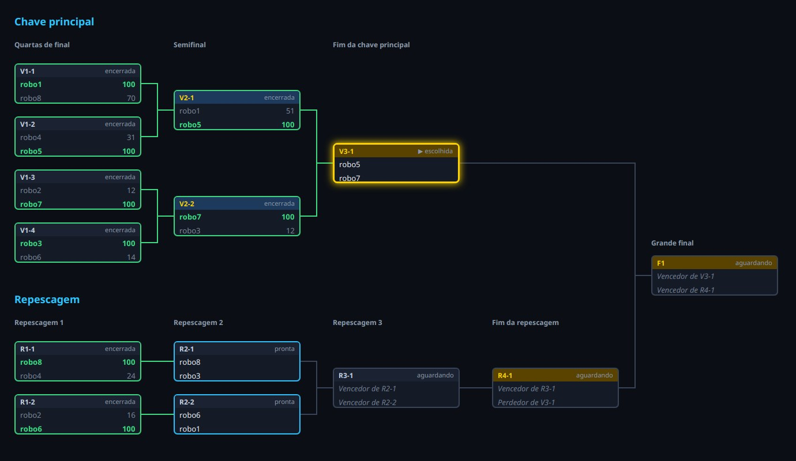
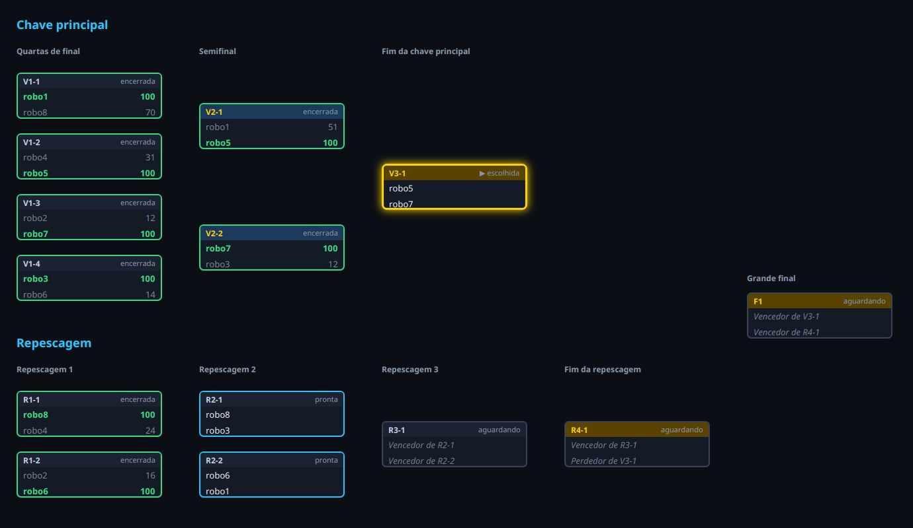
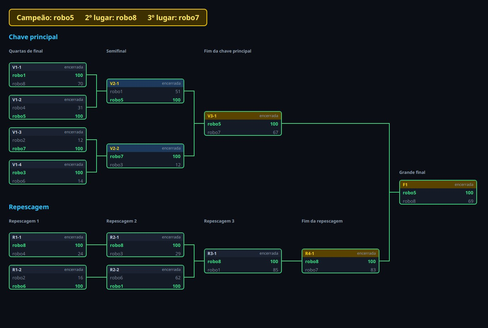
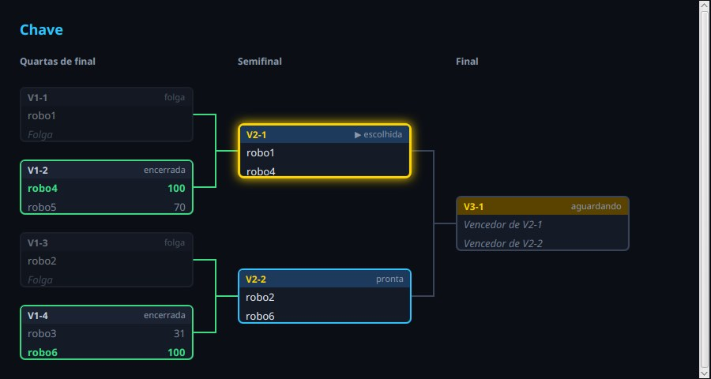

# Capítulo 14 — A chave na tela

## Objetivo

Mostrar a chave do capítulo anterior numa janela: as rodadas em colunas, cada partida num cartão, linhas ligando as partidas que se alimentam, e a próxima partida em destaque. Ao final, um programa de demonstração joga as partidas, com vencedores sorteados, enquanto a tela acompanha cada resultado.

O capítulo tem duas metades. Primeiro, as **contas**: onde fica cada cartão, o que escrever nele, de que cor. São contas puras, testadas com testes automáticos, como a `Chave`. Depois, o **desenho**: os componentes do JavaFX que transformam as contas em imagem, conferidos olhando a tela.

## Passo 1 — O que vamos desenhar

A imagem abaixo é o alvo. É uma chave de 8 robôs com repescagem, depois de 8 partidas:



Cada cartão é uma partida. No alto, o código e a situação. Abaixo, uma linha para cada vaga, com o nome do robô ou de onde ele vem (o `Vaga.descrever()` do capítulo 12). Num cartão encerrado, o vencedor aparece em verde, com os pontos, e o perdedor, em cinza. A cor da faixa de cima mostra a importância da partida, o `Importancia` do capítulo 13: azul para as semifinais e dourada para as finais. A borda mostra a situação: cinza para a que aguarda, azul para a pronta, verde para a encerrada, e dourada, com brilho, para a **escolhida**, a que será jogada em seguida.

As rodadas ficam em colunas, e as partidas de cada rodada ficam no meio das duas que as alimentam, como no desenho do capítulo 12. A repescagem fica numa faixa abaixo, e a grande final, à direita, no meio das duas finais.

Dois conceitos do JavaFX valem antes de começar:

- **O sistema de coordenadas da tela.** O ponto `(0, 0)` é o canto de cima, à esquerda, o `x` cresce para a direita e o `y` cresce **para baixo**, ao contrário do gráfico de matemática.
- **Componentes que se organizam e componentes que não.** A `VBox` e a `HBox`, que já usamos, arrumam os filhos sozinhas: uma coluna e uma linha. O `Pane` não arruma nada, e a documentação diz que ele serve "em casos em que o posicionamento absoluto dos filhos é necessário": a posição de cada filho é responsabilidade nossa, e ele só ajusta o tamanho dos filhos ao tamanho preferido. Um desenho de chave precisa disso, pois cada cartão tem o seu lugar exato, que vem de uma conta.

A divisão do trabalho segue o que o capítulo 9 fez com a `Aparencia`: tudo o que pode ser conta fica numa classe sem JavaFX, que se testa com `mvn test`. O motivo é prático. Os componentes do JavaFX só podem ser criados depois que o **toolkit**, o motor gráfico do JavaFX, está de pé, o que acontece quando se abre uma janela. Um teste automático comum que tentasse criar uma `Label` terminaria com `Toolkit not initialized`. As classes deste capítulo são estas, todas no pacote `campeonato.tela`:

| Classe | O que faz | Como se confere |
| --- | --- | --- |
| `Disposicao` | calcula onde fica cada cartão e cada título | testes |
| `Aspecto` | decide como o cartão se apresenta, conforme a situação da partida | testes |
| `CartaoDaPartida` | o cartão de uma partida | olhando a tela |
| `VisaoDaChave` | a tela da chave: títulos, linhas, cartões e escolha | olhando a tela |
| `DemonstracaoDaChave` | o programa de demonstração | rodando |

## Passo 2 — Onde cada cartão fica

A `Disposicao` recebe uma `Chave` e calcula, para cada partida, o canto de cima, à esquerda, do cartão. As regras são estas:

1. Cada **rodada** é uma **coluna**. A coluna de índice `c` começa em `x = c × (largura do cartão + intervalo)`. O intervalo é o espaço por onde passam as linhas.
2. Na **primeira rodada** de cada parte da chave, as partidas ficam uma abaixo da outra, com espaços iguais.
3. Nas **outras rodadas**, cada partida fica no meio das partidas que a alimentam com o vencedor: a altura do seu centro é a média das alturas dos centros delas. Uma partida da repescagem que recebe um sobrevivente da rodada anterior (as rodadas pares do capítulo 13) tem uma só origem da repescagem, e fica na altura dela. Quem cai da chave principal não conta, pois vem de outra parte da tela.
4. A **repescagem** é uma segunda faixa, abaixo da principal, com o seu título.
5. A **grande final** fica numa coluna à direita de todas, na altura do meio das duas finais.

Os resultados são medidas em pixels, e as medidas vêm em dois tipos de dados. O ponto `(x, y)` e o título (um texto numa posição) são **records**, os do capítulo 5: só guardam valores, e o Java cria o construtor e os métodos `x()`, `y()` e os outros. O `Titulo` tem um campo `secao`, que diz se é o título de uma parte da chave ("Chave principal", "Repescagem") ou o de uma rodada ("Semifinal"); os dois são desenhados de jeitos diferentes.

Vamos escrever a classe em etapas. Primeiro, o esqueleto: os records, as medidas, os campos e os métodos que devolvem o resultado. **Crie o arquivo** `src/main/java/campeonato/tela/Disposicao.java`:

<!-- arquivo: src/main/java/campeonato/tela/Disposicao.java | criar -->
```java
package campeonato.tela;

import campeonato.torneio.Partida;
import java.util.ArrayList;
import java.util.HashMap;
import java.util.List;
import java.util.Map;

/**
 * Onde cada partida da chave fica na tela: as rodadas lado a lado, e cada partida no meio das partidas que a alimentam.
 *
 * <p>Esta classe só faz contas, sem nada de JavaFX, e por isso pode ser testada sem abrir janela. As medidas são em pixels, com o
 * ponto (0, 0) no canto de cima, à esquerda.
 */
public final class Disposicao {

    /** Um ponto da tela. */
    public record Ponto(double x, double y) {
    }

    /** Um título, escrito a partir do ponto (x, y): o nome de uma parte da chave (seção) ou de uma rodada. */
    public record Titulo(String texto, double x, double y, boolean secao) {
    }

    public static final double LARGURA_DO_CARTAO = 220;
    public static final double ALTURA_DO_CARTAO = 70;
    /** O espaço entre uma coluna e a seguinte, por onde passam as linhas. */
    public static final double INTERVALO = 56;

    /** A altura reservada a cada partida da primeira rodada: o cartão e um respiro. */
    private static final double ESPACO_DA_PARTIDA = 92;
    private static final double ALTURA_DO_TITULO_DA_SECAO = 44;
    private static final double ALTURA_DO_TITULO_DA_RODADA = 30;
    private static final double INTERVALO_ENTRE_SECOES = 40;

    /** O canto de cima, à esquerda, do cartão de cada partida, pelo código dela. */
    private final Map<String, Ponto> cartoes = new HashMap<>();
    private final List<Titulo> titulos = new ArrayList<>();
    private double largura;
    private double altura;

    /** O canto de cima, à esquerda, do cartão da partida. */
    public Ponto cartao(String codigo) {
        return cartoes.get(codigo);
    }

    /** Onde as linhas saem do cartão: o meio do lado direito. */
    public Ponto saida(Partida partida) {
        Ponto canto = cartoes.get(partida.codigo());
        return new Ponto(canto.x() + LARGURA_DO_CARTAO, canto.y() + ALTURA_DO_CARTAO / 2);
    }

    /** Onde as linhas chegam ao cartão: o meio do lado esquerdo. */
    public Ponto entrada(Partida partida) {
        Ponto canto = cartoes.get(partida.codigo());
        return new Ponto(canto.x(), canto.y() + ALTURA_DO_CARTAO / 2);
    }

    public List<Titulo> titulos() {
        return titulos;
    }

    /** A largura de tudo o que foi desenhado. */
    public double largura() {
        return largura;
    }

    /** A altura de tudo o que foi desenhado. */
    public double altura() {
        return altura;
    }
}
```

Os **cartões** são guardados num `Map` pelo código da partida, como o `porCodigo` da `Chave`. O `saida` e o `entrada` dão os dois pontos por onde as linhas passam: o meio do lado direito do cartão de onde o vencedor sai, e o meio do lado esquerdo do cartão aonde ele chega. A conta deles é só somar a metade da altura (e, no `saida`, a largura) ao canto.

<!-- compilar -->

Agora o coração da classe: onde fica um cartão. O método `colocar` guarda o cartão, e recebe a altura do **centro** (mais natural para as contas de "no meio de") e desconta metade da altura para chegar ao canto de cima. O `centroDasOrigens` calcula a média pedida na regra 3: percorre as duas vagas da partida, pega as partidas de origem que valem, e tira a média das alturas dos seus centros.

Esse método usa três recursos do Java que ainda não vimos juntos:

- `Stream.of(a, b)` faz um **fluxo** com os dois valores, e o `filter` fica só com os que passam no teste, como o `stream().filter(...)` do capítulo 12. A origem de uma vaga da primeira rodada é `null`, e por isso o filtro começa por `origem != null`.
- O `mapToDouble` transforma cada elemento do fluxo num `double`, aqui a altura do centro da partida de origem, e o `average()` calcula a média.
- A média de um fluxo vazio não existe, e por isso o `average()` devolve um `OptionalDouble`, a **caixa que pode estar vazia** do capítulo 12, só que para números `double`. Quem a recebe escolhe o que fazer se estiver vazia: o `orElse(valor)` usa um valor de reserva, e o `orElseThrow()` lança uma exceção.

O filtro vale para as origens do mesmo lado da chave, e a grande final, cujo lado é `Lado.FINAL`, conta as duas. **Acrescente os imports** no topo de `Disposicao.java`:

<!-- arquivo: src/main/java/campeonato/tela/Disposicao.java | importar -->
```java
import campeonato.torneio.Lado;
import java.util.OptionalDouble;
import java.util.stream.Stream;
```

**Acrescente os métodos** antes do `cartao`, o que começa com "O canto de cima, à esquerda, do cartão da partida":

<!-- arquivo: src/main/java/campeonato/tela/Disposicao.java | inserir-antes O canto de cima, à esquerda, do cartão da partida. -->
```java
    /** Guarda o cartão da partida, na coluna x, com o centro na altura pedida. */
    private void colocar(Partida partida, double x, double centro) {
        cartoes.put(partida.codigo(), new Ponto(x, centro - ALTURA_DO_CARTAO / 2));
    }

    /**
     * A média das alturas do centro das partidas que alimentam esta com o vencedor delas, se já foram colocadas. Só contam as
     * do mesmo lado da chave (a grande final conta as duas), pois quem cai da chave principal vem de outra parte da tela.
     */
    private OptionalDouble centroDasOrigens(Partida partida) {
        return Stream.of(partida.a().origem(), partida.b().origem())
                .filter(origem -> origem != null && (origem.lado() == partida.lado() || partida.lado() == Lado.FINAL))
                .mapToDouble(origem -> cartoes.get(origem.codigo()).y() + ALTURA_DO_CARTAO / 2)
                .average();
    }

```

<!-- compilar -->

O próximo método coloca as rodadas de uma parte da chave. Ele recebe as rodadas, o `topo` (onde a parte começa, na vertical) e uma função `nomes`, que dá o nome de uma rodada pelo número dela. O tipo `IntFunction<String>` é "uma função que recebe um `int` e devolve um `String`", e quem chama passa a referência a método do capítulo 12: `chave::nomeDaRodadaPrincipal`, que é o método da chave, já ligado a ela.

Cada volta do laço de fora cuida de uma coluna: calcula o `x`, escreve o título da rodada no `topo` e coloca as partidas dela. Para cada partida, o centro é a média das origens, e **se não há origem do mesmo lado** (o `OptionalDouble` vazio), é a primeira rodada, e o centro vem da conta dos espaços iguais: o `indice + 0.5`, de modo que o primeiro cartão fique no meio do primeiro espaço, e assim por diante. O método devolve a altura que a parte ocupou: o título da rodada mais os espaços da primeira rodada, a que tem mais partidas. **Acrescente os imports**:

<!-- arquivo: src/main/java/campeonato/tela/Disposicao.java | importar -->
```java
import java.util.function.IntFunction;
```

**Acrescente o método** antes do `colocar`, o que começa com "Guarda o cartão da partida":

<!-- arquivo: src/main/java/campeonato/tela/Disposicao.java | inserir-antes Guarda o cartão da partida, na coluna x -->
```java
    /** Coloca as rodadas de uma parte da chave, uma coluna por rodada, com o título de cada uma, e devolve a altura usada. */
    private double distribuir(List<List<Partida>> rodadas, double topo, IntFunction<String> nomes) {
        for (int coluna = 0; coluna < rodadas.size(); coluna++) {
            double x = coluna * (LARGURA_DO_CARTAO + INTERVALO);
            titulos.add(new Titulo(nomes.apply(coluna + 1), x, topo, false));
            List<Partida> rodada = rodadas.get(coluna);
            for (int indice = 0; indice < rodada.size(); indice++) {
                // na primeira rodada, os espaços são iguais; nas outras, a partida fica no meio das que a alimentam
                double centroDaPrimeira = topo + ALTURA_DO_TITULO_DA_RODADA + ESPACO_DA_PARTIDA * (indice + 0.5);
                colocar(rodada.get(indice), x, centroDasOrigens(rodada.get(indice)).orElse(centroDaPrimeira));
            }
        }
        return ALTURA_DO_TITULO_DA_RODADA + rodadas.get(0).size() * ESPACO_DA_PARTIDA;
    }

```

<!-- compilar -->

Por fim, o construtor, que junta tudo, na ordem da tela, de cima para baixo:

1. O título da parte principal: "Chave principal" se há repescagem, ou só "Chave" se não há.
2. As rodadas da principal, com `distribuir`. O `topo` anda para baixo a cada parte.
3. Se a repescagem não está vazia (com dois participantes ela é vazia, como vimos no capítulo 13), um intervalo, o título "Repescagem" e as rodadas dela.
4. A grande final, se existe (a partida `F1`): fica na coluna depois da última, na altura da média das duas finais, e leva o título "Grande final". O `centroDasOrigens` já faz essa média, e o `orElseThrow()` só lança se a conta falhar, o que não pode acontecer: a `F1` sempre tem origens.
5. A largura e a altura totais: o maior canto à direita e embaixo, entre todos os cartões.

**Acrescente o import** e **o construtor**, antes do `distribuir`, o que começa com "Coloca as rodadas de uma parte da chave":

<!-- arquivo: src/main/java/campeonato/tela/Disposicao.java | importar -->
```java
import campeonato.torneio.Chave;
```

<!-- arquivo: src/main/java/campeonato/tela/Disposicao.java | inserir-antes Coloca as rodadas de uma parte da chave -->
```java
    /** Calcula a posição de todas as partidas e dos títulos de uma chave. */
    public Disposicao(Chave chave) {
        double topo = 0;
        titulos.add(new Titulo(chave.temRepescagem() ? "Chave principal" : "Chave", 0, topo, true));
        topo += ALTURA_DO_TITULO_DA_SECAO;
        topo += distribuir(chave.rodadasPrincipais(), topo, chave::nomeDaRodadaPrincipal);

        if (!chave.rodadasDaRepescagem().isEmpty()) {
            topo += INTERVALO_ENTRE_SECOES;
            titulos.add(new Titulo("Repescagem", 0, topo, true));
            topo += ALTURA_DO_TITULO_DA_SECAO;
            distribuir(chave.rodadasDaRepescagem(), topo, chave::nomeDaRodadaDaRepescagem);
        }

        // a grande final fica à direita de tudo, entre as finais das duas partes
        Partida grandeFinal = chave.partida("F1");
        if (grandeFinal != null) {
            int colunas = Math.max(chave.rodadasPrincipais().size(), chave.rodadasDaRepescagem().size());
            double x = colunas * (LARGURA_DO_CARTAO + INTERVALO);
            double centro = centroDasOrigens(grandeFinal).orElseThrow();
            colocar(grandeFinal, x, centro);
            titulos.add(new Titulo(chave.nomeDaRodada(grandeFinal), x, centro - ALTURA_DO_CARTAO / 2 - ALTURA_DO_TITULO_DA_RODADA, false));
        }

        for (Ponto canto : cartoes.values()) {
            largura = Math.max(largura, canto.x() + LARGURA_DO_CARTAO);
            altura = Math.max(altura, canto.y() + ALTURA_DO_CARTAO);
        }
    }

```

<!-- compilar -->

Os testes conferem a disposição **sem abrir janela**, que é a vantagem de ter separado as contas. A constante `COLUNA` é a distância de uma coluna à seguinte. O terceiro argumento do `assertEquals`, `1e-9`, é a **tolerância**: números `double` não são exatos, e dois resultados calculados de jeitos diferentes podem diferir na última casa, de modo que o teste aceita uma diferença de até 0,000000001. O `1e-9` é a notação científica, 1 × 10⁻⁹.

Primeiro, a chave principal: as rodadas lado a lado, os espaços iguais da primeira rodada e as partidas no meio das que as alimentam. **Crie o arquivo** `src/test/java/campeonato/tela/DisposicaoTest.java`:

<!-- arquivo: src/test/java/campeonato/tela/DisposicaoTest.java | criar -->
```java
package campeonato.tela;

import static org.junit.jupiter.api.Assertions.assertEquals;
import static org.junit.jupiter.api.Assertions.assertTrue;

import campeonato.torneio.Chave;
import java.util.ArrayList;
import java.util.List;
import org.junit.jupiter.api.Test;

class DisposicaoTest {

    /** A distância de uma coluna à seguinte. */
    private static final double COLUNA = Disposicao.LARGURA_DO_CARTAO + Disposicao.INTERVALO;

    private static List<String> robos(int quantidade) {
        List<String> robos = new ArrayList<>();
        for (int numero = 1; numero <= quantidade; numero++) {
            robos.add("robo" + numero);
        }
        return robos;
    }

    @Test
    void asRodadasFicamLadoALado() {
        Disposicao disposicao = new Disposicao(new Chave(robos(8)));
        assertEquals(0, disposicao.cartao("V1-1").x());
        assertEquals(COLUNA, disposicao.cartao("V2-1").x());
        assertEquals(2 * COLUNA, disposicao.cartao("V3-1").x());
    }

    @Test
    void aPrimeiraRodadaTemEspacosIguais() {
        Disposicao disposicao = new Disposicao(new Chave(robos(8)));
        double primeiro = disposicao.cartao("V1-2").y() - disposicao.cartao("V1-1").y();
        double segundo = disposicao.cartao("V1-3").y() - disposicao.cartao("V1-2").y();
        assertEquals(primeiro, segundo, 1e-9);
        assertTrue(primeiro > Disposicao.ALTURA_DO_CARTAO, "os cartões não podem se tocar");
    }

    @Test
    void cadaPartidaFicaNoMeioDasQueAAlimentam() {
        Disposicao disposicao = new Disposicao(new Chave(robos(8)));
        assertEquals((disposicao.cartao("V1-1").y() + disposicao.cartao("V1-2").y()) / 2, disposicao.cartao("V2-1").y(), 1e-9);
        assertEquals((disposicao.cartao("V2-1").y() + disposicao.cartao("V2-2").y()) / 2, disposicao.cartao("V3-1").y(), 1e-9);
    }
}
```

<!-- testar -->

Agora a repescagem, a grande final e as propriedades gerais:

- A repescagem fica abaixo da principal, e a `R2` fica na altura da `R1`, pois só tem uma origem do mesmo lado.
- A grande final está à direita de todos os cartões e a meio caminho entre a final da principal e a da repescagem. Com dois participantes, a repescagem é vazia e as duas origens da `F1` são a mesma partida: a final fica na altura dela.
- O teste mais forte confere que **nenhum cartão se sobrepõe a outro**, em chaves de 2 a 40 participantes, com e sem repescagem. Dois cartões se sobrepõem quando a distância horizontal entre eles é menor que a largura de um cartão **e** a distância vertical é menor que a altura de um. O `Math.abs` dá o valor absoluto de um número, sem o sinal.
- O tamanho total cobre todos os cartões, e os títulos trazem os nomes da parte e das rodadas.

**Acrescente os imports** no topo de `DisposicaoTest.java`:

<!-- arquivo: src/test/java/campeonato/tela/DisposicaoTest.java | importar -->
```java
import static org.junit.jupiter.api.Assertions.assertFalse;
import campeonato.tela.Disposicao.Ponto;
import campeonato.tela.Disposicao.Titulo;
import campeonato.torneio.Partida;
```

**Acrescente ao final da classe** `DisposicaoTest`:

<!-- arquivo: src/test/java/campeonato/tela/DisposicaoTest.java | acrescentar -->
```java

    @Test
    void aRepescagemFicaAbaixoDaPrincipalEAlinhadaComQuemAAlimenta() {
        Disposicao disposicao = new Disposicao(new Chave(robos(8), true));
        assertTrue(disposicao.cartao("R1-1").y() > disposicao.cartao("V1-4").y() + Disposicao.ALTURA_DO_CARTAO);
        // a R2 recebe um sobrevivente da R1, e fica na altura dele; quem cai da principal vem de outra parte da tela
        assertEquals(disposicao.cartao("R1-1").y(), disposicao.cartao("R2-1").y(), 1e-9);
        assertEquals((disposicao.cartao("R2-1").y() + disposicao.cartao("R2-2").y()) / 2, disposicao.cartao("R3-1").y(), 1e-9);
    }

    @Test
    void aGrandeFinalFicaADireitaDeTudoEEntreAsDuasFinais() {
        Chave chave = new Chave(robos(8), true);
        Disposicao disposicao = new Disposicao(chave);
        for (Partida partida : chave.partidas()) {
            if (!partida.codigo().equals("F1")) {
                assertTrue(disposicao.cartao("F1").x() > disposicao.cartao(partida.codigo()).x(), partida.codigo());
            }
        }
        double entreAsFinais = (disposicao.cartao("V3-1").y() + disposicao.cartao("R4-1").y()) / 2;
        assertEquals(entreAsFinais, disposicao.cartao("F1").y(), 1e-9);
    }

    @Test
    void comDoisParticipantesAGrandeFinalFicaNaAlturaDaUnicaPartida() {
        Disposicao disposicao = new Disposicao(new Chave(robos(2), true));
        assertEquals(disposicao.cartao("V1-1").y(), disposicao.cartao("F1").y(), 1e-9);
        assertEquals(COLUNA, disposicao.cartao("F1").x());
    }

    @Test
    void nenhumCartaoSeSobrepoeEmChaveAlguma() {
        for (int quantidade = 2; quantidade <= 40; quantidade++) {
            for (boolean repescagem : new boolean[] { false, true }) {
                Chave chave = new Chave(robos(quantidade), repescagem);
                Disposicao disposicao = new Disposicao(chave);
                List<Partida> partidas = chave.partidas();
                for (int i = 0; i < partidas.size(); i++) {
                    for (int j = i + 1; j < partidas.size(); j++) {
                        Ponto p = disposicao.cartao(partidas.get(i).codigo());
                        Ponto q = disposicao.cartao(partidas.get(j).codigo());
                        boolean sobrepoem = Math.abs(p.x() - q.x()) < Disposicao.LARGURA_DO_CARTAO
                                && Math.abs(p.y() - q.y()) < Disposicao.ALTURA_DO_CARTAO;
                        assertFalse(sobrepoem, "n=" + quantidade + ": " + partidas.get(i).codigo() + " e " + partidas.get(j).codigo());
                    }
                }
            }
        }
    }

    @Test
    void oTamanhoCobreTodosOsCartoes() {
        Chave chave = new Chave(robos(8), true);
        Disposicao disposicao = new Disposicao(chave);
        for (Partida partida : chave.partidas()) {
            Ponto canto = disposicao.cartao(partida.codigo());
            assertTrue(canto.x() >= 0 && canto.y() >= 0, partida.codigo());
            assertTrue(canto.x() + Disposicao.LARGURA_DO_CARTAO <= disposicao.largura() + 1e-9, partida.codigo());
            assertTrue(canto.y() + Disposicao.ALTURA_DO_CARTAO <= disposicao.altura() + 1e-9, partida.codigo());
        }
    }

    @Test
    void osTitulosTrazemOsNomesDasPartesEDasRodadas() {
        Disposicao disposicao = new Disposicao(new Chave(robos(8), true));
        List<String> textos = disposicao.titulos().stream().map(Titulo::texto).toList();
        assertTrue(textos.containsAll(List.of("Chave principal", "Repescagem", "Quartas de final", "Semifinal",
                "Fim da chave principal", "Repescagem 1", "Fim da repescagem", "Grande final")), textos.toString());
        assertEquals(2, disposicao.titulos().stream().filter(Titulo::secao).count());

        // sem repescagem, só existe uma parte, chamada apenas de "Chave"
        Disposicao simples = new Disposicao(new Chave(robos(8)));
        assertEquals(1, simples.titulos().stream().filter(Titulo::secao).count());
        assertEquals("Chave", simples.titulos().get(0).texto());
    }
```

<!-- testar -->

## Passo 3 — O aspecto de um cartão

A aparência de um cartão depende da situação da partida e de ela ser ou não a **escolhida**. É uma decisão pura, e fica num `enum`, como a `Situacao`: o `Aspecto` tem cinco valores, cada um com o texto que aparece no canto do cartão, e um método `de(partida, escolhida)` que escolhe o valor.

O método `de` tem duas novidades de sintaxe. A primeira é o `static`: ele pertence ao `enum` e não a um valor dele, e se chama `Aspecto.de(...)`, como o `Cores.deArgb` do capítulo 6. A segunda é o `switch` com `->` sobre `partida.situacao()`: dentro dele, os valores do `enum` se escrevem **sem o nome do tipo** (`case AGUARDANDO`, e não `case Situacao.AGUARDANDO`), pois o Java já sabe de qual `enum` se trata. Como o `switch` devolve um valor, o compilador exige que todas as situações estejam tratadas, e se o capítulo 13 ganhasse uma situação nova, este código não compilaria até que ela fosse tratada aqui.

Só uma partida pronta pode ser a escolhida: nas outras situações, o argumento `escolhida` é ignorado. **Crie o arquivo** `src/main/java/campeonato/tela/Aspecto.java`:

<!-- arquivo: src/main/java/campeonato/tela/Aspecto.java | criar -->
```java
package campeonato.tela;

import campeonato.torneio.Partida;

/** Como o cartão de uma partida se apresenta, conforme a situação dela e se foi a escolhida. */
public enum Aspecto {

    AGUARDANDO("aguardando"),
    PRONTA("pronta"),
    ESCOLHIDA("▶ escolhida"),
    ENCERRADA("encerrada"),
    FOLGA("folga");

    private final String texto;

    Aspecto(String texto) {
        this.texto = texto;
    }

    /** A palavra escrita no canto do cartão. */
    public String texto() {
        return texto;
    }

    /** O aspecto de uma partida: só uma partida pronta pode ser a escolhida. */
    public static Aspecto de(Partida partida, boolean escolhida) {
        return switch (partida.situacao()) {
        case AGUARDANDO -> AGUARDANDO;
        case PRONTA -> escolhida ? ESCOLHIDA : PRONTA;
        case FINALIZADA -> ENCERRADA;
        case FOLGA -> FOLGA;
        };
    }
}
```

O teste usa a chave de 5 participantes, a das folgas do capítulo 12, que tem uma partida em cada situação: a `V1-1` é folga, a `V1-2` está pronta, e a `V2-1` aguarda. **Crie o arquivo** `src/test/java/campeonato/tela/AspectoTest.java`:

<!-- arquivo: src/test/java/campeonato/tela/AspectoTest.java | criar -->
```java
package campeonato.tela;

import static org.junit.jupiter.api.Assertions.assertEquals;
import static org.junit.jupiter.api.Assertions.assertFalse;

import campeonato.torneio.Chave;
import java.util.ArrayList;
import java.util.List;
import org.junit.jupiter.api.Test;

class AspectoTest {

    private static List<String> robos(int quantidade) {
        List<String> robos = new ArrayList<>();
        for (int numero = 1; numero <= quantidade; numero++) {
            robos.add("robo" + numero);
        }
        return robos;
    }

    @Test
    void oAspectoSegueASituacaoDaPartida() {
        // 5 robôs: a V1-1 é folga, a V1-2 está pronta e a V2-1 espera o vencedor da V1-2
        Chave chave = new Chave(robos(5));
        assertEquals(Aspecto.FOLGA, Aspecto.de(chave.partida("V1-1"), false));
        assertEquals(Aspecto.PRONTA, Aspecto.de(chave.partida("V1-2"), false));
        assertEquals(Aspecto.AGUARDANDO, Aspecto.de(chave.partida("V2-1"), false));

        chave.registrar("V1-2", "robo4", 1, 0);
        assertEquals(Aspecto.ENCERRADA, Aspecto.de(chave.partida("V1-2"), false));
    }

    @Test
    void soUmaPartidaProntaPodeSerEscolhida() {
        Chave chave = new Chave(robos(5));
        assertEquals(Aspecto.ESCOLHIDA, Aspecto.de(chave.partida("V1-2"), true));
        // nas outras situações, a escolha é ignorada
        assertEquals(Aspecto.AGUARDANDO, Aspecto.de(chave.partida("V2-1"), true));
        assertEquals(Aspecto.FOLGA, Aspecto.de(chave.partida("V1-1"), true));
    }

    @Test
    void cadaAspectoTemUmTextoParaOCartao() {
        for (Aspecto aspecto : Aspecto.values()) {
            assertFalse(aspecto.texto().isBlank(), aspecto.name());
        }
        assertEquals("▶ escolhida", Aspecto.ESCOLHIDA.texto());
    }
}
```

<!-- testar -->

## Passo 4 — O cartão da partida

Agora o desenho. O `CartaoDaPartida` é uma `VBox`, uma coluna com três filhos: a faixa de cima (o **cabeçalho**) e uma **linha** para cada vaga. As cores e os tamanhos de fonte vão em `setStyle`, com as propriedades `-fx-...` do JavaFX, o mesmo jeito do `Placar` do capítulo 8. A classe não é pública (`final class`, sem `public`): só a `VisaoDaChave` a usa, do mesmo pacote.

Começamos pelas partes soltas, que não dependem do resto. A `corDaBorda` escolhe a cor da borda pelo `Aspecto`, com um `switch` que devolve um texto: um valor de cor no formato `#rrggbb`, o mesmo das cores do `Placar`. O `espacador` é o espaço elástico do capítulo 8: uma `Region` vazia que, com `HBox.setHgrow(espaco, Priority.ALWAYS)`, cresce para ocupar toda a sobra da linha e empurra os vizinhos para as pontas. **Crie o arquivo** `src/main/java/campeonato/tela/CartaoDaPartida.java`:

<!-- arquivo: src/main/java/campeonato/tela/CartaoDaPartida.java | criar -->
```java
package campeonato.tela;

import javafx.scene.layout.HBox;
import javafx.scene.layout.Priority;
import javafx.scene.layout.Region;
import javafx.scene.layout.VBox;

/** O cartão de uma partida: o código e a situação em cima, e uma linha para cada vaga, com o vencedor em destaque. */
final class CartaoDaPartida extends VBox {

    private static final double ALTURA_DO_CABECALHO = 22;

    private static String corDaBorda(Aspecto aspecto) {
        return switch (aspecto) {
        case AGUARDANDO -> "#3a4458";
        case PRONTA -> "#2ec4ff";
        case ESCOLHIDA -> "#ffd400";
        case ENCERRADA -> "#3ddc84";
        case FOLGA -> "#2a3140";
        };
    }

    /** Um espaço elástico, como o do placar do capítulo 8: empurra os vizinhos para as pontas da linha. */
    private static Region espacador() {
        Region espaco = new Region();
        HBox.setHgrow(espaco, Priority.ALWAYS);
        return espaco;
    }
}
```

<!-- compilar -->

O **cabeçalho** é uma `HBox` com o código da partida à esquerda, o espaçador no meio e o texto do aspecto à direita. A cor de fundo da faixa vem da `Importancia`, por um `switch`: cinza-azulado para as comuns, azul para as semifinais, e dourado escuro para as finais, que ainda ganham o código em dourado. O `Insets(0, 8, 0, 8)` é o enchimento: o `Insets` recebe as quatro margens, na ordem **cima, direita, baixo, esquerda**, e aqui são 8 pixels nas laterais. O `-fx-background-radius: 4 4 0 0` arredonda só os cantos de cima.

**Acrescente os imports** e depois **o método**:

<!-- arquivo: src/main/java/campeonato/tela/CartaoDaPartida.java | importar -->
```java
import campeonato.torneio.Importancia;
import campeonato.torneio.Partida;
import javafx.geometry.Insets;
import javafx.geometry.Pos;
import javafx.scene.control.Label;
```

<!-- arquivo: src/main/java/campeonato/tela/CartaoDaPartida.java | acrescentar -->
```java

    /** A faixa de cima: o código da partida, e a situação dela no canto. A cor da faixa mostra a importância. */
    private static HBox cabecalho(Partida partida, Aspecto aspecto, Importancia importancia) {
        String cor = switch (importancia) {
        case COMUM -> "#1b2332";
        case SEMIFINAL -> "#1d3a5c";
        case FINAL -> "#5a4300";
        };
        Label codigo = new Label(partida.codigo());
        codigo.setStyle("-fx-text-fill: " + (importancia == Importancia.COMUM ? "#c8d3e6" : "#ffd400") + "; -fx-font-weight: bold; -fx-font-size: 12px;");
        Label situacao = new Label(aspecto.texto());
        situacao.setStyle("-fx-text-fill: #8b98ab; -fx-font-size: 11px;");

        HBox faixa = new HBox(codigo, espacador(), situacao);
        faixa.setAlignment(Pos.CENTER_LEFT);
        faixa.setPadding(new Insets(0, 8, 0, 8));
        faixa.setMinHeight(ALTURA_DO_CABECALHO);
        faixa.setMaxHeight(ALTURA_DO_CABECALHO);
        faixa.setStyle("-fx-background-color: " + cor + "; -fx-background-radius: 4 4 0 0;");
        return faixa;
    }
```

<!-- compilar -->

A **linha** de uma vaga tem o nome (o `vaga.descrever()` do capítulo 12: o robô, `Folga` ou `Vencedor de V1-2`) e, se a partida terminou, os pontos à direita. O estilo do texto depende de quatro casos, escolhidos por uma cadeia de `? :` (o operador condicional do capítulo 1, um dentro do outro, a cada `:`), na ordem em que são testados:

1. O participante é `null`: ainda não se sabe quem é, ou é uma folga. Cinza e em itálico.
2. A partida terminou e este é o vencedor: verde e em negrito.
3. A partida terminou e este perdeu: cinza.
4. Qualquer outro caso: branco, o normal.

O `venceu` é verdadeiro quando a partida está finalizada, o participante existe e é igual ao `vencedor()` da partida. A ordem das condições importa: o `participante != null` vem antes do `participante.equals(...)`, pelo mesmo motivo do capítulo 12, já que chamar `equals` em `null` dá erro. **Acrescente os imports** e depois **o método**:

<!-- arquivo: src/main/java/campeonato/tela/CartaoDaPartida.java | importar -->
```java
import campeonato.torneio.Situacao;
import campeonato.torneio.Vaga;
```

<!-- arquivo: src/main/java/campeonato/tela/CartaoDaPartida.java | acrescentar -->
```java

    /** A linha de uma vaga: o nome do robô (ou de onde ele virá) e, se a partida terminou, os pontos dele. */
    private static HBox linha(Partida partida, Vaga vaga) {
        String participante = vaga.participante();
        boolean encerrada = partida.situacao() == Situacao.FINALIZADA;
        boolean venceu = encerrada && participante != null && participante.equals(partida.vencedor());

        Label nome = new Label(vaga.descrever());
        // quem ainda não se sabe quem é, ou a folga, aparece em cinza e em itálico
        String estilo = participante == null ? "-fx-text-fill: #6f7c90; -fx-font-style: italic;"
                : venceu ? "-fx-text-fill: #3ddc84; -fx-font-weight: bold;"
                : encerrada ? "-fx-text-fill: #7a8699;"
                : "-fx-text-fill: #e8eef9;";
        nome.setStyle(estilo + " -fx-font-size: 13px;");

        HBox linha = new HBox(nome, espacador());
        if (encerrada && participante != null) {
            Label pontos = new Label(String.valueOf(venceu ? partida.pontosDoVencedor() : partida.pontosDoPerdedor()));
            pontos.setStyle(estilo + " -fx-font-size: 13px;");
            linha.getChildren().add(pontos);
        }
        linha.setAlignment(Pos.CENTER_LEFT);
        linha.setPadding(new Insets(0, 8, 0, 8));
        linha.setMinHeight((Disposicao.ALTURA_DO_CARTAO - ALTURA_DO_CABECALHO) / 2);
        linha.setMaxHeight((Disposicao.ALTURA_DO_CARTAO - ALTURA_DO_CABECALHO) / 2);
        return linha;
    }
```

<!-- compilar -->

O **construtor** monta o cartão: fixa o tamanho (`setPrefSize`, `setMinSize` e `setMaxSize` com o mesmo valor, para o cartão não encolher nem crescer), aplica o estilo do fundo e da borda, e acrescenta os três filhos na ordem: o cabeçalho, a linha da vaga `a` e a da vaga `b`. Dois detalhes de aparência dependem do aspecto:

- A borda do cartão escolhido é mais grossa (3 pixels, em vez de 2) e tem um **brilho**, um `DropShadow` dourado: uma sombra sem deslocamento, com raio 18, que vira um halo em volta do cartão. O `DropShadow(18, Color.web("#ffd400"))` recebe o raio e a cor.
- O cartão de **folga** fica com metade da opacidade, para não competir com os que serão jogados.

O `Color.web("#ffd400")` converte um texto de cor em um objeto `Color`, o tipo que o `DropShadow` aceita. **Acrescente os imports** e depois **o construtor**, logo depois da constante `ALTURA_DO_CABECALHO`:

<!-- arquivo: src/main/java/campeonato/tela/CartaoDaPartida.java | importar -->
```java
import javafx.scene.effect.DropShadow;
import javafx.scene.paint.Color;
```

<!-- arquivo: src/main/java/campeonato/tela/CartaoDaPartida.java | inserir-depois ALTURA_DO_CABECALHO = 22; -->
```java

    CartaoDaPartida(Partida partida, Aspecto aspecto, Importancia importancia) {
        setPrefSize(Disposicao.LARGURA_DO_CARTAO, Disposicao.ALTURA_DO_CARTAO);
        setMinSize(Disposicao.LARGURA_DO_CARTAO, Disposicao.ALTURA_DO_CARTAO);
        setMaxSize(Disposicao.LARGURA_DO_CARTAO, Disposicao.ALTURA_DO_CARTAO);
        setStyle("-fx-background-color: #141a26; -fx-background-radius: 6; -fx-border-radius: 6; -fx-border-width: "
                + (aspecto == Aspecto.ESCOLHIDA ? 3 : 2) + "; -fx-border-color: " + corDaBorda(aspecto) + ";");
        if (aspecto == Aspecto.ESCOLHIDA) {
            setEffect(new DropShadow(18, Color.web("#ffd400")));
        }
        if (aspecto == Aspecto.FOLGA) {
            setOpacity(0.5);
        }
        getChildren().addAll(cabecalho(partida, aspecto, importancia), linha(partida, partida.a()), linha(partida, partida.b()));
    }
```

<!-- compilar -->

## Passo 5 — A tela da chave

A `VisaoDaChave` junta as peças. Ela é um `ScrollPane`, o componente do JavaFX que mostra um pedaço de um conteúdo maior e ganha barras de rolagem quando o conteúdo não cabe: a chave de 8 robôs com repescagem já passa de 1300 pixels de largura, e a de 32 robôs passa de 3000 pixels de altura. O `setPannable(true)` deixa **arrastar** o conteúdo com o mouse, além de usar as barras.

Dentro do `ScrollPane` fica o `quadro`, o `Pane` onde tudo é posto, cada coisa no lugar exato que a `Disposicao` mandou: o `relocate(x, y)` de um componente o põe na posição `(x, y)` do `Pane`. O `quadro` vai dentro de uma `VBox` só porque o `Pane` não desconta o enchimento (`padding`) ao posicionar os filhos: a margem de 24 pixels fica na `VBox` que o envolve.

A classe guarda a `chave` que está mostrando, e o código da partida **escolhida**, o `escolhida`. O método `mostrar(chave)` é o que se chama sempre que a chave muda. Ele decide a escolha: se a partida escolhida antes ainda está pronta, ela continua; se não (nunca houve escolha, ou a partida foi jogada), a escolhida passa a ser a **próxima partida** da chave, a que a `proximaPartida()` do capítulo 12 manda. O `Optional.map(Partida::codigo)` transforma o conteúdo da caixa, se houver, e o `orElse(null)` usa `null` se a chave não tem mais nada a jogar. Em seguida chama o `desenhar`.

O `partidaEscolhida()` devolve a partida escolhida num `Optional`: o `Optional.ofNullable(escolhida)` cria uma caixa vazia se `escolhida` é `null`, ou com o código dentro, e o `map(chave::partida)` troca o código pela partida. O `aoEscolher` guarda o que fazer quando a pessoa clica numa partida pronta: um `Consumer<Partida>`, uma função que recebe uma partida e não devolve nada. O valor inicial, `partida -> { }`, é uma função que não faz nada, e evita `null`.

O `desenhar` limpa o quadro, ajusta o tamanho dele ao que a `Disposicao` calculou (para o `ScrollPane` saber o tamanho do conteúdo e criar as barras) e põe os títulos, cada um numa `Label` na posição pedida. Os cartões vêm de um método à parte, o `desenharCartoes`, que percorre as partidas e, para cada uma, cria o `CartaoDaPartida` com o seu aspecto e importância, e o põe no canto que a `Disposicao` calculou. **Crie o arquivo** `src/main/java/campeonato/tela/VisaoDaChave.java`:

<!-- arquivo: src/main/java/campeonato/tela/VisaoDaChave.java | criar -->
```java
package campeonato.tela;

import campeonato.tela.Disposicao.Ponto;
import campeonato.tela.Disposicao.Titulo;
import campeonato.torneio.Chave;
import campeonato.torneio.Partida;
import campeonato.torneio.Situacao;
import java.util.Optional;
import java.util.function.Consumer;
import javafx.geometry.Insets;
import javafx.scene.control.Label;
import javafx.scene.control.ScrollPane;
import javafx.scene.layout.Pane;
import javafx.scene.layout.VBox;

/** A tela da chave: as rodadas em colunas, as partidas em cartões ligados por linhas, e a partida escolhida em destaque. */
public final class VisaoDaChave extends ScrollPane {

    /** Onde os títulos, as linhas e os cartões são postos, cada um no seu lugar exato. */
    private final Pane quadro = new Pane();

    private Chave chave;
    /** O código da partida escolhida para jogar: a próxima, a menos que a pessoa clique em outra. */
    private String escolhida;
    private Consumer<Partida> aoEscolher = partida -> {
    };

    public VisaoDaChave() {
        VBox conteudo = new VBox(quadro);
        conteudo.setPadding(new Insets(24));
        conteudo.setStyle("-fx-background-color: #0b0e14;");

        setContent(conteudo);
        setPannable(true);
        setStyle("-fx-background: #0b0e14; -fx-background-color: #0b0e14;");
    }

    /** Mostra a chave como ela está agora. Chame de novo depois de cada resultado. */
    public void mostrar(Chave chave) {
        this.chave = chave;
        // mantém a escolha enquanto a partida continuar pronta; senão, volta para a próxima
        Partida atual = escolhida == null ? null : chave.partida(escolhida);
        if (atual == null || atual.situacao() != Situacao.PRONTA) {
            escolhida = chave.proximaPartida().map(Partida::codigo).orElse(null);
        }
        desenhar();
    }

    /** A partida escolhida para jogar, se há alguma pronta. */
    public Optional<Partida> partidaEscolhida() {
        return Optional.ofNullable(escolhida).map(chave::partida);
    }

    /** Quem quiser saber quando a pessoa clica numa partida pronta registra aqui o que fazer com ela. */
    public void aoEscolher(Consumer<Partida> acao) {
        this.aoEscolher = acao;
    }

    private void desenhar() {
        Disposicao disposicao = new Disposicao(chave);
        quadro.getChildren().clear();
        quadro.setPrefSize(disposicao.largura(), disposicao.altura());
        quadro.setMinSize(disposicao.largura(), disposicao.altura());

        for (Titulo titulo : disposicao.titulos()) {
            Label rotulo = new Label(titulo.texto());
            rotulo.setStyle(titulo.secao() ? "-fx-text-fill: #2ec4ff; -fx-font-size: 18px; -fx-font-weight: bold;"
                    : "-fx-text-fill: #8b98ab; -fx-font-size: 12px; -fx-font-weight: bold;");
            rotulo.relocate(titulo.x(), titulo.y());
            quadro.getChildren().add(rotulo);
        }
        desenharCartoes(disposicao);
    }

    private void desenharCartoes(Disposicao disposicao) {
        for (Partida partida : chave.partidas()) {
            Aspecto aspecto = Aspecto.de(partida, partida.codigo().equals(escolhida));
            CartaoDaPartida cartao = new CartaoDaPartida(partida, aspecto, chave.importancia(partida));
            Ponto canto = disposicao.cartao(partida.codigo());
            cartao.relocate(canto.x(), canto.y());
            quadro.getChildren().add(cartao);
        }
    }
}
```

<!-- compilar -->

Ainda não há quem abra uma janela com a tela, mas dá para **ver** o resultado. A imagem abaixo é a do mesmo estado do alvo, com 8 robôs e a repescagem, depois de 8 partidas, só com os títulos e os cartões:

<!-- marco: 14-cartoes -->


As partidas estão nos lugares certos, mas nada as liga. A ordem em que são acrescentadas ao `quadro` decide quem aparece por cima de quem: **o último filho acrescentado é desenhado por cima dos anteriores**. As linhas precisam ficar por baixo dos cartões, e por isso entram antes.

Cada linha liga uma partida de origem à partida seguinte, e é uma `Polyline`, uma figura feita de segmentos retos ligados: ela recebe uma lista de coordenadas `x1, y1, x2, y2, ...`, os pontos por onde passa. O caminho de cada linha tem três segmentos: sai para a direita do cartão de origem (`de`), sobe ou desce na vertical no **meio do intervalo** entre as colunas, e chega ao cartão de destino (`para`).

Só a vaga **do vencedor** ganha linha. A vaga do perdedor, na repescagem, já diz de onde ele vem (`Perdedor de V2-1`), e linhas de todos os cartões da chave principal para a repescagem cruzariam a tela inteira. A cor da linha mostra o andamento: verde se a partida de origem já terminou, e portanto o vencedor já percorreu aquele caminho, e cinza se ainda não. **Acrescente os imports** e depois **os métodos**:

<!-- arquivo: src/main/java/campeonato/tela/VisaoDaChave.java | importar -->
```java
import campeonato.torneio.Vaga;
import java.util.List;
import javafx.scene.paint.Color;
import javafx.scene.shape.Polyline;
```

<!-- arquivo: src/main/java/campeonato/tela/VisaoDaChave.java | acrescentar -->
```java

    private void desenharLinhas(Disposicao disposicao) {
        for (Partida partida : chave.partidas()) {
            ligar(disposicao, partida);
        }
    }

    /** Liga a partida às que mandam o vencedor para ela. Quem perde não ganha linha: a vaga já diz de onde ele vem. */
    private void ligar(Disposicao disposicao, Partida partida) {
        for (Vaga vaga : List.of(partida.a(), partida.b())) {
            Partida origem = vaga.origem();
            if (origem == null || !vaga.doVencedor()) {
                continue;
            }
            Ponto de = disposicao.saida(origem);
            Ponto para = disposicao.entrada(partida);
            // a linha sai para a direita, sobe ou desce no meio do intervalo entre as colunas, e chega ao cartão
            double meio = para.x() - Disposicao.INTERVALO / 2;
            Polyline linha = new Polyline(de.x(), de.y(), meio, de.y(), meio, para.y(), para.x(), para.y());
            linha.setStrokeWidth(2);
            linha.setStroke(Color.web(origem.situacao().decidida() ? "#3ddc84" : "#3a4458"));
            quadro.getChildren().add(linha);
        }
    }
```

E é preciso chamá-lo no `desenhar`, **antes** de `desenharCartoes`. **Acrescente as linhas** abaixo antes da chamada `desenharCartoes(disposicao);`:

<!-- arquivo: src/main/java/campeonato/tela/VisaoDaChave.java | inserir-antes desenharCartoes(disposicao); -->
```java
        // as linhas primeiro, para os cartões ficarem por cima delas
        desenharLinhas(disposicao);
```

<!-- compilar -->

Com as linhas, a tela é a do alvo do passo 1:

<!-- marco: 14-linhas -->


Falta a **escolha**. O `desenharCartoes` precisa ligar um clique ao cartão de cada partida pronta: o `setOnMouseClicked` recebe a função que o JavaFX chama quando o mouse é clicado no cartão, e ela chama o `escolher(partida)`. Este guarda o código da partida como o escolhido, **desenha tudo de novo**, para o brilho passar de um cartão a outro, e avisa quem estiver ouvindo (`aoEscolher.accept(partida)`). Redesenhar tudo a cada clique é mais simples que mexer em dois cartões, e é rápido o bastante: são poucas dezenas de componentes.

Dentro da função do clique, a variável `partida` do laço é usada, e a regra do capítulo 2 vale de novo: uma lambda só pode usar variáveis locais que nunca mudam depois de definidas, o que a variável do `for` cumpre, pois cada volta cria uma nova. **Substitua o método** `desenharCartoes` e **acrescente o `escolher`**:

<!-- arquivo: src/main/java/campeonato/tela/VisaoDaChave.java | substituir-metodo desenharCartoes -->
```java
    private void desenharCartoes(Disposicao disposicao) {
        for (Partida partida : chave.partidas()) {
            Aspecto aspecto = Aspecto.de(partida, partida.codigo().equals(escolhida));
            CartaoDaPartida cartao = new CartaoDaPartida(partida, aspecto, chave.importancia(partida));
            Ponto canto = disposicao.cartao(partida.codigo());
            cartao.relocate(canto.x(), canto.y());
            if (partida.situacao() == Situacao.PRONTA) {
                cartao.setOnMouseClicked(evento -> escolher(partida));
            }
            quadro.getChildren().add(cartao);
        }
    }
```

<!-- arquivo: src/main/java/campeonato/tela/VisaoDaChave.java | acrescentar -->
```java

    private void escolher(Partida partida) {
        escolhida = partida.codigo();
        desenhar();
        aoEscolher.accept(partida);
    }
```

<!-- compilar -->

Por último, quando a chave termina, uma **faixa dourada** no alto mostra o pódio, o `podio()` do capítulo 13. Ela é uma `Label` com `setVisible` e `setManaged`: o primeiro esconde o componente, e o segundo o tira do cálculo do espaço, e sem os dois a faixa vazia ainda ocuparia lugar na `VBox`. O texto junta o campeão e, se existirem, o segundo e o terceiro lugares. A faixa passa a ser o primeiro filho da `VBox`, acima do quadro.

**Acrescente o campo** da faixa, depois do `quadro`:

<!-- arquivo: src/main/java/campeonato/tela/VisaoDaChave.java | inserir-depois private final Pane quadro = new Pane(); -->
```java
    private final Label faixaDoCampeao = new Label();
```

**Substitua o construtor** para a faixa entrar na `VBox`:

<!-- arquivo: src/main/java/campeonato/tela/VisaoDaChave.java | substituir-metodo VisaoDaChave -->
```java
    public VisaoDaChave() {
        faixaDoCampeao.setStyle("-fx-text-fill: #ffe766; -fx-font-size: 20px; -fx-font-weight: bold; -fx-padding: 8 20 8 20;"
                + " -fx-background-color: #3d2f00; -fx-border-color: #ffd400; -fx-border-width: 2; -fx-background-radius: 8;"
                + " -fx-border-radius: 8;");
        VBox conteudo = new VBox(18, faixaDoCampeao, quadro);
        conteudo.setPadding(new Insets(24));
        conteudo.setStyle("-fx-background-color: #0b0e14;");

        setContent(conteudo);
        setPannable(true);
        setStyle("-fx-background: #0b0e14; -fx-background-color: #0b0e14;");
    }
```

E o método que escreve a faixa, chamado no fim do `desenhar`:

<!-- arquivo: src/main/java/campeonato/tela/VisaoDaChave.java | acrescentar -->
```java

    /** Quando a chave termina, a faixa de cima mostra o pódio. */
    private void desenharCampeao() {
        List<String> podio = chave.podio();
        faixaDoCampeao.setVisible(!podio.isEmpty());
        faixaDoCampeao.setManaged(!podio.isEmpty());
        if (podio.isEmpty()) {
            return;
        }
        String texto = "Campeão: " + podio.get(0);
        if (podio.size() > 1) {
            texto += "      2º lugar: " + podio.get(1);
        }
        if (podio.size() > 2) {
            texto += "      3º lugar: " + podio.get(2);
        }
        faixaDoCampeao.setText(texto);
    }
```

<!-- arquivo: src/main/java/campeonato/tela/VisaoDaChave.java | inserir-depois desenharCartoes(disposicao); -->
```java
        desenharCampeao();
```

<!-- compilar -->

## Passo 6 — Ver a chave funcionando

O programa de demonstração monta uma chave de 8 robôs com repescagem (duas constantes no começo da classe, `ROBOS` e `COM_REPESCAGEM`, que você pode trocar), mostra a `VisaoDaChave` e deixa jogar:

- **ENTER** joga a partida escolhida, com o vencedor sorteado, e mostra a chave de novo;
- **R** recomeça com uma chave nova;
- **um clique** numa partida pronta (borda azul) a escolhe.

O teclado chega à cena pelo `setOnKeyPressed`, que recebe uma lambda, como os `setOn...` do capítulo 2: o `evento.getCode()` devolve a tecla, um valor do `enum` `KeyCode`, e o `switch` com `->` é o mesmo do `Aspecto`, com o `default` de chaves vazias para as teclas que não nos interessam. Os pontos de cada partida também são sorteados: o vencedor faz 100 e o perdedor, de 10 a 89 (o `nextInt(80)` devolve de 0 a 79). **Crie o arquivo** `src/main/java/campeonato/tela/DemonstracaoDaChave.java`:

<!-- arquivo: src/main/java/campeonato/tela/DemonstracaoDaChave.java | criar -->
```java
package campeonato.tela;

import campeonato.torneio.Chave;
import java.util.ArrayList;
import java.util.List;
import java.util.Random;
import javafx.application.Application;
import javafx.scene.Scene;
import javafx.stage.Stage;

/**
 * Mostra a chave na tela e joga as partidas com vencedores sorteados: ENTER joga a partida escolhida, e R recomeça. Um clique
 * numa partida pronta a escolhe.
 */
public class DemonstracaoDaChave extends Application {

    private static final int ROBOS = 8;
    private static final boolean COM_REPESCAGEM = true;

    private final Random sorteio = new Random();
    private final VisaoDaChave visao = new VisaoDaChave();
    private Chave chave;

    @Override
    public void start(Stage palco) {
        recomecar();

        Scene cena = new Scene(visao, 1300, 760);
        cena.setOnKeyPressed(evento -> {
            switch (evento.getCode()) {
            case ENTER -> jogarAEscolhida();
            case R -> recomecar();
            default -> {
            }
            }
        });
        palco.setTitle("A chave do campeonato");
        palco.setScene(cena);
        palco.show();
    }

    /** Começa uma chave nova, com ROBOS robôs. */
    private void recomecar() {
        List<String> robos = new ArrayList<>();
        for (int numero = 1; numero <= ROBOS; numero++) {
            robos.add("robo" + numero);
        }
        chave = new Chave(robos, COM_REPESCAGEM);
        System.out.println("Chave montada: " + ROBOS + " robôs, " + chave.partidas().size() + " partidas.");
        visao.mostrar(chave);
    }

    /** Joga a partida escolhida, sorteando o vencedor, e mostra a chave de novo. */
    private void jogarAEscolhida() {
        visao.partidaEscolhida().ifPresent(partida -> {
            String a = partida.a().participante();
            String b = partida.b().participante();
            chave.registrar(partida.codigo(), sorteio.nextBoolean() ? a : b, 100, 10 + sorteio.nextInt(80));
            visao.mostrar(chave);
        });
    }

    public static void main(String[] args) {
        launch(args);
    }
}
```

<!-- compilar -->

O `ifPresent` do `Optional` roda a função só se a caixa não está vazia: quando a chave termina, o ENTER não faz nada. Rode a demonstração com a opção `-Dclasse.principal` do capítulo 9:

<!-- executar: | espera: Chave montada: 8 robôs, 14 partidas | rodar: 12 | proibe: Exception, ERROR -->
```bash
mvn javafx:run -Dclasse.principal=campeonato.tela.DemonstracaoDaChave
```

A janela abre com a chave de 8 robôs, e a primeira partida, a `V1-1`, vem escolhida. Aperte ENTER 14 vezes: a cada vez, uma partida passa de pronta a encerrada, as linhas ficam verdes e os vencedores sobem. A escolha segue a ordem do capítulo 13: primeiro as partidas da chave principal, entre elas a da repescagem que já está pronta. Quando o campeonato termina, a faixa dourada com o pódio aparece no alto:

<!-- marco: 14-final -->


Experimente também **clicar** numa partida pronta que não é a escolhida: o brilho passa para ela, e o ENTER joga essa. Uma chave sem repescagem (troque `COM_REPESCAGEM` por `false`) tem uma só parte, chamada "Chave", e com um número de robôs que não é potência de dois aparecem as folgas, desbotadas, como mostra a imagem de 6 robôs sem repescagem, depois de duas partidas:

<!-- marco: 14-folgas -->


## O que construímos

```text
src/main/java/campeonato/tela/
├── Disposicao.java          (cap. 14) as contas: onde fica cada cartão, cada título e cada ponto de ligação
├── Aspecto.java             (cap. 14) como o cartão se apresenta: aguardando, pronta, escolhida, encerrada ou folga
├── CartaoDaPartida.java     (cap. 14) o cartão de uma partida
├── VisaoDaChave.java        (cap. 14) a tela da chave: títulos, linhas, cartões, escolha e pódio
└── DemonstracaoDaChave.java (cap. 14) o programa que mostra a chave e joga as partidas sorteadas

src/test/java/campeonato/tela/
├── DisposicaoTest.java      (cap. 14)
└── AspectoTest.java         (cap. 14)
```

## Exercícios

**Fácil**

1. Troque `ROBOS` por 5, por 6 e por 16, e `COM_REPESCAGEM` por `false`, e rode a demonstração. Quantas colunas tem cada chave? Onde estão as folgas, e por que elas aparecem na primeira rodada, junto das sementes mais fortes?
2. Troque `ESPACO_DA_PARTIDA` na `Disposicao` por 120 e rode os testes: algum falha? Depois troque por 60 e rode de novo. Qual teste falha, e o que a mensagem de erro diz? Volte ao valor 92.
3. Escreva um teste para a `Disposicao` de uma chave de 16 robôs com repescagem: a `V1-1` está na coluna 0, a `R6-1` (o fim da repescagem) está na coluna 5 (`5 * COLUNA`), e a `F1` está na coluna 6. Dica: quantas rodadas tem a repescagem de 16 robôs?

**Médio**

4. Escolher a próxima partida pronta **pelo teclado**. Acrescente à `Chave` o método `List<Partida> prontas()`, que devolve as partidas `PRONTA` na ordem da lista, e escreva um teste (numa chave de 8, no começo, são 4). Acrescente à `VisaoDaChave` o método `escolherSeguinte()`, que escolhe a partida pronta que vem depois da escolhida, voltando à primeira depois da última, e ligue-o à tecla TAB na demonstração. Dica: o `indexOf` de uma lista devolve a posição de um elemento, e o `%` dá a volta na lista.
5. A **estrada do campeão**. Quando a chave termina, pinte de dourado (`#ffd400`) as linhas por onde o campeão passou. Dica: no `ligar`, uma linha é do campeão se `chave.campeao()` não é `null` e a partida de origem foi vencida por ele, ou seja, `chave.campeao().equals(origem.vencedor())`.

**Difícil**

6. **Zoom**: com a tecla CTRL apertada, a roda do mouse amplia ou reduz a chave. Acrescente `ampliar(double fator)` à `VisaoDaChave`, que multiplica uma escala (`setScaleX` e `setScaleY` do `quadro`) e a mantém entre 0,3 e 2, e ligue-o ao evento `setOnScroll`. Há uma armadilha, que a documentação do `ScrollPane` descreve: os cálculos de tamanho se baseiam no `layoutBounds`, e não nos limites visuais, e o `layoutBounds` de um componente **não muda** quando se muda a escala, então as barras de rolagem não acompanham o zoom. A saída é envolver o componente que muda de escala num `Group`, cujo tamanho inclui as transformações dos filhos: na `VBox` do construtor, troque `quadro` por `new Group(quadro)`. Teste nos dois sentidos, ampliando até o máximo e reduzindo até o mínimo: as barras devem aparecer e sumir conforme o tamanho visível.

## Perguntas para fixação

1. Por que a `Disposicao` não usa nada do JavaFX, e o que isso permitiu fazer com ela?
2. Por que a primeira rodada tem espaços iguais, e as outras, não? O que acontece com uma partida da repescagem que recebe um sobrevivente da rodada anterior e um perdedor da chave principal?
3. Por que as linhas são acrescentadas ao `quadro` antes dos cartões?
4. Por que só a vaga do vencedor recebe uma linha?
5. Quando o `mostrar` mantém a partida escolhida, e quando a troca pela próxima? Por que não manter sempre a escolhida?

<details>
<summary>Respostas</summary>

1. Porque as contas (onde fica cada cartão) não dependem de nenhum componente de tela, só dos números da chave. Isso permitiu testá-las com testes automáticos, sem abrir janela, e conferir o que seria difícil ver olhando: que nenhum cartão se sobrepõe a outro, em chaves de 2 a 40 participantes, com e sem repescagem. Os componentes do JavaFX só podem ser criados depois que o toolkit é iniciado, o que um teste comum não faz.
2. Na primeira rodada, não há partidas de origem do mesmo lado, e o jeito natural é distribuir os cartões em espaços iguais. Nas outras, cada partida fica na média das alturas das partidas que a alimentam, e por isso as linhas de entrada formam um colchete simétrico. A partida da repescagem com um sobrevivente e um perdedor da principal só conta o sobrevivente, pois o perdedor vem de outra parte da tela, e fica na mesma altura dele, com a linha reta.
3. Porque o último componente acrescentado a um `Pane` é desenhado por cima dos anteriores. Se as linhas fossem acrescentadas depois, atravessariam os cartões, e as pontas das linhas cobririam as bordas.
4. A vaga do perdedor, na repescagem, já diz de onde ele vem (`Perdedor de V2-1`), e uma linha de cada cartão da chave principal até a repescagem cruzaria a tela inteira, passando por cima de outros cartões. O caminho do vencedor é o que a pessoa acompanha, e é ele que ganha a linha.
5. Mantém quando a partida escolhida ainda está pronta (a pessoa clicou nela, e a chave mudou por outro motivo). Troca quando ela já foi jogada, ou nunca houve escolha: a escolhida passa a ser a próxima partida da chave. Se mantivesse sempre, a escolha apontaria para uma partida já encerrada, que não pode ser jogada de novo.

</details>

No próximo capítulo, as peças se juntam: o campeonato completo, com a chave na tela, as batalhas de verdade no Robocode, o replay em 3D e o pódio.
