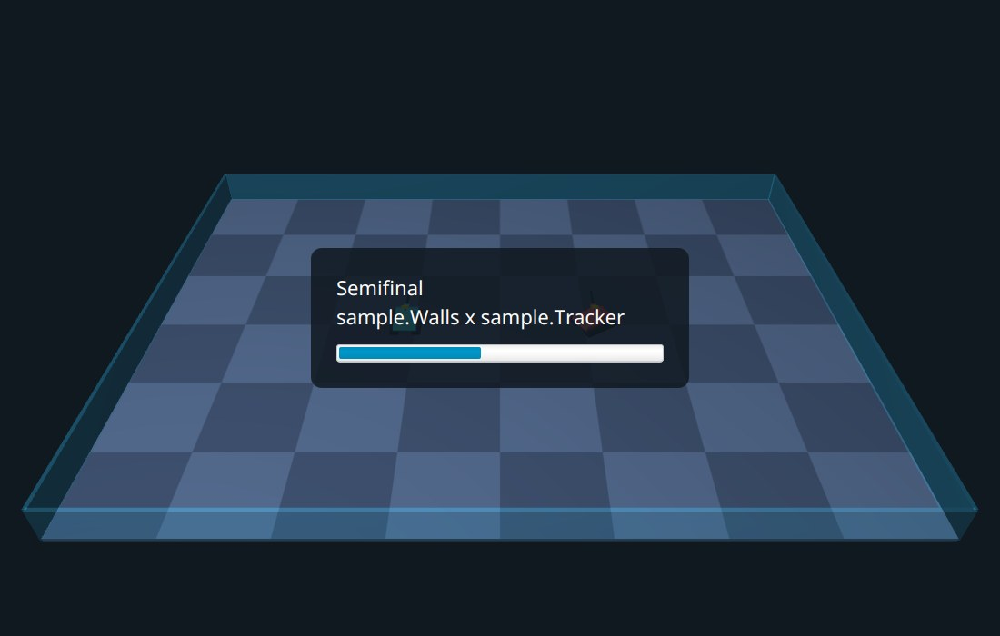
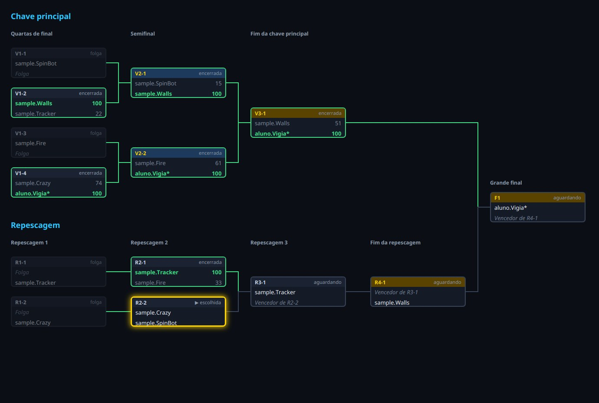
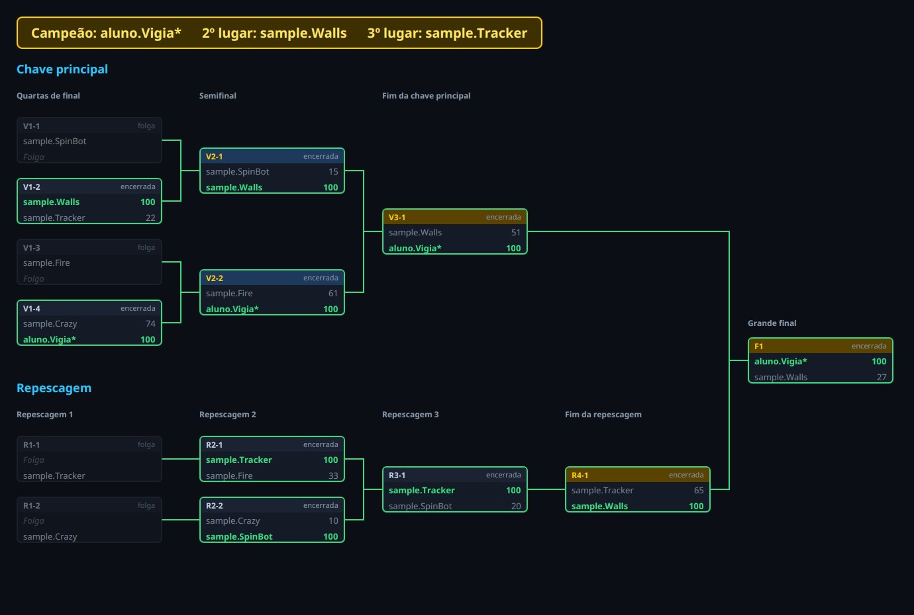

# Capítulo 15 — O campeonato completo

## Objetivo

Juntar tudo o que foi construído num programa só: um **campeonato** que sorteia a ordem dos robôs, joga as partidas com batalhas de verdade do Robocode, mostra cada batalha em 3D, volta à chave com o resultado, anuncia as semifinais e as finais, deixa **desfazer** o último resultado e **continua de onde parou** quando o programa é aberto de novo.

O trabalho se divide em duas partes. A primeira é lógica pura e testada: a classe `Campeonato`, que guarda os resultados, desfaz, sorteia e grava num arquivo. A segunda é a ligação entre as telas: um **fluxo** que decide, a cada tecla, o que o programa faz, e que se apoia nas classes dos capítulos anteriores. Antes de pôr o campeonato na janela, ele é jogado no terminal, e assim o que depende do Robocode é conferido sozinho.

## Passo 1 — O caminho de uma partida

Uma partida do campeonato percorre sempre o mesmo caminho:

```text
tela da chave ──ENTER──► preparando a batalha ──► replay em 3D ──► tela da chave
 (partida                (o Robocode simula em    (o resultado já        (a chave mostra
  escolhida)              segundo plano; um        está registrado        o resultado e
                          anúncio nas semifinais   e guardado)           a próxima partida)
                          e nas finais)
```

Algumas regras decidem os detalhes:

- **O vencedor da partida é o primeiro da classificação** da batalha, a `classificacao().get(0)` do capítulo 5: quem ganhou mais rodadas, e os pontos desempatam. Um empate perfeito é raro, e nesse caso vale quem vier primeiro na lista.
- **O resultado vale quando a batalha termina, e não quando o replay acaba.** O replay é só para ver. Se a janela fosse fechada no meio dele, e o resultado só fosse guardado no fim, a batalha teria acontecido à toa.
- **O replay pode ser interrompido** com a tecla ESC, e a tela da chave volta na hora.
- **Cada resultado é guardado** num arquivo, e o programa lê esse arquivo ao abrir, para continuar.

O capítulo 12 já preparou o terreno para a última regra: a `Chave` guarda só as sementes e os resultados, e o resto é **calculado**. Então basta guardar as sementes e os resultados, em ordem, e montar a chave de novo repetindo os resultados. A classe `Campeonato` faz exatamente isso.

## Passo 2 — O campeonato guarda só os resultados

O `Campeonato` tem a lista de **sementes** (os robôs, na ordem), se há repescagem, e a lista dos **resultados** já registrados, na ordem em que foram jogados. Cada resultado é um `record`, o `ResultadoDePartida`: o código da partida, o vencedor e os pontos dos dois. A `Chave` do campeonato é um **campo**, mas ela sempre pode ser recriada a partir dos outros dois.

- O construtor guarda uma cópia das sementes e monta a chave, o que também confere os participantes: a `Chave` do capítulo 12 lança `IllegalArgumentException` para menos de dois participantes ou para nomes repetidos.
- O `registrar` entrega o resultado à chave **primeiro**, e só depois o acrescenta à lista. Se a chave recusar o resultado (partida que não existe, vencedor que não joga nela, partida que ainda não pode ser jogada), a exceção sobe, e o campeonato continua como estava.
- O `desfazer` tira o último resultado da lista, monta uma chave nova só com as sementes e repete os resultados que sobraram. Devolve `false` se não havia nada a desfazer. Depois de um `desfazer`, o objeto devolvido pelo `chave()` é **outro**, e quem mostra a chave na tela precisa pedi-la de novo.

**Crie o arquivo** `src/main/java/campeonato/torneio/Campeonato.java`:

<!-- arquivo: src/main/java/campeonato/torneio/Campeonato.java | criar -->
```java
package campeonato.torneio;

import java.util.ArrayList;
import java.util.Collections;
import java.util.List;

/**
 * Um campeonato: os participantes, na ordem das sementes, e os resultados das partidas já jogadas.
 *
 * <p>A chave não é guardada: é montada de novo a partir das sementes e dos resultados, sempre que preciso. É por isso que
 * desfazer um resultado e continuar um campeonato guardado em arquivo são operações simples.
 */
public final class Campeonato {

    /** O resultado de uma partida, como é guardado. */
    public record ResultadoDePartida(String codigo, String vencedor, int pontosDoVencedor, int pontosDoPerdedor) {
    }

    private final List<String> sementes;
    private final boolean repescagem;
    private final List<ResultadoDePartida> resultados = new ArrayList<>();
    private Chave chave;

    /** Um campeonato novo, sem nenhuma partida jogada. As regras da chave valem para os participantes. */
    public Campeonato(List<String> sementes, boolean repescagem) {
        this.sementes = List.copyOf(sementes);
        this.repescagem = repescagem;
        this.chave = new Chave(this.sementes, repescagem);
    }

    /** A chave como está agora. Depois de um desfazer, é outra chave: peça de novo. */
    public Chave chave() {
        return chave;
    }

    public List<String> sementes() {
        return sementes;
    }

    public boolean temRepescagem() {
        return repescagem;
    }

    public List<ResultadoDePartida> resultados() {
        return Collections.unmodifiableList(resultados);
    }

    /**
     * Registra o resultado de uma partida. Se a chave recusar, nada muda.
     *
     * @throws IllegalArgumentException se a partida não existe ou o vencedor não joga nela
     * @throws IllegalStateException se a partida não pode ser jogada agora
     */
    public void registrar(String codigo, String vencedor, int pontosDoVencedor, int pontosDoPerdedor) {
        chave.registrar(codigo, vencedor, pontosDoVencedor, pontosDoPerdedor);
        resultados.add(new ResultadoDePartida(codigo, vencedor, pontosDoVencedor, pontosDoPerdedor));
    }

    /** Desfaz o último resultado e diz se havia algum a desfazer. */
    public boolean desfazer() {
        if (resultados.isEmpty()) {
            return false;
        }
        resultados.remove(resultados.size() - 1);
        chave = new Chave(sementes, repescagem);
        for (ResultadoDePartida resultado : resultados) {
            chave.registrar(resultado.codigo(), resultado.vencedor(), resultado.pontosDoVencedor(), resultado.pontosDoPerdedor());
        }
        return true;
    }
}
```

<!-- compilar -->

Os testes primeiro: o resultado entra na chave e na lista; um resultado recusado não deixa rastro; o `desfazer` volta a chave ao estado anterior, também **depois do fim**, quando já havia um campeão. A função `jogarUma` sorteia o vencedor da próxima partida, como a `Simulacao` do capítulo 12. O `Campeonato.ResultadoDePartida` compara por conteúdo, graças ao `equals` que o record cria, e o teste confere a lista inteira de uma vez. **Crie o arquivo** `src/test/java/campeonato/torneio/CampeonatoTest.java`:

<!-- arquivo: src/test/java/campeonato/torneio/CampeonatoTest.java | criar -->
```java
package campeonato.torneio;

import static org.junit.jupiter.api.Assertions.assertEquals;
import static org.junit.jupiter.api.Assertions.assertFalse;
import static org.junit.jupiter.api.Assertions.assertNull;
import static org.junit.jupiter.api.Assertions.assertThrows;
import static org.junit.jupiter.api.Assertions.assertTrue;

import java.util.ArrayList;
import java.util.List;
import java.util.Random;
import org.junit.jupiter.api.Test;

class CampeonatoTest {

    private static List<String> robos(int quantidade) {
        List<String> robos = new ArrayList<>();
        for (int numero = 1; numero <= quantidade; numero++) {
            robos.add("robo" + numero);
        }
        return robos;
    }

    /** Joga a próxima partida do campeonato, sorteando o vencedor. */
    private static void jogarUma(Campeonato campeonato, Random sorteio) {
        Partida partida = campeonato.chave().proximaPartida().orElseThrow();
        String a = partida.a().participante();
        String b = partida.b().participante();
        campeonato.registrar(partida.codigo(), sorteio.nextBoolean() ? a : b, 100, 10 + sorteio.nextInt(80));
    }

    @Test
    void registrarAtualizaAChaveEGuardaOResultado() {
        Campeonato campeonato = new Campeonato(robos(4), true);
        campeonato.registrar("V1-1", "robo4", 80, 60);

        assertEquals(List.of(new Campeonato.ResultadoDePartida("V1-1", "robo4", 80, 60)), campeonato.resultados());
        assertEquals(Situacao.FINALIZADA, campeonato.chave().partida("V1-1").situacao());
    }

    @Test
    void umResultadoRecusadoNaoMudaNada() {
        Campeonato campeonato = new Campeonato(robos(4), true);
        assertThrows(IllegalArgumentException.class, () -> campeonato.registrar("V1-1", "robo2", 1, 0));
        assertThrows(IllegalStateException.class, () -> campeonato.registrar("V2-1", "robo1", 1, 0));
        assertTrue(campeonato.resultados().isEmpty());
    }

    @Test
    void desfazerVoltaAChaveAoEstadoAnterior() {
        Campeonato campeonato = new Campeonato(robos(4), false);
        campeonato.registrar("V1-1", "robo1", 1, 0);
        campeonato.registrar("V1-2", "robo2", 1, 0);
        assertEquals(Situacao.PRONTA, campeonato.chave().partida("V2-1").situacao());

        assertTrue(campeonato.desfazer());
        assertEquals(1, campeonato.resultados().size());
        assertEquals(Situacao.AGUARDANDO, campeonato.chave().partida("V2-1").situacao());
        assertEquals("V1-2", campeonato.chave().proximaPartida().orElseThrow().codigo());

        assertTrue(campeonato.desfazer());
        assertFalse(campeonato.desfazer(), "não há mais nada a desfazer");
    }

    @Test
    void desfazerDepoisDoFimTiraOCampeao() {
        Campeonato campeonato = new Campeonato(robos(6), true);
        Random sorteio = new Random(4);
        while (campeonato.chave().proximaPartida().isPresent()) {
            jogarUma(campeonato, sorteio);
        }
        assertTrue(campeonato.chave().terminou());

        campeonato.desfazer();
        assertFalse(campeonato.chave().terminou());
        assertNull(campeonato.chave().campeao());
        assertEquals("F1", campeonato.chave().proximaPartida().orElseThrow().codigo());
    }
}
```

<!-- testar -->

## Passo 3 — O sorteio

Quem decide as sementes? No programa, um **sorteio**: embaralhar os robôs, e a ordem que sair é a das sementes. O `Collections.shuffle(lista, sorteio)` embaralha a lista no lugar, e recebe o `Random` como argumento: com a mesma semente do `Random`, o embaralhamento repete, e é o que permite testar. A lista original é copiada antes, para a de quem chamou não ser mexida.

O método é `static`: pertence à classe, e não a um campeonato, pois cria um. Um método assim, que devolve um objeto novo, chama-se **método de fábrica**. **Acrescente o import** no topo de `Campeonato.java`, e **o método** no fim da classe:

<!-- arquivo: src/main/java/campeonato/torneio/Campeonato.java | importar -->
```java
import java.util.Random;
```

<!-- arquivo: src/main/java/campeonato/torneio/Campeonato.java | acrescentar -->
```java

    /** Um campeonato novo, com os participantes embaralhados: a ordem sorteada decide as sementes. */
    public static Campeonato sortear(List<String> participantes, boolean repescagem, Random sorteio) {
        List<String> embaralhados = new ArrayList<>(participantes);
        Collections.shuffle(embaralhados, sorteio);
        return new Campeonato(embaralhados, repescagem);
    }
```

<!-- compilar -->

O teste confere o que importa: a mesma semente repete a ordem, e outra semente muda, **ninguém some** (o `Set.copyOf` compara os conteúdos sem a ordem), e a lista recebida continua como era. A comparação com a ordem original só passa por acaso se a ordem sorteada fosse a original, o que tem chance de 1 em 3,6 milhões com 10 robôs, e a semente 1 foi escolhida para não ser o caso. **Acrescente os imports** no topo de `CampeonatoTest.java` e **o teste** ao fim da classe:

<!-- arquivo: src/test/java/campeonato/torneio/CampeonatoTest.java | importar -->
```java
import static org.junit.jupiter.api.Assertions.assertNotEquals;
import java.util.Set;
```

<!-- arquivo: src/test/java/campeonato/torneio/CampeonatoTest.java | acrescentar -->
```java

    @Test
    void oSorteioEmbaralhaMasNaoPerdeNinguem() {
        List<String> robos = robos(10);
        Campeonato primeiro = Campeonato.sortear(robos, false, new Random(1));
        Campeonato igual = Campeonato.sortear(robos, false, new Random(1));
        Campeonato outro = Campeonato.sortear(robos, false, new Random(2));

        // a mesma semente do sorteio repete a ordem, e outra semente muda
        assertEquals(primeiro.sementes(), igual.sementes());
        assertNotEquals(primeiro.sementes(), outro.sementes());
        assertNotEquals(robos, primeiro.sementes());
        // ninguém some, e a lista recebida não é mexida
        assertEquals(Set.copyOf(robos), Set.copyOf(primeiro.sementes()));
        assertEquals(robos(10), robos);
    }
```

<!-- testar -->

## Passo 4 — Guardar e continuar

O arquivo do campeonato é um **arquivo de texto**, com uma informação por linha, no formato `nome=valor`:

```text
repescagem=true
robo=sample.Crazy
robo=aluno.Vigia*
robo=sample.Fire
robo=sample.Walls
robo=sample.Tracker
robo=sample.SpinBot
resultado=V1-2;sample.Walls;536;16
resultado=V1-4;sample.SpinBot;529;120
```

As linhas `robo` estão na ordem das sementes, e as `resultado` na ordem em que as partidas foram jogadas, com quatro campos separados por `;`: o código da partida, o vencedor e os pontos do vencedor e do perdedor. Os números do exemplo são inventados. Um arquivo de texto tem a vantagem de poder ser lido e até corrigido num editor.

**Para guardar**, o `salvar` monta a lista de linhas e a grava com `Files.write(arquivo, linhas, StandardCharsets.UTF_8)`. Três tipos novos aparecem:

- `Path` é o **caminho** de um arquivo ou de uma pasta, como `Path.of("campeonato.txt")`. Sem barra no começo, é relativo à pasta de onde o programa foi aberto.
- `Files` tem os métodos para mexer em arquivos: `write` grava uma lista de linhas, `readAllLines` lê todas, `exists` pergunta se existe.
- `StandardCharsets.UTF_8` diz como as letras viram bytes. Sem isso, o `ç` e o `ã` podem ser gravados de um jeito num computador e lidos de outro jeito em outro. Com o UTF-8, não.

Mexer em arquivos pode falhar de formas que o programa não controla: o disco está cheio, a pasta não existe, o arquivo foi apagado. O Java trata isso com uma exceção, a `IOException`, que é **verificada**: o compilador **obriga** a decidir o que fazer com ela, ou avisando no cabeçalho do método (`throws IOException`, que passa a decisão adiante), ou capturando num `try ... catch`. O `salvar` e o `carregar` declaram o `throws`, e quem os chamar decide.

**Para ler**, o `carregar` percorre as linhas: ignora as em branco, separa cada uma no primeiro `=` (o `indexOf('=')` acha a posição, e o `substring` corta antes e depois), e um `switch` sobre o nome decide o que fazer com o valor. Esse `switch` com `->` é sobre um texto, como o dos nomes de rodadas do capítulo 13, e cada `case` guarda o valor numa variável. O `default` cobre qualquer nome que o programa não conheça, e lança uma `IOException`: um arquivo com linhas que não se entendem não é o arquivo de um campeonato.

Depois de ler tudo, o `carregar` monta o campeonato e **repete os resultados** com o `registrar`. Aqui acontece uma coisa importante: se o arquivo foi alterado à mão e agora não combina com a chave (um resultado de uma partida que ainda não pode ter sido jogada, um vencedor que não joga a partida), o `registrar` lança uma `IllegalArgumentException` ou uma `IllegalStateException`. Para quem chama o `carregar`, o problema é um só, o de um arquivo ruim, e por isso as duas são capturadas, num `catch` com `|` (como o do capítulo 5), e relançadas como `IOException`, com a mensagem original e o erro de origem como **causa** (o segundo argumento do construtor). O `lerResultado` converte os quatro campos de um resultado, e o `Integer.parseInt` lança `NumberFormatException` se os pontos não forem números.

**Acrescente os imports** no topo de `Campeonato.java` e **os métodos** no fim da classe:

<!-- arquivo: src/main/java/campeonato/torneio/Campeonato.java | importar -->
```java
import java.io.IOException;
import java.nio.charset.StandardCharsets;
import java.nio.file.Files;
import java.nio.file.Path;
```

<!-- arquivo: src/main/java/campeonato/torneio/Campeonato.java | acrescentar -->
```java

    /** Guarda o campeonato num arquivo de texto: uma linha para a repescagem, uma para cada participante e uma para cada resultado. */
    public void salvar(Path arquivo) throws IOException {
        List<String> linhas = new ArrayList<>();
        linhas.add("repescagem=" + repescagem);
        for (String participante : sementes) {
            linhas.add("robo=" + participante);
        }
        for (ResultadoDePartida resultado : resultados) {
            linhas.add("resultado=" + String.join(";", resultado.codigo(), resultado.vencedor(),
                    String.valueOf(resultado.pontosDoVencedor()), String.valueOf(resultado.pontosDoPerdedor())));
        }
        Files.write(arquivo, linhas, StandardCharsets.UTF_8);
    }

    /**
     * Lê um campeonato guardado por salvar e repete os resultados na chave.
     *
     * @throws IOException se o arquivo não pode ser lido, tem uma linha que não se entende, ou os resultados não combinam com a chave
     */
    public static Campeonato carregar(Path arquivo) throws IOException {
        boolean repescagem = false;
        List<String> participantes = new ArrayList<>();
        List<ResultadoDePartida> resultados = new ArrayList<>();
        for (String linha : Files.readAllLines(arquivo, StandardCharsets.UTF_8)) {
            if (linha.isBlank()) {
                continue;
            }
            int igual = linha.indexOf('=');
            if (igual < 0) {
                throw new IOException("Linha que não se entende: " + linha);
            }
            String valor = linha.substring(igual + 1);
            switch (linha.substring(0, igual)) {
            case "repescagem" -> repescagem = Boolean.parseBoolean(valor);
            case "robo" -> participantes.add(valor);
            case "resultado" -> resultados.add(lerResultado(valor));
            default -> throw new IOException("Linha que não se entende: " + linha);
            }
        }
        try {
            Campeonato campeonato = new Campeonato(participantes, repescagem);
            for (ResultadoDePartida resultado : resultados) {
                campeonato.registrar(resultado.codigo(), resultado.vencedor(), resultado.pontosDoVencedor(), resultado.pontosDoPerdedor());
            }
            return campeonato;
        } catch (IllegalArgumentException | IllegalStateException erro) {
            throw new IOException("O arquivo não combina com a chave: " + erro.getMessage(), erro);
        }
    }

    private static ResultadoDePartida lerResultado(String valor) throws IOException {
        String[] partes = valor.split(";");
        if (partes.length != 4) {
            throw new IOException("Resultado que não se entende: " + valor);
        }
        try {
            return new ResultadoDePartida(partes[0], partes[1], Integer.parseInt(partes[2]), Integer.parseInt(partes[3]));
        } catch (NumberFormatException erro) {
            throw new IOException("Pontos que não são números: " + valor, erro);
        }
    }
```

<!-- compilar -->

Os testes de arquivo usam uma pasta temporária. O parâmetro `@TempDir Path pasta` faz o JUnit criar uma pasta nova para o teste e apagá-la depois, e assim os testes não deixam arquivos pelo disco nem dependem de uma pasta que só existe no seu computador. Eles conferem:

- **guardar e continuar**: um campeonato de 5 robôs, depois de 4 partidas, guardado e lido, tem as mesmas sementes, os mesmos resultados e a mesma próxima partida, e continua a ser jogado;
- **guardar em qualquer ponto**: para campeonatos de 2 a 9 robôs, a cada partida jogada o campeonato é guardado e lido, e o lido é igual ao original, até o fim, com o mesmo campeão;
- **recusar o que não combina**: um arquivo que não existe, uma linha sem `=`, um nome de linha desconhecido, um vencedor que não joga a partida, pontos que não são números, e um campeonato com um só robô, todos viram `IOException`. O arquivo que não existe lança uma `NoSuchFileException`, que é uma das subclasses da `IOException`.

**Acrescente os imports** no topo de `CampeonatoTest.java` e **os testes** ao fim da classe:

<!-- arquivo: src/test/java/campeonato/torneio/CampeonatoTest.java | importar -->
```java
import java.io.IOException;
import java.nio.file.Files;
import java.nio.file.Path;
import org.junit.jupiter.api.io.TempDir;
```

<!-- arquivo: src/test/java/campeonato/torneio/CampeonatoTest.java | acrescentar -->
```java

    @Test
    void guardarEContinuarDeOndeParou(@TempDir Path pasta) throws IOException {
        Campeonato original = new Campeonato(robos(5), true);
        Random sorteio = new Random(7);
        for (int i = 0; i < 4; i++) {
            jogarUma(original, sorteio);
        }
        Path arquivo = pasta.resolve("campeonato.txt");
        original.salvar(arquivo);

        Campeonato lido = Campeonato.carregar(arquivo);
        assertEquals(original.sementes(), lido.sementes());
        assertEquals(original.temRepescagem(), lido.temRepescagem());
        assertEquals(original.resultados(), lido.resultados());
        assertEquals(original.chave().proximaPartida().orElseThrow().codigo(), lido.chave().proximaPartida().orElseThrow().codigo());

        // e o campeonato lido continua a ser jogado
        jogarUma(lido, sorteio);
        assertEquals(5, lido.resultados().size());
    }

    @Test
    void guardarEmQualquerPontoDoCampeonatoDaOMesmoCampeonato(@TempDir Path pasta) throws IOException {
        Path arquivo = pasta.resolve("campeonato.txt");
        for (int quantidade = 2; quantidade <= 9; quantidade++) {
            Campeonato campeonato = new Campeonato(robos(quantidade), quantidade % 2 == 0);
            Random sorteio = new Random(quantidade);
            while (campeonato.chave().proximaPartida().isPresent()) {
                campeonato.salvar(arquivo);
                Campeonato lido = Campeonato.carregar(arquivo);
                assertEquals(campeonato.resultados(), lido.resultados(), "n=" + quantidade);
                assertEquals(campeonato.chave().proximaPartida().orElseThrow().codigo(), lido.chave().proximaPartida().orElseThrow().codigo());
                jogarUma(campeonato, sorteio);
            }
            campeonato.salvar(arquivo);
            assertEquals(campeonato.chave().campeao(), Campeonato.carregar(arquivo).chave().campeao(), "n=" + quantidade);
        }
    }

    @Test
    void umArquivoQueNaoCombinaEhRecusado(@TempDir Path pasta) throws IOException {
        Path arquivo = pasta.resolve("ruim.txt");

        assertThrows(IOException.class, () -> Campeonato.carregar(pasta.resolve("nao-existe.txt")));

        Files.writeString(arquivo, "isto não é um campeonato\n");
        assertThrows(IOException.class, () -> Campeonato.carregar(arquivo));

        Files.writeString(arquivo, "repescagem=false\nrobo=a\nrobo=b\ncolecao=de selos\n");
        assertThrows(IOException.class, () -> Campeonato.carregar(arquivo));

        // um vencedor que não joga a partida, e pontos que não são números
        Files.writeString(arquivo, "repescagem=false\nrobo=a\nrobo=b\nresultado=V1-1;c;1;0\n");
        assertThrows(IOException.class, () -> Campeonato.carregar(arquivo));
        Files.writeString(arquivo, "repescagem=false\nrobo=a\nrobo=b\nresultado=V1-1;a;muitos;0\n");
        assertThrows(IOException.class, () -> Campeonato.carregar(arquivo));

        // um campeonato com um só robô não existe
        Files.writeString(arquivo, "repescagem=false\nrobo=a\n");
        assertThrows(IOException.class, () -> Campeonato.carregar(arquivo));
    }
```

<!-- testar -->

## Passo 5 — Um campeonato inteiro, no terminal

Antes de pôr o campeonato numa janela, vamos jogá-lo **no terminal**, com batalhas de verdade. É um passo que vale: se algo der errado, o problema está no campeonato ou no Robocode, e não nas telas.

Primeiro, a lista dos robôs, numa classe só, porque o programa com janela também vai usá-la. Ela tem o robô do capítulo 4, o `aluno.Vigia*`, e cinco que vêm com o Robocode (o asterisco depois do nome é o dos robôs soltos, como no capítulo 4). **Crie o arquivo** `src/main/java/campeonato/ListaDeRobos.java`:

<!-- arquivo: src/main/java/campeonato/ListaDeRobos.java | criar -->
```java
package campeonato;

import java.util.List;

/** Os robôs do campeonato: o do capítulo 4 e alguns dos que vêm com o Robocode. */
final class ListaDeRobos {

    /** O asterisco depois de aluno.Vigia é o dos robôs soltos, como no capítulo 4. */
    static final List<String> PADRAO = List.of("aluno.Vigia*", "sample.Walls", "sample.SpinBot", "sample.Tracker", "sample.Fire", "sample.Crazy");

    private ListaDeRobos() {
    }
}
```

O `CampeonatoNoTerminal` sorteia o campeonato (com repescagem) e repete, até a chave acabar: pega a próxima partida, roda a batalha com o `ControleDeBatalha.rodar` do capítulo 5, e registra o resultado, com o primeiro e o segundo da classificação. O `progresso -> { }` é uma função que não faz nada: o `rodar` exige uma, e aqui não precisamos da barra. O `main` declara `throws Exception`, pois o `rodar` pode lançar `IOException` e `InterruptedException`, e um programa de terminal pode deixar o erro subir e aparecer. **Crie o arquivo** `src/main/java/campeonato/CampeonatoNoTerminal.java`:

<!-- arquivo: src/main/java/campeonato/CampeonatoNoTerminal.java | criar -->
```java
package campeonato;

import campeonato.robocode.ControleDeBatalha;
import campeonato.torneio.Campeonato;
import campeonato.torneio.Chave;
import campeonato.torneio.Partida;
import java.util.List;
import java.util.Random;

/** Joga um campeonato inteiro com batalhas de verdade do Robocode, sem janela, e escreve o andamento no terminal. */
public final class CampeonatoNoTerminal {

    private CampeonatoNoTerminal() {
    }

    /** Uso: CampeonatoNoTerminal PASTA_DO_ROBOCODE [rodadas por batalha]. */
    public static void main(String[] args) throws Exception {
        String pastaDoRobocode = args[0];
        int rodadas = args.length > 1 ? Integer.parseInt(args[1]) : 3;

        Campeonato campeonato = Campeonato.sortear(ListaDeRobos.PADRAO, true, new Random());
        System.out.println("Sementes: " + campeonato.sementes());

        while (campeonato.chave().proximaPartida().isPresent()) {
            Partida partida = campeonato.chave().proximaPartida().get();
            String a = partida.a().participante();
            String b = partida.b().participante();
            System.out.println(partida.codigo() + " " + campeonato.chave().nomeDaRodada(partida) + ": " + a + " x " + b);

            ControleDeBatalha.Desfecho desfecho = ControleDeBatalha.rodar(List.of(a, b), pastaDoRobocode, rodadas, progresso -> {
            });
            ControleDeBatalha.Resultado primeiro = desfecho.classificacao().get(0);
            ControleDeBatalha.Resultado segundo = desfecho.classificacao().get(1);
            campeonato.registrar(partida.codigo(), primeiro.robo(), primeiro.pontos(), segundo.pontos());
            System.out.println("   venceu " + primeiro.robo() + " (" + primeiro.rodadasGanhas() + " rodadas, " + primeiro.pontos() + " pontos)");
        }

        Chave chave = campeonato.chave();
        System.out.println("Campeão: " + chave.campeao());
        System.out.println("Pódio: " + chave.podio());
    }
}
```

<!-- compilar -->

Rode, **no mesmo terminal** em que a variável `ROBOCODE` foi definida. Cada batalha leva alguns segundos, e as 10 de um campeonato com 6 robôs e repescagem, menos de um minuto. No Linux e no macOS:

<!-- executar: | espera: Pódio: \[ | tempo: 600 | proibe: Exception -->
```bash
mvn -q compile
java -cp target/classes campeonato.CampeonatoNoTerminal "$ROBOCODE"
```

No Windows:

```text
mvn -q compile
java -cp target/classes campeonato.CampeonatoNoTerminal "%ROBOCODE%"
```

A saída muda a cada execução, porque o sorteio muda as sementes e as batalhas têm acaso. Foi esta, numa delas:

```text
Sementes: [sample.Crazy, aluno.Vigia*, sample.Fire, sample.Walls, sample.Tracker, sample.SpinBot]
V1-2 Quartas de final: sample.Walls x sample.Tracker
   venceu sample.Walls (3 rodadas, 536 pontos)
V1-4 Quartas de final: sample.Fire x sample.SpinBot
   venceu sample.SpinBot (3 rodadas, 529 pontos)
V2-1 Semifinal: sample.Crazy x sample.Walls
   venceu sample.Walls (3 rodadas, 246 pontos)
V2-2 Semifinal: aluno.Vigia* x sample.SpinBot
   venceu aluno.Vigia* (2 rodadas, 300 pontos)
V3-1 Fim da chave principal: sample.Walls x aluno.Vigia*
   venceu sample.Walls (3 rodadas, 411 pontos)
R2-1 Repescagem 2: sample.Tracker x sample.SpinBot
   venceu sample.SpinBot (3 rodadas, 548 pontos)
R2-2 Repescagem 2: sample.Fire x sample.Crazy
   venceu sample.Crazy (2 rodadas, 361 pontos)
R3-1 Repescagem 3: sample.SpinBot x sample.Crazy
   venceu sample.SpinBot (3 rodadas, 367 pontos)
R4-1 Fim da repescagem: sample.SpinBot x aluno.Vigia*
   venceu sample.SpinBot (2 rodadas, 358 pontos)
F1 Grande final: sample.Walls x sample.SpinBot
   venceu sample.Walls (3 rodadas, 347 pontos)
Campeão: sample.Walls
Pódio: [sample.Walls, sample.SpinBot, aluno.Vigia*]
```

Com 6 robôs, a chave principal é a de 8, e as duas folgas (das sementes 1 e 2) tiram do jogo as partidas `V1-1` e `V1-3`. A repescagem também tem folgas, e por isso a `R1-1` e a `R1-2` não aparecem: foram decididas sem batalha. Foram 10 batalhas, as `2 × 6 − 2` do capítulo 13.

## Passo 6 — Anunciar as partidas importantes

O programa tem uma tela de preparação, o cartão "Preparando a batalha" da arena, que fica na tela enquanto o Robocode simula. É o lugar natural para **anunciar as partidas importantes**: só as semifinais e as finais, o `Importancia` do capítulo 13. Nas outras partidas o título continua "Preparando a batalha".

O texto do anúncio é uma conta pura, e por isso fica numa classe sem JavaFX, a `Avisos`: para uma partida comum devolve o título de sempre, e para uma importante devolve o nome da rodada, uma quebra de linha (`\n`) e os dois robôs, como `Semifinal` e `sample.Walls x sample.Tracker` em linhas separadas. **Crie o arquivo** `src/main/java/campeonato/tela/Avisos.java`:

<!-- arquivo: src/main/java/campeonato/tela/Avisos.java | criar -->
```java
package campeonato.tela;

import campeonato.torneio.Chave;
import campeonato.torneio.Importancia;
import campeonato.torneio.Partida;

/** O que a tela escreve antes de uma batalha: só as semifinais e as finais são anunciadas. */
public final class Avisos {

    /** O texto da tela de preparação quando a partida não é importante. */
    public static final String PREPARANDO = "Preparando a batalha";

    private Avisos() {
    }

    /** O título da tela de preparação: o nome da rodada e os dois robôs, para as partidas importantes. */
    public static String tituloDaBatalha(Chave chave, Partida partida) {
        if (chave.importancia(partida) == Importancia.COMUM) {
            return PREPARANDO;
        }
        return chave.nomeDaRodada(partida) + "\n" + partida.a().participante() + " x " + partida.b().participante();
    }
}
```

O teste usa uma chave de 8 robôs: a `V1-1` é comum, a `V2-1` é uma semifinal, e a `V3-1` é a final. Com a repescagem, a final da principal passa a se chamar "Fim da chave principal", e a primeira rodada da repescagem é comum. **Crie o arquivo** `src/test/java/campeonato/tela/AvisosTest.java`:

<!-- arquivo: src/test/java/campeonato/tela/AvisosTest.java | criar -->
```java
package campeonato.tela;

import static org.junit.jupiter.api.Assertions.assertEquals;

import campeonato.torneio.Chave;
import java.util.ArrayList;
import java.util.List;
import org.junit.jupiter.api.Test;

class AvisosTest {

    private static List<String> robos(int quantidade) {
        List<String> robos = new ArrayList<>();
        for (int numero = 1; numero <= quantidade; numero++) {
            robos.add("robo" + numero);
        }
        return robos;
    }

    @Test
    void soAsSemifinaisEAsFinaisSaoAnunciadas() {
        Chave chave = new Chave(robos(8));
        // uma partida comum não ganha anúncio
        assertEquals(Avisos.PREPARANDO, Avisos.tituloDaBatalha(chave, chave.partida("V1-1")));

        chave.registrar("V1-1", "robo1", 1, 0);
        chave.registrar("V1-2", "robo4", 1, 0);
        chave.registrar("V1-3", "robo2", 1, 0);
        chave.registrar("V1-4", "robo3", 1, 0);
        assertEquals("Semifinal\nrobo1 x robo4", Avisos.tituloDaBatalha(chave, chave.partida("V2-1")));

        chave.registrar("V2-1", "robo1", 1, 0);
        chave.registrar("V2-2", "robo2", 1, 0);
        assertEquals("Final\nrobo1 x robo2", Avisos.tituloDaBatalha(chave, chave.partida("V3-1")));
    }

    @Test
    void comRepescagemAsFinaisTemOsNomesProprios() {
        Chave chave = new Chave(robos(4), true);
        // com 4 robôs, a primeira rodada da principal já é a semifinal
        assertEquals("Semifinal\nrobo1 x robo4", Avisos.tituloDaBatalha(chave, chave.partida("V1-1")));
        chave.registrar("V1-1", "robo1", 1, 0);
        chave.registrar("V1-2", "robo2", 1, 0);
        // a R1 é uma partida comum da repescagem
        assertEquals(Avisos.PREPARANDO, Avisos.tituloDaBatalha(chave, chave.partida("R1-1")));
        chave.registrar("V2-1", "robo1", 1, 0);
        assertEquals("Fim da chave principal\nrobo1 x robo2", Avisos.tituloDaBatalha(chave, chave.partida("V2-1")));
    }
}
```

<!-- testar -->

Agora a arena e o executor precisam aceitar o título. A `Arena3D` ganha um segundo `carregando`, com um parâmetro a mais, e o antigo passa a chamar o novo com o título de sempre, sem que quem já o usa precise mudar: é a **sobrecarga** do capítulo 13, os dois métodos com o mesmo nome e parâmetros diferentes. **Substitua o método** `carregando` da `Arena3D` pelos dois:

<!-- arquivo: src/main/java/campeonato/cena/Arena3D.java | substituir-metodo carregando -->
```java
    /** Mostra o cartão "Preparando a batalha"; a barra acompanha o progresso dado, de 0 a 1. */
    public void carregando(ReadOnlyDoubleProperty progresso) {
        carregando(progresso, Avisos.PREPARANDO);
    }

    /** Mostra o cartão com o título dado, por exemplo o anúncio de uma semifinal; a barra acompanha o progresso. */
    public void carregando(ReadOnlyDoubleProperty progresso, String titulo) {
        fase = Fase.CARREGANDO;
        tituloDoCarregamento.setText(titulo);
        barra.setManaged(true);
        barra.setVisible(true);
        barra.progressProperty().bind(progresso);
        carregamento.setVisible(true);
    }
```

A `Arena3D` está no pacote `campeonato.cena`, e a `Avisos`, no `campeonato.tela`: é preciso importar. **Acrescente o import** no topo de `Arena3D.java`:

<!-- arquivo: src/main/java/campeonato/cena/Arena3D.java | importar -->
```java
import campeonato.tela.Avisos;
```

O `ExecutorDeBatalha` recebe o mesmo tratamento: um `executar` com o título a mais, e o antigo chama o novo. O corpo do novo é o de antes, com o título passado à arena. **Substitua o método** `executar` pelos dois:

<!-- arquivo: src/main/java/campeonato/ExecutorDeBatalha.java | substituir-metodo executar -->
```java
    /**
     * Inicia a batalha e volta logo. Quando ela acabar, chama {@code aoTerminar} com o resultado ou
     * {@code aoFalhar} com o erro, sempre na linha de execução do JavaFX.
     */
    static void executar(Arena3D arena, List<String> robos, String pastaDoRobocode, int rodadas,
            Consumer<ControleDeBatalha.Desfecho> aoTerminar, Consumer<Throwable> aoFalhar) {
        executar(arena, Avisos.PREPARANDO, robos, pastaDoRobocode, rodadas, aoTerminar, aoFalhar);
    }

    /** O mesmo, com o título que a arena mostra enquanto a batalha é preparada. */
    static void executar(Arena3D arena, String titulo, List<String> robos, String pastaDoRobocode, int rodadas,
            Consumer<ControleDeBatalha.Desfecho> aoTerminar, Consumer<Throwable> aoFalhar) {
        Task<ControleDeBatalha.Desfecho> tarefa = new Task<>() {
            @Override
            protected ControleDeBatalha.Desfecho call() throws Exception {
                return ControleDeBatalha.rodar(robos, pastaDoRobocode, rodadas, progresso -> updateProgress(progresso, 1.0));
            }
        };
        arena.carregando(tarefa.progressProperty(), titulo);
        tarefa.setOnSucceeded(evento -> aoTerminar.accept(tarefa.getValue()));
        tarefa.setOnFailed(evento -> aoFalhar.accept(tarefa.getException()));

        Thread linha = new Thread(tarefa, "batalha-robocode");
        linha.setDaemon(true);
        linha.start();
    }
```

<!-- arquivo: src/main/java/campeonato/ExecutorDeBatalha.java | importar -->
```java
import campeonato.tela.Avisos;
```

<!-- compilar -->

O cartão de uma semifinal aparece assim, com o título em duas linhas:

<!-- marco: 15-aviso -->


## Passo 7 — O fluxo do programa

Falta o maestro: a classe que sabe **em que ponto do caminho** o programa está e o que cada tecla faz ali. É o `FluxoDoCampeonato`, uma `StackPane` (várias camadas, uma sobre a outra, como a `Arena3D`) que mostra **uma tela de cada vez**: a tela da chave ou a arena. O `getChildren().setAll(tela)` troca a tela mostrada, e tem um efeito do capítulo 1: quando a arena sai da janela, o relógio dela para, e quando entra de novo, volta a andar.

O ponto do caminho é um `enum`, o `Estado`:

- `CHAVE`: a tela da chave espera uma tecla;
- `PREPARANDO`: a batalha está sendo simulada, e nenhuma tecla vale (se o ESC voltasse à chave agora, o resultado chegaria depois e encontraria o programa em outro ponto);
- `REPRODUZINDO`: o replay passa, e o ESC volta à chave. A mensagem de erro de uma batalha que falhou também fica nesse estado, para o ESC valer ali.

A tela da chave é um `BorderPane`, o do `Placar` do capítulo 8: a `VisaoDaChave` no centro e uma linha de ajuda embaixo, com as teclas. A cada volta à chave, o fluxo pede à visão que mostre a chave **de agora** (`campeonato.chave()`), e a linha de ajuda muda quando o campeonato termina.

Começamos pelo esqueleto: os campos, o construtor, o `mostrarAChave` e o `salvar`. Guardar o campeonato é uma tarefa que não pode derrubar o programa: se o disco falhar, o fluxo escreve o erro no terminal (`System.err`) e **continua**, pois o campeonato na memória está certo. **Crie o arquivo** `src/main/java/campeonato/FluxoDoCampeonato.java`:

<!-- arquivo: src/main/java/campeonato/FluxoDoCampeonato.java | criar -->
```java
package campeonato;

import campeonato.cena.Arena3D;
import campeonato.tela.VisaoDaChave;
import campeonato.torneio.Campeonato;
import java.io.IOException;
import java.nio.file.Path;
import javafx.geometry.Insets;
import javafx.scene.control.Label;
import javafx.scene.layout.BorderPane;
import javafx.scene.layout.StackPane;

/** O programa por dentro: leva o campeonato da tela da chave à batalha, ao replay em 3D, e de volta à chave. */
final class FluxoDoCampeonato extends StackPane {

    /** Em que ponto do caminho o programa está. */
    enum Estado {
        /** A tela da chave, esperando uma tecla. */
        CHAVE,
        /** A batalha está sendo simulada em segundo plano. */
        PREPARANDO,
        /** O replay está passando (ou deu erro, e a mensagem espera o ESC). */
        REPRODUZINDO
    }

    private static final int RODADAS_POR_BATALHA = 3;
    private static final String AJUDA_NA_CHAVE = "ENTER: jogar a partida escolhida   •   clique: escolher outra   •   U: desfazer o último resultado";
    private static final String AJUDA_NO_FIM = "O campeonato terminou.   N: novo campeonato   •   U: desfazer o último resultado";

    private final Path arquivo;
    private final String pastaDoRobocode;
    private final VisaoDaChave visao = new VisaoDaChave();
    private final Arena3D arena = new Arena3D();
    private final Label ajuda = new Label();
    private final BorderPane telaDaChave = new BorderPane();

    private Campeonato campeonato;
    private Estado estado = Estado.CHAVE;

    FluxoDoCampeonato(Campeonato campeonato, Path arquivo, String pastaDoRobocode) {
        this.campeonato = campeonato;
        this.arquivo = arquivo;
        this.pastaDoRobocode = pastaDoRobocode;

        ajuda.setStyle("-fx-text-fill: #8b98ab; -fx-font-size: 13px; -fx-font-weight: bold;");
        ajuda.setPadding(new Insets(10, 24, 10, 24));
        telaDaChave.setCenter(visao);
        telaDaChave.setBottom(ajuda);
        telaDaChave.setStyle("-fx-background-color: #0b0e14;");
        mostrarAChave();
    }

    /** Mostra a tela da chave, como o campeonato está agora. */
    private void mostrarAChave() {
        estado = Estado.CHAVE;
        visao.mostrar(campeonato.chave());
        ajuda.setText(campeonato.chave().terminou() ? AJUDA_NO_FIM : AJUDA_NA_CHAVE);
        getChildren().setAll(telaDaChave);
    }

    private void salvar() {
        try {
            campeonato.salvar(arquivo);
        } catch (IOException erro) {
            System.err.println("Não foi possível guardar o campeonato em " + arquivo + ": " + erro.getMessage());
        }
    }
}
```

<!-- compilar -->

Duas operações mexem no campeonato sem batalha:

- O **desfazer** pede ao `Campeonato` que desfaça, e só se havia algo a desfazer, guarda de novo no arquivo e mostra a chave.
- O **campeonato novo** só vale depois que o atual terminou: sem essa regra, uma tecla apertada sem querer jogaria fora, e sobrescreveria no arquivo, um campeonato em andamento. Ele sorteia os mesmos robôs de novo, com `campeonato.sementes()` e `temRepescagem()`.

**Acrescente os imports** no topo e **os métodos** no fim da classe:

<!-- arquivo: src/main/java/campeonato/FluxoDoCampeonato.java | importar -->
```java
import java.util.Random;
```

<!-- arquivo: src/main/java/campeonato/FluxoDoCampeonato.java | acrescentar -->
```java

    private void desfazer() {
        if (campeonato.desfazer()) {
            salvar();
            mostrarAChave();
        }
    }

    /** Um campeonato novo, com os mesmos robôs e a ordem sorteada de novo, mas só depois de o atual terminar. */
    private void novoCampeonato() {
        if (!campeonato.chave().terminou()) {
            return;
        }
        campeonato = Campeonato.sortear(campeonato.sementes(), campeonato.temRepescagem(), new Random());
        salvar();
        mostrarAChave();
    }
```

<!-- compilar -->

Agora o coração do fluxo: jogar a partida escolhida. O `jogarAEscolhida` pergunta à visão qual é a partida escolhida (um `Optional`: se está vazio, não há o que jogar), muda o estado para `PREPARANDO`, põe a arena na tela e chama o `ExecutorDeBatalha` do capítulo 6, com os dois robôs da partida e o título do anúncio. As duas funções que ele recebe dizem o que fazer no fim:

- `desfecho -> aoTerminar(partida, desfecho)` é uma lambda, e usa a variável `partida`, que nunca muda depois de definida. O `ExecutorDeBatalha` a chama **na linha de execução do JavaFX**, e por isso ela pode mexer nas telas.
- `this::aoFalhar` é uma **referência a método**: o mesmo que `falha -> this.aoFalhar(falha)`.

O `aoTerminar` é onde mora a regra "o resultado vale quando a batalha termina": registra o resultado no campeonato (o vencedor é o primeiro da classificação, e os pontos são os do primeiro e do segundo), **guarda no arquivo**, e só depois muda o estado para `REPRODUZINDO` e começa o replay, com um `Runnable` para o fim dele: `this::mostrarAChave`. O `aoFalhar` mostra a mensagem de erro na arena e, também, deixa o estado em `REPRODUZINDO`, para o ESC voltar à chave.

**Acrescente os imports** e depois **os métodos** no fim da classe:

<!-- arquivo: src/main/java/campeonato/FluxoDoCampeonato.java | importar -->
```java
import campeonato.robocode.ControleDeBatalha;
import campeonato.tela.Avisos;
import campeonato.torneio.Partida;
import java.util.List;
import java.util.Optional;
```

<!-- arquivo: src/main/java/campeonato/FluxoDoCampeonato.java | acrescentar -->
```java

    /** Roda a batalha da partida escolhida em segundo plano; quando ela acaba, registra o resultado e passa o replay. */
    private void jogarAEscolhida() {
        Optional<Partida> escolhida = visao.partidaEscolhida();
        if (escolhida.isEmpty()) {
            return;
        }
        Partida partida = escolhida.get();
        estado = Estado.PREPARANDO;
        getChildren().setAll(arena);
        List<String> robos = List.of(partida.a().participante(), partida.b().participante());
        ExecutorDeBatalha.executar(arena, Avisos.tituloDaBatalha(campeonato.chave(), partida), robos, pastaDoRobocode, RODADAS_POR_BATALHA,
                desfecho -> aoTerminar(partida, desfecho), this::aoFalhar);
    }

    /** O resultado vale assim que a batalha acaba, sem esperar o replay: se a janela fechar agora, nada se perde. */
    private void aoTerminar(Partida partida, ControleDeBatalha.Desfecho desfecho) {
        List<ControleDeBatalha.Resultado> classificacao = desfecho.classificacao();
        campeonato.registrar(partida.codigo(), classificacao.get(0).robo(), classificacao.get(0).pontos(), classificacao.get(1).pontos());
        salvar();
        estado = Estado.REPRODUZINDO;
        arena.tocar(desfecho.gravacao(), this::mostrarAChave);
    }

    private void aoFalhar(Throwable falha) {
        estado = Estado.REPRODUZINDO;
        arena.mostrarMensagem("Não foi possível rodar a batalha:\n" + falha.getMessage() + "\n\nESC: voltar para a chave");
    }
```

<!-- compilar -->

Por último, o `tecla`, que o programa chama para cada tecla apertada, e que faz uma coisa diferente em cada estado. Na chave, o ENTER joga, o U desfaz e o N sorteia um campeonato novo, e as outras teclas não fazem nada. No replay, só o ESC vale. Na preparação, nenhuma. É um `switch` sobre o `Estado`, e dentro dele, no caso da chave, outro, sobre a tecla, que é um valor do `enum` `KeyCode`. **Acrescente os imports** e depois **os métodos** no fim da classe:

<!-- arquivo: src/main/java/campeonato/FluxoDoCampeonato.java | importar -->
```java
import javafx.scene.input.KeyCode;
```

<!-- arquivo: src/main/java/campeonato/FluxoDoCampeonato.java | acrescentar -->
```java

    /** Recebe uma tecla; o que ela faz depende de onde o programa está. */
    void tecla(KeyCode tecla) {
        switch (estado) {
        case CHAVE -> teclaNaChave(tecla);
        case REPRODUZINDO -> {
            if (tecla == KeyCode.ESCAPE) {
                mostrarAChave();
            }
        }
        case PREPARANDO -> {
        }
        }
    }

    private void teclaNaChave(KeyCode tecla) {
        switch (tecla) {
        case ENTER -> jogarAEscolhida();
        case U -> desfazer();
        case N -> novoCampeonato();
        default -> {
        }
        }
    }
```

<!-- compilar -->

O `Principal` agora é só a porta de entrada. Ele procura a pasta do Robocode na variável `ROBOCODE`, como no capítulo 6, e abre o **campeonato guardado**, se o arquivo `campeonato.txt` existe, ou sorteia um novo. Se o arquivo existe mas não pode ser lido (foi estragado à mão, por exemplo), o programa avisa no terminal e começa um campeonato novo, em vez de se recusar a abrir. A janela tem a cena com o fluxo, e cada tecla vai para ele: o `evento.getCode()` é a tecla. **Substitua o conteúdo** de `Principal.java`:

<!-- arquivo: src/main/java/campeonato/Principal.java | criar -->
```java
package campeonato;

import campeonato.torneio.Campeonato;
import java.io.IOException;
import java.nio.file.Files;
import java.nio.file.Path;
import java.util.Random;
import javafx.application.Application;
import javafx.scene.Scene;
import javafx.scene.control.Label;
import javafx.stage.Stage;

/** O programa: abre a janela com a chave do campeonato, que continua de onde parou na vez anterior. */
public class Principal extends Application {

    /** Onde o campeonato fica guardado, na pasta de onde o programa é aberto. */
    private static final Path ARQUIVO = Path.of("campeonato.txt");

    @Override
    public void start(Stage palco) {
        palco.setTitle("Mini Campeonato de Robocode");

        String pastaDoRobocode = System.getenv("ROBOCODE");
        if (pastaDoRobocode == null) {
            palco.setScene(new Scene(new Label("Defina a variável ROBOCODE com a pasta do Robocode (capítulo 4, passo 2)."), 640, 100));
            palco.show();
            return;
        }

        FluxoDoCampeonato fluxo = new FluxoDoCampeonato(abrirOuSortear(), ARQUIVO, pastaDoRobocode);
        Scene cena = new Scene(fluxo, 1300, 760);
        cena.setOnKeyPressed(evento -> fluxo.tecla(evento.getCode()));
        palco.setScene(cena);
        palco.show();
    }

    /** O campeonato guardado no arquivo, se houver; senão, um novo, com os robôs sorteados. */
    private static Campeonato abrirOuSortear() {
        if (Files.exists(ARQUIVO)) {
            try {
                Campeonato guardado = Campeonato.carregar(ARQUIVO);
                System.out.println("Campeonato retomado de " + ARQUIVO + ": " + guardado.resultados().size() + " partidas já jogadas.");
                return guardado;
            } catch (IOException erro) {
                System.err.println("Não consegui ler " + ARQUIVO + " (" + erro.getMessage() + "): começando um campeonato novo.");
            }
        }
        Campeonato novo = Campeonato.sortear(ListaDeRobos.PADRAO, true, new Random());
        System.out.println("Campeonato novo, com as sementes " + novo.sementes());
        return novo;
    }

    public static void main(String[] args) {
        launch(args);
    }
}
```

<!-- compilar -->

## Passo 8 — O programa completo

Rode o programa, de novo **no terminal em que a variável `ROBOCODE` foi definida**:

<!-- executar: | espera: Campeonato novo, com as sementes | rodar: 15 | proibe: Exception, ERROR -->
```bash
mvn javafx:run
```

A janela abre com a chave de um campeonato sorteado, e o terminal diz as sementes. Sem nenhum resultado, a primeira partida pronta já vem escolhida, com a borda dourada, e a faixa de ajuda embaixo lembra as teclas. Aperte **ENTER**: o cartão "Preparando a batalha" aparece (nas semifinais e nas finais, com o anúncio), a barra anda, e logo a arena mostra a batalha em 3D, como no capítulo 6. Quando o replay acaba, ou quando você aperta **ESC**, a chave volta com o resultado: o vencedor em verde, as linhas verdes, a próxima partida escolhida.

<!-- marco: 15-meio -->


Experimente o resto:

- **Clique** numa partida pronta (borda azul) para escolher outra, e aperte ENTER.
- Aperte **U** para desfazer o último resultado: a partida volta a ficar pronta.
- **Feche a janela** no meio do campeonato e abra de novo com `mvn javafx:run`. O terminal diz `Campeonato retomado de campeonato.txt: ... partidas já jogadas`, e a chave aparece como estava. Abra o arquivo `campeonato.txt`, na pasta do projeto, num editor de texto: é o formato do passo 4.
- Jogue até o fim: a faixa dourada com o pódio aparece no alto, e a ajuda passa a dizer **N** para sortear um campeonato novo.

<!-- marco: 15-fim -->


Se a variável `ROBOCODE` não estiver definida, a janela abre só com o aviso, e se a batalha falhar, a arena mostra a mensagem de erro do `ControleDeBatalha` e o ESC volta para a chave, sem perder o campeonato.

## O que construímos

A árvore do projeto terminado, cada arquivo com o capítulo que o criou. Quando um capítulo posterior mudou o arquivo, os números vêm depois do nome, depois de um `+`: `Arena3D.java (+2,3,6,7,8,9,15)` foi criado no capítulo 1 e mudado nesses outros.

```text
mini-campeonato/
├── pom.xml                                     (cap. 1; o cap. 5 acrescenta o JUnit e o plugin dos testes)
├── campeonato.txt                              (criado pelo programa ao jogar a primeira partida, cap. 15)
├── robos/aluno/
│   ├── Vigia.java                              (cap. 4)
│   └── Vigia.properties                        (cap. 4)
├── iniciador/
│   ├── IniciadorDeBatalha.java                 (cap. 4)
│   └── opcoes.txt                              (cap. 4)
└── src/
    ├── main/java/campeonato/
    │   ├── Principal.java                    (cap. 1, 6, 15: a porta de entrada)
    │   ├── ExecutorDeBatalha.java            (cap. 6, 15: a batalha em segundo plano)
    │   ├── FluxoDoCampeonato.java            (cap. 15: o que cada tecla faz em cada tela)
    │   ├── ListaDeRobos.java                 (cap. 15: os robôs do campeonato)
    │   ├── CampeonatoNoTerminal.java         (cap. 15: o campeonato sem janela)
    │   ├── robocode/  a conversa com o Robocode
    │   │       ControleDeBatalha.java, Demonstracao.java, Gravacao.java,       (cap. 5)
    │   │       ProgressoDaBatalha.java
    │   │       Vitorias.java                                                   (cap. 8)
    │   ├── cena/  a arena em 3D, e o que vive nela
    │   │       Arena3D.java (+2,3,6,7,8,9,15)                                  (cap. 1)
    │   │       CameraOrbital.java (+9,11)                                      (cap. 2)
    │   │       Poligonos.java, Tanque.java                                     (cap. 3)
    │   │       Cores.java, Geometria.java (+9)                                 (cap. 6)
    │   │       CorpoLivre.java, Destroco.java, Efeito.java, Efeitos.java,      (cap. 7)
    │   │       Explosao.java, Materiais.java, Tiros.java
    │   │       Aviso.java, Energia.java, Nomes.java, PainelDoJogador.java,     (cap. 8)
    │   │       Placar.java, RastroDeDano.java
    │   │       Aparencia.java (+11), Avaria.java, Dosador.java,                (cap. 9)
    │   │       Experimento.java, Galeria.java, Particula.java (+11),
    │   │       Particulas.java (+11), Queima.java (+11), TexturasDeFogo.java
    │   │       (+10), Velocidade.java
    │   │       Atelie.java, ImagemDaChama.java, Ruido.java                     (cap. 10)
    │   │       FitaDeChama.java, Fitas.java, RastroDoRobo.java                 (cap. 11)
    │   ├── torneio/  o campeonato, sem nada de tela
    │   │       Chave.java (+13), Lado.java, Partida.java, Simulacao.java       (cap. 12)
    │   │       (+13), Situacao.java, Vaga.java
    │   │       Importancia.java                                                (cap. 13)
    │   │       Campeonato.java                                                 (cap. 15)
    │   └── tela/  as telas do campeonato
    │           Aspecto.java, CartaoDaPartida.java, DemonstracaoDaChave.java,   (cap. 14)
    │           Disposicao.java, VisaoDaChave.java
    │           Avisos.java                                                     (cap. 15)
    └── test/java/campeonato/  os testes, escritos junto das classes que testam
        ├── robocode/
        │       ControleDeBatalhaTest.java, GravacaoTest.java,                  (cap. 5)
        │       ProgressoDaBatalhaTest.java
        │       VitoriasTest.java                                               (cap. 8)
        ├── cena/
        │       CoresTest.java, GeometriaTest.java (+9)                         (cap. 6)
        │       CorpoLivreTest.java                                             (cap. 7)
        │       EnergiaTest.java, NomesTest.java, RastroDeDanoTest.java         (cap. 8)
        │       AparenciaTest.java (+11), AvariaTest.java,                      (cap. 9)
        │       CameraOrbitalTest.java (+11), DosadorTest.java,
        │       VelocidadeTest.java
        │       ImagemDaChamaTest.java, RuidoTest.java,                         (cap. 10)
        │       TexturasDeFogoTest.java
        │       FitaDeChamaTest.java, RastroDoRoboTest.java                     (cap. 11)
        ├── torneio/
        │       ChaveTest.java (+13)                                            (cap. 12)
        │       CampeonatoTest.java                                             (cap. 15)
        └── tela/
                AspectoTest.java, DisposicaoTest.java                           (cap. 14)
                AvisosTest.java                                                 (cap. 15)
```

Vista de quem usa o programa, a jornada é esta. Ao abrir, o `Principal` lê o arquivo `campeonato.txt`; se ele existe, o `Campeonato.carregar` remonta a chave a partir das sementes e dos resultados, e se não, o `Campeonato.sortear` embaralha os robôs. O `FluxoDoCampeonato` mostra a `VisaoDaChave`, cujas contas vêm da `Disposicao` e cujas cores vêm do `Aspecto` e da `Importancia`. O ENTER manda o fluxo pedir ao `ExecutorDeBatalha` uma batalha, que o `ControleDeBatalha` roda no Robocode, em segundo plano, enquanto a `Arena3D` mostra a barra de progresso e, nas partidas importantes, o anúncio da `Avisos`. Quando a batalha termina, a classificação diz o vencedor, o `Campeonato` registra o resultado, o fluxo o guarda no arquivo, e a `Arena3D` toca a `Gravacao`: o replay, com os tanques, os tiros, as explosões, o fogo e o placar. De volta à chave, os cartões e as linhas são desenhados de novo a partir da `Chave` atual, e a próxima partida vem escolhida. Quando a `Chave` diz que há campeão, a faixa dourada mostra o pódio.

**Onde cada peça está no programa completo.** O programa que este tutorial imita é o do repositório, e as peças dele têm outros nomes, em inglês:

| No tutorial | No programa completo |
| --- | --- |
| `Chave`, `Partida`, `Vaga`, `Situacao`, `Lado`, `Importancia` | `Bracket`, `Match`, `Slot`, `Status`, `Side`, `Importance` (pacote `tournament`) |
| `Campeonato` (arquivo de texto) | `ChampionshipService` e `Championship` (banco de dados) |
| `ControleDeBatalha`, `ExecutorDeBatalha` | `BattleControl`, `BattleRunner` |
| `FluxoDoCampeonato`, `Principal` | `ChampionshipFlow`, `Main` |
| `VisaoDaChave` | `BracketViewer` (com `BracketLayout` e `BracketCards`) |
| `Arena3D` | `BattleArena3D` |

O programa completo faz muito mais do que o tutorial, e vale saber o que foi deixado de fora: o cadastro dos robôs por uma página web, com imagem, equipe e descrição, e o banco de dados para guardá-los junto do campeonato; os logotipos dos robôs nos cartões da chave, e uma câmera que se move e dá zoom na partida escolhida; várias arenas com temas diferentes, música, narração e efeitos sonoros; uma cerimônia de pódio em 3D, com confetes e o troféu; e as fotos dos melhores momentos de cada batalha. Todas essas partes usam as mesmas ideias dos capítulos: dados que se **calculam** a partir do mínimo guardado, lógica separada do desenho para poder ser testada, e batalhas simuladas em segundo plano e depois reproduzidas.

## Exercícios

**Fácil**

1. Troque a lista em `ListaDeRobos.PADRAO` para ter 8 robôs, acrescentando dois que vêm com o Robocode (por exemplo `sample.RamFire` e `sample.Corners`), apague o arquivo `campeonato.txt` e abra o programa de novo. Quantas partidas tem agora o campeonato? Confira com a conta `2n − 2`.
2. Troque `RODADAS_POR_BATALHA` em `FluxoDoCampeonato` por 1 e por 5. Jogue uma partida em cada e compare o tempo da preparação com a duração do replay: qual dos dois muda com o número de rodadas, e por quê? Dica: o replay passa 30 turnos por segundo (`TURNOS_POR_SEGUNDO`), e a gravação guarda os turnos de todas as rodadas. Com 1 rodada, os pontos servem para alguma coisa na hora de decidir o vencedor da partida?
3. Abra o `campeonato.txt` depois de algumas partidas, apague a **última** linha `resultado=...` e abra o programa de novo. O que aconteceu com a chave? Por que o programa se comporta como se você tivesse apertado U?

**Médio**

4. A **ordem** das linhas `resultado` importa. Escreva um teste em `CampeonatoTest` que mostra isso: um arquivo de 4 robôs sem repescagem em que o resultado da `V2-1` vem **antes** dos das duas partidas da primeira rodada deve ser recusado com `IOException`. Em que linha do `carregar` o erro nasce, e por que o `try ... catch` o transforma?
5. Leia a lista dos robôs de um **arquivo** em vez de uma constante. Faça o `Principal` ler `robos.txt` (um robô por linha, linhas em branco ignoradas), com `Files.readAllLines`, quando o arquivo existe, e usar a `ListaDeRobos.PADRAO` quando não existe. Dicas: o `Files.readAllLines(...).stream().filter(linha -> !linha.isBlank()).toList()` devolve a lista sem as linhas em branco, e um `.map(String::strip)` antes do `filter` tira os espaços das pontas; o `readAllLines` lança a `IOException`, que o `Principal` precisa tratar, como faz no `abrirOuSortear`.

**Difícil**

6. Uma **tela de pódio**. Crie a classe `TelaDoPodio`, uma `HBox` que recebe a lista do `chave.podio()` e mostra três colunas alinhadas embaixo, a do segundo lugar à esquerda, a do primeiro no meio e a do terceiro à direita, com alturas diferentes (por exemplo 160, 220 e 120 pixels), cada uma com o nome do robô e o número do lugar. No `FluxoDoCampeonato`, a tecla **P** mostra essa tela quando a chave terminou, e o ESC volta à chave. Dicas: um novo `Estado`, `PODIO`; o `getChildren().setAll(telaDoPodio)` troca a tela; e o `tecla` precisa de um `case PODIO`, para o ESC voltar à chave.

## Perguntas para fixação

1. Por que o `Campeonato` guarda as sementes e os resultados, e não a chave? Cite duas coisas que essa escolha tornou simples.
2. Por que o resultado de uma partida é registrado e guardado quando a batalha termina, e não quando o replay termina?
3. Por que o `registrar` do `Campeonato` entrega o resultado à chave **antes** de acrescentá-lo à lista?
4. Por que o `carregar` transforma as exceções da chave numa `IOException`?
5. Por que o `FluxoDoCampeonato` ignora todas as teclas no estado `PREPARANDO`?

<details>
<summary>Respostas</summary>

1. Porque a chave é calculada pelas sementes e pelos resultados: guardar a chave seria guardar duas vezes a mesma informação, com o risco de as duas discordarem. A escolha tornou simples o **desfazer** (tira o último resultado e monta a chave de novo) e o **guardar e continuar** (o arquivo tem só as sementes e os resultados, e o `carregar` repete os resultados). Também facilita testar: qualquer estado do campeonato pode ser montado repetindo resultados.
2. Porque o replay serve só para ver. Se o resultado só fosse guardado no fim dele, fechar a janela, ou o programa travar, no meio do replay faria a batalha ser jogada à toa, e a pessoa teria de jogar a partida de novo, com um resultado possivelmente diferente.
3. Porque a chave é quem sabe se o resultado é válido. Se o resultado fosse acrescentado à lista antes, e a chave o recusasse (uma `IllegalArgumentException` ou uma `IllegalStateException`), a lista ficaria com um resultado que não vale, e o próximo `desfazer` ou `carregar` quebraria ao repeti-lo. Na ordem certa, se a chave recusa, nada muda.
4. Porque, para quem chama o `carregar`, o problema é um só: o arquivo não é o de um campeonato válido. Ler com sucesso mas repetir resultados que não combinam com a chave é um problema do arquivo, e a `IOException` é a exceção que o código que lê arquivos já trata. Quem chama não precisa saber que a chave tem as suas regras próprias. A causa original fica guardada na exceção.
5. Porque, durante a preparação, a batalha roda em segundo plano e vai chegar, a qualquer momento, ao `aoTerminar`, que espera o programa no estado de preparação: registra, guarda e começa o replay. Se uma tecla mudasse o estado antes disso (voltar à chave com o ESC, por exemplo), o resultado chegaria com a tela da chave já visível, e o replay começaria por cima dela. Ignorar as teclas é a regra mais simples que evita isso.

</details>

Daqui em diante o projeto é seu. Os exercícios deste capítulo são pontos de partida, e as ideias do capítulo 14 e deste se combinam com o que vem do Robocode: um robô que você escreva no lugar do `Vigia`, a ordem das sementes pelo ranking de campeonatos anteriores, uma tela de pódio, o som. O Apêndice A reúne os recursos do Java usados no tutorial, e o Apêndice B, os problemas mais comuns e como resolvê-los.
